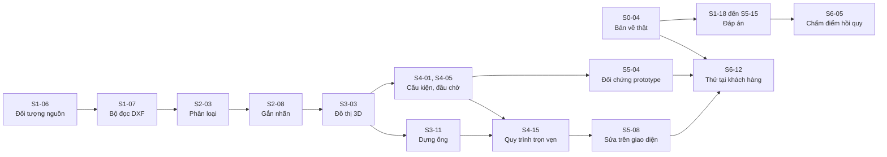

> **Tài liệu trước pivot.** Từ 10/11/2026 sản phẩm thu hẹp thành tờ isometric sang 3D, xem `docs/CHUYEN_HUONG_ISOMETRIC.md`. Tài liệu này mô tả hướng mặt bằng 2D cũ và chưa cập nhật; mã nguồn vẫn trích dẫn số mục của nó nên giữ nguyên.

# Kế hoạch sprint dự án Piping Agent

**Phân rã lộ trình 12 tháng thành 25 sprint và các việc nhỏ**

| Mục | Giá trị |
|---|---|
| Phiên bản | 0.11 (bản nháp) |
| Ngày lập | 09/11/2026 |
| Tài liệu gốc | [`TAI_LIEU_DU_AN.md`](TAI_LIEU_DU_AN.md) phiên bản 0.4. Mọi mã `FR`, `NFR`, `ADR`, `UC`, `Q`, `R` và số mục trong cột "Truy vết" đều trỏ về tài liệu đó |
| Danh sách việc dạng bảng tính | [`backlog.csv`](backlog.csv), sinh tự động từ tài liệu này để nhập vào công cụ quản lý công việc |
| Trạng thái | Toàn bộ là **[ĐỀ XUẤT]** của người soạn. Chưa có số liệu năng suất thật của đội. Phải hiệu chỉnh sau Sprint 1 và Sprint 2 |

## Mục lục

1. [Cách đọc và các giả định](#1-cách-đọc-và-các-giả-định)
2. [Cách làm việc](#2-cách-làm-việc)
3. [Lịch sprint và các mốc](#3-lịch-sprint-và-các-mốc)
4. [Sprint 0: chuẩn bị](#4-sprint-0-chuẩn-bị)
5. [Giai đoạn 1: plug-in AutoCAD, Sprint 1 đến 6](#5-giai-đoạn-1-plug-in-autocad-sprint-1-đến-6)
6. [Giai đoạn 2: agent, Sprint 7 đến 12](#6-giai-đoạn-2-agent-sprint-7-đến-12)
7. [Giai đoạn 3: Smart 3D, Sprint 13 đến 16](#7-giai-đoạn-3-smart-3d-sprint-13-đến-16)
8. [Giai đoạn 4: thương mại hóa, Sprint 17 đến 24](#8-giai-đoạn-4-thương-mại-hóa-sprint-17-đến-24)
9. [Đường găng và phụ thuộc chính](#9-đường-găng-và-phụ-thuộc-chính)
10. [Kịch bản chỉ có một lập trình viên](#10-kịch-bản-chỉ-có-một-lập-trình-viên)
11. [Theo dõi rủi ro theo sprint](#11-theo-dõi-rủi-ro-theo-sprint)
12. [Việc người sáng lập cần chốt](#12-việc-người-sáng-lập-cần-chốt)
13. [Danh sách chờ](#13-danh-sách-chờ)

---

## 1. Cách đọc và các giả định

### 1.1 Mức chi tiết giảm dần theo thời gian

Kế hoạch này lập theo kiểu cuốn chiếu. Sprint càng gần thì càng chi tiết:

| Phạm vi | Mức chi tiết | Lý do |
|---|---|---|
| Sprint 0 đến 6 | Từng việc từ nửa ngày đến hai ngày rưỡi, có kết quả kiểm được | Đủ thông tin để làm ngay |
| Sprint 7 đến 12 | Từng việc từ nửa ngày đến ba ngày | Phụ thuộc kết quả thử nghiệm của giai đoạn 1 |
| Sprint 13 đến 24 | Từng việc từ một đến ba ngày, ở mức hạng mục | Phụ thuộc khảo sát Smart 3D và khách hàng đầu tiên. Phải chia nhỏ lại ở cuối giai đoạn trước |

Viết chi tiết Sprint 20 ngay bây giờ sẽ là chi tiết giả. Cuối mỗi giai đoạn có một việc lập lại kế hoạch cho giai đoạn sau.

### 1.2 Giả định về đội

Tài liệu dự án chưa chốt quy mô đội. Kế hoạch này giả định đội hình ở mục 12.7 của tài liệu dự án:

| Mã vai trò | Vai trò | Thời lượng | Ghi chú |
|---|---|---|---|
| `CAD` | Lập trình viên plug-in CAD | Toàn thời gian | Người sáng lập |
| `LÕI` | Lập trình viên lõi và agent | Toàn thời gian | Người thứ hai. Nếu chưa có, xem chương 10 |
| `ỐNG` | Chuyên gia đường ống | Hai đến ba ngày mỗi sprint | Lập đáp án, rà bộ luật, rà bản vẽ mẫu |
| `KH` | Phụ trách khách hàng | Theo việc | Nếu chưa có người riêng thì người sáng lập kiêm. Khi đó sức làm của `CAD` giảm tương ứng |

Vai trò ghi trên mỗi việc là người chịu trách nhiệm chính. Hai lập trình viên vẫn rà soát mã cho nhau.

### 1.3 Giả định về sức làm

- Một sprint dài hai tuần, tức 10 ngày làm việc.
- Mỗi lập trình viên được xếp tối đa **8 ngày công** mỗi sprint. Hai ngày còn lại dành cho họp, rà soát mã và việc phát sinh.
- Đơn vị ước lượng là ngày công lý tưởng của một người, làm một việc không bị ngắt.
- Con số ước lượng là của người soạn, chưa dựa trên năng suất thật. Sau Sprint 2, lấy số ngày công thực tế chia cho số ước lượng để ra hệ số, rồi nhân hệ số đó cho các sprint sau.
- Công cụ lập trình có AI hỗ trợ có thể làm nhanh hơn ở phần mã lõi. Kế hoạch này không tính trước mức tăng đó.

### 1.4 Cấu trúc một dòng việc

| Cột | Ý nghĩa |
|---|---|
| Mã | `S<số sprint>-<số thứ tự>`. Mã này không đổi khi việc bị dời sang sprint khác, nên số sprint trong mã có thể khác sprint đang chứa việc đó |
| Việc | Việc phải làm |
| Kết quả phải có | Điều kiện để coi việc là xong. Phải kiểm được |
| Vai trò | Người chịu trách nhiệm chính |
| Công | Ngày công ước lượng |
| Phụ thuộc | Việc phải xong trước |
| Truy vết | Yêu cầu, quyết định hoặc mục tương ứng trong tài liệu dự án |

---

## 2. Cách làm việc

### 2.1 Nhịp làm việc cho đội hai đến bốn người

| Hoạt động | Thời điểm | Thời lượng | Nội dung |
|---|---|---|---|
| Lập kế hoạch sprint | Sáng thứ Hai đầu sprint | 1 giờ | Rà danh sách việc của sprint, điều chỉnh theo việc tồn, chốt mục tiêu |
| Trao đổi hằng ngày | Mỗi sáng | 10 phút | Hôm qua xong gì, hôm nay làm gì, đang vướng gì |
| Rà soát mã | Liên tục | | Mọi thay đổi vào nhánh chính đều qua một người khác xem |
| Trình diễn cuối sprint | Chiều thứ Sáu cuối sprint | 30 phút | Chạy thật trên bản vẽ. Mời chuyên gia đường ống, và khách hàng thử nghiệm nếu được |
| Nhìn lại | Ngay sau trình diễn | 30 phút | Một điều giữ, một điều bỏ, một điều thử. Ghi lại ngày công thực tế |

### 2.2 Điều kiện để một việc được đưa vào sprint

1. Kết quả phải có đã ghi rõ và kiểm được.
2. Các việc phụ thuộc đã xong hoặc xong trong cùng sprint trước nó.
3. Ước lượng không quá ba ngày công. Lớn hơn thì chia nhỏ.
4. Dữ liệu cần dùng đã có: bản vẽ, bảng kích thước, môi trường phần mềm.

### 2.3 Điều kiện để một việc được coi là xong

1. Mã đã gộp vào nhánh chính qua rà soát.
2. Có kiểm thử tự động cho phần lõi. Phần chạy trong AutoCAD có ít nhất một kịch bản kiểm tra được ghi lại.
3. Dựng tự động đạt, gồm kiểm tra kiến trúc: lõi không tham chiếu CAD, giao diện, mạng.
4. Không làm giảm chỉ số nào trên bộ bản vẽ chuẩn so với lần đo trước.
5. Nếu thay đổi hợp đồng dữ liệu thì lược đồ JSON và tài liệu dự án đã được cập nhật.
6. Đã chạy thử trên bản vẽ mẫu, và trên bản vẽ thật khi có.

### 2.4 Điều kiện để một sprint được coi là đạt

- Mục tiêu sprint được trình diễn bằng phần mềm chạy thật, không phải bằng slide.
- Việc chưa xong được ghi rõ lý do và dời sang sprint sau, không âm thầm kéo dài.
- Bảng rủi ro ở chương 11 được cập nhật.

### 2.5 Quy tắc khi trễ

- Không kéo dài sprint. Việc chưa xong dời sang sprint sau.
- Trễ quá 20% số ngày công trong hai sprint liên tiếp thì cắt phạm vi theo thứ tự ưu tiên `C`, rồi `S`, giữ `M`.
- Không cắt ba thứ: kiểm thử trên bản vẽ thật, bộ bản vẽ chuẩn có đáp án, và bộ đánh giá agent. Cắt chúng thì không còn biết sản phẩm tốt hay xấu.

---

## 3. Lịch sprint và các mốc

### 3.1 Lịch

Ngày bắt đầu là giả định, khớp với biểu đồ ở mục 12.1 của tài liệu dự án. Nếu lùi ngày bắt đầu thì lùi cả lịch. Lịch nghỉ Tết chính thức chưa có khi lập kế hoạch, nên giả định nghỉ một tuần.

| Sprint | Giai đoạn | Từ thứ Hai | Đến thứ Sáu | Trọng tâm | Mốc |
|---|---|---|---|---|---|
| 0 | Chuẩn bị | 16/11/2026 | 27/11/2026 | Bản vẽ thật, chuyên gia, khung dự án | M0 |
| 1 | GĐ1 | 30/11/2026 | 11/12/2026 | Khung dữ liệu, đọc bản vẽ |  |
| 2 | GĐ1 | 14/12/2026 | 25/12/2026 | Phân loại, đọc và gắn nhãn | M1 |
| 3 | GĐ1 | 28/12/2026 | 08/01/2027 | Đồ thị 3D, ống đầu tiên trong AutoCAD | M2 |
| 4 | GĐ1 | 11/01/2027 | 22/01/2027 | Cấu kiện, thiết bị, khung bộ luật |  |
| 5 | GĐ1 | 25/01/2027 | 05/02/2027 | Bộ luật, quyết định, chỉnh sửa | M3 |
| Nghỉ Tết | | 08/02/2027 | 12/02/2027 | Giả định nghỉ một tuần | |
| 6 | GĐ1 | 15/02/2027 | 26/02/2027 | Xuất kết quả, thử tại khách hàng | M4 |
| 7 | GĐ2 | 01/03/2027 | 12/03/2027 | Lớp công cụ, kết nối mô hình ngôn ngữ |  |
| 8 | GĐ2 | 15/03/2027 | 26/03/2027 | Vòng lặp agent, chế độ lập hồ sơ |  |
| 9 | GĐ2 | 29/03/2027 | 09/04/2027 | Chế độ giải quyết mơ hồ | M5 |
| 10 | GĐ2 | 12/04/2027 | 23/04/2027 | Đánh giá, tinh chỉnh, mở rộng nhận diện |  |
| 11 | GĐ2 | 26/04/2027 | 07/05/2027 | Lệnh sửa bằng lời, ống hai nét, va chạm |  |
| 12 | GĐ2 | 10/05/2027 | 21/05/2027 | Đo, sửa, nghiệm thu giai đoạn 2 | M6 |
| 13 | GĐ3 | 24/05/2027 | 04/06/2027 | Khung plug-in Smart 3D, ánh xạ cấp ống |  |
| 14 | GĐ3 | 07/06/2027 | 18/06/2027 | Dựng tuyến và đoạn chạy trong Smart 3D |  |
| 15 | GĐ3 | 21/06/2027 | 02/07/2027 | Cấu kiện, đầu chờ, gỡ bỏ an toàn |  |
| 16 | GĐ3 | 05/07/2027 | 16/07/2027 | Thử nghiệm Smart 3D, nghiệm thu giai đoạn 3 | M7 |
| 17 | GĐ4 | 19/07/2027 | 30/07/2027 | Bộ cài, quy trình phát hành |  |
| 18 | GĐ4 | 02/08/2027 | 13/08/2027 | Cấp phép |  |
| 19 | GĐ4 | 16/08/2027 | 27/08/2027 | Triển khai trong mạng của khách hàng |  |
| 20 | GĐ4 | 30/08/2027 | 10/09/2027 | Tài liệu, đào tạo |  |
| 21 | GĐ4 | 13/09/2027 | 24/09/2027 | Máy chủ MCP, chế độ dịch vụ |  |
| 22 | GĐ4 | 27/09/2027 | 08/10/2027 | Theo yêu cầu của khách hàng |  |
| 23 | GĐ4 | 11/10/2027 | 22/10/2027 | Hoàn thiện trước phát hành |  |
| 24 | GĐ4 | 25/10/2027 | 05/11/2027 | Phát hành bản 1.0 | M8 |

Các sprint có ngày lễ: Sprint 3 có ngày 01/01, Sprint 11 có ngày 30/04 và 01/05, Sprint 20 có ngày 02/09. Ở các sprint này sức làm giảm khoảng một ngày mỗi người. Các ngày nghỉ khác cần đối chiếu lịch chính thức.

### 3.2 Các mốc

| Mốc | Thời điểm | Nội dung | Quyết định tại mốc |
|---|---|---|---|
| M0 | Cuối Sprint 0 | Đầu ra của prototype mở được trong AutoCAD. Có khách hàng đồng ý thử nghiệm | Nếu chưa có bản vẽ thật: vẫn làm Sprint 1 và 2, nhưng dồn sức của `KH` vào việc này |
| M1 | Cuối Sprint 2 | Hạn chót có bản vẽ thật | Nếu vẫn chưa có: dừng lại xem xét. Phân khúc khách hàng hoặc cách tiếp cận đang sai |
| M2 | Cuối Sprint 3 | Ống đầu tiên được dựng trong AutoCAD từ bản vẽ mẫu | Đo năng suất thật, hiệu chỉnh ước lượng cho Sprint 4 đến 6 |
| M3 | Cuối Sprint 5 | Quy trình trọn vẹn trên bản vẽ mẫu. Lõi C# khớp prototype | Đủ điều kiện mang đi cài cho khách hàng thử nghiệm |
| M4 | Cuối Sprint 6 | Nghiệm thu giai đoạn 1 theo mục 5.11 | Chốt Q7. Quyết định vào giai đoạn 2 hay kéo dài giai đoạn 1 |
| M5 | Cuối Sprint 9 | Agent lập hồ sơ và xử lý mơ hồ chạy được từ đầu đến cuối | Kết quả khảo sát Smart 3D. Chốt Q9 |
| M6 | Cuối Sprint 12 | Nghiệm thu giai đoạn 2 | Chốt Q3: Smart 3D hay Plant 3D trước |
| M7 | Cuối Sprint 16 | Nghiệm thu giai đoạn 3 | Chốt phạm vi bản 1.0 |
| M8 | Cuối Sprint 24 | Phát hành bản 1.0. Có khách hàng trả tiền | |

---

## 4. Sprint 0: chuẩn bị

**Mục tiêu.** Có bản vẽ thật, có người hiểu nghề đường ống, xác nhận đầu ra của prototype dùng được trong AutoCAD, và có khung dự án dựng được.

**Trình diễn cuối sprint.** Mở mô hình 3D của prototype trong AutoCAD. Trình bày bản phân tích ít nhất một bản vẽ thật. Chạy lệnh thử của plug-in trên hai phiên bản AutoCAD.

Sprint này xử lý luôn hai điểm từ phản hồi ngày 09/11/2026 của người xem demo: demo bị hiểu là công cụ tự động định tuyến, và bản vẽ mẫu chưa đúng thực tế thiết kế.

| Mã | Việc | Kết quả phải có | Vai trò | Công | Phụ thuộc | Truy vết |
|---|---|---|---|---|---|---|
| S0-01 | Trả lời người góp ý về demo. Nói rõ sản phẩm dựng lại tuyến đã thiết kế, không tự định tuyến. Xin một bản vẽ thật hoặc 30 phút rà bản vẽ mẫu | Đã gửi. Ghi lại câu trả lời của họ | KH | 0,5 | | R1 |
| S0-02 | Lập danh sách 10 công ty có thể thử nghiệm: nhà thầu thiết kế, xưởng gia công ống, công ty làm thuê bản vẽ. Liên hệ từng nơi | Bảng theo dõi: tên, người liên hệ, trạng thái, phần mềm họ dùng, phiên bản AutoCAD | KH | 1,5 | | Việc 0.2, R1 |
| S0-03 | Soạn thỏa thuận bảo mật và một trang mô tả cách xử lý bản vẽ: lưu ở đâu, ai xem, ẩn danh thế nào, xóa khi nào | Hai tài liệu đã được người có chuyên môn pháp lý xem qua | KH | 1 | | Mục 13.2, CON-05 |
| S0-04 | Ký thỏa thuận với một đến hai khách hàng thử nghiệm và nhận bản vẽ | Từ 5 đến 10 bản vẽ mặt bằng đường ống thật, dạng DWG hoặc DXF, kèm đồng ý bằng văn bản | KH | 1 | S0-02, S0-03 | Việc 0.2, ASM-06 |
| S0-05 | Tìm một kỹ sư đường ống làm bán thời gian. Thống nhất khối lượng hai đến ba ngày mỗi sprint | Có người nhận lời, đã thống nhất việc và thù lao | KH | 1 | | Q10, mục 12.7 |
| S0-06 | Tổ chức đo đường cơ sở: một họa viên dựng thủ công mô hình 3D từ một bản vẽ, ghi lại số giờ | Con số giờ công cho ít nhất một bản vẽ, kèm mô tả cách đo | KH | 0,5 | S0-04 | Việc 0.4, Q7 |
| S0-07 | Thêm nhóm công cụ tự động định tuyến vào trang đối thủ của bộ slide và vào tài liệu dự án. Thêm một câu định vị phân biệt | Bộ slide và tài liệu dự án đã cập nhật | KH | 0,5 | S0-01 | R5 |
| S0-08 | Cài hai phiên bản AutoCAD trên máy phát triển: một bản chạy .NET Framework 4.8 và một bản chạy .NET 8 | Cả hai bản khởi động được. Ghi lại nguồn giấy phép | CAD | 0,5 | | Q2, NFR-CMP-02 |
| S0-09 | Mở `prototype/data/model_3d.dxf` trong AutoCAD. Kiểm tra hiển thị, layer, kích thước. Quay màn hình | Danh sách lỗi hiển thị nếu có. Một đoạn quay màn hình AutoCAD thật cho bộ slide | CAD | 0,5 | S0-08 | Việc 0.1 |
| S0-10 | Viết plug-in tối thiểu, một dự án dựng ra hai bản cho hai nền .NET, có một lệnh in ra số đối tượng trong bản vẽ | Lệnh chạy được trên cả hai phiên bản AutoCAD từ cùng một bộ mã | CAD | 1,5 | S0-08 | Mục 10.1, CON-01 |
| S0-11 | Họp chốt các quyết định phải có trước giai đoạn 1: Q2, Q4, Q5, Q8, Q10, Q11, Q13, Q14 | Mục 14.2 của tài liệu dự án được cập nhật trạng thái từng câu | CAD | 0,5 | S0-12, S0-13 | Việc 0.5 |
| S0-12 | Phân tích bản vẽ thật: quy ước layer, cách ghi nhãn, ngữ nghĩa cao độ, có ống xiên không, mức độ sạch. Đếm tỷ lệ ký hiệu là block so với nét rời. Ghi nhận có bảng chú giải ký hiệu không và chú thích của cấu kiện được ghi thế nào | Bản ghi nhận khác biệt so với sáu giả định ở mục 5.10. Mỗi giả định ghi rõ đúng, sai, hay chưa đủ dữ liệu. Có con số tỷ lệ ký hiệu nét rời để chốt Q14 | LÕI | 2 | S0-04 | Việc 0.3, ASM-01 đến 05, Q14, mục 7.9.3 |
| S0-13 | Đánh giá hai đến ba thư viện đọc DXF cho .NET trên bản vẽ mẫu và bản vẽ thật. Xét giấy phép, tình trạng bảo trì, loại đối tượng đọc được, tốc độ | Bảng so sánh và thư viện được chọn | LÕI | 2 | | Q11, FR-ING-02 |
| S0-14 | Tạo kho mã theo mục 6.10. Tạo các dự án rỗng. Thiết lập dựng và kiểm thử tự động cho mỗi lần đẩy mã | Một lần đẩy mã kích hoạt dựng và chạy kiểm thử, kết quả xanh | LÕI | 1,5 | | Việc 0.6 |
| S0-15 | Viết kiểm tra kiến trúc: dự án lõi không được tham chiếu thư viện CAD, giao diện hay mạng. Đưa quy ước mã và điều kiện "xong" vào kho | Thử thêm một tham chiếu cấm vào lõi thì dựng tự động báo đỏ | LÕI | 0,5 | S0-14 | NFR-MNT-09, hạng mục 1.3c |
| S0-16 | Sửa bản vẽ mẫu theo góp ý của chuyên gia thành bản thứ hai. Giữ nguyên bản đầu để kiểm thử đối chứng. Dựng lại video và slide từ bản mới | `piping_plan_2d_v2.dxf` được chuyên gia chấp nhận. Video và slide mới. Bản đầu không đổi | LÕI | 1,5 | S0-18 | Mục 13.3 |
| S0-17 | Tham gia họp chốt quyết định, chuẩn bị số liệu cho Q11, Q13 và Q14 | Có đề xuất bằng văn bản cho Q11, Q13 và Q14 | LÕI | 0,5 | S0-12, S0-13 | Việc 0.5 |
| S0-18 | Rà bản vẽ mẫu của prototype theo thực tế thiết kế đường ống. Ví dụ: ống hút từ bồn về bơm đang nằm trọn trong một mặt phẳng | Danh sách điểm chưa đúng thực tế, kèm cách sửa | ỐNG | 1 | S0-05 | Phản hồi 09/11/2026 |
| S0-19 | Cùng phân tích bản vẽ thật, giải thích các quy ước ngành mà lập trình viên chưa biết | Ghi chú thuật ngữ và quy ước bổ sung vào bản phân tích | ỐNG | 1 | S0-04 | Việc 0.3 |

**Tổng công.** `CAD` 3, `LÕI` 8, `ỐNG` 2, `KH` 6. Cộng 19 ngày công, 19 việc.

**Điểm cần chú ý.**
- S0-04 là việc quan trọng nhất của sprint và có thể kéo dài hơn hai tuần vì phụ thuộc bên ngoài. S0-06, S0-12 và S0-19 trễ theo. Các việc này được phép dời sang Sprint 1 và 2 mà không chặn việc lập trình.
- Nếu người sáng lập kiêm `KH` thì tổng việc của `CAD` và `KH` trong sprint này vừa khít sức một người.
- Nếu `LÕI` chưa vào đội thì S0-13 đến S0-16 dời sang Sprint 1, và áp dụng chương 10.

**Tiến độ, cập nhật ngày 10/11/2026.** Các việc không cần người ngoài đã được làm trước ngày bắt đầu sprint. Ngày 10/11/2026 người sáng lập cài AutoCAD 2025 và cung cấp một bản vẽ mặt bằng thật, một isometric và một P&ID.

| Trạng thái | Việc | Ghi chú |
|---|---|---|
| Xong | Việc S0-07 | Trang đối thủ của bộ slide có nhóm tự động định tuyến. Tài liệu dự án có mục 1.8 về định vị |
| Xong | Việc S0-14 | Kho mã có 9 dự án, dựng và kiểm thử đạt trên máy phát triển. Tệp cấu hình dựng tự động đã viết nhưng chưa chạy trên máy chủ nào, vì chưa chọn nơi lưu kho mã |
| Xong | Việc S0-15 | Kiểm tra kiến trúc có 6 ca. Đã thử thêm tham chiếu cấm vào lõi và kiểm thử báo đỏ đúng như yêu cầu |
| Xong | Việc S0-13 | Ba thư viện đo trên hai tệp mẫu và trên bản vẽ thật, cả DXF lẫn DWG. ACadSharp là thư viện duy nhất đọc đủ. Kết quả ở [`DANH_GIA_THU_VIEN_DXF.md`](DANH_GIA_THU_VIEN_DXF.md) |
| Xong, chờ xác nhận | Việc S0-12 | Phân tích bằng công cụ ở [`KHAO_SAT_BAN_VE_THAT.md`](KHAO_SAT_BAN_VE_THAT.md): sáu giả định đã đối chiếu, có số liệu cho Q13 và Q14. Các suy đoán về quy ước chờ chuyên gia đường ống xác nhận theo S0-19 |
| Xong một phần | Việc S0-10 | Bản .NET 8 đã nạp và chạy trong AutoCAD 2025: `PA_HELLO` đếm đúng 19.054 đối tượng trên bản vẽ thật, khớp với ezdxf và ACadSharp. Kiểm thử lặp lại bằng `build\test_plugin.ps1` qua `accoreconsole`, cần thư mục `bin` của plug-in nằm trong `TRUSTEDPATHS`. Bản .NET Framework 4.8 chỉ mới biên dịch, chưa có AutoCAD bản 2024 trở về trước để thử |
| Xong một phần | Việc S0-17 | Có đề xuất bằng văn bản cho cả Q11, Q13 và Q14. Chờ họp chốt |
| Chờ chuyên gia đường ống | Việc S0-16, S0-18, S0-19 | S0-19 có sẵn danh sách câu hỏi ở mục 7 của bản khảo sát |
| Chờ người sáng lập | Việc S0-01 đến S0-06, S0-08, S0-09, S0-11 | S0-08 chặn phần còn lại của S0-10 |

---

## 5. Giai đoạn 1: plug-in AutoCAD, Sprint 1 đến 6

**Mục tiêu giai đoạn.** Chạy trọn UC-01, UC-02, UC-05, UC-08 trong AutoCAD bằng hồ sơ quy ước, không có AI, trên bản vẽ mẫu và ít nhất ba bản vẽ thật.

**Cách chia việc.** `LÕI` làm chuỗi nhận diện và kiểm thử hoàn toàn ngoài AutoCAD. `CAD` làm plug-in, bộ dựng và giao diện song song. Hai nhánh gặp nhau ở hợp đồng dữ liệu: đối tượng nguồn, mô hình trung gian IR, và ba giao diện ở mục 10.4.

### Sprint 1: khung dữ liệu và đọc bản vẽ

**Mục tiêu.** Đọc được bản vẽ thành đối tượng trung lập bằng hai đường, từ tệp DXF và từ AutoCAD, và hai đường cho kết quả giống nhau.

**Trình diễn cuối sprint.** Gõ lệnh `PA_SCAN` trong AutoCAD trên bản vẽ mẫu, xem bản tóm tắt bản vẽ. Chạy công cụ so sánh cho thấy bộ đọc AutoCAD và bộ đọc DXF trả về cùng tập đối tượng.

| Mã | Việc | Kết quả phải có | Vai trò | Công | Phụ thuộc | Truy vết |
|---|---|---|---|---|---|---|
| S1-01 | Viết các lớp của IR: mô hình, tuyến, đoạn chạy, đoạn ống, nút, cấu kiện, thiết bị, kết cấu, vấn đề, quyết định, nguồn gốc | Các lớp khớp bảng ở mục 7.4. Không có kiểu dữ liệu nào của CAD | LÕI | 1,5 | S0-14 | Hạng mục 1.1, ADR-02 |
| S1-02 | Tuần tự hóa IR ra JSON và đọc lại, có trường phiên bản lược đồ | Ví dụ ở mục 7.5 đọc vào rồi ghi ra cho kết quả giống hệt | LÕI | 1 | S1-01 | FR-EXP-03, NFR-CMP-06 |
| S1-03 | Viết tệp lược đồ JSON cho IR và kiểm thử đối chiếu | Tệp lược đồ trong kho. IR sai lược đồ bị từ chối kèm thông báo chỉ rõ trường sai | LÕI | 0,5 | S1-02 | Mục 6.12.2 |
| S1-04 | Thư viện hình học: điểm, véc-tơ 2D và 3D, hộp bao, so sánh có dung sai, khoảng cách điểm tới đoạn, giao hai đoạn, kiểm tra thẳng hàng | Kiểm thử đơn vị cho từng phép, gồm các ca biên: song song, trùng nhau, chạm đầu mút | LÕI | 1,5 | S0-14 | Hạng mục 1.2, NFR-ACC-01 |
| S1-05 | Chỉ mục không gian để tìm đối tượng gần một điểm hoặc trong một vùng | Truy vấn trên 5.000 đoạn trả kết quả đúng như duyệt toàn bộ và nhanh hơn rõ rệt | LÕI | 1 | S1-04 | NFR-PRF-01 |
| S1-06 | Định nghĩa đối tượng nguồn trung lập, bộ lọc và bản tóm tắt bản vẽ | Các lớp dùng chung cho mọi bộ đọc. Giữ mã định danh nguồn, layer, màu, kiểu nét, đường dẫn block | LÕI | 0,5 | S1-01 | FR-ING-07, mục 10.4 |
| S1-07 | Bộ đọc DXF: đường thẳng, polyline, cung, đường tròn, chữ một dòng và nhiều dòng, block kèm thuộc tính, đường dẫn | Đọc bản vẽ mẫu ra đúng 80 đối tượng như prototype. Đọc được bản vẽ thật mà không dừng giữa chừng | LÕI | 1,5 | S1-06, S0-13 | Hạng mục 1.4, FR-ING-02 |
| S1-08 | Nhận biết đơn vị bản vẽ và quy đổi về milimét. Không xác định được thì trả về trạng thái cần hỏi người dùng | Kiểm thử với bản vẽ đơn vị milimét, mét, inch và không khai báo | LÕI | 0,5 | S1-07 | FR-ING-04, R-GEN-02 |
| S1-09 | Hoàn chỉnh dự án plug-in: cấu trúc gói `.bundle`, tệp khai báo, tự nạp khi mở AutoCAD | Chép thư mục gói vào máy là plug-in tự nạp trên cả hai phiên bản | CAD | 1 | S0-10 | Hạng mục 1.12, mục 11.3 |
| S1-10 | Khung lệnh: lớp cơ sở có bắt ngoại lệ, khóa tài liệu, ghi nhật ký. Đăng ký `PA_SCAN` và `PA_PANEL` | Cố ý ném ngoại lệ trong lệnh thì AutoCAD không thoát, người dùng thấy thông báo rõ ràng | CAD | 1 | S1-09 | NFR-REL-01, NFR-USE-02 |
| S1-11 | Bộ đọc AutoCAD: đường thẳng, polyline, cung, đường tròn, chữ, block kèm thuộc tính. Giữ handle | Trả về đối tượng trung lập cho mọi đối tượng thuộc các loại trên ở không gian mô hình | CAD | 2 | S1-06, S1-10 | FR-ING-01, FR-ING-07 |
| S1-12 | Bộ đọc AutoCAD: đường dẫn, đường dẫn nhiều nhánh, kích thước | Đọc được ba loại trên. Block lồng nhau để giai đoạn 2 | CAD | 1 | S1-11 | FR-ING-01 |
| S1-13 | Bản tóm tắt bản vẽ: layer, block, kiểu chữ, số lượng theo loại, phạm vi tọa độ | `PA_SCAN` in bản tóm tắt ra dòng lệnh | CAD | 0,5 | S1-11 | FR-ING-09 |
| S1-14 | Giới hạn vùng xử lý bằng cửa sổ chọn hoặc tập đối tượng đã chọn | Chỉ đối tượng trong vùng được đọc | CAD | 0,5 | S1-11 | FR-ING-05 |
| S1-15 | Thư viện nhật ký có cấu trúc: mỗi dòng một bản ghi JSON, có mã phiên | Một lần chạy `PA_SCAN` tạo tệp nhật ký có bản ghi phiên và bản ghi từng bước | CAD | 0,5 | S0-14 | NFR-MNT-06, mục 11.5 |
| S1-16 | Công cụ so sánh hai bộ đọc: xuất đối tượng trung lập từ AutoCAD và từ DXF của cùng bản vẽ rồi so | Trên bản vẽ mẫu hai bộ đọc khớp nhau. Mọi khác biệt được liệt kê | CAD | 1 | S1-07, S1-12 | Mục 13.6 |
| S1-17 | Dấu vân tay bản vẽ nguồn: băm nội dung trước và sau khi chạy để chứng minh không sửa bản vẽ | Kiểm thử chạy `PA_SCAN` rồi so dấu vân tay, phải giống nhau | CAD | 0,5 | S1-11 | NFR-REL-03, FR-ING-06 |
| S1-18 | Lập đáp án cho bản vẽ mẫu thứ hai và cho bản vẽ thật đầu tiên: tuyến, DN, cao độ, kết nối | Hai thư mục trong bộ bản vẽ chuẩn có `expected.json` và `notes.md` | ỐNG | 2 | S0-16, S0-04 | Hạng mục 1.18, mục 13.2 |
| S1-19 | Theo dõi khách hàng thử nghiệm. Hỏi rõ phiên bản AutoCAD họ dùng và chính sách về dịch vụ AI bên ngoài | Bảng theo dõi cập nhật. Có câu trả lời cho Q2 | KH | 1 | S0-02 | Q2, Q6, R7 |

**Tổng công.** `CAD` 8, `LÕI` 8, `ỐNG` 2, `KH` 1. Cộng 19 ngày công, 19 việc.

**Điểm cần chú ý.**
- S1-06 phải xong trong hai ngày đầu vì cả hai nhánh cùng dùng.
- Đáp án ở S1-18 do chuyên gia lập tay. Không lấy đầu ra của chính hệ thống làm đáp án.

**Tiến độ, cập nhật ngày 10/11/2026.** Phần lõi được làm trước ngày bắt đầu sprint, ngay sau khi có bản vẽ thật.

| Trạng thái | Việc | Ghi chú |
|---|---|---|
| Xong | Việc S1-01 | Các lớp IR trong `src/PipingAgent.Core/Ir`. Thêm mốc cao độ `BOP`, `TOP`, `TOS`, `Unknown` và trường tờ vẽ theo khảo sát bản vẽ thật. Bộ kiểm tra `ModelValidator` bắt định danh trùng, tham chiếu treo, quyết định của agent thiếu lý do |
| Xong | Việc S1-02 | `IrJson` ghi và đọc, khoá camelCase, liệt kê snake_case, điểm là mảng số. Ví dụ mục 7.5 đọc vào rồi ghi ra giống hệt về nội dung. Phiên bản lược đồ lạ hoặc thiếu bị từ chối. Lõi dùng `System.Text.Json` 8.0.6, là gói bên thứ ba duy nhất, chọn cùng dòng .NET 8 của AutoCAD 2025 |
| Xong | Việc S1-03 | Lược đồ `schemas/piping-ir-1.0.json`. Kiểm thử bằng `JsonSchema.Net` chỉ trong dự án kiểm thử: IR sai bị từ chối với đường dẫn tới trường sai, sáu ca mẫu |
| Xong | Việc S1-04 | `src/PipingAgent.Core/Geometry`: điểm, véc-tơ, hộp bao, đoạn, dung sai 0,01 mm, khoảng cách, giao hai đoạn phân loại bảy quan hệ, thẳng hàng. 30 ca kiểm thử gồm song song, trùng đường, chạm đầu mút, chữ T, hở trong dung sai |
| Xong | Việc S1-05 | `SpatialGrid` lưới đều. Trên 5.000 đoạn: trùng kết quả duyệt toàn bộ ở 600 truy vấn ngẫu nhiên, nhanh hơn ít nhất 5 lần theo kiểm thử |
| Xong | Việc S1-06 | `SourceEntity` lớp phẳng có handle, layer, màu, kiểu nét, đường dẫn block; `EntityFilter`; `DrawingSummary` có danh sách tờ vẽ; giao diện `IDrawingReader` |
| Xong | Việc S1-07 | `DxfDrawingReader` bằng ACadSharp, đọc cả DWG. Bản vẽ mẫu ra đúng 80 đối tượng. Bản vẽ thật ra đủ 19.054, không bỏ sót, DWG và DXF cho cùng dấu vân tay. Đọc được MULTILEADER, kích thước, hatch, block lồng nhau có lật gương. 19 kiểm thử |
| Xong | Việc S1-08 | Đọc đơn vị từ tệp, quy về mm. Không khai báo thì giữ hệ số 1 và bật cờ cần xác nhận, có hệ số do người dùng đặt. Kiểm thử với mm, m, inch và không khai báo |
| Xong một phần | Việc S1-09 | `build\pack_bundle.ps1` dựng `dist\PipingAgent.bundle` với hai nền và `PackageContents.xml`. Chưa cài thử vào thư mục tự nạp của AutoCAD vì bước đó cần người sáng lập làm. Tên công ty và mã sản phẩm trong tệp khai báo là tạm |
| Xong | Việc S1-10 | `CommandBase`: khoá tài liệu, giao dịch chỉ đọc, bắt ngoại lệ, báo lỗi rõ kèm đường dẫn nhật ký. Lệnh `PA_SCAN`, `PA_SCANWINDOW`, `PA_EXPORT`, `PA_PANEL`, `PA_HELLO`. `PA_PANEL` tự nhận ra môi trường không có giao diện |
| Xong | Việc S1-11, S1-12 | `AcadDrawingReader` đọc đủ các loại kể cả đường dẫn, đường dẫn nhiều nhánh, kích thước, và nổ block lồng nhau. Block lồng nhau làm luôn ở giai đoạn 1 vì cần để so khớp với bộ đọc DXF |
| Xong | Việc S1-13 | `PA_SCAN` in tóm tắt: đơn vị, số theo loại, layer, block, phạm vi, dấu vân tay. Bản vẽ thật quét trong 0,35 giây |
| Xong | Việc S1-14 | `PA_SCAN` nhận tập chọn trước, `PA_SCANWINDOW` nhận cửa sổ hai điểm |
| Xong | Việc S1-15 | `JsonLineLogger` trong lõi, mỗi dòng một bản ghi JSON có mã phiên. Plug-in ghi vào `%LOCALAPPDATA%\PipingAgent\logs`. Không ghi nội dung bản vẽ |
| Xong | Việc S1-16 | `PipingAgent.Cli compare`. Trên bản vẽ thật, bộ đọc AutoCAD và bộ đọc DXF trùng tuyệt đối: 19.054 đối tượng không nổ block, 88.409 đối tượng khi nổ block, cùng dấu vân tay. Bản vẽ mẫu cũng trùng |
| Xong | Việc S1-17 | `DrawingFingerprint` SHA-256 trên dạng chuẩn hoá, không phụ thuộc thứ tự và bộ đọc. Chạy `PA_SCAN` ba lần trong một phiên cho cùng dấu vân tay |
| Chờ người ngoài | Việc S1-18, S1-19 | |

Kết quả so hai bộ đọc đã đạt tiêu chí trình diễn cuối sprint. Những khác biệt tìm ra và đã sửa trong quá trình so: điểm chèn block lật gương lưu theo hệ toạ độ đối tượng trong DXF, đỉnh cuối của đường dẫn nhiều nhánh, đỉnh lặp ở vòng biên hatch, khoảng góc của đối tượng trong block.

### Sprint 2: phân loại và đọc nhãn

**Mục tiêu.** Từ đối tượng trung lập, hệ thống biết đối tượng nào là ống, nhãn, van, thiết bị, và gắn được nhãn vào đoạn chạy kèm điểm tin cậy.

**Trình diễn cuối sprint.** Trong AutoCAD, mở bảng điều khiển, chạy quét, xem tỷ lệ đối tượng đã phân loại và danh sách đoạn chạy kèm số hiệu tuyến, DN, cao độ. Bấm vào một đoạn chạy thì bản vẽ phóng tới và tô sáng.

| Mã | Việc | Kết quả phải có | Vai trò | Công | Phụ thuộc | Truy vết |
|---|---|---|---|---|---|---|
| S2-01 | Mô hình hồ sơ quy ước, lược đồ JSON, bộ nạp có kiểm tra | Hồ sơ ở mục 7.7 nạp được. Hồ sơ sai báo lỗi chỉ rõ dòng và trường | LÕI | 1 | S1-03 | Hạng mục 1.1, FR-PRF-01, 02 |
| S2-02 | Viết hồ sơ mẫu cho bản vẽ mẫu, cả hai bản | Hai tệp hồ sơ trong `data/profiles/` | LÕI | 0,5 | S2-01 | FR-PRF-08 |
| S2-03 | Bộ phân loại: khớp theo tên layer có ký tự đại diện, tên block, loại đối tượng, màu, kiểu nét, mẫu văn bản | Trên bản vẽ mẫu mọi đối tượng được gán đúng vai trò. Kết quả không đổi giữa các lần chạy | LÕI | 1,5 | S2-01, S1-07 | Hạng mục 1.5, FR-CLS-01, 02 |
| S2-04 | Báo cáo đối tượng chưa phân loại, gom theo layer | Có tỷ lệ tổng và bảng theo layer | LÕI | 0,5 | S2-03 | FR-CLS-03, R-GEN-01 |
| S2-05 | Đọc nhãn theo mẫu trong hồ sơ: tách số hiệu tuyến, DN, cao độ và trường tùy chọn. Bỏ mã định dạng của chữ nhiều dòng | 11 nhãn của bản vẽ mẫu được tách đúng. Nhãn không khớp mẫu nào được ghi nhận, không bị bỏ qua | LÕI | 1 | S2-01 | Hạng mục 1.6, FR-REC-01 |
| S2-06 | Làm sạch hình học: gộp đoạn nối tiếp thẳng hàng, bắt đầu mút gần nhau trong dung sai, loại đối tượng trùng | Kiểm thử trên các ca dựng sẵn: khe hở nhỏ, đoạn trùng, polyline bị cắt vụn | LÕI | 1 | S1-04, S1-05 | FR-ING-08 |
| S2-07 | Dựng đoạn chạy từ polyline và chuỗi đoạn thẳng | 11 đoạn chạy trên bản vẽ mẫu | LÕI | 0,5 | S2-06 | Hạng mục 1.6 |
| S2-08 | Gắn nhãn với đoạn chạy theo ba mức ưu tiên: đường dẫn chạm đoạn chạy, nhãn nằm trên hoặc song song sát, đoạn gần nhất trong bán kính | Trên bản vẽ mẫu 11 nhãn gắn đúng 11 đoạn chạy | LÕI | 1,5 | S2-05, S2-07 | FR-REC-02 |
| S2-09 | Tính điểm tin cậy cho mỗi liên kết. Hai ứng viên có điểm gần nhau thì tạo vấn đề nhãn mơ hồ thay vì tự chọn | Ca dựng sẵn có hai đoạn chạy cách đều một nhãn phải ra vấn đề, không ra liên kết | LÕI | 0,5 | S2-08 | FR-REC-03, mục 9.4, NFR-ACC-06 |
| S2-10 | Danh mục ống và phụ kiện: định dạng dữ liệu, bộ nạp, hàm tra theo loại, DN, tiêu chuẩn. Nhập bảng ống ASME B36.10 và phụ kiện hàn ASME B16.9 cho DN15 đến DN600 | Tra được đường kính ngoài, bán kính co, kích thước tê. DN không có trả về kết quả rõ ràng, không ném lỗi | CAD | 1,5 | S0-14 | Hạng mục 1.3, FR-CFG-03, FR-REC-17 |
| S2-11 | Bảng điều khiển gắn trong AutoCAD: khung các thẻ Tổng quan, Vấn đề, Tuyến ống, Hồ sơ, Nhật ký. Tách phần hiển thị và phần dữ liệu để dùng lại cho Smart 3D | `PA_PANEL` mở bảng. Bảng nằm trong dự án giao diện dùng chung, không gọi API AutoCAD trực tiếp | CAD | 2 | S1-10 | Hạng mục 1.14, FR-REV-01 |
| S2-12 | Nối `PA_SCAN` với lõi: đọc, phân loại, hiện kết quả ở thẻ Tổng quan | Thẻ Tổng quan hiện số đối tượng theo vai trò và tỷ lệ chưa phân loại | CAD | 1 | S2-03, S2-11 | UC-01 |
| S2-13 | Tô sáng bằng đồ họa tạm thời theo danh sách handle. Phóng tới một vùng. Xóa tô sáng | Tô sáng không tạo đối tượng thật. Dấu vân tay bản vẽ không đổi | CAD | 1,5 | S1-17 | FR-REV-02, mục 10.4 |
| S2-14 | Thanh tiến độ và nút hủy cho thao tác dài. Hàm đưa việc về luồng chính của AutoCAD | Thao tác dài hơn 2 giây có tiến độ và hủy được giữa chừng | CAD | 1 | S1-10 | NFR-PRF-05, CON-02 |
| S2-15 | Ngữ cảnh phiên theo từng bản vẽ đang mở, không dùng biến tĩnh toàn cục. Xử lý sự kiện chuyển và đóng bản vẽ | Mở hai bản vẽ, quét cả hai, dữ liệu không lẫn nhau | CAD | 1 | S2-11 | Mục 6.12.3 quy tắc 4 |
| S2-16 | Kiểm tra bảng kích thước trong danh mục đối chiếu với tiêu chuẩn gốc | Bảng được ký xác nhận. Sai lệch được sửa | ỐNG | 0,5 | S2-10 | FR-CFG-03 |
| S2-17 | Lập đáp án cho hai bản vẽ thật tiếp theo | Hai thư mục mới trong bộ bản vẽ chuẩn | ỐNG | 2 | S0-04 | Hạng mục 1.18 |
| S2-18 | Chạy phân loại và đọc nhãn trên các bản vẽ thật đã có. Ghi lại chỗ sai và nguyên nhân | Bảng lỗi theo loại. Tỷ lệ chưa phân loại của từng bản vẽ | KH | 1 | S2-08 | R2, mốc M1 |

**Tổng công.** `CAD` 8, `LÕI` 8, `ỐNG` 2,5, `KH` 1. Cộng 19,5 ngày công, 18 việc.

**Tiến độ, cập nhật ngày 10/11/2026.** Phần lập trình làm trước ngày bắt đầu sprint. Người sáng lập đã xác nhận bảng điều khiển hiện được trong AutoCAD 2025.

| Trạng thái | Việc | Ghi chú |
|---|---|---|
| Xong | Việc S2-01 | `src/PipingAgent.Core/Profile`: lớp hồ sơ, bộ nạp `ProfileLoader`, kế thừa `extends`, hợp nhất con lên cha. Lỗi cú pháp và lỗi nội dung đều báo dòng, cột và đường dẫn trường, ví dụ `dòng 6, $.roles[1].role`. Lõi không đọc tệp, phần đọc tệp nằm ở dự án mới `src/PipingAgent.Hosting` |
| Xong | Việc S2-02 | `data/profiles/base-default.json` làm nền, `sample-pump-station.json` cho bản vẽ mẫu, thêm `nsrp-piping-layout.json` cho bản vẽ thật. Thêm mục `elevationPatterns` cho chữ cao độ ghi rời, vì bản vẽ thật ghi cao độ tách khỏi số hiệu tuyến |
| Xong | Việc S2-03 | `Classifier`: layer có ký tự đại diện `*`, `?`, `#`, tên block, loại gốc hoặc loại trung lập, màu, kiểu nét, mẫu chữ. Quy tắc đầu tiên khớp thắng nên kết quả ổn định. Bản vẽ mẫu: 80/80 đối tượng có vai trò |
| Xong | Việc S2-04 | `ClassificationReport`: tỷ lệ tổng, bảng theo layer kèm loại đối tượng còn thiếu quy tắc, so với ngưỡng R-GEN-01 của hồ sơ |
| Xong | Việc S2-05 | `TagParser`: nhóm đặt tên chuẩn `line`, `dn`, `el`, `datum`, `service`, `spec`, `insul`; cỡ inch kể cả phân số quy về DN; chữ không khớp được ghi nhận thành R-TAG-03. 11 nhãn bản vẽ mẫu tách đúng, dạng nhãn bản vẽ thật `2"-XXX-nnn-nnnn-A1AS-HS(40)` cũng tách được |
| Xong | Việc S2-06 | `CenterlineCleaner`: loại nét suy biến, bắt điểm trong dung sai, bỏ đoạn trùng và giữ handle của nó làm nguồn, gộp thẳng hàng, nối nét rời tại đỉnh bậc hai. Polyline là ranh giới đoạn chạy, không nối. 7 ca kiểm thử |
| Xong | Việc S2-07 | `RunBuilder`: 11 đoạn chạy trên bản vẽ mẫu, mỗi đoạn có nguồn gốc `REC-RUN-01` |
| Xong | Việc S2-08 | `TagAttacher` ba mức: đường dẫn chạm, nằm sát và song song với hình chiếu chồng lên đoạn, gần nhất trong bán kính. Bản vẽ mẫu: 11/11 nhãn gắn đúng, 4 bằng đường dẫn, 6 nằm sát, 1 gần nhất, không có vấn đề nào |
| Xong | Việc S2-09 | Điểm tin cậy theo mục 9.4, ngưỡng 0,75 tự quyết, 0,40 đến 0,75 kèm R-TAG-02, dưới 0,40 không gắn và tạo R-TAG-02 với gợi ý `assign_tag` cho từng ứng viên. Ca hai đoạn cách đều ra vấn đề, không ra liên kết |
| Xong, chờ ký | Việc S2-10 | `PipeCatalog` và hai tệp `data/catalog/asme-b36.10.json`, `asme-b16.9.json` sinh từ `tools/make_catalog.py`, DN15 đến DN600: đường kính ngoài, dày STD và XS, co 90 LR và SR, co 45, tê, côn thu, nắp. Số liệu chép tay, tệp ghi `verified: false` cho đến khi S2-16 ký |
| Xong | Việc S2-11 | `PanelViewModel` và `IHostActions` trong `src/PipingAgent.UI`, không tham chiếu AutoCAD. `MainPanel` năm thẻ, bảng danh sách, nút Quét, thanh tiến độ và nút Hủy |
| Xong | Việc S2-12 | `PA_SCAN` và `PA_SCANWINDOW` chạy `RecognitionPipeline` sau khi đọc, in báo cáo ra dòng lệnh và đổ vào bảng. Đã chạy trong accoreconsole trên bản vẽ thật: 19.054 đối tượng, 13,3% chưa phân loại, 2.723 đoạn chạy, 1,0 giây |
| Xong, chưa thử tay | Việc S2-13 | `HighlightService`: đồ hoạ tạm thời `TransientManager`, phóng theo vùng giữ tỉ lệ khung nhìn, xoá tô sáng. Bấm dòng ở thẻ Tuyến ống hoặc Vấn đề thì phóng và tô sáng. Chưa bấm thử trong giao diện vì cần người sáng lập |
| Xong | Việc S2-14 | `AcadProgress`: thước tiến độ của AutoCAD, Esc hoặc nút Hủy của bảng đều hủy qua `CancellationToken`. `HostThread.Post` đưa việc về ngữ cảnh lệnh |
| Xong, chưa thử hai bản vẽ | Việc S2-15 | `SessionManager` giữ một `DocumentSession` cho mỗi bản vẽ, bỏ khi đóng, đổi dữ liệu bảng khi chuyển bản vẽ. Chưa thử mở hai bản vẽ trong giao diện |
| Chờ người ngoài | Việc S2-16, S2-17 | Cần chuyên gia đường ống |
| Xong một phần | Việc S2-18 | Đã chạy trên bản vẽ thật đầu tiên bằng `PipingAgent.Cli recognize`, xem mốc M1 dưới đây. Hai bản vẽ thật còn lại chưa có |

**Mốc M1 trên bản vẽ thật đầu tiên, ngày 10/11/2026.** Tỷ lệ chưa phân loại 13,3%, dưới ngưỡng 30% nên rủi ro R2 chưa kích hoạt. Phần chưa phân loại tập trung ở layer `0`, `HA1`, `Aa_Pipe Trench`, `PLIN`, `BALLOON`, toàn nét vẽ nền và mương ống, chưa rõ vai trò. Nhãn: 2.004 chữ trên layer nhãn, 1.096 khớp mẫu gồm 625 nhãn tuyến và 471 cao độ rời, 908 chưa khớp phần lớn là số đơn, ghi chú, cỡ côn `6"x4"`. Gắn nhãn: 409 trong 1.096. Mô hình: 126 tuyến, 2.723 đoạn chạy nhưng chỉ 207 có nhãn. Nguyên nhân chính: bản vẽ thật vẽ ống bằng nét rời bị ngắt tại chỗ đặt block phụ kiện, khoảng 70% đầu mút đoạn chạy cách đầu mút của đoạn khác dưới 200 mm. Vì vậy số đoạn chạy gấp hơn mười lần số tuyến và phần lớn không có nhãn, 2.516 vấn đề R-TAG-01. Kết luận cho Sprint 3: việc S3-03 phải nối đoạn chạy qua block phụ kiện bằng bảng `blocks` của hồ sơ, và S3-02 lan truyền nhãn qua các đoạn đã nối. 59 vấn đề R-TAG-05 cho thấy gắn theo khoảng cách còn chọn nhầm khi nhiều tuyến chạy song song, cần xét hướng chữ và thứ tự dọc tuyến ở S3-09.

**Điểm cần chú ý.**
- Cuối sprint này là mốc M1. Nếu tỷ lệ chưa phân loại trên bản vẽ thật đầu tiên vượt 30% thì đó là dấu hiệu của rủi ro R2. Dành Sprint 3 để mở rộng hồ sơ quy ước trước khi làm tiếp.
- S2-18 ghi cho `KH` vì đây là việc quan sát kết quả cùng khách hàng. Nếu `KH` không rành kỹ thuật thì `LÕI` làm và lấy từ phần dự phòng.

### Sprint 3: đồ thị 3D và ống đầu tiên trong AutoCAD

**Mục tiêu.** Có mô hình trung gian IR đầy đủ kết nối 3D cho ống, co, tê, ống đứng. Dựng được ống thật trong AutoCAD.

**Trình diễn cuối sprint.** Gõ `PA_BUILD` trên bản vẽ mẫu. AutoCAD tạo bản vẽ mới có ống, co, tê dạng solid, chia layer theo tuyến. Bấm Undo một lần thì mọi thứ biến mất.

| Mã | Việc | Kết quả phải có | Vai trò | Công | Phụ thuộc | Truy vết |
|---|---|---|---|---|---|---|
| S3-01 | Ngữ nghĩa cao độ: tâm ống, đáy ống, đỉnh ống. Quy đổi về cao độ tâm theo đường kính ngoài | Kiểm thử ba ngữ nghĩa với DN150. Thiếu khai báo thì tạo vấn đề chặn | LÕI | 0,5 | S2-08, S2-10 | FR-REC-07, R-ELV-05 |
| S3-02 | Lan truyền thuộc tính: đoạn chạy không nhãn nối thẳng với đoạn có nhãn thì thừa hưởng tuyến và DN, có đánh dấu là suy ra | Ca dựng sẵn cho kết quả đúng và cờ suy ra được đặt | LÕI | 1 | S2-08 | FR-REC-04 |
| S3-03 | Dựng đồ thị kết nối 3D: nút tại đầu mút, điểm gãy, điểm giao. Cạnh là đoạn ống thẳng | Trên bản vẽ mẫu ra 26 đoạn ống. Hai đoạn khác cao độ cắt nhau trên mặt bằng không bị nối nhầm | LÕI | 2 | S2-07, S3-01 | Hạng mục 1.7, FR-REC-05 |
| S3-04 | Suy ra ống đứng khi hai đoạn chạy khác cao độ có chung điểm trên mặt bằng. Đối chiếu ký hiệu ống đứng nếu có | 3 ống đứng trên bản vẽ mẫu. Có vấn đề khi ký hiệu và hình học không khớp | LÕI | 1 | S3-03 | FR-REC-06, R-ELV-01, 02 |
| S3-05 | Phân loại nút: co 90 độ, tê, đầu hở. Nút đầu chờ để Sprint 4 | 15 co và 3 tê trên bản vẽ mẫu | LÕI | 1 | S3-03 | FR-REC-08 |
| S3-06 | Áp kích thước phụ kiện từ danh mục: tính phần co và tê chiếm chỗ, cắt đoạn ống thẳng tương ứng | Tổng chiều dài theo đường tâm bằng 115,9 m. Chiều dài từng đoạn thẳng sau khi trừ phụ kiện không âm | LÕI | 1 | S3-05, S2-10 | FR-REC-17, R-GEO-02 |
| S3-07 | Ghi nguồn gốc cho mọi phần tử IR: đối tượng nguồn, quy tắc đã áp, điểm tin cậy, cờ suy ra | Không phần tử nào trong IR thiếu nguồn gốc | LÕI | 0,5 | S3-03 | FR-REC-16 |
| S3-08 | Cô lập lỗi: đối tượng gây lỗi thành một vấn đề, phần còn lại vẫn xử lý | Bản vẽ có một polyline hỏng vẫn ra IR cho các tuyến khác | LÕI | 0,5 | S3-03 | FR-REC-10 |
| S3-09 | Chạy chuỗi nhận diện đến đồ thị trên bản vẽ thật. Ghi lại sai lệch so với đáp án | Bảng lỗi theo loại cho từng bản vẽ thật | LÕI | 0,5 | S3-05, S1-18 | R2, R3 |
| S3-10 | Khung bộ dựng: giao diện dựng mô hình, tùy chọn dựng, xem trước số lượng theo loại mà không đổi bản vẽ | Xem trước trả đúng số ống, co, tê của IR. Dấu vân tay bản vẽ không đổi | CAD | 1 | S1-01 | Hạng mục 1.13, FR-BLD-06, 11 |
| S3-11 | Dựng đoạn ống thẳng: solid hình trụ theo đường kính ngoài, đặt theo trục đoạn ống | Hộp bao của solid khớp tính toán trong 0,1 mm, cho cả ống ngang và ống đứng | CAD | 1 | S3-10 | FR-BLD-01, NFR-ACC-01 |
| S3-12 | Dựng co: quét tiết diện tròn theo cung tâm co | Co nối khít hai đoạn ống ở mọi hướng trong không gian | CAD | 1,5 | S3-11 | FR-BLD-01 |
| S3-13 | Dựng tê: hợp hai hình trụ | Tê đúng hướng nhánh | CAD | 0,5 | S3-11 | FR-BLD-01 |
| S3-14 | Tổ chức layer theo tuyến và loại đối tượng, tên theo mẫu cấu hình được | Mỗi tuyến một nhóm layer. Đổi mẫu tên trong cấu hình thì tên layer đổi theo | CAD | 0,5 | S3-11 | FR-BLD-03 |
| S3-15 | Gắn dữ liệu vào từng solid: số hiệu tuyến, DN, loại, mã phần tử IR, handle nguồn 2D | Chọn một solid bất kỳ đọc lại được đủ năm trường | CAD | 1 | S3-11 | FR-BLD-04, mục 10.1.5 |
| S3-16 | Gói cả lần dựng vào một nhóm hoàn tác. Lỗi giữa chừng thì hủy toàn bộ | Một lần Undo đưa bản vẽ về trạng thái trước. Tiêm lỗi giữa chừng không để lại đối tượng dở dang | CAD | 1 | S3-11 | FR-BLD-05, NFR-REL-02 |
| S3-17 | Dựng vào bản vẽ mới, tham chiếu bản 2D làm nền. Tùy chọn dựng vào chính bản đang mở trên layer riêng | Cả hai chế độ chạy được. Bản 2D gốc không đổi | CAD | 1,5 | S3-16 | FR-BLD-02, ADR-08, Q5 |
| S3-18 | Lập đáp án cho hai bản vẽ thật tiếp theo. Rà danh sách luật giai đoạn 1 ở chương 9 | Hai thư mục mới. Ghi chú góp ý cho từng luật: giữ, sửa ngưỡng, hay bỏ | ỐNG | 2,5 | S0-04 | Hạng mục 1.18, 1.9 |

**Tổng công.** `CAD` 8, `LÕI` 8, `ỐNG` 2,5. Cộng 18,5 ngày công, 18 việc.

**Tiến độ, cập nhật ngày 10/11/2026.** Phần lập trình làm trước ngày bắt đầu sprint.

| Trạng thái | Việc | Ghi chú |
|---|---|---|
| Xong | Việc S3-01 | `ElevationResolver`: CL giữ nguyên, BOP cộng nửa đường kính ngoài, TOP trừ, TOS cộng chiều cao đỡ và nửa đường kính ngoài. Kiểm thử ba ngữ nghĩa với DN150. Thiếu mốc hoặc thiếu DN thì tạo R-ELV-05 mức chặn và bỏ đoạn chạy đó khỏi đồ thị, các đoạn khác vẫn dựng. Hồ sơ có `defaultSupportHeight` cho TOS |
| Xong | Việc S3-02 | `TagPropagator`: thẳng hàng 0,85, qua co 0,75, không qua tê. Cờ suy ra được đặt. Giai đoạn hai lan truyền cao độ giữa các đoạn cùng tuyến. Thêm `FittingBridger` nối đoạn chạy bị ngắt tại block phụ kiện theo kết luận M1, và `GapCloser` khép khe hở nhỏ theo R-CON-02; cả hai bật bằng `fittingReach` và `gapTolerance` trong hồ sơ |
| Xong | Việc S3-03 | `GraphBuilder`: nút tại đầu mút, điểm gãy, điểm đâm vào; tách đoạn tại tê; hai đoạn khác cao độ cắt nhau trên mặt bằng không nối, cùng cao độ mà không có nút thì R-CON-03. Bản vẽ mẫu ra đúng 26 đoạn ống |
| Xong | Việc S3-04 | Ống đứng suy ra khi hai nút trùng mặt bằng khác cao độ và ít nhất một là đầu mút. 3 ống đứng trên bản vẽ mẫu, khớp 3 ký hiệu. Không có ký hiệu thì R-ELV-01, ký hiệu thừa thì R-ELV-02 |
| Xong | Việc S3-05 | Nút bậc một là đầu hở, bậc hai là co với góc, bậc ba là tê với nhánh là đoạn không thẳng hàng. 15 co và 3 tê trên bản vẽ mẫu. Góc ngoài tập `allowedBendAngles` thì R-GEO-01, bốn nhánh thì R-CON-04 |
| Xong | Việc S3-06 | Co 90 LR cắt `A`, co 45 cắt `B`, tê cắt `C` trên nhánh chạy và `M` trên nhánh rẽ. Tổng chiều dài tâm 115,9 m, đúng số của kế hoạch. Đoạn ngắn hơn phần cắt thì R-GEO-02 |
| Xong | Việc S3-07 | Mọi đoạn ống và nút có `prov` với handle nguồn, mã quy tắc `REC-SEG-01`, `REC-SEG-02`, `REC-NODE-01`; ống đứng đánh dấu suy ra. Kiểm thử trên bản vẽ mẫu xác nhận không phần tử nào thiếu |
| Xong | Việc S3-08 | Mỗi đoạn chạy xử lý trong try/catch riêng, lỗi thành R-GEO-05 và các đoạn khác vẫn vào đồ thị. Kế hoạch dựng cũng bỏ qua từng phần tử lỗi thay vì dừng |
| Xong một phần | Việc S3-09 | Bản vẽ thật: 2.723 đoạn chạy, sau nối qua block 1.160 chỗ và khép 451 khe hở thì 126 đoạn thừa hưởng nhãn. Chỉ 71 đoạn chạy có đủ cao độ để vào đồ thị, ra 94 đoạn ống, 40 co, 2 tê, 425,8 m. Nguyên nhân chính: cao độ ghi rời rạc, 471 chữ cao độ chỉ gắn được cho 118 đoạn chạy. Chưa có đáp án để so vì S1-18 chưa làm |
| Xong | Việc S3-10 | `BuildPlan.FromModel` trong lõi: danh sách ống, co, tê với toạ độ đã trừ phụ kiện, không đổi IR. `PA_BUILD` mặc định `Xemtruoc` in số lượng, dấu vân tay không đổi vì không chạm cơ sở dữ liệu |
| Xong | Việc S3-11 | `AcadBuilder.Pipe`: `Solid3d.CreateFrustum` rồi xoay theo trục đoạn ống. Chưa đo hộp bao so với tính toán trong 0,1 mm bằng máy, mới kiểm tra số lượng |
| Xong | Việc S3-12 | Co: tiết diện tròn tại điểm tiếp, xoay quanh trục qua tâm cung đúng góc uốn, chiều xoay chọn tự động để tới điểm tiếp bên kia |
| Xong | Việc S3-13 | Tê: hợp hai hình trụ bằng `BooleanOperation` |
| Xong | Việc S3-14 | Layer `PA-{line}-{kind}` đổi được bằng `BuildOptions.LayerPattern`, màu theo tuyến. Bản vẽ mẫu ra 17 layer |
| Xong | Việc S3-15 | Xdata `PIPINGAGENT`: tuyến, DN, loại, mã IR, handle nguồn. Đọc lại bằng `entget` trong accoreconsole đủ năm trường |
| Xong | Việc S3-16 | Cả lần dựng trong một giao dịch của một lệnh. Thử trong accoreconsole: dựng 44 solid, `UNDO 1` còn 0 solid; tiêm lỗi sau 3 phần tử bằng từ khoá `Loithu` thì không để lại solid nào. Kịch bản `build\test_build.ps1` |
| Xong một phần | Việc S3-17 | `Moi` dựng vào bản vẽ mới, ghi `<tên>-3D.dwg` cạnh bản 2D và mở nếu có giao diện; `Hientai` dựng vào bản đang mở. Tham chiếu bản 2D làm nền chỉ nhận DWG và bị `eFileAccessErr` trong accoreconsole vì tệp đang mở; chưa thử trong giao diện |
| Chờ người ngoài | Việc S3-18 | |

**Kết quả trình diễn.** Trên bản vẽ mẫu, `PA_SCAN` rồi `PA_BUILD Hientai` trong accoreconsole tạo 26 ống, 15 co, 3 tê, tức 44 solid trên 17 layer; một lần Undo bỏ hết. Chưa xem bằng mắt trong giao diện.

**Điểm cần chú ý.**
- Cuối sprint là mốc M2. Tính hệ số giữa ngày công thực tế và ước lượng của ba sprint đầu, áp cho Sprint 4 đến 6.
- S3-03 là việc khó nhất của giai đoạn. Nếu bản phân tích ở S0-12 cho thấy bản vẽ thật có ống xiên thì giả định ASM-05 sai và việc này phải tăng thêm công.

### Sprint 4: cấu kiện, thiết bị và khung bộ luật

**Mục tiêu.** IR có đủ van, thiết bị, đầu chờ, giá đỡ. Thư viện thiết bị chạy được. Bảng điều khiển hiện danh sách vấn đề và phóng tới vị trí.

**Trình diễn cuối sprint.** Gõ `PA_CONVERT` trên bản vẽ mẫu. Mô hình 3D có đủ ống, van, bồn, bơm, giá đỡ. Thêm một loại thiết bị mới bằng một tệp JSON và một dòng trong hồ sơ, chạy lại, thiết bị mới xuất hiện mà không biên dịch lại.

| Mã | Việc | Kết quả phải có | Vai trò | Công | Phụ thuộc | Truy vết |
|---|---|---|---|---|---|---|
| S4-01 | Nhận diện van và cấu kiện nối tiếp từ block: tìm đoạn ống chứa nó, vị trí, hướng trục. Chia đoạn ống tại đó | 7 van trên bản vẽ mẫu. Block không nằm trên ống nào thì tạo vấn đề | LÕI | 1,5 | S3-03 | Hạng mục 1.8, FR-REC-09, R-GEO-06 |
| S4-02 | Thư viện thiết bị: lược đồ tệp định nghĩa, bộ nạp ba lớp mặc định, công ty, dự án, lớp sau ghi đè lớp trước | Nạp được ví dụ ở mục 7.8.3. Tệp sai lược đồ báo lỗi rõ | LÕI | 1 | S2-01 | Hạng mục 1.3b, ADR-10 |
| S4-03 | Bộ tính biểu thức cho thư viện thiết bị: bốn phép tính, dấu ngoặc, tên tham số. Không chạy mã bên ngoài | Kiểm thử gồm biểu thức sai cú pháp, tham số không tồn tại, chia cho không | LÕI | 1 | S4-02 | Mục 7.8.3 |
| S4-04 | Nhận diện thiết bị theo `equipmentRules`: khớp theo hình, tên block, tiền tố số hiệu. Lấy tham số từ hình bao và nhãn. Viết định nghĩa cho bồn đứng, bơm và hộp bao dự phòng | 2 bồn và 2 bơm trên bản vẽ mẫu. Loại chưa có định nghĩa thành hộp bao kèm cảnh báo | LÕI | 1,5 | S4-03, S2-03 | FR-REC-11, R-EQP-04, NFR-MNT-07 |
| S4-05 | Nhận diện đầu chờ: đầu ống kết thúc trên biên thiết bị. Ghi thiết bị được nối | 8 đầu chờ và 5 đầu hở trên bản vẽ mẫu. Đầu ống gần thiết bị nhưng không chạm thì tạo vấn đề | LÕI | 1 | S4-04 | FR-REC-12, R-CON-05 |
| S4-06 | Nhận diện giá đỡ: cột, dầm, cao độ mặt trên kết cấu | 8 cột và 10 dầm trên bản vẽ mẫu | LÕI | 0,5 | S2-03 | FR-REC-13 |
| S4-07 | Khung bộ luật: giao diện một luật, bộ chạy, cấu trúc vấn đề, ba mức độ, bật tắt và đổi mức độ từ hồ sơ | Một luật mẫu chạy được. Đổi mức độ trong hồ sơ thì kết quả đổi theo | LÕI | 1 | S3-07 | Hạng mục 1.9, FR-CHK-01 đến 03, mục 9.2 |
| S4-18 | Đọc thuộc tính của block thành thuộc tính cấu kiện theo ánh xạ trong hồ sơ: số hiệu, cấp áp và các trường khác. Ghi nguồn gốc cho từng thuộc tính | Van có thuộc tính số hiệu trong block thì số hiệu xuất hiện trong IR. Thuộc tính không có trong ánh xạ được bỏ qua, không gây lỗi | LÕI | 0,5 | S4-01 | Hạng mục 1.8b, FR-REC-18, mục 7.9.5 |
| S4-09 | Dựng van và mặt bích: tổ hợp solid đơn giản theo kích thước danh mục, hoặc chèn block 3D nếu có | Van đúng vị trí, đúng hướng trục. Đoạn ống hai bên được cắt đúng chiều dài van | CAD | 1,5 | S4-01, S3-11 | FR-BLD-01, mục 10.1.4 |
| S4-10 | Dựng thiết bị từ định nghĩa: năm khối cơ bản hình trụ, hộp, nón, đáy cong, cầu. Tùy chọn chèn block 3D do người dùng cung cấp | Bồn, bơm dựng đúng kích thước. Thứ tự chọn cách dựng đúng mục 7.8.5 | CAD | 2 | S4-04, S3-10 | Mục 7.8.5, FR-BLD-01 |
| S4-11 | Dựng kết cấu: cột và dầm dạng hộp theo tiết diện | Cột và dầm đúng cao độ mặt trên | CAD | 0,5 | S4-06 | FR-BLD-01 |
| S4-12 | Thẻ Vấn đề: danh sách có mức độ, mã luật, mô tả, gợi ý sửa. Bấm vào thì phóng tới và tô sáng đối tượng liên quan | Bấm từng vấn đề trên bản vẽ mẫu đều tới đúng chỗ | CAD | 1,5 | S4-07, S2-13 | FR-REV-02 |
| S4-13 | Lọc và sắp xếp danh sách vấn đề theo mức độ, mã luật, tuyến, trạng thái | Bốn tiêu chí lọc hoạt động và kết hợp được | CAD | 0,5 | S4-12 | FR-REV-04 |
| S4-14 | Thẻ Tổng quan: số liệu nhận diện, tóm tắt vấn đề, xem trước số đối tượng sẽ dựng | Số liệu khớp IR | CAD | 1 | S3-10, S2-12 | FR-BLD-06 |
| S4-15 | Nối `PA_CONVERT`, `PA_CHECK`, `PA_BUILD` thành quy trình. Còn vấn đề mức chặn thì không cho dựng | Bản vẽ có vấn đề chặn: nút dựng bị khóa kèm lý do | CAD | 1 | S4-07, S3-17 | UC-01, FR-CHK-02 |
| S4-16 | Lập đáp án cho hai bản vẽ thật tiếp theo. Rà hình dạng các thiết bị trong thư viện | Hai thư mục mới. Góp ý về tham số và đầu chờ của từng loại thiết bị | ỐNG | 2,5 | S0-04 | Hạng mục 1.18, mục 7.8 |
| S4-17 | Thống nhất với khách hàng lịch cài thử ở Sprint 6: máy nào, ai dùng, bản vẽ nào, đo gì | Lịch và danh sách bản vẽ thử được hai bên xác nhận | KH | 1 | S1-19 | Hạng mục 1.19 |

**Tổng công.** `CAD` 8, `LÕI` 8, `ỐNG` 2,5, `KH` 1. Cộng 19,5 ngày công, 17 việc.

**Tiến độ, cập nhật ngày 10/11/2026.** Phần lập trình làm trước ngày bắt đầu sprint.

| Trạng thái | Việc | Ghi chú |
|---|---|---|
| Xong | Việc S4-01 | `ComponentRecognizer`: block tra bảng `blocks` của hồ sơ theo mẫu, tìm đoạn ống trong `componentTolerance`, vị trí chiếu lên trục, hướng trục, chiều dài tra `ASME-B16.10` (tệp danh mục mới, chưa ký). 7 van trên bản vẽ mẫu. Không nằm trên ống thì R-GEO-06, chưa ánh xạ thì R-CAT-02. Không chia đoạn ống trong IR; bộ dựng cắt ống hai bên |
| Xong | Việc S4-02 | `EquipmentLibrary` với `EquipmentDefinition` theo mục 7.8.3, `EquipmentFiles.LoadLayers` ba lớp mặc định, công ty `%PROGRAMDATA%\PipingAgent\equipment`, dự án `%LOCALAPPDATA%\PipingAgent\equipment`, lớp sau ghi đè. Ví dụ mục 7.8.3 nạp được nguyên văn. Sai lược đồ báo đường dẫn trường, định nghĩa sai không được thêm |
| Xong | Việc S4-03 | `Expression`: bốn phép tính, ngoặc, dấu âm, tên tham số. Kiểm thử sai cú pháp, tham số không tồn tại, chia cho không, ký tự lạ |
| Xong | Việc S4-04 | `EquipmentRecognizer`: hình bao từ tròn, chữ nhật khép kín, polyline kín, block; khớp `equipmentRules` theo hình, layer, block, tiền tố số hiệu; tham số từ hình bao, chữ gần theo mẫu, thuộc tính block, mặc định. 2 bồn `D=5000 H=6000`, 2 bơm `L=2400 W=1100` trên bản vẽ mẫu. Thiếu định nghĩa thì `generic_box` kèm R-EQP-04, thiếu số hiệu R-EQP-01, thiếu tham số R-EQP-02. Thư viện có `tank_vertical`, `pump`, `generic_box`, `exchanger_horizontal` |
| Xong | Việc S4-05 | `NozzleRecognizer`: đầu hở nằm trên biên thiết bị trong `nozzleTolerance` thành nút đầu chờ có `equipmentId`, `nozzleId`, thêm đầu chờ vào thiết bị. 8 đầu chờ và 5 đầu hở trên bản vẽ mẫu. Gần trong `nearEquipment` mà không chạm thì R-CON-05 |
| Xong | Việc S4-06 | `StructureRecognizer`: block ánh xạ `structure` thành cột, nét thẳng trên layer kết cấu thành dầm, cao độ mặt trên từ chữ khớp `tosPattern` gần nhất. 8 cột và 10 dầm, TOS 4000 |
| Xong | Việc S4-07 | `IRule`, `RuleContext`, `RuleRunner`: mức từ hồ sơ, `off` thì bỏ, luật lỗi không dừng luật khác. Luật mẫu R-TAG-01, R-CON-01, R-ELV-03 theo `elevationRange`, R-CAT-03 mới báo danh mục chưa ký. Kiểm thử đổi mức trong hồ sơ thì kết quả đổi theo |
| Xong | Việc S4-18 | Thuộc tính block theo ánh xạ `attributes` của bảng `blocks`: `tag` thành số hiệu kèm `tagRef`, `attributes.x` thành thuộc tính, thuộc tính không có trong ánh xạ giữ nguyên tên viết thường. Mỗi thuộc tính có nguồn `block_attribute` và handle. Bản vẽ mẫu không có block thuộc tính nên mới kiểm thử bằng mã |
| Xong | Việc S4-09 | `BuildPlanExtras`: cắt ống hai bên cấu kiện đúng chiều dài, `AcadBuilder.Component` thân trụ cộng trục tay vặn. Mặt bích chưa dựng vì bản vẽ mẫu không có |
| Xong | Việc S4-10 | Khối cơ bản `cylinder`, `box`, `cone`, `sphere`, `dished_head` xấp xỉ nón cụt, tính số ở lõi, plug-in chỉ tạo solid và hợp lại. Hệ trục cục bộ theo mục 7.8.3. Cách 3 chèn block 3D mới đọc được đường dẫn từ `hosts.autocad.block3d`, chưa chèn. Cách 1 và 2 thuộc Smart 3D |
| Xong | Việc S4-11 | Cột hộp từ chân tới mặt trên, dầm hộp có mặt trên tại TOS, tiết diện từ `section` hoặc `defaultSectionSize` 300 |
| Xong | Việc S4-12 | Thẻ Vấn đề có mức, luật, tuyến, trạng thái, nội dung, gợi ý. Bấm thì phóng và tô sáng. Chưa bấm thử từng vấn đề trong giao diện |
| Xong | Việc S4-13 | Lọc theo mức, mã luật, tuyến, trạng thái, kết hợp được, có đếm tổng |
| Xong | Việc S4-14 | Thẻ Tổng quan thêm dòng "Sẽ dựng" từ kế hoạch dựng và trạng thái khoá |
| Xong | Việc S4-15 | `PA_CONVERT` đọc và nhận diện, `PA_CHECK` chạy lại bộ luật và in theo luật, `PA_BUILD` từ chối khi còn vấn đề chặn và in lý do. Thử trong accoreconsole: bản vẽ mẫu không chặn nên dựng 80 solid gồm 33 ống, 15 co, 3 tê, 7 van, 4 thiết bị, 18 kết cấu; bản vẽ thật còn 2.724 vấn đề chặn nên bị khoá |
| Chờ người ngoài | Việc S4-16, S4-17 | |

**Điểm cần chú ý.**
- S4-18 chỉ đọc thuộc tính có sẵn trong block. Việc gắn chữ rời với cấu kiện và đọc bảng chú giải nằm ở Sprint 10 và 11.
- S4-02 đến S4-04 hiện thực quyết định ADR-10. Ca kiểm thử quan trọng nhất là thêm thiết bị mà không sửa mã.
- Bộ dựng thiết bị ở S4-10 là phần đầu tiên chứng minh định nghĩa thiết bị dùng lại được cho phần mềm CAD khác. Không để logic hình khối lọt vào dự án plug-in. Phần tính hình nằm ở lõi, plug-in chỉ tạo solid từ danh sách khối cơ bản.

### Sprint 5: bộ luật, quyết định và chỉnh sửa

**Mục tiêu.** Đủ 27 luật của giai đoạn 1. Người dùng sửa được kết quả nhận diện trên giao diện, và các chỉnh sửa còn nguyên khi chạy lại.

**Trình diễn cuối sprint.** Trên bản vẽ mẫu đã cố ý làm hỏng vài chỗ: hệ thống báo vấn đề, người dùng sửa từng vấn đề trên bảng điều khiển, dựng 3D. Đóng AutoCAD, mở lại, chạy lại, các chỉnh sửa vẫn được áp. Kiểm thử đối chứng với prototype đạt.

| Mã | Việc | Kết quả phải có | Vai trò | Công | Phụ thuộc | Truy vết |
|---|---|---|---|---|---|---|
| S5-01 | Nhóm luật nhãn: R-TAG-01 đến 06 | Mỗi luật có ít nhất một ca phát hiện đúng và một ca không báo nhầm | LÕI | 1 | S4-07 | Mục 9.3 |
| S5-02 | Nhóm luật kết nối và hình học: R-CON-01 đến 05, R-GEO-01, 02, 04, 05, 06 | Như trên | LÕI | 1,5 | S4-07 | Mục 9.3 |
| S5-03 | Các nhóm còn lại của giai đoạn 1: R-ELV-01, 02, 03, 05, R-EQP-01, 02, 04, R-CAT-01, 02, R-GEN-01, 02 | Như trên. Bản vẽ mẫu sạch cho ra không vấn đề chặn | LÕI | 1 | S4-07 | Mục 9.3 |
| S5-04 | Kiểm thử đối chứng tự động với prototype trên bản vẽ mẫu bản đầu | Mọi chỉ số ở bảng mục 13.3 khớp. Chênh lệch chiều dài do khác bảng phụ kiện được giải thích bằng văn bản | LÕI | 1 | S4-05, S4-06 | Hạng mục 1.11, mục 13.3 |
| S5-05 | Cơ chế quyết định: mô hình dữ liệu, lưu tách khỏi kết quả nhận diện, áp lên kết quả, khớp lại theo handle nguồn và dấu vân tay hình học. Quyết định không còn khớp được đánh dấu mồ côi | Sửa một nhãn, chạy lại nhận diện, chỉnh sửa vẫn được áp. Xóa đối tượng nguồn thì quyết định thành mồ côi và người dùng được báo | LÕI | 2 | S3-07 | Hạng mục 1.10, FR-REV-07, ADR-06 |
| S5-06 | Lưu phiên: tệp đi kèm cạnh bản vẽ chứa IR, quyết định, vấn đề đã bỏ qua, hồ sơ đã dùng. Tự lưu sau mỗi thay đổi | Tắt tiến trình đột ngột rồi mở lại không mất chỉnh sửa nào | LÕI | 1 | S5-05 | FR-CFG-01, NFR-REL-05, Q4 |
| S4-08 | Chạy toàn bộ chuỗi trên bản vẽ thật. Thêm tệp định nghĩa cho các thiết bị gặp trong bản vẽ thật | Bảng lỗi theo loại. Ít nhất một thiết bị mới được thêm chỉ bằng dữ liệu | LÕI | 0,5 | S4-04, S0-04 | R2, mục 7.8.6 |
| S5-08 | Thao tác sửa trên giao diện, phần một: gắn lại nhãn, nhập DN, nhập cao độ | Mỗi thao tác tạo một quyết định, chạy lại nhận diện và cập nhật danh sách vấn đề | CAD | 1,5 | S5-05, S4-12 | Hạng mục 1.14, FR-REV-03 |
| S5-09 | Thao tác sửa, phần hai: đổi loại nút, nối hai đầu ống, tách tuyến, bỏ qua đối tượng | Như trên | CAD | 1,5 | S5-08 | FR-REV-03 |
| S5-10 | Bỏ qua một vấn đề, bắt buộc nhập lý do. Ghi vào nhật ký | Không nhập lý do thì không bỏ qua được. Vấn đề đã bỏ qua vẫn xem lại được | CAD | 0,5 | S4-12 | FR-CHK-06 |
| S5-11 | Thẻ Tuyến ống: danh sách tuyến kèm DN, chiều dài, số vấn đề. Bấm thì tô sáng cả tuyến | Số liệu khớp IR | CAD | 1 | S2-13 | FR-REV-01 |
| S5-12 | Trình soạn hồ sơ: liệt kê layer và block của bản vẽ đang mở, cho gán vai trò | Tạo được hồ sơ của bản vẽ mẫu từ đầu chỉ bằng giao diện | CAD | 2 | S2-11, S2-01 | Hạng mục 1.15, FR-PRF-03 |
| S5-13 | Trình soạn hồ sơ: nhập mẫu nhãn và thử ngay trên các nhãn của bản vẽ. Nhập, xuất hồ sơ ra tệp | Gõ mẫu nhãn thấy ngay bao nhiêu nhãn khớp và nhãn nào không | CAD | 1 | S5-12 | FR-PRF-03, FR-PRF-06 |
| S5-14 | Chạy lại nhận diện và bộ luật sau mỗi quyết định, cập nhật giao diện | Sửa một vấn đề thì danh sách vấn đề cập nhật trong vài giây | CAD | 0,5 | S5-08 | UC-02 |
| S5-15 | Lập đáp án cho hai bản vẽ thật tiếp theo. Chấm tỷ lệ cờ thừa của bộ luật trên các bản đã có đáp án | Bộ bản vẽ chuẩn đạt khoảng mười bản. Danh sách cờ thừa theo luật | ỐNG | 2,5 | S5-03 | Hạng mục 1.18, mục 13.4 |
| S5-16 | Soạn kịch bản thử nghiệm cho khách hàng: các bước, phiếu ghi thời gian, câu hỏi phỏng vấn sau khi dùng | Kịch bản và phiếu ghi được khách hàng xem trước | KH | 1 | S4-17 | Hạng mục 1.19, NFR-USE-01 |

**Tổng công.** `CAD` 8, `LÕI` 8, `ỐNG` 2,5, `KH` 1. Cộng 19,5 ngày công, 16 việc.

**Tiến độ, cập nhật ngày 10/11/2026.** Phần lập trình làm trước ngày bắt đầu sprint.

| Trạng thái | Việc | Ghi chú |
|---|---|---|
| Xong | Việc S5-01, S5-02, S5-03 | Đủ 27 luật giai đoạn 1 cộng R-CAT-03 và R-DEC-01 mới. Kiểm thử `RuleMatrixTests` xác nhận mọi luật giai đoạn 1 có định nghĩa trong danh mục và có mã sinh trong lõi; thêm R-GEN-02 từ cờ đơn vị của bộ đọc và R-GEO-04 cấu kiện chồng nhau. Ca phát hiện đúng và không báo nhầm có cho từng nhóm trong các tệp kiểm thử hiện có, chưa đủ một cặp cho từng luật riêng lẻ. Bản vẽ mẫu sạch: 0 vấn đề chặn, 5 cảnh báo R-CON-01 tại ranh giới, 1 thông tin R-CAT-03 |
| Xong | Việc S5-04 | `PrototypeComparisonTests`: mọi chỉ số của `prototype/data/model.json` khớp, kể cả chiều dài theo DN. Chiều dài ống thẳng sau khi trừ co và tê theo ASME B16.9 là 106,2 m so với 115,9 m chiều dài tâm, vì prototype không có bảng phụ kiện |
| Xong | Việc S5-05 | `DecisionApplier`: khớp theo handle nguồn trong `prov.sources`, áp ở đúng bước của chuỗi nhận diện. Chín thao tác: gắn nhãn, DN, cao độ, loại nút, loại cấu kiện, nối, tách, bỏ đối tượng, miễn trừ. Quyết định không khớp được đánh dấu `orphan` và tạo R-DEC-01. Kiểm thử gắn nhãn rồi chạy lại vẫn áp, xoá đối tượng nguồn thì mồ côi |
| Xong | Việc S5-06 | `SessionFile` ghi cạnh bản vẽ `<tên>.pa.json` gồm IR, quyết định, hồ sơ, dấu vân tay; ghi qua tệp tạm rồi đổi tên. Thử trong accoreconsole: bỏ qua một vấn đề, mở phiên mới, quyết định được áp lại |
| Xong, chưa thử tay | Việc S5-08, S5-09 | `PA_FIX` với từ khoá Nhan, Dn, Caodo, Nut, Caukien, Noi, Tach, Boqua: chọn đối tượng nguồn trên bản vẽ, nhập giá trị, ghi quyết định, chạy lại. Nút Sửa trên thẻ Vấn đề gọi lệnh. Chưa thử chọn đối tượng trong giao diện |
| Xong | Việc S5-10 | `PA_WAIVE` và nút Bỏ qua trên bảng: không có lý do thì từ chối. Ghi quyết định `waive_issue` vào tệp phiên và nhật ký. Vấn đề đã bỏ qua vẫn trong danh sách với trạng thái Miễn trừ, lọc được |
| Xong | Việc S5-11 | Thẻ Tuyến ống: tuyến, DN, chiều dài, số đoạn chạy, số vấn đề mở; bấm tô sáng mọi đối tượng nguồn của tuyến. Thẻ cũ đổi tên Đoạn chạy |
| Xong một phần | Việc S5-12, S5-13 | Trình soạn trong thẻ Hồ sơ: liệt kê layer và block của bản vẽ với số lượng và loại, gán vai trò bằng ô chọn, thử mẫu nhãn thấy ngay số khớp và ví dụ không khớp, xuất hồ sơ kế thừa `base-default`. Chưa có nhập hồ sơ vào trình soạn, chưa soạn bảng `blocks` và `equipmentRules`, chưa thử trong giao diện |
| Xong | Việc S5-14 | `PA_RERUN` và `Rerun` dùng chung: chạy lại trên đối tượng đã đọc, không đọc lại bản vẽ; bản vẽ mẫu dưới 0,1 giây |
| Chờ người ngoài | Việc S5-15, S5-16 | |

**Điểm cần chú ý.**
- Cuối sprint là mốc M3. Chưa đạt kiểm thử đối chứng S5-04 thì không mang đi cài cho khách hàng.
- S5-05 quyết định trải nghiệm duyệt và sửa. Nếu thiếu thời gian, cắt S5-11 và S5-13 trước, không cắt S5-05.

### Sprint 6: xuất kết quả và thử nghiệm với khách hàng

**Mục tiêu.** Nghiệm thu giai đoạn 1: phần mềm chạy trên máy khách hàng với bản vẽ của họ, có số đo giờ công.

**Trình diễn cuối sprint.** Buổi trình diễn diễn ra tại khách hàng thử nghiệm hoặc bằng bản ghi của buổi thử. Trình bày bảng chỉ số chất lượng trên bộ bản vẽ chuẩn và số giờ tiết kiệm so với đường cơ sở.

| Mã | Việc | Kết quả phải có | Vai trò | Công | Phụ thuộc | Truy vết |
|---|---|---|---|---|---|---|
| S6-01 | Chạy thử hồ sơ và trả về chỉ số: tỷ lệ phân loại, tỷ lệ nhãn khớp mẫu, số đoạn chạy không nhãn, số vấn đề theo loại | Trình soạn hồ sơ hiện bốn chỉ số sau mỗi lần chạy thử | LÕI | 1 | S5-03 | FR-PRF-04 |
| S6-02 | Xuất bảng khối lượng ra CSV và Excel: chiều dài ống theo tuyến và DN, số co, tê, van, mặt bích | Số liệu trên bản vẽ mẫu khớp IR | LÕI | 1 | S4-01 | Hạng mục 1.16, FR-EXP-01 |
| S6-03 | Xuất báo cáo chuyển đổi: thống kê, danh sách vấn đề, vấn đề đã bỏ qua kèm lý do | Một tệp báo cáo đọc được mà không cần phần mềm | LÕI | 1 | S5-06 | FR-EXP-02 |
| S6-04 | Công cụ dòng lệnh: xử lý nhiều bản vẽ DXF với một hồ sơ, xuất IR và báo cáo tổng hợp | Chạy trên cả bộ bản vẽ chuẩn bằng một lệnh | LÕI | 1 | S6-03 | Hạng mục 1.17, FR-CFG-04, mức tích hợp C |
| S6-05 | Bộ chấm điểm hồi quy: so IR với `expected.json`, tính các chỉ số ở mục 13.4, gồm tỷ lệ sai im lặng | Một lệnh in ra bảng chỉ số cho toàn bộ bộ bản vẽ chuẩn. Chạy trong dựng tự động | LÕI | 1,5 | S6-04, S5-15 | Mục 13.4, NFR-MNT-05 |
| S5-07 | Chạy bộ luật trên bản vẽ thật. Chỉnh ngưỡng theo góp ý của chuyên gia. Đo tỷ lệ cờ thừa | Bảng số vấn đề theo luật cho từng bản vẽ. Danh sách ngưỡng đã chỉnh | LÕI | 0,5 | S5-03, S3-18 | Mục 13.4, R2 |
| S6-07 | Sửa lỗi phát hiện trong buổi thử với khách hàng, phần lõi | Các lỗi chặn quy trình đều được sửa hoặc có cách vòng | LÕI | 1,5 | S6-12 | Hạng mục 1.19 |
| S6-08 | Kiểm thử tích hợp AutoCAD theo bảng ở mục 13.6: đọc, dựng, dữ liệu thuộc tính, hoàn tác, lỗi giữa chừng, dấu vân tay, dựng lại, hai nền .NET | Tám ca chạy được bằng kịch bản trên hai phiên bản AutoCAD | CAD | 2 | S5-14 | Mục 13.6 |
| S6-09 | Nối `PA_EXPORT` và `PA_BATCH`. Thêm thẻ lệnh trên ribbon | Tám lệnh ở mục 5.8.1 đều gọi được từ ribbon | CAD | 1 | S6-02, S6-04 | Mục 5.8.1 |
| S6-10 | Tách chuỗi giao diện ra tệp tài nguyên, có tiếng Việt và tiếng Anh | Đổi ngôn ngữ trong cấu hình thì toàn bộ giao diện đổi | CAD | 0,5 | S5-13 | FR-CFG-05 |
| S6-11 | Gói cài thủ công: tệp nén chứa gói `.bundle`, hồ sơ mẫu, hướng dẫn cài hai trang | Người không viết mã cài được theo hướng dẫn | CAD | 0,5 | S6-09 | FR-LIC-03 |
| S6-12 | Cài tại khách hàng, cùng họ chạy ít nhất ba bản vẽ thật theo kịch bản, ghi thời gian duyệt và mọi chỗ vướng | Phiếu ghi cho từng bản vẽ. Danh sách lỗi và góp ý | CAD | 2 | S6-11, S5-16 | Hạng mục 1.19, mục 5.11 |
| S6-13 | Sửa lỗi phát hiện trong buổi thử, phần plug-in và giao diện | Các lỗi chặn quy trình đều được sửa | CAD | 1,5 | S6-12 | Hạng mục 1.19 |
| S6-14 | Rà nghiệm thu giai đoạn 1 theo mục 5.11. Lập lại kế hoạch chi tiết cho Sprint 7 đến 12 | Biên bản nghiệm thu ghi rõ đạt, chưa đạt. Kế hoạch giai đoạn 2 đã cập nhật | CAD | 0,5 | S6-12 | Mục 5.11, mốc M4 |
| S6-15 | Chia bộ bản vẽ chuẩn thành phần phát triển và phần giữ lại. Ký xác nhận đáp án | Danh sách hai phần. Phần giữ lại không được dùng để chỉnh thuật toán | ỐNG | 1 | S5-15 | Mục 13.2 |
| S6-16 | Tham gia buổi thử, đánh giá mô hình 3D kết quả theo con mắt người trong nghề | Nhận xét bằng văn bản: dùng được ở đâu, chưa dùng được ở đâu | ỐNG | 1 | S6-12 | Mục 13.7 mục 6 |
| S6-17 | Tổng hợp số đo: giờ công thủ công so với giờ công có công cụ. Phỏng vấn người dùng. Hỏi điều kiện để họ trả tiền | Một trang kết quả thử nghiệm. Đề xuất con số mục tiêu cho Q7 | KH | 2 | S6-12, S0-06 | Q7, Q12 |

**Tổng công.** `CAD` 8, `LÕI` 7,5, `ỐNG` 2, `KH` 2. Cộng 19,5 ngày công, 17 việc.

**Tiến độ, cập nhật ngày 10/11/2026.** Chỉ phần lập trình được làm trước; phần nghiệm thu với khách hàng chưa thể làm.

| Trạng thái | Việc | Ghi chú |
|---|---|---|
| Xong một phần | Việc S6-01 | Bốn chỉ số có trong `RecognitionReport` và bảng điều khiển sau mỗi lần quét; trình soạn hồ sơ mới hiện số nhãn khớp mẫu khi thử mẫu, chưa chạy thử cả hồ sơ đang soạn |
| Xong một phần | Việc S6-02 | `QuantityExport`: chiều dài ống đã trừ phụ kiện theo tuyến và DN, số co, tê, van, mặt bích. Xuất CSV có BOM UTF-8 để Excel mở đúng; chưa xuất `.xlsx` thật. Số liệu bản vẽ mẫu khớp IR |
| Xong | Việc S6-03 | `ConversionReport` ra Markdown: thống kê, khối lượng, vấn đề theo luật, vấn đề đã bỏ qua kèm lý do, quyết định và quyết định mồ côi |
| Xong | Việc S6-04 | `PipingAgent.Cli batch <thư mục> --profile --out`: IR, khối lượng, báo cáo cho từng bản và `tong-hop.csv`. Đọc tệp phiên `.pa.json` nếu có |
| Xong | Việc S6-05 | `RegressionScorer` so IR với `<tên>.expected.json`: số đoạn chạy, đoạn ống, co, tê, ống đứng, đầu chờ, van, thiết bị, tổng chiều dài, chiều dài từng tuyến, tuyến thiếu và thừa làm tỷ lệ sai im lặng. Đáp án mẫu ở `data/golden/piping_plan_2d.expected.json`, bản vẽ mẫu 10/10. `batch` trả mã thoát 1 khi có bản không đạt để dùng trong dựng tự động |
| Xong một phần | Việc S6-08 | `build\test_build.ps1` chạy bằng kịch bản các ca đọc, dựng, xdata, hoàn tác, lỗi giữa chừng trên .NET 8. Chưa có ca dấu vân tay sau khi dựng, dựng lại, và nền .NET Framework 4.8 vì không có AutoCAD cũ |
| Chưa làm | Việc S6-09, S6-10 | Ribbon cần kiểu của AcMgd, phải cô lập như PaletteSet; chuỗi giao diện chưa tách ra tài nguyên |
| Xong, chưa thử tay | Việc S6-11 | `build\pack_bundle.ps1 -Zip` tạo `dist\PipingAgent-<phiên bản>.zip` gồm gói `.bundle`, thư mục hồ sơ mẫu và `build\HUONG_DAN_CAI.md`. Chưa có người không viết mã cài thử |
| Chờ người ngoài | Việc S6-07, S6-12 đến S6-17 | Cần khách hàng thử nghiệm và chuyên gia đường ống |

**Điểm cần chú ý.**
- S6-12 phụ thuộc lịch của khách hàng. Chốt lịch từ Sprint 4 qua việc S4-17.
- Nếu buổi thử lộ ra lỗi lớn hơn sức sửa của S6-07 và S6-13 thì kéo dài giai đoạn 1 thêm một sprint thay vì mang lỗi sang giai đoạn 2.

### Tổng kết giai đoạn 1

**Điều kiện nghiệm thu**, theo mục 5.11 của tài liệu dự án:

| # | Điều kiện | Việc chứng minh |
|---|---|---|
| 1 | UC-01, UC-02, UC-05, UC-08 chạy trọn trong AutoCAD trên bản vẽ mẫu | S4-15, S5-09, S6-09 |
| 2 | Chạy được trên ít nhất ba bản vẽ thật của khách hàng | S6-12 |
| 3 | Lõi C# khớp prototype trên bản vẽ mẫu | S5-04 |
| 4 | Có số đo đường cơ sở về giờ công | S0-06, S6-17 |
| 5 | Kiểm thử tích hợp đạt trên hai nền .NET | S6-08 |

**Yêu cầu của giai đoạn 1 được hoãn có chủ ý:**

| Yêu cầu | Ưu tiên | Dời tới | Lý do |
|---|---|---|---|
| FR-CFG-02, cấu hình ba cấp | S | Sprint 7 | Thử nghiệm chỉ cần một cấp |
| FR-EXP-05, xuất DXF 3D khi chạy ngoài AutoCAD | S | Danh sách chờ, việc S10-06 | Prototype Python đã có chức năng này để dùng tạm |
| NFR-PRF-01 và 02, đo hiệu năng trên bản vẽ lớn | | Danh sách chờ, việc S6-06 | Nhường chỗ cho việc đọc thuộc tính cấu kiện. Đưa lại ngay khi gặp bản vẽ thật trên 5.000 đối tượng |
| FR-ING-03, block lồng nhau và bản vẽ tham chiếu ngoài | S | Sprint 7 | Đúng theo tài liệu dự án là giai đoạn 2. Kéo lên sớm nếu bản vẽ thật cần |

---

## 6. Giai đoạn 2: agent, Sprint 7 đến 12

**Mục tiêu giai đoạn.** Agent lập được hồ sơ quy ước cho bộ bản vẽ chưa từng gặp và đề xuất cách xử lý các chỗ mơ hồ. Có bộ đánh giá đo được chất lượng. Chế độ không có agent vẫn chạy.

**Nguyên tắc xuyên suốt.** Bộ đánh giá được làm song song với agent từ Sprint 8, không để cuối. Không có bộ đánh giá thì không biết một lần sửa lời nhắc là tốt lên hay xấu đi.

**Lưu ý.** Danh sách dưới đây phải được rà lại ở việc S6-14, sau khi có kết quả thử nghiệm của giai đoạn 1.

### Sprint 7: lớp công cụ và kết nối mô hình ngôn ngữ

**Mục tiêu.** Agent Host chạy thành tiến trình riêng, gọi được mô hình ngôn ngữ, và mô hình gọi được công cụ chỉ đọc trên bản vẽ đang mở.

**Trình diễn cuối sprint.** Trong AutoCAD, gửi câu hỏi "bản vẽ này có những layer nào chứa ống". Mô hình gọi công cụ tóm tắt bản vẽ và trả lời đúng. Nhật ký ghi đủ từng lệnh gọi.

| Mã | Việc | Kết quả phải có | Vai trò | Công | Phụ thuộc | Truy vết |
|---|---|---|---|---|---|---|
| S7-01 | Khung hợp đồng công cụ: tên, mô tả, lược đồ vào và ra ở chế độ chặt, lớp quyền chỉ đọc, đề xuất, hành động. Kiểm tra tham số trước khi chạy | Một công cụ mẫu đăng ký được. Tham số sai lược đồ bị từ chối kèm thông báo mô hình hiểu được | LÕI | 2 | S6-14 | Hạng mục 2.1, mục 8.3, ADR-09 |
| S7-02 | Các công cụ chỉ đọc trên bản vẽ: tóm tắt, danh sách layer, danh sách block, lấy mẫu đối tượng, lấy mẫu văn bản đã gom nhóm, truy vấn lân cận, ghi chú chung | Bảy công cụ ở mục 8.2 có kiểm thử. Kết quả có giới hạn kích thước | LÕI | 2 | S7-01 | Hạng mục 2.2, mục 8.2 |
| S7-03 | Các công cụ chỉ đọc trên IR và danh mục: tổng quan IR, chi tiết phần tử, danh sách vấn đề, ngữ cảnh một vấn đề, tra danh mục | Năm công cụ có kiểm thử | LÕI | 1 | S7-01 | Hạng mục 2.2 |
| S7-04 | Tiến trình Agent Host: ứng dụng chạy nền, vòng đời khởi động và tự tắt, giao thức JSON-RPC 2.0 qua kênh đặt tên giới hạn cho người dùng hiện tại | Hai tiến trình gọi nhau được. Tiến trình khác người dùng không kết nối được | LÕI | 1,5 | S7-01 | Hạng mục 2.3, ADR-04, mục 11.2 |
| S7-05 | Lớp trừu tượng nhà cung cấp và bộ kết nối đầu tiên dùng thư viện chính thức của Anthropic cho C#. Mô hình mặc định theo mục 8.6 | Một lượt hỏi đáp có gọi công cụ chạy trọn. Đổi mô hình chỉ bằng cấu hình | LÕI | 1,5 | S7-04 | Hạng mục 2.4, mục 8.7, FR-AGT-10 |
| S7-06 | Đầu plug-in của giao thức nội bộ: khởi chạy và dừng Agent Host, nhận lệnh gọi công cụ, đưa về luồng chính của AutoCAD, có giới hạn thời gian | Công cụ đọc bản vẽ chạy đúng luồng. AutoCAD không treo khi Agent Host chết | CAD | 2 | S7-04 | Mục 6.5, CON-02 |
| S7-07 | Hộp thoại cài đặt: nhà cung cấp, mô hình, điểm cuối. Khóa truy cập lưu bằng cơ chế bảo vệ thông tin xác thực của Windows | Khóa không xuất hiện trong tệp cấu hình và nhật ký | CAD | 1 | S7-05 | NFR-SEC-04, NFR-SEC-08 |
| S7-08 | Đọc đối tượng trong block lồng nhau và bản vẽ tham chiếu ngoài, ghi đường dẫn nguồn | Bản vẽ thật có ống nằm trong block được đọc đủ | CAD | 1,5 | S1-12 | FR-ING-03 |
| S7-09 | Cấu hình ba cấp máy, người dùng, dự án. Cấp sau ghi đè cấp trước | Kiểm thử ba cấp với cùng một khóa cấu hình | CAD | 1 | S5-06 | FR-CFG-02 |
| S7-10 | Hồ sơ kế thừa: hồ sơ dự án kế thừa hồ sơ công ty, chỉ ghi phần khác | Hồ sơ con rỗng cho kết quả giống hồ sơ cha | CAD | 1 | S2-01 | FR-PRF-05 |
| S7-11 | Sửa các lỗi còn tồn từ buổi thử giai đoạn 1 | Danh sách lỗi tồn về không hoặc được xếp ưu tiên lại | CAD | 1,5 | S6-13 | Hạng mục 1.19 |
| S7-12 | Lập tệp các chỗ mơ hồ và cách giải quyết đúng, kèm lý do, cho năm bản vẽ chuẩn đầu tiên | Năm tệp `ambiguities.json`. Có cả ca mà đáp án là "không đủ căn cứ, phải hỏi người" | ỐNG | 2,5 | S6-15 | Mục 13.2, 13.5 |
| S7-13 | Chốt với khách hàng thử nghiệm kiểu kết nối mô hình ngôn ngữ được phép. Kiểm tra điều kiện lưu dữ liệu của đúng mô hình và nền tảng | Câu trả lời bằng văn bản cho Q6. Phụ lục thỏa thuận về dữ liệu gửi tới mô hình | KH | 1 | S1-19 | Q6, R7, mục 8.6 |
| S7-14 | Tìm khách hàng thử nghiệm thứ hai có quy ước bản vẽ khác | Có nguồn bản vẽ thứ hai đồng ý cung cấp | KH | 1,5 | S6-17 | Hạng mục 2.13, mục 13.2 |

**Tổng công.** `CAD` 8, `LÕI` 8, `ỐNG` 2,5, `KH` 2,5. Cộng 21 ngày công, 14 việc.

**Tiến độ, cập nhật ngày 10/11/2026.** Người sáng lập chốt dùng Hermes Agent của Nous Research trên máy làm cổng mô hình: `hermes proxy start` mở điểm cuối kiểu OpenAI tại `http://127.0.0.1:8645/v1`, suy luận chạy trên Nous Portal. Tài khoản chưa có tín dụng cho mô hình trả phí nên dùng mô hình miễn phí `meituan/longcat-2.5:free`; `anthropic/claude-sonnet-5.5` qua cùng cổng khi có tín dụng, chỉ đổi cấu hình.

| Trạng thái | Việc | Ghi chú |
|---|---|---|
| Xong | Việc S7-01 | `PipingAgent.Tools`: `ToolDefinition`, `ToolRegistry`, `ToolResult`, `ToolSchema` kiểm tra lược đồ chặt tự viết, không thư viện ngoài. Lược đồ không có `additionalProperties: false` hoặc trường tuỳ chọn không nằm trong `required` bị từ chối khi đăng ký. Tham số sai trả kết quả lỗi kèm gợi ý cách gọi đúng. Kết quả quá 24.000 ký tự bị cắt kèm ghi chú |
| Xong | Việc S7-02 | Bảy công cụ chỉ đọc trên bản vẽ: tóm tắt, layer, block, mẫu đối tượng có phân trang, mẫu chữ gom theo dạng, lân cận theo handle, ghi chú chung đánh dấu là dữ liệu. Chưa có `drawing_render_region` và `drawing_get_legend`, thuộc Sprint 10 và 11 |
| Xong | Việc S7-03 | `catalog_lookup`, `ir_get_overview`, `ir_get_element`, `ir_list_issues`, `ir_get_issue_context`. 12 công cụ có kiểm thử |
| Xong | Việc S7-04 | `PipingAgent.AgentHost` tiến trình riêng, JSON-RPC 2.0 mỗi dòng một thông điệp trên named pipe `PipingAgent.<guid>` với ACL chỉ cho tài khoản Windows hiện tại; tự thoát khi plug-in đóng kênh, tiến trình cha chết, hoặc rảnh 10 phút. `JsonRpcPeer` dùng chung trong `PipingAgent.Hosting`. Chưa thử kết nối từ tài khoản khác |
| Xong, đổi hướng | Việc S7-05 | `ILlmProvider` với bộ kết nối `OpenAiCompatibleProvider` thay vì thư viện Anthropic, theo quyết định ngày 10/11/2026 dùng Hermes proxy; cùng mã chạy với Ollama, LM Studio hay cổng nội bộ. Đổi mô hình chỉ bằng `agent.json`. Vòng lặp agent: lịch sử chỉ nối thêm, kiểm tra lý do dừng, phát hiện gọi lặp, giới hạn bước, nhật ký từng lượt. Chưa truyền theo luồng |
| Xong | Việc S7-06 | `AgentClient` trong plug-in khởi chạy Agent Host, nhận `tool.call` và chạy công cụ ngay trên luồng chính trong lúc chờ, có hạn giờ. `PA_ASK` trong accoreconsole với câu hỏi của kế hoạch: mô hình gọi 9 công cụ, trả lời đúng layer `PIPE` kèm căn cứ, 57,6 giây, nhật ký `agent-<ngày>.jsonl` ghi đủ từng lệnh gọi và không chứa khoá |
| Xong | Việc S7-07 | `PA_AGENTCONFIG` ghi `%LOCALAPPDATA%\PipingAgent\agent.json`; khoá mã hoá DPAPI theo tài khoản, hoặc tên biến môi trường. Kiểm thử xác nhận khoá không xuất hiện trong tệp lẫn chuỗi mô tả. Chưa có hộp thoại, mới hỏi ở dòng lệnh |
| Xong một phần | Việc S7-08 | Block lồng nhau đã đọc được từ Sprint 1 với đường dẫn block. Xref chưa thử, bản vẽ thật không có xref |
| Xong | Việc S7-09 | `AgentConfig.Load`: máy `%PROGRAMDATA%`, người dùng `%LOCALAPPDATA%`, dự án `pipingagent.agent.json` cạnh bản vẽ; cấp sau ghi đè từng trường. Có kiểm thử |
| Xong | Việc S7-10 | Hồ sơ kế thừa `extends` đã làm ở Sprint 2 với kiểm thử hợp nhất |
| Chờ người ngoài | Việc S7-11 đến S7-14 | |

**Số đo tham khảo.** Cùng câu hỏi trên bản vẽ mẫu: `meituan/longcat-2.5:free` đúng, 9 lệnh gọi, 43 đến 58 giây, 17.000 đến 22.000 token vào; `upstage/solar-mini4:free` trả lời sau 1 lệnh gọi, 7 giây, xếp nhầm VALVE, EQUIP, STRUCT vào nhóm chứa ống; `stepfun/step-3.7-flash:free` bị giới hạn tần suất sau lệnh gọi đầu; `reflection/beam-1.0-501b-a23b:free` trả HTTP 400 với yêu cầu có công cụ.

**Điểm cần chú ý.**
- Trước khi viết mã gọi mô hình, đối chiếu tài liệu chính thức của nhà cung cấp. Tên mô hình, tham số và giá thay đổi nhanh.
- Nếu khách hàng trả lời S7-13 là cấm dịch vụ AI bên ngoài thì giai đoạn 2 vẫn làm, nhưng thử nghiệm agent diễn ra trên bản vẽ đã ẩn danh hoặc với khách hàng khác.

### Sprint 8: vòng lặp agent và chế độ lập hồ sơ

**Mục tiêu.** Agent tự khảo sát một bản vẽ và đề xuất hồ sơ quy ước. Người dùng theo dõi từng bước và duyệt.

**Trình diễn cuối sprint.** Mở bản vẽ mẫu, không có hồ sơ. Bấm "Đề xuất hồ sơ". Thẻ Trò chuyện hiện từng bước agent làm. Kết thúc, người dùng xem hồ sơ đề xuất kèm lý do từng ánh xạ, duyệt, rồi chạy chuyển đổi.

| Mã | Việc | Kết quả phải có | Vai trò | Công | Phụ thuộc | Truy vết |
|---|---|---|---|---|---|---|
| S8-01 | Vòng lặp agent: gọi mô hình, thực thi các lệnh gọi công cụ, gửi mọi kết quả của một lượt trong cùng một tin nhắn, xử lý đủ các lý do dừng gồm cả từ chối | Một phiên nhiều bước chạy trọn. Mỗi lý do dừng có nhánh xử lý và kiểm thử | LÕI | 2 | S7-05 | Hạng mục 2.3, mục 8.4 |
| S8-02 | Giới hạn phiên: số bước, số token, thời gian. Vượt thì dừng và báo cáo trạng thái | Phiên cố ý chạy dài bị dừng đúng ngưỡng, có bản tóm tắt | LÕI | 0,5 | S8-01 | FR-AGT-07 |
| S8-03 | Ghi vết: mỗi lệnh gọi công cụ và mỗi yêu cầu tới mô hình thành một bản ghi nhật ký, gồm số token vào, ra, đọc từ bộ nhớ đệm, thời gian, lý do dừng | Tái hiện được trình tự một phiên chỉ từ tệp nhật ký | LÕI | 1 | S8-01 | FR-AGT-08, mục 11.5 |
| S8-04 | Sắp xếp ngữ cảnh để dùng được bộ nhớ đệm lời nhắc theo mục 8.5. Đo số token đọc từ bộ nhớ đệm | Từ yêu cầu thứ hai trong phiên, số token đọc từ bộ nhớ đệm lớn hơn không | LÕI | 0,5 | S8-03 | Mục 8.5, R8 |
| S8-05 | Hai công cụ của chế độ lập hồ sơ: ghi hồ sơ nháp, và chạy thử hồ sơ nháp trả về chỉ số kèm mẫu các ca không khớp | Hồ sơ nháp không có hiệu lực cho đến khi người dùng duyệt | LÕI | 1,5 | S7-02, S6-01 | Hạng mục 2.5, FR-PRF-07 |
| S8-06 | Lời nhắc hệ thống và quy trình của chế độ lập hồ sơ, bản đầu. Chạy trên bản vẽ mẫu và hai bản vẽ thật | Trên bản vẽ mẫu, hồ sơ agent đề xuất cho kết quả nhận diện bằng hồ sơ viết tay | LÕI | 1 | S8-05 | FR-AGT-02, UC-03 |
| S8-07 | Khung bộ đánh giá: chạy một ca nhiều lần, ghi số bước, token, thời gian, chi phí, lưu toàn bộ chuỗi lệnh gọi | Một lệnh chạy một ca năm lần và in bảng kết quả có trung bình và độ dao động | LÕI | 1,5 | S8-03 | Hạng mục 2.9, mục 13.5 |
| S8-08 | Thẻ Trò chuyện: dòng tin nhắn, hiển thị agent đang làm gì theo từng bước, nút dừng | Bấm dừng thì phiên dừng trong vài giây và trạng thái được giữ | CAD | 2,5 | S7-06 | Hạng mục 2.7, FR-AGT-13 |
| S8-09 | Màn hình duyệt hồ sơ đề xuất: từng ánh xạ kèm lý do, cho chấp nhận, sửa, từ chối | Hồ sơ chỉ được lưu sau khi người dùng bấm duyệt | CAD | 2 | S8-05, S5-12 | FR-PRF-07, FR-AGT-05 |
| S8-10 | Chế độ tắt agent và mất kết nối: giao diện chuyển trạng thái rõ ràng, mọi chức năng không phải agent vẫn chạy | Rút mạng giữa phiên: có thông báo, không mất dữ liệu, chuyển đổi bằng hồ sơ vẫn chạy | CAD | 1 | S8-08 | FR-AGT-09, NFR-SEC-03 |
| S8-11 | Thử lại có giới hạn khi gọi mô hình lỗi. Hết lượt thì báo rõ và cho tiếp tục không có agent | Kiểm thử với lỗi giả lập: quá tải, hết thời gian, sai khóa | CAD | 1 | S8-01 | NFR-REL-06 |
| S8-12 | Kiểm tra giao diện AutoCAD không treo quá một giây trong lúc agent chờ mô hình | Thao tác phóng, xoay bản vẽ vẫn mượt khi phiên agent đang chạy | CAD | 1 | S8-08 | NFR-PRF-04 |
| S8-13 | Xác định nguồn môi trường Smart 3D để phát triển: của khách hàng, của đối tác hay tự mua | Có đường truy cập cụ thể và ngày bắt đầu dùng được | CAD | 0,5 | | Q9, mục 10.3.3 |
| S8-14 | Hoàn tất tệp chỗ mơ hồ cho các bản vẽ chuẩn còn lại. Chấm các hồ sơ agent đề xuất | Đủ tệp cho toàn bộ bộ bản vẽ chuẩn. Danh sách ánh xạ agent làm sai | ỐNG | 2,5 | S7-12 | Mục 13.5 |
| S8-15 | Nhận bản vẽ từ nguồn quy ước thứ hai, ký thỏa thuận | Từ năm bản vẽ trở lên của nguồn thứ hai | KH | 1,5 | S7-14 | Hạng mục 2.13 |

**Tổng công.** `CAD` 8, `LÕI` 8, `ỐNG` 2,5, `KH` 1,5. Cộng 20 ngày công, 15 việc.

**Điểm cần chú ý.**
- Mỗi lần chạy bộ đánh giá tốn tiền thật. Ước tính chi phí trước mỗi đợt chạy lớn và ghi vào nhật ký sprint.
- S8-13 phải xong trong sprint này. Thiếu môi trường Smart 3D thì khảo sát ở Sprint 9 không làm được và cả giai đoạn 3 trễ theo.

### Sprint 9: chế độ giải quyết mơ hồ

**Mục tiêu.** Agent xem các vấn đề mà bộ luật không tự quyết được, đề xuất quyết định kèm lý do và điểm tin cậy, hoặc hỏi người dùng khi thiếu căn cứ.

**Trình diễn cuối sprint.** Trên một bản vẽ thật có nhãn mơ hồ: agent đề xuất gắn nhãn, người dùng xem lý do, xem ảnh vùng bản vẽ agent đã xem, duyệt từng đề xuất. Mở màn hình "Dữ liệu đã gửi" để thấy chính xác nội dung đã gửi tới mô hình.

| Mã | Việc | Kết quả phải có | Vai trò | Công | Phụ thuộc | Truy vết |
|---|---|---|---|---|---|---|
| S9-01 | Các công cụ đề xuất: đề xuất quyết định, xem trước tác động của quyết định, đánh dấu cần người xem, hỏi người dùng có lựa chọn, kết thúc phiên có tóm tắt | Năm công cụ có kiểm thử. Đề xuất thiếu lý do hoặc điểm tin cậy bị từ chối | LÕI | 2 | S7-03, S5-05 | Hạng mục 2.6, mục 8.2 |
| S9-02 | Lời nhắc và quy trình của chế độ giải quyết mơ hồ. Mọi đề xuất ở trạng thái chờ duyệt | Agent xử lý các vấn đề của một bản vẽ thật từ đầu đến cuối. Không quyết định nào tự có hiệu lực | LÕI | 1,5 | S9-01 | FR-AGT-03, 05, 06, UC-04 |
| S9-03 | Hàng rào an toàn: văn bản lấy từ bản vẽ luôn được bọc và đánh dấu là dữ liệu. Kiểm tra quyền ở lớp công cụ. Tạo bản vẽ kiểm thử có cài cắm chỉ dẫn | Trên bản vẽ cài cắm, agent không làm theo chỉ dẫn và không có đề xuất nào xuất phát từ nó | LÕI | 1,5 | S9-02 | Mục 8.8, NFR-SEC-05, 06 |
| S9-04 | Bộ lọc dữ liệu gửi tới mô hình theo bảng ở mục 8.9: chỉ phần trích có cấu trúc, tối thiểu cho nhiệm vụ | Kiểm thử chứng minh tệp bản vẽ và các trường bị cấm không bao giờ nằm trong yêu cầu | LÕI | 1 | S8-03 | Mục 8.9, NFR-SEC-01 |
| S9-05 | Bộ ca đánh giá cho chế độ lập hồ sơ trên phần phát triển của bộ bản vẽ chuẩn. Chấm theo mục 13.5 | Bảng điểm: chỉ số nhận diện với hồ sơ của agent so với hồ sơ đúng, số ánh xạ phải sửa | LÕI | 1,5 | S8-07, S8-14 | Mục 13.5 |
| S9-06 | Chạy đo lần đầu để lấy mốc so sánh. Ghi chi phí và thời gian | Bảng mốc được lưu trong kho, mọi thay đổi sau này so với nó | LÕI | 0,5 | S9-05 | Mục 13.5 |
| S9-07 | Xuất ảnh một vùng bản vẽ cho agent, có đánh số các đối tượng đáng chú ý | Ảnh rõ ở vùng 20 m. Số trên ảnh khớp mã đối tượng trả về kèm | CAD | 2 | S7-06 | Hạng mục 2.8, FR-AGT-11 |
| S9-08 | Màn hình duyệt quyết định đề xuất: lý do, điểm tin cậy, nguồn quyết định, chấp nhận hoặc từ chối. Phân biệt rõ phần tử do quy tắc, do agent, do người | Mỗi phần tử trên giao diện cho biết ai quyết định | CAD | 2 | S9-01, S5-08 | FR-REV-05, NFR-USE-04 |
| S9-09 | Duyệt hàng loạt các đề xuất trên ngưỡng tin cậy. Không cho duyệt hàng loạt dưới ngưỡng | Ngưỡng cấu hình được. Đề xuất dưới ngưỡng phải duyệt từng cái | CAD | 0,5 | S9-08 | FR-REV-06, R4 |
| S9-10 | Giao diện cho câu hỏi của agent: hiện câu hỏi có lựa chọn, phóng tới chỗ liên quan, gửi trả lời | Agent nhận được trả lời và tiếp tục phiên | CAD | 1 | S8-08, S9-01 | FR-AGT-06 |
| S9-11 | Màn hình "Dữ liệu đã gửi": toàn bộ nội dung gửi tới mô hình trong phiên, gồm cả ảnh | Nội dung khớp từng byte với nhật ký yêu cầu | CAD | 1 | S8-03 | NFR-SEC-07 |
| S9-12 | Khảo sát Smart 3D: viết mã thử tạo một tuyến và định tuyến một đoạn chạy hoàn toàn bằng mã | Đoạn mã chạy được trong môi trường Smart 3D, hoặc danh sách cụ thể những gì API không cho làm | CAD | 1,5 | S8-13 | Hạng mục 3.1, R6 |
| S9-13 | Lập đáp án và tệp chỗ mơ hồ cho bản vẽ của nguồn quy ước thứ hai | Từ ba thư mục mới trong bộ bản vẽ chuẩn | ỐNG | 2,5 | S8-15 | Hạng mục 2.13 |
| S9-14 | Cho khách hàng thử nghiệm xem agent chạy. Ghi phản ứng về mức tin tưởng và về dữ liệu gửi đi | Ghi chú buổi làm việc. Danh sách lo ngại của khách hàng | KH | 1 | S9-02 | R4, R7 |

**Tổng công.** `CAD` 8, `LÕI` 8, `ỐNG` 2,5, `KH` 1. Cộng 19,5 ngày công, 14 việc.

**Điểm cần chú ý.**
- Cuối sprint là mốc M5. Kết quả S9-12 quyết định phạm vi giai đoạn 3. Nếu API không đủ, dùng phương án dự phòng qua tệp trung gian ở mục 10.3.3.
- Theo dõi tỷ lệ đề xuất sai có điểm tin cậy cao. Đây là dấu hiệu sớm của rủi ro R4.

### Sprint 10: đánh giá, tinh chỉnh và mở rộng nhận diện

**Mục tiêu.** Có bộ đánh giá đủ ba nhóm ca. Hoàn thành một vòng tinh chỉnh dựa trên số liệu. Nhận diện thêm co 45 độ và côn thu. Agent đọc được bảng chú giải ký hiệu.

**Trình diễn cuối sprint.** Trình bày bảng điểm trước và sau vòng tinh chỉnh. Trình diễn dựng lại từng phần: sửa cao độ một tuyến, chỉ tuyến đó được dựng lại. Chọn một ống 3D, đối tượng 2D nguồn được tô sáng.

| Mã | Việc | Kết quả phải có | Vai trò | Công | Phụ thuộc | Truy vết |
|---|---|---|---|---|---|---|
| S10-01 | Bộ ca đánh giá cho chế độ giải quyết mơ hồ và nhóm ca an toàn | Bảng điểm: tỷ lệ đề xuất đúng, tỷ lệ sai với tin cậy cao, tỷ lệ hỏi đúng lúc, kết quả nhóm ca an toàn | LÕI | 1,5 | S9-05, S9-13 | Mục 13.5 |
| S10-02 | Phân tích lỗi từ chuỗi lệnh gọi đã lưu. Sửa lời nhắc và mô tả công cụ, vòng một. Chạy lại bộ đánh giá | Bảng so sánh trước và sau. Mỗi thay đổi được giữ đều có số liệu chứng minh | LÕI | 2 | S10-01 | Mục 13.5 |
| S10-03 | So sánh các mô hình và mức nỗ lực suy luận trên bộ đánh giá: chất lượng, thời gian, chi phí theo việc hoàn thành | Bảng so sánh. Đề xuất mô hình và mức nỗ lực mặc định cho từng chế độ | LÕI | 1 | S10-01 | Mục 8.6, R8 |
| S10-04 | Báo cáo chi phí và thời gian cho mỗi bản vẽ, tính từ nhật ký | Con số đo được thay cho mục để trống ở mục 14.3 của tài liệu dự án | LÕI | 0,5 | S8-03 | Mục 14.3, R8 |
| S10-05 | Mở rộng phân loại nút: co 45 độ, côn thu, tê thu | Ca kiểm thử cho từng loại. Luật R-CON-04 không báo nhầm tại côn thu | LÕI | 2 | S3-05 | Hạng mục 2.11, FR-REC-08 |
| S10-15 | Công cụ đọc bảng chú giải ký hiệu: phát hiện vùng chú giải, trả về từng ô gồm tên block, chữ mô tả và ảnh. Đối tượng trong vùng chú giải không được coi là cấu kiện thật. Cập nhật lời nhắc chế độ lập hồ sơ để đọc chú giải trước | Trên bản vẽ có bảng chú giải, hồ sơ agent đề xuất ghi rõ ánh xạ nào lấy từ chú giải. Không có van lơ lửng sinh ra từ ký hiệu mẫu trong bảng | LÕI | 1 | S7-02, S8-06 | Hạng mục 2.11b, FR-PRF-09, mục 7.9.4 |
| S10-07 | Dựng co 45 độ, côn thu, tê thu trong AutoCAD | Hộp bao khớp tính toán trong 0,1 mm | CAD | 1,5 | S10-05 | FR-BLD-01 |
| S10-08 | Dựng lại từng phần: khi IR đổi thì chỉ xóa và dựng lại đối tượng 3D bị ảnh hưởng | Sửa một tuyến trên mô hình 500 đoạn ống: chỉ tuyến đó được dựng lại, không tạo đối tượng trùng | CAD | 2 | S3-15 | Hạng mục 2.12, FR-BLD-07 |
| S10-09 | Liên kết hai chiều giữa đối tượng 3D và đối tượng 2D nguồn | Chọn bên này thì bên kia được tô sáng, cả hai chiều | CAD | 1,5 | S3-15, S2-13 | FR-BLD-08 |
| S10-10 | Phát hiện đối tượng 3D đã bị sửa tay sau khi dựng. Hỏi trước khi ghi đè | Di chuyển một ống bằng tay rồi dựng lại: có cảnh báo liệt kê đối tượng bị ảnh hưởng | CAD | 1,5 | S10-08 | FR-BLD-12 |
| S11-08 | Thêm định nghĩa thiết bị: bồn nằm, thiết bị trao đổi nhiệt. Kiểm thử nhận diện | Hai tệp định nghĩa mới, thêm mà không sửa mã | CAD | 1 | S4-04 | FR-REC-11, mục 7.8 |
| S10-12 | Viết báo cáo khảo sát Smart 3D theo sáu mục ở mục 10.3.3 | Báo cáo kèm khuyến nghị về phạm vi giai đoạn 3 | CAD | 0,5 | S9-12 | Hạng mục 3.1, Q3 |
| S10-13 | Mở rộng bộ bản vẽ chuẩn lên khoảng 15 bản, trong đó có bản vẽ có bảng chú giải. Bổ sung số hiệu và thuộc tính cấu kiện vào đáp án. Phân loại nguyên nhân các đề xuất sai của agent | Đáp án có thuộc tính cấu kiện để chấm việc gắn chú thích. Bảng nguyên nhân: thiếu thông tin, hiểu sai quy ước, sai kiến thức ngành | ỐNG | 2,5 | S10-01 | Hạng mục 2.13 |
| S10-14 | Chuẩn bị buổi thử nghiệm giai đoạn 2: khách hàng nào, bộ bản vẽ chưa từng gặp nào, đo gì | Lịch và bộ bản vẽ được xác nhận | KH | 1 | S9-14 | Mục 5.11 |

**Tổng công.** `CAD` 8, `LÕI` 8, `ỐNG` 2,5, `KH` 1. Cộng 19,5 ngày công, 14 việc.

**Điểm cần chú ý.**
- Chỉ sửa lời nhắc theo phần phát triển của bộ bản vẽ chuẩn. Phần giữ lại chỉ dùng để chấm ở Sprint 12.
- Chỉ đổi sang mô hình rẻ hơn khi bảng ở S10-03 cho thấy chất lượng giữ được.

### Sprint 11: lệnh sửa bằng lời, ống hai nét và kiểm tra va chạm

**Mục tiêu.** Hoàn tất các chức năng còn lại của giai đoạn 2, gồm cả gắn chú thích với cấu kiện, để Sprint 12 chỉ còn đo và sửa.

**Trình diễn cuối sprint.** Gõ "nâng tuyến P-1011 lên cao độ 4500" trong thẻ Trò chuyện. Agent đề xuất thay đổi, người dùng xem trước rồi duyệt, mô hình 3D cập nhật. Chạy kiểm tra va chạm trên một bản vẽ có ống giao nhau.

| Mã | Việc | Kết quả phải có | Vai trò | Công | Phụ thuộc | Truy vết |
|---|---|---|---|---|---|---|
| S11-01 | Chế độ lệnh sửa: lời nhắc, quy trình, dùng lại các công cụ đề xuất quyết định trên IR | Năm câu lệnh mẫu cho ra đúng quyết định. Yêu cầu ngoài khả năng được từ chối rõ ràng | LÕI | 2 | S9-01 | Hạng mục 2.10, FR-AGT-04, UC-06 |
| S11-02 | Bộ ca đánh giá cho chế độ lệnh sửa: câu lệnh kèm trạng thái IR mong đợi | Bảng điểm cho chế độ thứ ba | LÕI | 1 | S11-01 | Mục 13.5 |
| S11-03 | Ống vẽ bằng hai nét song song: suy ra đường tâm và đường kính ngoài theo tỷ lệ | Ca kiểm thử trên bản vẽ thật có ống hai nét. Trường hợp không chắc thì tạo vấn đề | LÕI | 2,5 | S2-06 | Hạng mục 2.11, FR-CLS-04 |
| S11-04 | Ghi chú chung: agent đọc và đề xuất thay đổi tương ứng trong hồ sơ, ví dụ ngữ nghĩa cao độ mặc định | Trên bản vẽ có ghi chú "cao độ là đáy ống", agent đề xuất đúng thiết lập | LÕI | 1 | S8-06 | FR-REC-14 |
| S11-14 | Gắn chú thích chữ rời với cấu kiện: vai trò và mẫu chú thích trong hồ sơ, ba mức ưu tiên đường dẫn, nằm sát, gần nhất, điểm tin cậy và ngưỡng dùng chung với nhãn ống | Ca dựng sẵn: chú thích có đường dẫn gắn đúng. Hai van cách đều một chú thích thì ra vấn đề, không ra liên kết. Nhãn ống không bị lấy nhầm làm chú thích van | LÕI | 1,5 | S4-18, S2-09 | Hạng mục 2.11c, FR-REC-19, mục 7.9.5 |
| S11-06 | Kiểm tra va chạm cứng ống với ống, ống với thiết bị, ống với kết cấu. Ba luật R-CLH-01 đến 03 | Phát hiện đúng trên ca dựng sẵn. Không báo va chạm tại đầu chờ và tại nút nối | CAD | 2,5 | S4-10, S4-11 | Hạng mục 2.12, FR-CHK-05 |
| S11-07 | Bốn luật còn lại của giai đoạn 2: R-CON-06, R-GEO-03, R-ELV-04, R-EQP-03 | Mỗi luật có ca phát hiện đúng và ca không báo nhầm | CAD | 1 | S5-03 | Mục 9.3 |
| S11-15 | Ba luật chú thích cấu kiện: R-CMP-01 đến 03 | Mỗi luật có ca phát hiện đúng và ca không báo nhầm | CAD | 0,5 | S11-14 | Mục 9.3 |
| S11-16 | Hiển thị thuộc tính và nguồn gốc từng thuộc tính của cấu kiện trên bảng điều khiển. Cho gắn lại chú thích sang cấu kiện khác. Ghi số hiệu cấu kiện vào dữ liệu gắn trên đối tượng 3D và bảng khối lượng | Người dùng thấy số hiệu van lấy từ thuộc tính block hay từ chữ rời, và sửa được liên kết sai | CAD | 0,5 | S11-14, S5-08 | FR-REC-19, NFR-USE-04 |
| S11-09 | Giao diện lệnh sửa trong thẻ Trò chuyện: xem trước thay đổi trước khi duyệt | Người dùng thấy phần tử nào đổi và vấn đề nào sinh ra hay mất đi | CAD | 1,5 | S11-01, S9-08 | FR-AGT-04 |
| S11-10 | Công cụ ẩn danh bản vẽ của khách hàng: bỏ khung tên, đổi số hiệu theo bảng ánh xạ | Bản vẽ sau ẩn danh không còn tên khách hàng và tên dự án. Hình học không đổi | CAD | 1 | S1-07 | Mục 13.2 |
| S11-11 | Mở rộng kiểm thử tích hợp AutoCAD cho các chức năng giai đoạn 2 | Thêm ca cho dựng lại từng phần, liên kết hai chiều, phát hiện sửa tay | CAD | 1 | S10-10 | Mục 13.6 |
| S11-12 | Mở rộng bộ bản vẽ chuẩn lên từ 20 bản, từ ít nhất hai nguồn quy ước | Đủ 20 thư mục có đáp án và tệp chỗ mơ hồ | ỐNG | 2,5 | S10-13 | Hạng mục 2.13, mục 5.11 |
| S11-13 | Hỏi khách hàng thử nghiệm về mức giá chấp nhận được và cách tính tiền họ muốn | Ghi chú từ ít nhất hai khách hàng | KH | 1 | S9-14 | Q12 |

**Tổng công.** `CAD` 8, `LÕI` 8, `ỐNG` 2,5, `KH` 1. Cộng 19,5 ngày công, 14 việc.

**Điểm cần chú ý.**
- S11-03 chỉ làm khi bản vẽ thật có ống hai nét. Nếu không gặp, dời xuống danh sách chờ và dùng thời gian cho vòng tinh chỉnh agent.
- S11-06, S11-07 và S11-15 là việc của lõi, giao cho `CAD` để cân sức làm giữa hai người.
- Các điểm tin cậy ở S11-14 là điểm khởi đầu. Chỉnh lại theo đáp án đã bổ sung ở S10-13.

### Sprint 12: đo, sửa và nghiệm thu giai đoạn 2

**Mục tiêu.** Đo toàn bộ chỉ số trên bộ bản vẽ chuẩn từ 20 bản. Thử nghiệm agent với bộ bản vẽ chưa từng gặp. Nghiệm thu giai đoạn 2.

**Trình diễn cuối sprint.** Trình bày bảng chỉ số ở mục 5.2 trên phần giữ lại, bảng điểm agent, chi phí mỗi bản vẽ. Chạy trực tiếp: agent lập hồ sơ cho một bộ bản vẽ mà đội chưa từng xem.

| Mã | Việc | Kết quả phải có | Vai trò | Công | Phụ thuộc | Truy vết |
|---|---|---|---|---|---|---|
| S12-01 | Đo toàn bộ chỉ số nhận diện trên bộ bản vẽ chuẩn, tách phần phát triển và phần giữ lại | Bảng chỉ số so với mục tiêu ở mục 5.2, gồm tỷ lệ sai im lặng | LÕI | 1 | S11-12 | Mục 5.2, 13.4 |
| S12-02 | Vòng tinh chỉnh agent thứ hai, tập trung vào nhóm lỗi lớn nhất từ S10-13 | Bảng so sánh trước và sau trên phần phát triển | LÕI | 2 | S10-02, S11-02 | Mục 13.5 |
| S12-03 | Chỉnh ngưỡng tin cậy để cân bằng tỷ lệ sai im lặng và tỷ lệ cờ thừa, dựa trên thời gian duyệt đo được | Ngưỡng mặc định mới kèm số liệu giải thích | LÕI | 1 | S12-01 | Mục 13.4 |
| S12-04 | Sửa lỗi phát hiện trong buổi thử nghiệm, phần lõi và agent | Không còn lỗi chặn quy trình | LÕI | 2 | S12-08 | Mục 13.7 |
| S12-05 | Đo lại chi phí, thời gian, tỷ lệ dùng bộ nhớ đệm. Chốt mô hình mặc định | Cấu hình mặc định của bản phát hành | LÕI | 0,5 | S12-02 | Mục 8.6 |
| S12-06 | Cập nhật chương 8 và 13 của tài liệu dự án bằng số liệu thật | Các mục đánh dấu đề xuất được thay bằng số đo | LÕI | 0,5 | S12-01 | Mục 14.3 |
| S12-07 | Soạn bản nháp khai báo năng lực của ứng dụng chủ, chuẩn bị cho bộ thích ứng thứ hai | Lớp khai báo năng lực có trong lõi. Bộ thích ứng AutoCAD khai báo đúng năng lực của mình | LÕI | 1 | S10-12 | Mục 6.12.3 quy tắc 8 |
| S12-08 | Thử nghiệm với khách hàng: agent lập hồ sơ cho bộ bản vẽ chưa từng gặp. Đo thời gian thiết lập so với soạn hồ sơ bằng tay | Số phút thiết lập của hai cách. Số ánh xạ người dùng phải sửa | CAD | 2 | S10-14 | Mục 5.11, mốc quyết định giai đoạn 2 |
| S12-09 | Sửa lỗi phát hiện trong buổi thử nghiệm, phần plug-in và giao diện | Không còn lỗi chặn quy trình | CAD | 2 | S12-08 | Mục 13.7 |
| S12-10 | Chạy đủ sáu cổng chất lượng ở mục 13.7. Đóng gói bản 0.2 | Biên bản từng cổng. Gói cài bản 0.2 | CAD | 1 | S12-04, S12-09 | Mục 13.7 |
| S12-11 | Kiểm tra chế độ không có agent vẫn chạy trọn quy trình | Toàn bộ kiểm thử giai đoạn 1 đạt khi tắt agent | CAD | 0,5 | S12-10 | FR-AGT-09, mục 5.11 |
| S12-12 | Plug-in tối thiểu trong Smart 3D: nạp được lõi và bảng điều khiển dùng chung | Một lệnh trong Smart 3D mở bảng điều khiển và nạp một tệp IR | CAD | 1,5 | S10-12 | Hạng mục 3.2 |
| S12-13 | Rà nghiệm thu giai đoạn 2. Chốt Q3. Lập lại kế hoạch chi tiết Sprint 13 đến 16 | Biên bản nghiệm thu. Kế hoạch giai đoạn 3 đã chia nhỏ | CAD | 1 | S12-10 | Mục 5.11, Q3, mốc M6 |
| S12-14 | Ký xác nhận đáp án của toàn bộ bộ bản vẽ chuẩn. Đánh giá chất lượng đề xuất của agent trong buổi thử | Danh sách ký. Nhận xét bằng văn bản | ỐNG | 2 | S12-08 | Mục 13.2 |
| S12-15 | Tổng hợp kết quả thử nghiệm giai đoạn 2. Đề nghị khách hàng thử nghiệm chuyển sang hợp đồng trả tiền | Một trang kết quả. Phản hồi của khách hàng về đề nghị | KH | 2 | S12-08 | Q12, mốc quyết định giai đoạn 4 |

**Tổng công.** `CAD` 8, `LÕI` 8, `ỐNG` 2, `KH` 2. Cộng 20 ngày công, 15 việc.

### Tổng kết giai đoạn 2

| # | Điều kiện nghiệm thu | Việc chứng minh |
|---|---|---|
| 1 | Agent lập được hồ sơ cho bộ bản vẽ chưa từng gặp, người dùng chỉ sửa nhỏ | S12-08 |
| 2 | Các chỉ số ở mục 5.2 được đo trên bộ bản vẽ chuẩn từ 20 bản | S12-01 |
| 3 | Chế độ không có agent vẫn hoạt động | S12-11 |
| 4 | Bộ đánh giá agent đủ bốn nhóm ca và chạy được bằng một lệnh | S10-01, S11-02 |
| 5 | Có số đo chi phí mô hình ngôn ngữ cho mỗi bản vẽ | S10-04, S12-05 |

---

## 7. Giai đoạn 3: Smart 3D, Sprint 13 đến 16

**Mục tiêu giai đoạn.** Cùng một IR dựng được mô hình trong cả AutoCAD và Smart 3D. Mô hình trong Smart 3D dùng đúng cấp ống của dự án thử nghiệm.

**Mức chi tiết.** Các việc dưới đây ở mức hạng mục. Mọi chi tiết về API của Smart 3D là **[CẦN XÁC MINH]**. Việc S12-13 phải chia nhỏ lại theo báo cáo khảo sát S10-12. Nếu khảo sát cho thấy API không đủ để định tuyến bằng mã thì Sprint 14 và 15 chuyển sang phương án tệp trung gian.

**Thay đổi về vai trò.** `CAD` làm bộ thích ứng Smart 3D. `LÕI` làm phần dùng chung, xuất PCF và bảo trì bản AutoCAD đang chạy ở khách hàng.

### Sprint 13: khung plug-in Smart 3D và ánh xạ cấp ống

**Mục tiêu.** Plug-in chạy trong Smart 3D, đọc được mô hình hiện có, và người dùng ánh xạ được tuyến sang cấp ống của dự án.

**Trình diễn cuối sprint.** Trong Smart 3D, nạp một IR, xem bảng ánh xạ tuyến sang cấp ống, thấy danh sách thiết bị và đầu chờ có sẵn khớp theo số hiệu.

| Mã | Việc | Kết quả phải có | Vai trò | Công | Phụ thuộc | Truy vết |
|---|---|---|---|---|---|---|
| S13-01 | Hoàn chỉnh dự án plug-in Smart 3D: lệnh, nạp lõi, nạp bảng điều khiển dùng chung, nhật ký | Bảng điều khiển chạy trong Smart 3D với cùng mã giao diện của bản AutoCAD | CAD | 2 | S12-12 | Hạng mục 3.2 |
| S13-02 | Khai báo năng lực cho bộ thích ứng Smart 3D. Giao diện tự ẩn chức năng mà ứng dụng chủ không có | Chức năng không hỗ trợ bị ẩn hoặc mờ kèm lý do, không gây lỗi | CAD | 1,5 | S12-07 | Mục 6.12.3 |
| S13-03 | Giao diện ánh xạ tuyến và DN sang cấp ống của dự án. Lưu ánh xạ vào hồ sơ dự án | Mọi tuyến trong IR có cấp ống trước khi cho dựng. Cấp ống thiếu DN cần dùng thì báo vấn đề | CAD | 2,5 | S13-01 | Hạng mục 3.3, FR-BLD-10 |
| S13-04 | Đọc mô hình Smart 3D hiện có: hệ thống ống, tuyến, thiết bị và đầu chờ theo số hiệu | Danh sách thiết bị và đầu chờ hiện trên bảng điều khiển, khớp với thiết bị trong IR | CAD | 2 | S13-01 | Mục 10.3, mục 7.8.5 cách 1 |
| S13-05 | Bộ kiểm thử chung cho bộ thích ứng: nạp bản vẽ chuẩn, dựng, so số lượng, tọa độ, thuộc tính với đáp án | Một bộ kiểm thử chạy được với bất kỳ bộ thích ứng nào cài đặt ba giao diện | LÕI | 2,5 | S12-07 | Mục 6.12.4, NFR-MNT-02 |
| S13-06 | Chạy bộ kiểm thử chung trên bộ thích ứng AutoCAD và bộ thích ứng DXF. Vá các chỗ hợp đồng còn thiếu | Cả hai bộ thích ứng đạt. Danh sách thay đổi hợp đồng | LÕI | 1,5 | S13-05 | NFR-MNT-08 |
| S13-07 | Bổ sung IR cho cấp ống: trường cấp ống, kết quả ánh xạ, vấn đề khi thiếu | Lược đồ IR lên phiên bản mới. IR cũ vẫn đọc được | LÕI | 1,5 | S13-03 | NFR-CMP-06 |
| S13-08 | Xuất PCF, phần một: nghiên cứu định dạng, ghi ống thẳng, co, tê | Tệp PCF của bản vẽ mẫu mở được trong một phần mềm đọc PCF | LÕI | 2,5 | S10-05 | Hạng mục 3.7, FR-EXP-04 |
| S13-09 | Cung cấp quy tắc chọn cấp ống theo lưu chất và DN. Rà bảng ánh xạ | Bảng quy tắc bằng văn bản cho dự án thử nghiệm | ỐNG | 2 | | Hạng mục 3.3 |
| S13-10 | Thu xếp môi trường Smart 3D và dự án thử nghiệm của khách hàng cho Sprint 16 | Lịch, quyền truy cập, phiên bản Smart 3D được xác nhận | KH | 1 | | NFR-CMP-05, hạng mục 3.8 |

**Tổng công.** `CAD` 8, `LÕI` 8, `ỐNG` 2, `KH` 1. Cộng 19 ngày công, 10 việc.

### Sprint 14: dựng tuyến và đoạn chạy trong Smart 3D

**Mục tiêu.** Dựng được tuyến ống thật trong Smart 3D từ IR.

**Trình diễn cuối sprint.** Từ bản vẽ mẫu, dựng các tuyến ống trong Smart 3D với đúng cấp ống. So số co và tê do Smart 3D tự sinh với IR.

| Mã | Việc | Kết quả phải có | Vai trò | Công | Phụ thuộc | Truy vết |
|---|---|---|---|---|---|---|
| S14-01 | Tạo hệ thống ống và tuyến cho từng số hiệu tuyến trong IR | Cây hệ thống trong Smart 3D khớp danh sách tuyến của IR | CAD | 2 | S13-03 | Hạng mục 3.4, FR-BLD-10 |
| S14-02 | Tạo đoạn chạy theo cấp ống và DN, định tuyến qua các điểm nút của IR | Đường tâm trong Smart 3D khớp IR trong dung sai | CAD | 3 | S14-01 | Hạng mục 3.4 |
| S14-03 | Đối chiếu phụ kiện do Smart 3D tự sinh với nút trong IR. Sai khác thành vấn đề | Bảng đối chiếu co, tê theo tuyến | CAD | 2 | S14-02 | Hạng mục 3.4 |
| S14-04 | Tiến độ, hủy giữa chừng và nhật ký cho quá trình dựng | Hủy giữa chừng không để lại đối tượng dở dang | CAD | 1 | S14-02 | NFR-PRF-05, NFR-REL-02 |
| S14-05 | Xuất PCF, phần hai: van và cấu kiện nối tiếp, mỗi tuyến một tệp | Tệp PCF của một bản vẽ thật được chuyên gia kiểm tra | LÕI | 2 | S13-08 | FR-EXP-04 |
| S14-06 | Bộ lập trình tự dựng: từ IR sinh ra danh sách thao tác có thứ tự cho ứng dụng chủ dựng theo đoạn chạy. Phần này nằm ở lõi để dùng lại cho Plant 3D | Bộ thích ứng Smart 3D chỉ thực thi danh sách, không tự suy luận thứ tự | LÕI | 2,5 | S13-07 | NFR-MNT-02, mục 6.12 |
| S14-07 | Khớp hệ tọa độ bản vẽ 2D với hệ tọa độ nhà máy: gốc, góc xoay, cao độ mốc | Người dùng nhập ba tham số hoặc chọn hai điểm tham chiếu. Kiểm thử quy đổi hai chiều | LÕI | 1,5 | | Mục 10.3.3 mục 3 |
| S14-08 | Bảo trì bản AutoCAD đang chạy ở khách hàng: sửa lỗi, trả lời hỗ trợ | Lỗi được ghi nhận và xử lý trong sprint | LÕI | 2 | | Hạng mục 4.8 |
| S14-09 | Kiểm tra mô hình Smart 3D kết quả theo con mắt người trong nghề | Nhận xét bằng văn bản | ỐNG | 2 | S14-02 | Mục 13.7 mục 6 |
| S14-10 | Duy trì quan hệ khách hàng. Cập nhật tiến độ Smart 3D cho khách hàng quan tâm | Bảng theo dõi cập nhật | KH | 1 | | |

**Tổng công.** `CAD` 8, `LÕI` 8, `ỐNG` 2, `KH` 1. Cộng 19 ngày công, 10 việc.

### Sprint 15: cấu kiện, đầu chờ và gỡ bỏ an toàn

**Mục tiêu.** Mô hình Smart 3D có van, nối vào đầu chờ thiết bị có sẵn, và gỡ bỏ được sạch khi lỗi hoặc khi dựng lại.

**Trình diễn cuối sprint.** Dựng một bản vẽ thật vào mô hình Smart 3D đã có thiết bị. Ống nối vào đúng đầu chờ. Gỡ bỏ cả lần dựng bằng một thao tác.

| Mã | Việc | Kết quả phải có | Vai trò | Công | Phụ thuộc | Truy vết |
|---|---|---|---|---|---|---|
| S15-01 | Chèn van và cấu kiện nối tiếp vào đoạn chạy theo cấp ống | Van đúng vị trí và đúng loại theo cấp ống | CAD | 2,5 | S14-02 | Hạng mục 3.4 |
| S15-02 | Nối đầu ống vào đầu chờ thiết bị có sẵn, khớp theo số hiệu thiết bị và vị trí. Không tạo thiết bị mới | Đầu ống kết nối thật với đầu chờ. Không khớp được thì báo vấn đề | CAD | 2,5 | S13-04 | Hạng mục 3.5 |
| S15-03 | Chiến lược gỡ bỏ: theo dõi mọi đối tượng đã tạo trong một phiên, gỡ khi lỗi và khi dựng lại | Gỡ bỏ không đụng tới đối tượng do người khác tạo | CAD | 2 | S14-04 | Hạng mục 3.6 |
| S15-04 | Tô sáng và phóng tới vị trí trong Smart 3D, nếu API cho phép | Bấm vào vấn đề thì Smart 3D tới đúng chỗ, hoặc năng lực này được khai báo là không có | CAD | 1 | S13-02 | Mục 10.4 |
| S15-05 | Logic khớp đầu chờ trong lõi. Luật R-EQP-03 dùng dữ liệu đầu chờ thật | Ca kiểm thử: khớp đúng, lệch DN, lệch vị trí | LÕI | 1,5 | S13-04 | Mục 9.3 |
| S15-06 | Phương án dự phòng qua tệp trung gian cho phần mà API không làm được. Bỏ qua nếu S14 và S15 dựng được hoàn toàn bằng API | Phần bị hạn chế được nhập qua tệp, hoặc quyết định không cần | LÕI | 2,5 | S14-03 | R6, mục 10.3.3 mục 4 |
| S15-07 | Chạy bộ kiểm thử chung trên bộ thích ứng Smart 3D | Kết quả từng ca. Ca không đạt có giải thích | LÕI | 2 | S13-05, S15-01 | Mục 6.12.4 |
| S15-08 | Bảo trì bản AutoCAD ở khách hàng | Lỗi được xử lý trong sprint | LÕI | 2 | | Hạng mục 4.8 |
| S15-09 | Rà kết quả nối đầu chờ và loại van theo cấp ống | Nhận xét bằng văn bản | ỐNG | 2 | S15-02 | |
| S15-10 | Chuẩn bị buổi thử tại khách hàng: kịch bản, phiếu ghi, người tham gia | Kịch bản được khách hàng xác nhận | KH | 1 | S13-10 | Hạng mục 3.8 |

**Tổng công.** `CAD` 8, `LÕI` 8, `ỐNG` 2, `KH` 1. Cộng 19 ngày công, 10 việc.

### Sprint 16: thử nghiệm Smart 3D và nghiệm thu giai đoạn 3

**Mục tiêu.** Dựng được mô hình trong môi trường Smart 3D của khách hàng với cấp ống của họ.

**Trình diễn cuối sprint.** Cùng một IR được dựng trong AutoCAD và trong Smart 3D, đặt cạnh nhau.

| Mã | Việc | Kết quả phải có | Vai trò | Công | Phụ thuộc | Truy vết |
|---|---|---|---|---|---|---|
| S16-01 | Thử nghiệm trong môi trường Smart 3D của khách hàng với dự án và cấp ống của họ | Phiếu ghi cho từng bản vẽ. Danh sách lỗi | CAD | 3 | S15-10 | Hạng mục 3.8, mục 5.11 |
| S16-02 | Sửa lỗi từ buổi thử, phần bộ thích ứng Smart 3D | Không còn lỗi chặn quy trình | CAD | 2,5 | S16-01 | |
| S16-03 | Ghi hình cùng một IR dựng trong hai phần mềm | Đoạn ghi hình dùng cho bán hàng và gọi vốn | CAD | 1 | S16-02 | Mục 5.11 |
| S16-04 | Rà nghiệm thu giai đoạn 3. Chốt phạm vi bản 1.0. Chia nhỏ lại Sprint 17 đến 24 | Biên bản nghiệm thu. Kế hoạch giai đoạn 4 đã cập nhật | CAD | 1,5 | S16-01 | Mốc M7 |
| S16-05 | Sửa lỗi từ buổi thử, phần lõi | Không còn lỗi chặn quy trình | LÕI | 2,5 | S16-01 | |
| S16-06 | Hoàn tất xuất PCF và nối vào lệnh xuất | Xuất PCF từ cả AutoCAD và Smart 3D | LÕI | 1,5 | S14-05 | FR-EXP-04 |
| S16-07 | Cập nhật mục 10.3 của tài liệu dự án bằng thông tin API đã kiểm chứng | Các nhãn cần xác minh ở mục 10.3 được gỡ hoặc sửa | LÕI | 1 | S16-01 | Mục 14.3 |
| S16-08 | Tìm hiểu công cụ làm bộ cài và thủ tục mua chứng thư ký số | Lựa chọn công cụ. Đã nộp hồ sơ mua chứng thư, vì thủ tục xác minh có thể mất nhiều ngày | LÕI | 1 | | Hạng mục 4.1 |
| S16-09 | Ghép nhiều tờ bản vẽ qua điểm nối tiếp. Chỉ làm nếu còn sức | Hai tờ có chung tuyến được nối thành một mô hình | LÕI | 2 | S3-03 | FR-REC-15 |
| S16-10 | Tham gia buổi thử, đánh giá mô hình | Nhận xét bằng văn bản | ỐNG | 2 | S16-01 | |
| S16-11 | Đàm phán hợp đồng trả tiền đầu tiên. Đề xuất mức giá | Bản chào giá đã gửi | KH | 2 | S12-15 | Q12 |

**Tổng công.** `CAD` 8, `LÕI` 8, `ỐNG` 2, `KH` 2. Cộng 20 ngày công, 11 việc.

---

## 8. Giai đoạn 4: thương mại hóa, Sprint 17 đến 24

**Mục tiêu giai đoạn.** Có bộ cài, cấp phép, tài liệu. Triển khai được trong mạng nội bộ của một khách hàng. Có khách hàng trả tiền.

**Mức chi tiết.** Ở mức hạng mục. Thứ tự các sprint trong giai đoạn này nên xếp lại theo yêu cầu của khách hàng trả tiền đầu tiên. Ví dụ khách cần triển khai nội bộ trước thì Sprint 19 lên trước Sprint 18.

**Việc chạy song song suốt giai đoạn.** Mỗi sprint dành sẵn hai đến ba ngày công của mỗi lập trình viên cho hỗ trợ khách hàng và sửa lỗi. Các việc này ghi là "Hỗ trợ và sửa lỗi".

### Sprint 17: bộ cài và quy trình phát hành

| Mã | Việc | Kết quả phải có | Vai trò | Công | Phụ thuộc | Truy vết |
|---|---|---|---|---|---|---|
| S17-01 | Bộ cài MSI cho plug-in AutoCAD, Agent Host, danh mục, thư viện thiết bị và hồ sơ mẫu | Cài trên máy sạch, mở AutoCAD là dùng được | CAD | 3 | S16-08 | Hạng mục 4.1, FR-LIC-03 |
| S17-02 | Ký số tệp thực thi và bộ cài trong quy trình dựng | Windows không cảnh báo nhà phát hành lạ | CAD | 1,5 | S16-08 | Mục 11.2 |
| S17-03 | Cài đặt không tương tác cho triển khai hàng loạt. Gỡ cài và nâng cấp | Cài, nâng cấp, gỡ bằng dòng lệnh trên máy sạch | CAD | 1,5 | S17-01 | FR-LIC-03 |
| S17-04 | Hỗ trợ và sửa lỗi | Lỗi được xử lý trong sprint | CAD | 2 | | Hạng mục 4.8 |
| S17-05 | Quy trình phát hành: đánh số phiên bản, ghi chú phát hành, dựng tự động ra gói cài | Một nhãn phiên bản trên kho mã sinh ra gói cài đã ký | LÕI | 1,5 | S17-02 | Mục 11.6 |
| S17-06 | Chuyển đổi dữ liệu cũ: IR, hồ sơ, tệp phiên của phiên bản trước đọc được ở phiên bản mới | Kiểm thử với dữ liệu của bản 0.1 và 0.2 | LÕI | 2 | | NFR-CMP-06 |
| S17-07 | Gói thông tin hỗ trợ: gom nhật ký và cấu hình, không chứa nội dung bản vẽ và khóa truy cập. Người dùng xem trước rồi tự gửi | Kiểm thử chứng minh gói không chứa hai loại dữ liệu trên | LÕI | 1,5 | | NFR-SEC-08, mục 11.2 |
| S17-08 | Hỗ trợ và sửa lỗi | Lỗi được xử lý trong sprint | LÕI | 3 | | Hạng mục 4.8 |
| S17-09 | Tìm hiểu điều kiện chương trình nhà phát triển của Autodesk và Hexagon | Danh sách điều kiện và chi phí | KH | 1 | | R12 |

**Tổng công.** `CAD` 8, `LÕI` 8, `KH` 1. Cộng 17 ngày công, 9 việc.

### Sprint 18: cấp phép

| Mã | Việc | Kết quả phải có | Vai trò | Công | Phụ thuộc | Truy vết |
|---|---|---|---|---|---|---|
| S18-01 | Thiết kế cấp phép: định dạng khóa có chữ ký, theo người dùng hoặc theo máy, thời hạn | Tài liệu thiết kế được rà về bảo mật | LÕI | 2 | | Hạng mục 4.2, FR-LIC-01 |
| S18-02 | Dịch vụ kích hoạt tối thiểu: cấp khóa, kích hoạt, thu hồi | Kích hoạt và thu hồi chạy được từ đầu đến cuối | LÕI | 3 | S18-01 | FR-LIC-01 |
| S18-03 | Kích hoạt ngoại tuyến cho máy không có Internet | Kích hoạt được bằng trao đổi tệp | LÕI | 2 | S18-02 | FR-LIC-02 |
| S18-04 | Hỗ trợ và sửa lỗi | Lỗi được xử lý trong sprint | LÕI | 1 | | Hạng mục 4.8 |
| S18-05 | Kiểm tra giấy phép trong plug-in. Giao diện nhập khóa. Hành xử khi hết hạn: không khóa dữ liệu của người dùng | Hết hạn thì vẫn mở và xuất được dữ liệu cũ | CAD | 2 | S18-02 | FR-LIC-01 |
| S18-06 | Chế độ dùng thử có thời hạn | Cài mới chạy được ở chế độ dùng thử | CAD | 1 | S18-05 | |
| S18-07 | Kiểm thử cấp phép trên cả hai nền .NET và trong Smart 3D | Bảng kết quả | CAD | 1,5 | S18-05 | |
| S18-08 | Rà soát bảo mật cho cấp phép và lưu khóa truy cập | Danh sách điểm yếu đã xử lý | CAD | 1,5 | S18-03 | Mục 11.2 |
| S18-09 | Hỗ trợ và sửa lỗi | Lỗi được xử lý trong sprint | CAD | 2 | | Hạng mục 4.8 |
| S18-10 | Chốt tên sản phẩm. Kiểm tra trùng nhãn hiệu | Tên chính thức | KH | 1 | | Q1 |

**Tổng công.** `CAD` 8, `LÕI` 8, `KH` 1. Cộng 17 ngày công, 10 việc.

### Sprint 19: triển khai trong mạng của khách hàng

| Mã | Việc | Kết quả phải có | Vai trò | Công | Phụ thuộc | Truy vết |
|---|---|---|---|---|---|---|
| S19-01 | Chế độ triển khai C: gọi mô hình qua tài khoản đám mây của khách hàng. Viết bộ kết nối cho nền tảng mà khách hàng đầu tiên dùng | Một phiên agent chạy trọn qua tài khoản của khách hàng | LÕI | 3 | S7-05 | Hạng mục 4.3, mục 11.1, NFR-SEC-02 |
| S19-02 | Chế độ triển khai D: Agent Host chạy trên máy chủ nội bộ dùng chung cho nhóm | Hai máy người dùng cùng dùng một Agent Host | LÕI | 2,5 | S19-01 | Mục 11.1 |
| S19-03 | Rà lại mô hình mối đe dọa ở mục 11.2 với kiến trúc đã triển khai | Từng mối đe dọa có biện pháp đã kiểm chứng | LÕI | 1 | S19-02 | Mục 11.2 |
| S19-04 | Hỗ trợ và sửa lỗi | Lỗi được xử lý trong sprint | LÕI | 1,5 | | Hạng mục 4.8 |
| S19-05 | Khóa cấu hình kết nối mô hình ngôn ngữ ở cấp máy. Người dùng không đổi được | Người dùng thường không sửa được cấu hình đã khóa | CAD | 1,5 | S7-09 | FR-LIC-05 |
| S19-06 | Triển khai thử trong mạng nội bộ của một khách hàng, cùng quản trị viên của họ | Biên bản triển khai. Danh sách vướng mắc về tường lửa, quyền cài đặt | CAD | 3 | S17-03, S19-01 | Mục 5.11 |
| S19-07 | Thống kê sử dụng ẩn danh, mặc định tắt, không chứa nội dung bản vẽ | Chỉ gửi khi quản trị viên bật | CAD | 1,5 | | FR-LIC-04 |
| S19-08 | Hỗ trợ và sửa lỗi | Lỗi được xử lý trong sprint | CAD | 2 | | Hạng mục 4.8 |
| S19-09 | Soạn điều khoản sử dụng và chính sách dữ liệu, có người chuyên môn pháp lý xem | Hai tài liệu sẵn sàng cho hợp đồng | KH | 2 | | Q12 |

**Tổng công.** `CAD` 8, `LÕI` 8, `KH` 2. Cộng 18 ngày công, 9 việc.

### Sprint 20: tài liệu và đào tạo

| Mã | Việc | Kết quả phải có | Vai trò | Công | Phụ thuộc | Truy vết |
|---|---|---|---|---|---|---|
| S20-01 | Tài liệu người dùng: cài đặt, chuyển đổi một bản vẽ, duyệt và sửa, soạn hồ sơ, thêm thiết bị | Người mới làm theo tài liệu hoàn thành UC-01 trong 30 phút | CAD | 3 | | Hạng mục 4.4, NFR-USE-01 |
| S20-02 | Ba video hướng dẫn ngắn: bắt đầu nhanh, soạn hồ sơ, làm việc với agent | Ba video quay trên AutoCAD thật | CAD | 2 | S20-01 | Hạng mục 4.4 |
| S20-03 | Rà toàn bộ thông báo lỗi: điều gì xảy ra, ở đâu, làm gì tiếp | Không còn thông báo chỉ có mã lỗi | CAD | 1 | | NFR-USE-02 |
| S20-04 | Hỗ trợ và sửa lỗi | Lỗi được xử lý trong sprint | CAD | 2 | | Hạng mục 4.8 |
| S20-05 | Tài liệu quản trị: triển khai hàng loạt, bốn chế độ triển khai, cấp phép, dữ liệu gửi đi | Quản trị viên của khách hàng tự triển khai được | LÕI | 2 | S19-06 | Hạng mục 4.4 |
| S20-06 | Tài liệu cho người tích hợp: các hợp đồng công khai ở mục 6.12.2, lược đồ JSON, ví dụ | Một người ngoài đội viết được chương trình đọc IR | LÕI | 2 | | NFR-MNT-08 |
| S20-07 | Bộ dữ liệu mẫu đi kèm bộ cài: bản vẽ mẫu, hồ sơ, kết quả mong đợi | Người dùng mới chạy thử được ngay sau khi cài | LÕI | 1 | | FR-PRF-08 |
| S20-08 | Hỗ trợ và sửa lỗi | Lỗi được xử lý trong sprint | LÕI | 3 | | Hạng mục 4.8 |
| S20-09 | Rà thuật ngữ đường ống trong giao diện và tài liệu | Danh sách thuật ngữ đã sửa | ỐNG | 2 | S20-01 | NFR-USE-05 |
| S20-10 | Quy trình hỗ trợ: kênh tiếp nhận, phân loại, thời gian phản hồi | Quy trình bằng văn bản, khách hàng đầu tiên đã biết | KH | 1 | | Hạng mục 4.8 |

**Tổng công.** `CAD` 8, `LÕI` 8, `ỐNG` 2, `KH` 1. Cộng 19 ngày công, 10 việc.

### Sprint 21: máy chủ MCP và chế độ dịch vụ

| Mã | Việc | Kết quả phải có | Vai trò | Công | Phụ thuộc | Truy vết |
|---|---|---|---|---|---|---|
| S21-01 | Máy chủ MCP cục bộ cung cấp cùng bộ công cụ, dùng chung hợp đồng công cụ | Một ứng dụng AI bên ngoài gọi được công cụ chỉ đọc | LÕI | 3 | S7-01 | Hạng mục 4.5, FR-AGT-12, ADR-09 |
| S21-02 | Phân quyền cho máy chủ MCP: mặc định chỉ đọc, công cụ đề xuất và hành động phải bật riêng | Kiểm thử từng lớp quyền | LÕI | 1,5 | S21-01 | NFR-SEC-06 |
| S21-03 | Chế độ dịch vụ của công cụ dòng lệnh: ứng dụng không phải .NET gọi lõi qua JSON-RPC | Một kịch bản Python gửi DXF và nhận IR | LÕI | 2,5 | S7-04 | Mục 6.12.1 mức B |
| S21-04 | Hỗ trợ và sửa lỗi | Lỗi được xử lý trong sprint | LÕI | 1 | | Hạng mục 4.8 |
| S21-05 | Đóng gói lõi và lớp công cụ thành gói thư viện có phiên bản | Một dự án mẫu ngoài kho mã tham chiếu gói và chạy được | CAD | 1,5 | | Mục 6.12.1 mức A |
| S21-06 | Dự án mẫu bộ thích ứng tối thiểu kèm hướng dẫn, làm khuôn cho ứng dụng chủ mới | Dự án mẫu đạt bộ kiểm thử chung | CAD | 2 | S13-05 | Mục 6.12.4 |
| S21-07 | Trình soạn định nghĩa thiết bị có giao diện và xem trước hình 3D | Tạo được một thiết bị mới không cần sửa tệp JSON bằng tay | CAD | 2,5 | S4-10 | Mục 7.8.7 |
| S21-08 | Hỗ trợ và sửa lỗi | Lỗi được xử lý trong sprint | CAD | 2 | | Hạng mục 4.8 |

**Tổng công.** `CAD` 8, `LÕI` 8. Cộng 16 ngày công, 8 việc.

### Sprint 22: theo yêu cầu của khách hàng

Sprint này để trống có chủ ý cho việc mà khách hàng trả tiền yêu cầu. Hai ứng viên chính:

| Mã | Việc | Kết quả phải có | Vai trò | Công | Phụ thuộc | Truy vết |
|---|---|---|---|---|---|---|
| S22-01 | Bộ dựng Plant 3D, phần một: khảo sát API, dựng ống và co bằng đối tượng ống thông minh. Chỉ làm khi có khách hàng cần | Một tuyến của bản vẽ mẫu dựng được trong Plant 3D | CAD | 6 | S14-06 | Hạng mục 4.6, FR-BLD-09 |
| S22-02 | Hỗ trợ và sửa lỗi | Lỗi được xử lý trong sprint | CAD | 2 | | Hạng mục 4.8 |
| S22-03 | Nhận diện ký hiệu van vẽ bằng nét rời qua so khớp mẫu hình học. Chỉ làm khi bản vẽ của khách hàng cần | Ca kiểm thử trên bản vẽ thật | LÕI | 5 | | FR-CLS-05 |
| S22-04 | Hỗ trợ và sửa lỗi | Lỗi được xử lý trong sprint | LÕI | 3 | | Hạng mục 4.8 |

**Tổng công.** `CAD` 8, `LÕI` 8. Cộng 16 ngày công, 4 việc.

Bộ dựng Plant 3D là hạng mục lớn, một sprint không đủ. Nếu làm thì phải lấy thêm Sprint 23 và lùi ngày phát hành.

### Sprint 23: hoàn thiện trước phát hành

| Mã | Việc | Kết quả phải có | Vai trò | Công | Phụ thuộc | Truy vết |
|---|---|---|---|---|---|---|
| S23-01 | Kiểm thử tương thích trên mọi phiên bản AutoCAD trong dải hỗ trợ | Bảng tương thích có kết quả từng phiên bản | CAD | 2,5 | | NFR-CMP-01 |
| S23-02 | Đo và tối ưu thời gian dựng 3D cho IR cỡ 500 đoạn ống | Dưới 60 giây hoặc có giải thích | CAD | 1,5 | | NFR-PRF-03 |
| S23-03 | Danh sách kiểm tra thủ công trên bản vẽ thật do người không viết mã thực hiện | Biên bản. Lỗi chặn được sửa | CAD | 2 | | Mục 13.7 mục 6 |
| S23-04 | Hỗ trợ và sửa lỗi | Lỗi được xử lý trong sprint | CAD | 2 | | Hạng mục 4.8 |
| S23-05 | Đọc tệp DWG khi không có AutoCAD, qua bước chuyển sang DXF | Xử lý theo lô nhận tệp DWG | LÕI | 2 | | Hạng mục 4.7, FR-ING-10 |
| S23-06 | Chạy đủ sáu cổng chất lượng trên bản ứng viên phát hành | Biên bản từng cổng | LÕI | 2 | S23-03 | Mục 13.7 |
| S23-07 | Chạy lại toàn bộ bộ đánh giá agent với mô hình mặc định hiện hành của nhà cung cấp | Bảng điểm. Quyết định giữ hay đổi mô hình mặc định | LÕI | 1 | | R9, mục 13.5 |
| S23-08 | Hỗ trợ và sửa lỗi | Lỗi được xử lý trong sprint | LÕI | 3 | | Hạng mục 4.8 |
| S23-09 | Viết một bài tình huống khách hàng từ kết quả thử nghiệm, có sự đồng ý của khách | Bài viết dùng cho bán hàng | KH | 2 | S12-15 | |

**Tổng công.** `CAD` 8, `LÕI` 8, `KH` 2. Cộng 18 ngày công, 9 việc.

### Sprint 24: phát hành bản 1.0

| Mã | Việc | Kết quả phải có | Vai trò | Công | Phụ thuộc | Truy vết |
|---|---|---|---|---|---|---|
| S24-01 | Phát hành bản 1.0: gói cài đã ký, ghi chú phát hành, tài liệu | Gói cài tải được. Khách hàng đầu tiên đã cài | CAD | 1,5 | S23-06 | Mốc M8 |
| S24-02 | Cài đặt và đào tạo tại khách hàng trả tiền đầu tiên | Người dùng của khách tự chạy được UC-01 | CAD | 3 | S24-01 | Mục 5.11 |
| S24-03 | Hỗ trợ và sửa lỗi sau phát hành | Lỗi chặn được sửa trong vòng một ngày làm việc | CAD | 3,5 | S24-01 | Hạng mục 4.8 |
| S24-04 | Hỗ trợ và sửa lỗi sau phát hành | Như trên | LÕI | 4 | S24-01 | Hạng mục 4.8 |
| S24-05 | Cập nhật tài liệu dự án lên bản 1.0: gỡ các nhãn đề xuất đã được kiểm chứng, ghi các quyết định đã chốt | Tài liệu dự án phản ánh đúng sản phẩm | LÕI | 1,5 | | |
| S24-06 | Nhìn lại cả năm. Lập lộ trình năm thứ hai từ danh sách chờ và phản hồi khách hàng | Lộ trình năm thứ hai, bản nháp | LÕI | 2,5 | | |
| S24-07 | Ký hợp đồng trả tiền. Thu phản hồi sau một tuần dùng | Hợp đồng đã ký | KH | 2 | S16-11 | Mục 5.11 |

**Tổng công.** `CAD` 8, `LÕI` 8, `KH` 2. Cộng 18 ngày công, 7 việc.

---

## 9. Đường găng và phụ thuộc chính

### 9.1 Chuỗi việc quyết định ngày xong giai đoạn 1

Ba điều rút ra:

- Chuỗi dài nhất chạy qua phần lõi: từ đối tượng nguồn tới đồ thị 3D rồi tới thử tại khách hàng. Chậm một ngày ở S3-03 là chậm một ngày của cả giai đoạn.
- Bản vẽ thật ở S0-04 chặn hai nhánh cùng lúc: bộ đáp án và buổi thử. Đây là phụ thuộc bên ngoài lớn nhất.
- Giao diện và bộ dựng có độ trễ cho phép. Khi thiếu sức, cắt ở hai nhánh này trước.

### 9.2 Phụ thuộc bên ngoài

| Phụ thuộc | Cần trước | Ai lo | Nếu trễ |
|---|---|---|---|
| Bản vẽ thật của khách hàng | Cuối Sprint 2 | `KH` | Không đo được chất lượng. Xem mốc M1 |
| Chuyên gia đường ống | Sprint 0 | `KH` | Không có đáp án. Bộ bản vẽ chuẩn vô nghĩa |
| Hai phiên bản AutoCAD có giấy phép | Sprint 0 | `CAD` | Không kiểm thử được hai nền .NET |
| Lịch thử tại khách hàng | Sprint 6, 12, 16 | `KH` | Lùi nghiệm thu giai đoạn |
| Khách hàng cho phép dùng dịch vụ AI | Sprint 7 | `KH` | Thử agent trên bản vẽ ẩn danh hoặc khách hàng khác |
| Tài khoản và ngân sách dịch vụ mô hình ngôn ngữ | Sprint 7 | `CAD` | Không chạy được agent và bộ đánh giá |
| Môi trường Smart 3D | Sprint 9 | `CAD` | Giai đoạn 3 trễ theo từng tuần |
| Chứng thư ký số | Sprint 17 | `LÕI` | Bộ cài bị Windows cảnh báo |

---

## 10. Kịch bản chỉ có một lập trình viên

Kế hoạch ở trên cần hai lập trình viên toàn thời gian. Nếu chỉ có người sáng lập thì ba tháng không đủ cho giai đoạn 1. Con số dưới đây là ước tính thô.

### 10.1 Khối lượng

| Khoản | Ngày công |
|---|---|
| Việc lập trình của Sprint 0 | 11 |
| Việc lập trình của giai đoạn 1, Sprint 1 đến 6 | 95,5 |
| Việc của `KH` trong Sprint 0 | 6 |
| Việc của `KH` trong giai đoạn 1 | 6 |
| Riêng chuỗi tối thiểu của lựa chọn B | 66,5 |

Một người xếp được 8 ngày công lập trình mỗi sprint, hoặc khoảng 7 nếu kiêm `KH`. Toàn bộ giai đoạn 1 khi đó cần từ 12 đến 14 sprint. Chuỗi tối thiểu cần từ 8 đến 10 sprint.

### 10.2 Ba lựa chọn

| Lựa chọn | Nội dung | Thời gian tới buổi thử tại khách hàng | Đánh đổi |
|---|---|---|---|
| A. Giữ phạm vi, kéo dài | Một người làm toàn bộ việc của giai đoạn 1 | Khoảng 12 đến 14 sprint, tức sáu đến bảy tháng | Lộ trình 12 tháng trong bộ slide không còn đúng |
| B. Bản thử nghiệm tối thiểu | Chỉ làm chuỗi nhận diện, bộ dựng và danh sách vấn đề in ra dòng lệnh. Hồ sơ và chỉnh sửa viết tay trong tệp JSON. Chưa có bảng điều khiển | Khoảng 8 đến 10 sprint, tức bốn đến năm tháng | Khách hàng không tự dùng được. Người sáng lập phải ngồi chạy cùng. Chưa chứng minh được UC-02 |
| C. Tuyển người thứ hai trước Sprint 3 | Người sáng lập làm một mình Sprint 0 đến 2 theo thứ tự ở mục 10.3, sau đó theo kế hoạch hai người | Trễ khoảng hai sprint so với kế hoạch | Cần ngân sách cho một người. Mất thời gian tuyển và hướng dẫn |

Khuyến nghị của người soạn: lựa chọn C nếu có ngân sách. Nếu không thì lựa chọn B, vì nó đưa sản phẩm tới bản vẽ thật sớm nhất, và đó là thứ quyết định dự án sống hay chết.

### 10.3 Thứ tự làm khi chỉ có một người

1. Sprint 0 như kế hoạch, ưu tiên S0-04 và S0-05.
2. Phần lõi của Sprint 1 và 2, kèm S1-09 đến S1-11 để có bộ đọc AutoCAD.
3. Phần lõi của Sprint 3, rồi ngay sau đó S3-10 đến S3-16 để sớm thấy ống trong AutoCAD.
4. Phần lõi của Sprint 4 và ba việc dựng S4-09 đến S4-11.
5. Bộ luật S5-01 đến S5-04, rồi S5-05 và S5-06.
6. Buổi thử tại khách hàng theo lựa chọn B.
7. Sau đó mới làm bảng điều khiển, trình soạn hồ sơ và các việc xuất kết quả.

### 10.4 Việc cắt trước khi thiếu sức

Áp dụng cho cả kịch bản hai người khi bị trễ. Cắt theo thứ tự từ trên xuống:

| Việc | Công | Hệ quả khi cắt |
|---|---|---|
| S6-10, giao diện hai ngôn ngữ | 0,5 | Chỉ có một ngôn ngữ ở bản thử |
| S4-13, lọc danh sách vấn đề | 0,5 | Danh sách dài khó xem trên bản vẽ lớn |
| S1-14, giới hạn vùng xử lý | 0,5 | Luôn xử lý cả bản vẽ |
| S5-11, thẻ Tuyến ống | 1 | Xem tuyến qua báo cáo xuất ra |
| S5-12 và S5-13, trình soạn hồ sơ | 3 | Hồ sơ viết tay bằng tệp JSON. Khách hàng chưa tự lập hồ sơ được |
| S3-17, dựng vào bản vẽ mới | 1,5 | Chỉ dựng vào bản đang mở trên layer riêng |
| S5-09, thao tác sửa phần hai | 1,5 | Chỉ sửa được nhãn, DN, cao độ |

Không cắt: S1-16 và S1-17, S5-04, S5-05, S6-05, S6-08, S6-12, và mọi việc của `ỐNG`.

---

## 11. Theo dõi rủi ro theo sprint

Mã rủi ro theo mục 14.1 của tài liệu dự án. Mỗi buổi nhìn lại cuối sprint rà bảng này.

| Rủi ro | Kiểm tra ở sprint | Dấu hiệu phải hành động | Hành động |
|---|---|---|---|
| R1, không có bản vẽ thật | 0, 1, 2 | Cuối Sprint 0 chưa có khách hàng nào đồng ý | Dồn sức `KH`. Đề nghị dịch vụ miễn phí đổi lấy bản vẽ. Cuối Sprint 2 vẫn chưa có thì dừng xem xét |
| R2, bản vẽ thật lộn xộn | 2, 3, 4 | Tỷ lệ chưa phân loại vượt 30% ở S2-18 | Mở rộng hồ sơ quy ước. Chọn lại phân khúc khách hàng có bản vẽ chuẩn hơn |
| R3, thiếu cao độ và đường kính trên mặt bằng | 0, 3 | S0-12 hoặc S3-09 cho thấy nhiều đoạn chạy không nhãn | Thêm việc nhập bổ sung từ bảng tuyến ống vào Sprint 5 |
| R4, agent tự tin sai | 9, 10, 12 | Tỷ lệ đề xuất sai có tin cậy cao tăng giữa hai lần đo | Nâng ngưỡng duyệt hàng loạt. Dành vòng tinh chỉnh cho nhóm lỗi này |
| R5, hãng lớn và công cụ tự định tuyến | 0, 6, 12, 16 | Thông báo sản phẩm mới của Autodesk, Hexagon hoặc nhóm tự định tuyến | Rà lại định vị ở S0-07. Đẩy mạnh tài sản riêng: hồ sơ quy ước và bộ bản vẽ chuẩn |
| R6, API Smart 3D không đủ | 9, 10 | S9-12 không định tuyến được bằng mã | Chuyển giai đoạn 3 sang phương án tệp trung gian. Cân nhắc đổi thứ tự với Plant 3D |
| R7, khách cấm dịch vụ AI ngoài | 1, 7 | Câu trả lời ở S1-19 hoặc S7-13 | Thử agent trên bản vẽ ẩn danh. Kéo Sprint 19 lên sớm |
| R8, chi phí mô hình cao | 8, 10, 12 | Chi phí mỗi bản vẽ ở S10-04 vượt mức khách hàng chấp nhận ở S11-13 | Chạy S10-03 kỹ hơn. Giảm số lượt gọi |
| R9, đổi API hoặc ngừng mô hình | 10, 12, 23 | Thông báo của nhà cung cấp | Chạy lại bộ đánh giá với mô hình thay thế trước khi đổi |
| R10, đội quá nhỏ | 3, 6 | Hệ số thực tế trên ước lượng vượt 1,3 ở mốc M2 | Áp dụng mục 10.4. Lùi Smart 3D |
| R11, phụ thuộc một người | Mọi sprint | Một phần mã chỉ một người hiểu | Rà soát mã chéo. Giữ tài liệu dự án cập nhật |
| R12, điều kiện giấy phép phát triển | 17 | Kết quả S17-09 | Điều chỉnh mô hình phân phối |

---

## 12. Việc người sáng lập cần chốt

### 12.1 Trước khi bắt đầu Sprint 0

| # | Câu hỏi | Vì sao cần ngay |
|---|---|---|
| 1 | Đội có mấy lập trình viên toàn thời gian, từ khi nào | Quyết định dùng kế hoạch chính hay chương 10 |
| 2 | Ai làm vai trò `KH` | Nếu người sáng lập kiêm thì sức lập trình giảm, nhất là ở Sprint 0 và 6 |
| 3 | Ngày bắt đầu thật | Toàn bộ lịch ở chương 3 dời theo |
| 4 | Ngân sách cho chuyên gia đường ống, giấy phép AutoCAD, dịch vụ mô hình ngôn ngữ, chứng thư ký số | Bốn khoản này không có trong kế hoạch nhưng chặn công việc nếu thiếu |
| 5 | Dùng công cụ nào để theo dõi công việc | Nhập `backlog.csv` vào đó |

### 12.2 Lịch chốt các quyết định mở của tài liệu dự án

| Quyết định | Nội dung | Chốt tại |
|---|---|---|
| Q2, Q4, Q5, Q8, Q10, Q11, Q13, Q14 | Dải phiên bản AutoCAD, nơi lưu phiên, nơi dựng, tiêu chuẩn danh mục, người lập đáp án, thư viện DXF, ống trực giao, ký hiệu vẽ bằng nét rời | S0-11 |
| Q6 | Kiểu kết nối mô hình ngôn ngữ | S7-13 |
| Q7 | Con số mục tiêu về giờ công | S6-17 |
| Q9 | Môi trường Smart 3D | S8-13 |
| Q3 | Smart 3D hay Plant 3D trước | S12-13 |
| Q12 | Mức giá và cách tính tiền | S11-13, S16-11 |
| Q1 | Tên sản phẩm | S18-10 |

### 12.3 Lịch sử thay đổi

| Phiên bản | Ngày | Nội dung |
|---|---|---|
| 0.1 | 09/11/2026 | Bản nháp đầu tiên: 25 sprint, phân rã từ chương 12 của tài liệu dự án phiên bản 0.2 |
| 0.2 | 09/11/2026 | Thêm năm việc về chú thích cấu kiện và bảng chú giải ký hiệu: S4-18, S10-15, S11-14, S11-15, S11-16. Mở rộng S0-12 để chốt Q14. Dời S4-08 sang Sprint 5, S5-07 sang Sprint 6, S11-08 sang Sprint 10. Đưa bốn việc vào danh sách chờ ở chương 13 |
| 0.3 | 09/11/2026 | Thêm bảng tiến độ vào Sprint 0 sau khi làm trước các việc S0-07, S0-10, S0-13, S0-14, S0-15, S0-17 |
| 0.4 | 10/11/2026 | Cập nhật tiến độ Sprint 0 sau khi có AutoCAD 2025 và bản vẽ thật: S0-13 xong, S0-12 xong chờ xác nhận, S0-17 có đủ ba đề xuất, S0-10 chạy được trên AutoCAD 2025. Thêm bảng tiến độ Sprint 1 sau khi làm trước S1-01 đến S1-06 |
| 0.5 | 10/11/2026 | Sprint 1 làm xong phần lập trình, S1-01 đến S1-17, trừ bước cài gói tự nạp của S1-09. Hai bộ đọc trùng nhau trên bản vẽ thật |
| 0.6 | 10/11/2026 | Sprint 2 làm xong phần lập trình, S2-01 đến S2-15, danh mục chờ ký ở S2-16. Mốc M1 đo trên bản vẽ thật đầu tiên: 13,3% chưa phân loại, phát hiện ống bị ngắt tại block phụ kiện, ghi yêu cầu cho S3-02 và S3-03 |
| 0.7 | 10/11/2026 | Sprint 3 làm xong phần lập trình, S3-01 đến S3-17. Bản vẽ mẫu dựng 44 solid, Undo một lần bỏ hết. Thêm nối đoạn chạy qua block phụ kiện và khép khe hở |
| 0.8 | 10/11/2026 | Sprint 4 làm xong phần lập trình, S4-01 đến S4-15 và S4-18. Thư viện thiết bị ba lớp, bộ luật, quy trình PA_CONVERT, PA_CHECK, PA_BUILD có khoá theo vấn đề chặn. Thêm danh mục van ASME B16.10 chưa ký |
| 0.9 | 10/11/2026 | Sprint 5 làm xong phần lập trình, S5-01 đến S5-14 trừ phần nhập hồ sơ của trình soạn. Cơ chế quyết định, tệp phiên, PA_FIX, PA_WAIVE, PA_RERUN, thẻ Tuyến ống, đối chứng prototype |
| 0.10 | 10/11/2026 | Sprint 6 phần lập trình: xuất khối lượng CSV, báo cáo Markdown, dòng lệnh batch, bộ chấm điểm hồi quy, gói zip cài thủ công. Phần nghiệm thu với khách hàng chờ |
| 0.11 | 10/11/2026 | Sprint 7 phần lập trình: hợp đồng công cụ, 12 công cụ chỉ đọc, Agent Host JSON-RPC qua named pipe, bộ kết nối kiểu OpenAI qua Hermes proxy, PA_ASK, PA_AGENTCONFIG, cấu hình ba cấp. Quyết định dùng Hermes proxy và mô hình miễn phí tạm thời |

---

## 13. Danh sách chờ

Các việc dưới đây đã rời khỏi sprint để nhường chỗ cho việc được ưu tiên hơn. Sức làm mỗi sprint không đổi, nên thêm việc mới thì phải có việc cũ đi ra. Các việc này không bị hủy. Chúng được xét lại ở mỗi buổi lập kế hoạch giai đoạn.

| Mã | Việc | Kết quả phải có | Vai trò | Công | Phụ thuộc | Truy vết |
|---|---|---|---|---|---|---|
| S6-06 | Đo hiệu năng trên bản vẽ cỡ 5.000 đối tượng. Sửa các điểm chậm rõ rệt | Bảng thời gian từng bước, so với mục tiêu ở mục 5.1 | LÕI | 1 | S6-04 | NFR-PRF-01, 02 |
| S10-06 | Xuất mô hình 3D ra DXF khi chạy ngoài AutoCAD | Tệp mở được trong AutoCAD. Số đối tượng khớp IR | LÕI | 1 | S4-10 | FR-EXP-05 |
| S10-11 | Trạng thái duyệt của mô hình: nháp, đã kiểm tra, đã duyệt. Ghi người duyệt và thời điểm | Trạng thái xuất hiện trong báo cáo chuyển đổi | CAD | 1 | S5-06 | FR-REV-08, UC-11 |
| S11-05 | Chạy lại bộ luật từng phần khi IR đổi cục bộ. Giao diện lập trình để thêm luật mà không sửa lõi | Sửa một tuyến chỉ chạy lại luật liên quan. Một luật mẫu nằm ngoài lõi nạp được | LÕI | 1,5 | S5-03 | FR-CHK-04, FR-CHK-07 |

| Việc rời đi | Nhường chỗ cho | Hệ quả khi chưa làm | Điều kiện đưa lại |
|---|---|---|---|
| Việc S6-06, đo hiệu năng | S4-18, đọc thuộc tính cấu kiện | Chưa biết hành xử trên bản vẽ lớn | Gặp bản vẽ thật trên 5.000 đối tượng, hoặc người dùng thử thấy chậm |
| Việc S10-06, xuất DXF 3D ngoài AutoCAD | S10-15, đọc bảng chú giải | Xử lý theo lô chỉ ra IR và báo cáo, chưa ra mô hình 3D | Có khách hàng cần mô hình 3D mà không có AutoCAD |
| Việc S10-11, trạng thái duyệt của mô hình | S11-15 và S11-16 | Chưa ghi được ai duyệt mô hình và khi nào | Khách hàng yêu cầu truy vết người duyệt. Muộn nhất là trước Sprint 23 |
| Việc S11-05, chạy lại luật từng phần và giao diện thêm luật | S11-14, gắn chú thích với cấu kiện | Mỗi lần sửa chạy lại toàn bộ luật. Luật mới phải viết trong lõi | Thời gian chạy lại luật vượt vài giây trên bản vẽ thật, hoặc có khách hàng muốn tự viết luật |

Người sáng lập đã đồng ý với bốn đánh đổi này ngày 09/11/2026. Về sau, muốn đưa một việc trở lại sprint thì một việc khác cùng cỡ phải rời đi.
