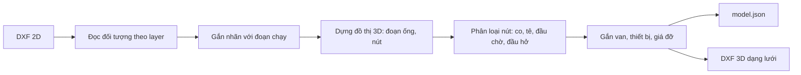
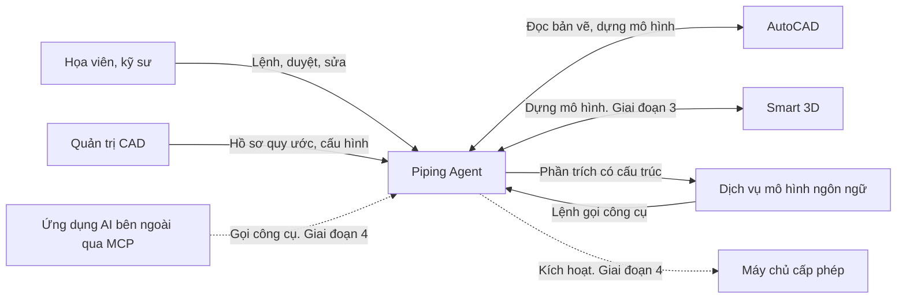
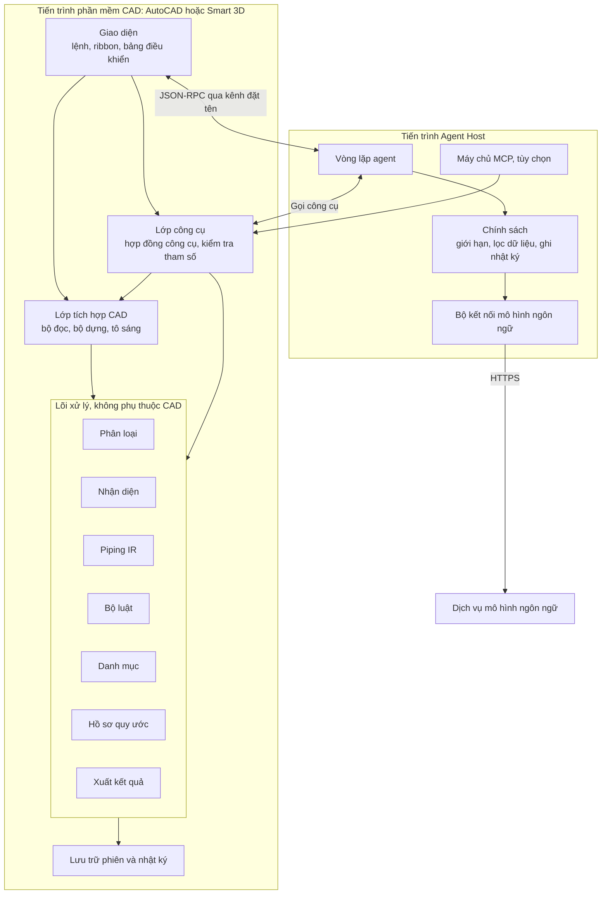
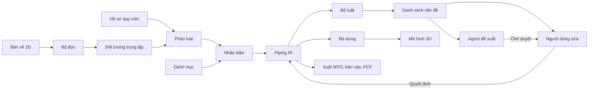
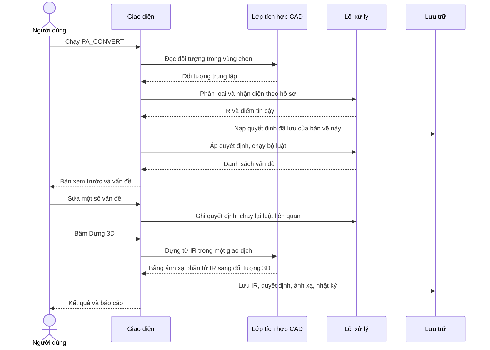
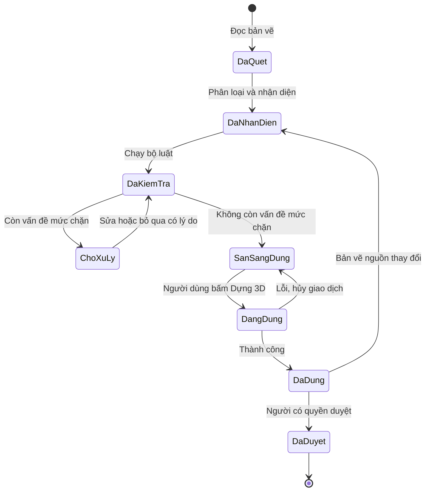
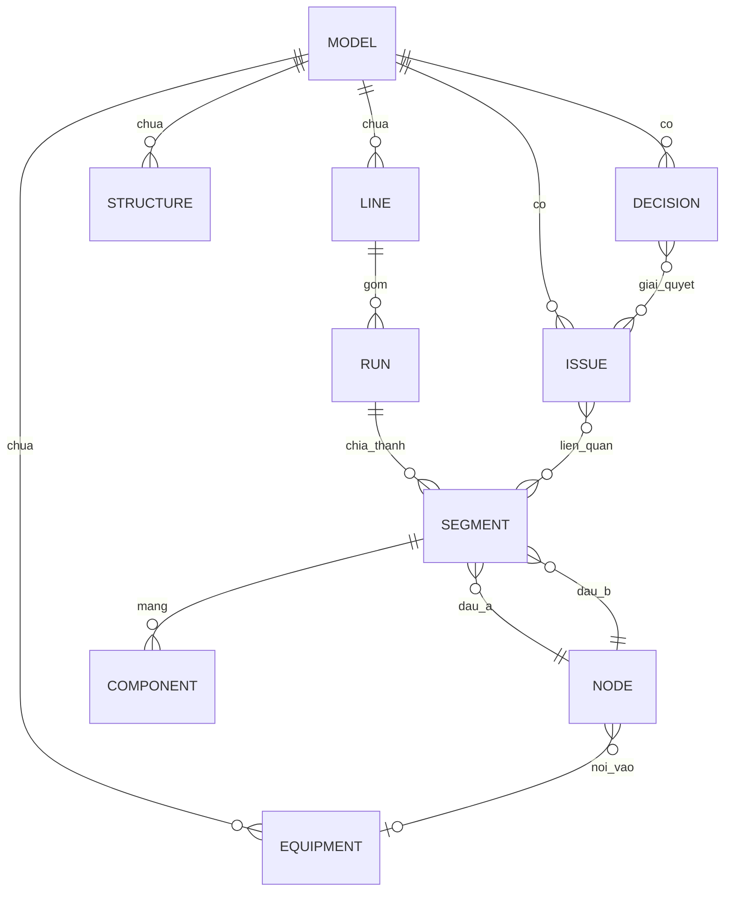
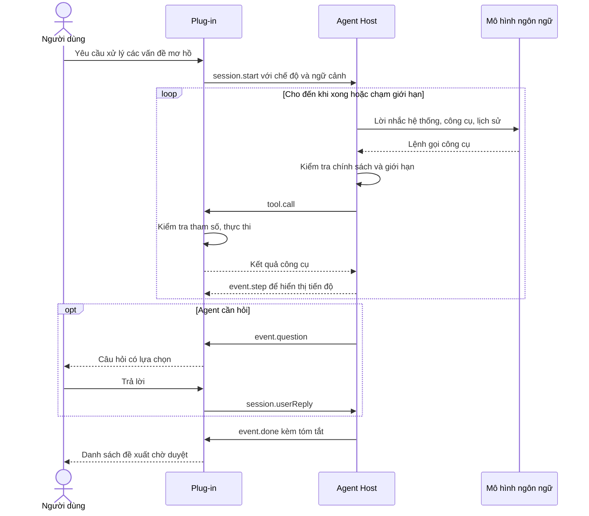
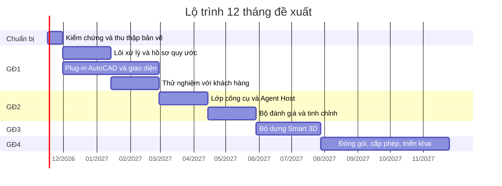

> **Tài liệu trước pivot.** Từ 10/11/2026 sản phẩm thu hẹp thành tờ isometric sang 3D, xem `docs/CHUYEN_HUONG_ISOMETRIC.md`. Tài liệu này mô tả hướng mặt bằng 2D cũ và chưa cập nhật; mã nguồn vẫn trích dẫn số mục của nó nên giữ nguyên.

# Tài liệu dự án Piping Agent

**Agent AI dựng mô hình đường ống 3D từ bản vẽ 2D, chạy trong AutoCAD và Smart 3D**

| Mục | Giá trị |
|---|---|
| Tên dự án | Piping Agent (tên tạm, lấy theo bộ slide gọi vốn) |
| Phiên bản tài liệu | 0.5 (bản nháp) |
| Ngày lập | 09/11/2026 |
| Trạng thái | Chờ người sáng lập rà soát và chốt các mục ở chương 14 |
| Phạm vi tài liệu | Đặc tả yêu cầu phần mềm (SRS), kiến trúc tổng thể, thiết kế chi tiết, kế hoạch kiểm thử, lộ trình triển khai |
| Tài liệu liên quan | `README.md`, `output/pitch_deck.pptx`, `output/demo_2d_to_3d.mp4`, mã nguồn `prototype/` |

## Cách đọc tài liệu này

Tài liệu gồm 15 chương. Người mới nên đọc chương 1 và 2 để nắm bối cảnh, sau đó đọc chương 6 để nắm kiến trúc. Người lập trình đọc thêm chương 4, 7, 8, 9, 10. Người quản lý dự án đọc chương 12, 13, 14.

Ba quy ước xuyên suốt tài liệu:

- **Mã yêu cầu.** Mỗi yêu cầu có mã dạng `FR-XXX-nn` (chức năng) hoặc `NFR-XXX-nn` (phi chức năng). Mã này dùng để truy vết từ yêu cầu sang thiết kế, mã nguồn và ca kiểm thử.
- **Mức ưu tiên.** `M` là bắt buộc, `S` là nên có, `C` là có thì tốt. Cột "GĐ" cho biết giai đoạn dự kiến thực hiện theo lộ trình ở chương 12.
- **Nhãn độ tin cậy.** Nội dung đánh dấu **[ĐỀ XUẤT]** là đề xuất của người soạn, chưa được người sáng lập xác nhận. Nội dung đánh dấu **[CẦN XÁC MINH]** là thông tin kỹ thuật về API của bên thứ ba, cần đối chiếu với tài liệu chính thức của đúng phiên bản phần mềm trước khi lập trình.

## Mục lục

1. [Tổng quan dự án](#1-tổng-quan-dự-án)
2. [Hiện trạng: prototype v0.1](#2-hiện-trạng-prototype-v01)
3. [Người dùng và ca sử dụng](#3-người-dùng-và-ca-sử-dụng)
4. [Yêu cầu chức năng](#4-yêu-cầu-chức-năng)
5. [Yêu cầu phi chức năng, giao diện ngoài và ràng buộc](#5-yêu-cầu-phi-chức-năng-giao-diện-ngoài-và-ràng-buộc)
6. [Kiến trúc tổng thể](#6-kiến-trúc-tổng-thể)
7. [Mô hình dữ liệu trung gian (Piping IR)](#7-mô-hình-dữ-liệu-trung-gian-piping-ir)
8. [Thiết kế agent](#8-thiết-kế-agent)
9. [Bộ kiểm tra bằng luật](#9-bộ-kiểm-tra-bằng-luật)
10. [Tích hợp phần mềm CAD](#10-tích-hợp-phần-mềm-cad)
11. [Bảo mật, triển khai và vận hành](#11-bảo-mật-triển-khai-và-vận-hành)
12. [Lộ trình và phân rã công việc](#12-lộ-trình-và-phân-rã-công-việc)
13. [Kế hoạch kiểm thử và đo chất lượng](#13-kế-hoạch-kiểm-thử-và-đo-chất-lượng)
14. [Rủi ro và các quyết định còn mở](#14-rủi-ro-và-các-quyết-định-còn-mở)
15. [Phụ lục](#15-phụ-lục)

---

## 1. Tổng quan dự án

### 1.1 Bối cảnh

Trong thiết kế nhà máy, mô hình đường ống 3D thường được dựng lại bằng tay từ bản vẽ 2D. Nguồn bản vẽ 2D có thể là bản vẽ mặt bằng đường ống, bản vẽ cũ của nhà máy đang vận hành, hoặc bản vẽ do khách hàng gửi sang công ty gia công. Họa viên đọc từng nhãn, tra đường kính và cao độ, rồi định tuyến lại từng đoạn ống trong AutoCAD, Plant 3D hoặc Smart 3D. Công việc lặp lại, tốn nhiều giờ công và dễ sai ở các chi tiết nhỏ như gắn nhầm nhãn hoặc đọc sai cao độ.

Người sáng lập có kinh nghiệm viết plug-in cho AutoCAD và Smart 3D. Đây là nền tảng để tự động hóa công việc trên ngay trong phần mềm mà kỹ sư đang dùng.

### 1.2 Vấn đề cần giải quyết

| # | Vấn đề | Hệ quả |
|---|---|---|
| 1 | Dựng 3D từ 2D là việc thủ công, lặp lại | Tốn giờ công của họa viên có tay nghề |
| 2 | Thông tin 3D nằm rải rác trong nhãn chữ, ký hiệu và ghi chú | Dễ đọc sai, gắn nhầm tuyến, sai cao độ |
| 3 | Mỗi công ty, mỗi dự án có quy ước layer và nhãn riêng | Công cụ tự động dựa trên quy tắc cứng không dùng lại được giữa các dự án |
| 4 | Mô hình ngôn ngữ còn yếu về hình học và kích thước chính xác | Không thể để AI tự sinh tọa độ cho bản vẽ kỹ thuật |
| 5 | Dữ liệu dự án cần bảo mật | Nhiều khách hàng không cho đưa bản vẽ ra ngoài mạng nội bộ |

Vấn đề 3 và 4 quyết định hướng kỹ thuật của dự án. Quy tắc cứng không đủ linh hoạt. AI tự vẽ thì không đủ chính xác. Sản phẩm phải kết hợp cả hai: AI lo phần hiểu quy ước và xử lý chỗ mơ hồ, lệnh tham số lo phần hình học.

### 1.3 Tầm nhìn sản phẩm

Kỹ sư mở bản vẽ mặt bằng đường ống 2D trong AutoCAD, bấm một lệnh, và nhận lại mô hình 3D đúng đường kính, đúng cao độ, kèm danh sách những chỗ cần xem lại. Kỹ sư chỉ dành thời gian cho những chỗ hệ thống không chắc, thay vì dựng lại toàn bộ.

### 1.4 Mục tiêu

| Mã | Mục tiêu | Cách đo |
|---|---|---|
| G1 | Giảm giờ công dựng mô hình 3D từ bản vẽ 2D | So sánh giờ công thủ công và giờ công có công cụ trên cùng bộ bản vẽ của khách hàng thử nghiệm |
| G2 | Kết quả đủ tin cậy để kỹ sư chỉ cần duyệt | Tỷ lệ đối tượng dựng đúng mà không cần sửa, đo trên bộ bản vẽ chuẩn (chương 13) |
| G3 | Dùng được với quy ước bản vẽ của nhiều công ty | Thời gian thiết lập cho một quy ước mới, tính từ lúc nhận bản vẽ đầu tiên |
| G4 | Chạy được trong mạng nội bộ của khách hàng | Có chế độ triển khai không gửi dữ liệu ra ngoài |
| G5 | Một lõi xử lý dùng chung cho AutoCAD và Smart 3D | Tỷ lệ mã nguồn dùng chung giữa hai bộ tích hợp |

Con số mục tiêu cụ thể cho G1 và G2 chưa có. Chúng cần được đặt sau khi đo đường cơ sở trên bản vẽ thật của khách hàng thử nghiệm đầu tiên. Xem mục 14.2.

### 1.5 Phạm vi

**Trong phạm vi của phiên bản thương mại đầu tiên:**

- Đầu vào là bản vẽ mặt bằng đường ống 2D dạng vector, định dạng DWG hoặc DXF.
- Nhận diện tuyến ống, nhãn tuyến, đường kính, cao độ, ống đứng, co, tê, van, thiết bị chính, giá đỡ ống.
- Dựng mô hình 3D trong AutoCAD bằng khối solid, có gắn dữ liệu thuộc tính.
- Kiểm tra bằng luật và danh sách vấn đề để kỹ sư duyệt.
- Agent AI hỗ trợ lập hồ sơ quy ước bản vẽ và xử lý chỗ mơ hồ.
- Xuất bảng khối lượng vật tư sơ bộ.
- Tích hợp Smart 3D ở giai đoạn sau, dùng chung lõi xử lý.

**Ngoài phạm vi, ít nhất đến hết lộ trình 12 tháng:**

- Bản vẽ scan, ảnh raster, PDF không có dữ liệu vector.
- Bản vẽ isometric và sơ đồ P&ID làm đầu vào.
- Tính toán ứng suất ống, tính thủy lực, chọn vật liệu.
- Thiết kế mới hoàn toàn từ yêu cầu bằng lời, không có bản vẽ đầu vào.
- Kết cấu thép, điện, thiết bị đo lường, thông gió.
- Sinh bản vẽ 2D ngược lại từ mô hình 3D.

### 1.6 Các bên liên quan

| Bên liên quan | Vai trò | Quan tâm chính |
|---|---|---|
| Người sáng lập | Chủ sản phẩm, kiến trúc sư, lập trình viên chính | Tính khả thi, tốc độ ra sản phẩm, chi phí |
| Nhà đầu tư | Cấp vốn | Thị trường, khác biệt, mốc kiểm chứng |
| Họa viên, kỹ sư đường ống | Người dùng trực tiếp | Nhanh, dễ sửa, không phá bản vẽ |
| Trưởng nhóm thiết kế | Người duyệt, người quyết định mua | Chất lượng, tiến độ, khả năng kiểm soát |
| Quản trị CAD và công nghệ thông tin | Cài đặt, cấu hình, bảo mật | Tương thích phiên bản, dữ liệu không rò rỉ |
| Khách hàng cuối của công ty gia công | Nhận mô hình | Đúng tiêu chuẩn bàn giao |

### 1.7 Thuật ngữ

| Thuật ngữ | Giải thích |
|---|---|
| Agent | Chương trình dùng mô hình ngôn ngữ lớn để tự chọn và gọi công cụ theo nhiều bước nhằm hoàn thành một việc |
| Công cụ (tool) | Một hàm có tên, mô tả và lược đồ tham số, do hệ thống cung cấp để agent gọi |
| Lệnh tham số | Hàm tất định nhận tham số kỹ thuật và sinh ra hình học chính xác thông qua API của phần mềm CAD |
| Piping IR | Mô hình dữ liệu trung gian của dự án, mô tả hệ thống ống độc lập với phần mềm CAD. Xem chương 7 |
| Hồ sơ quy ước (profile) | Tập cấu hình mô tả quy ước bản vẽ của một công ty hoặc dự án: layer nào chứa gì, nhãn viết theo mẫu nào, block nào là thiết bị gì |
| Tuyến ống (line) | Một đường ống có số hiệu riêng, ví dụ `P-1011` |
| Đoạn chạy (run) | Một polyline đường tâm ống trên bản vẽ, nằm ở một cao độ |
| DN | Đường kính danh nghĩa, tính bằng mm |
| OD | Đường kính ngoài thực tế của ống |
| EL | Cao độ. Có thể là cao độ tâm ống, đáy ống hoặc đỉnh ống tùy quy ước |
| TOS | Cao độ mặt trên của kết cấu thép |
| BOP | Cao độ đáy ống |
| Ống đứng (riser) | Đoạn ống thẳng đứng nối hai cao độ |
| Co, tê | Phụ kiện đổi hướng 90 độ hoặc 45 độ, và phụ kiện chia ba nhánh |
| Đầu chờ thiết bị (nozzle) | Điểm nối ống trên bồn, bơm và thiết bị khác |
| MTO | Bảng khối lượng vật tư |
| PCF | Định dạng tệp văn bản mô tả cấu kiện đường ống, dùng phổ biến để trao đổi dữ liệu và sinh bản vẽ isometric |
| MCP | Model Context Protocol, chuẩn mở để ứng dụng AI kết nối với công cụ và dữ liệu |
| Bộ bản vẽ chuẩn | Tập bản vẽ có đáp án đúng được kiểm tra bằng tay, dùng để đo chất lượng |
| Smart 3D, S3D | Phần mềm thiết kế nhà máy 3D của Hexagon |

### 1.8 Định vị so với công cụ hiện có

Mục này được thêm sau phản hồi ngày 09/11/2026 của một người xem demo. Người đó xếp demo vào nhóm công cụ tự động định tuyến ống. Thông tin về sản phẩm của bên thứ ba dưới đây lấy từ trang sản phẩm và thông cáo của các hãng, tra cứu tháng 11/2026.

| Nhóm | Ví dụ | Đầu vào | Đầu ra | Giai đoạn dự án |
|---|---|---|---|---|
| Tự động định tuyến | PlantStream của Arent, Aspen OptiPlant 3D Layout của AspenTech | Bố trí thiết bị, danh sách tuyến ống, sơ đồ công nghệ | Tuyến ống mới do phần mềm vạch ra | Nghiên cứu khả thi, thiết kế sơ bộ |
| Sản phẩm này | Piping Agent | Bản vẽ đường ống 2D mà kỹ sư đã thiết kế | Mô hình 3D của đúng các tuyến đó, trong AutoCAD hoặc Smart 3D | Thiết kế chi tiết, chuyển đổi bản vẽ cũ, cải tạo nhà máy |

Câu định vị: công cụ tự động định tuyến quyết định ống đi đường nào. Piping Agent không quyết định điều đó. Nó dựng lại đúng tuyến mà người thiết kế đã vẽ, và quyền quyết định tuyến vẫn thuộc về người thiết kế.

Hệ quả cho sản phẩm:

- Mọi tài liệu giới thiệu phải nói rõ đầu vào là bản vẽ đã thiết kế. Demo đầu tiên không nói rõ điều này nên bị hiểu nhầm.
- Bản vẽ mẫu dùng để giới thiệu phải đúng thực tế thiết kế đường ống, vì người xem trong nghề đánh giá sản phẩm qua bản vẽ đó. Xem việc S0-16 và S0-18 trong kế hoạch sprint.
- Hai nhóm có thể bổ trợ nhau: tuyến do công cụ tự định tuyến vạch ra vẫn phải được kỹ sư chỉnh và ban hành thành bản vẽ. Đây là hướng mở, chưa nằm trong lộ trình.

---

## 2. Hiện trạng: prototype v0.1

Prototype đã có trong thư mục `prototype/`. Nó chứng minh được chuỗi xử lý từ bản vẽ 2D đến mô hình 3D trên một bản vẽ mẫu. Nó chưa phải sản phẩm.

### 2.1 Thành phần đã có

| Tệp | Chức năng |
|---|---|
| `prototype/make_sample_drawing.py` | Tạo bản vẽ mặt bằng đường ống 2D mẫu của một trạm bơm |
| `prototype/convert_2d_to_3d.py` | Đọc DXF 2D, nhận diện bằng quy tắc, dựng mô hình, xuất `model.json` và DXF 3D |
| `prototype/geometry.py` | Hàm dựng lưới 3D cho ống, co, mặt bích, van, bồn, bơm, cột, dầm |
| `prototype/render_video.py`, `render_hero.py` | Dựng video demo và ảnh cho slide |
| `prototype/data/piping_plan_2d.dxf` | Bản vẽ mẫu đầu vào, 80 đối tượng, đơn vị mm |
| `prototype/data/model.json` | Mô hình tham số do prototype sinh ra |
| `prototype/data/model_3d.dxf` | Mô hình 3D dạng lưới đa diện, 87 khối |

### 2.2 Chuỗi xử lý của prototype



### 2.3 Quy tắc nhận diện hiện có

| Đối tượng trên bản vẽ | Quy tắc | Kết quả trong mô hình |
|---|---|---|
| Polyline trên layer `PIPE` | Mỗi polyline là đường tâm ống ở một cao độ | Đoạn chạy |
| Chữ trên layer `PIPE-TAG` dạng `P-1011 DN150 EL+4100` | Tách số hiệu tuyến, DN, cao độ tâm ống. Gắn với đoạn chạy mà đường dẫn chạm vào. Nếu không có đường dẫn thì gắn với đoạn gần nhất | Thuộc tính của đoạn chạy |
| Hai đoạn chạy khác cao độ gặp nhau trên mặt bằng | Tạo ống đứng nối hai cao độ. Đối chiếu với ký hiệu tròn trên layer `PIPE-RISER` | Đoạn ống đứng |
| Nút có hai nhánh không thẳng hàng | Co 90 độ bán kính dài, R = 1,5 × DN | Co |
| Nút có ba nhánh | Tê | Tê |
| Block `VALVE_GATE` | Van cổng trên đoạn ống mà block nằm lên | Van |
| Hình tròn trên layer `EQUIP` kèm chữ `H=...` | Bồn đứng | Bồn |
| Hình chữ nhật kín trên layer `EQUIP` | Bơm | Bơm |
| Block `COLUMN` và đường trên layer `STRUCT`, chữ `TOS EL+...` | Cột và dầm của giá đỡ ống | Giá đỡ |

### 2.4 Kết quả đo trên bản vẽ mẫu

| Chỉ số | Giá trị |
|---|---|
| Đối tượng 2D đầu vào | 80 |
| Đoạn chạy, đoạn ống thẳng | 11 đoạn chạy, 26 đoạn ống |
| Nhãn đọc được | 11 trên 11 |
| Số tuyến ống | 8 |
| Ống đứng | 3, khớp 3 trên 3 ký hiệu |
| Co, tê | 15 co, 3 tê |
| Đầu chờ thiết bị, đầu hở | 8 và 5 |
| Van, bồn, bơm | 7, 2, 2 |
| Cột, dầm | 8, 10 |
| Tổng chiều dài ống | 115,9 m |
| Thời gian đọc và dựng mô hình | 0,13 giây |
| Thời gian xuất DXF 3D | 7,0 giây |

Các số trên đo trên một bản vẽ mẫu tự tạo, trên máy tính cá nhân. Chúng không nói lên chất lượng trên bản vẽ thật.

### 2.5 Giới hạn của prototype

| # | Giới hạn | Yêu cầu khắc phục tương ứng |
|---|---|---|
| 1 | Chỉ chạy trên bản vẽ mẫu tự tạo, layer sạch | Hồ sơ quy ước, mục 4.3 |
| 2 | Quy tắc viết cứng trong mã | Hồ sơ quy ước và agent, mục 4.3 và 4.8 |
| 3 | Chưa có AI agent | Chương 8 |
| 4 | Chưa chạy trong AutoCAD hay Smart 3D | Chương 10 |
| 5 | Đầu ra là lưới đa diện, chưa phải solid hay đối tượng ống thông minh | Mục 4.6 |
| 6 | Chỉ đọc DXF, chưa đọc DWG | Mục 4.1 |
| 7 | Chỉ có co 90 độ, chưa có co 45 độ, côn thu, mặt bích nối ống | Mục 4.4 |
| 8 | Cao độ luôn hiểu là cao độ tâm ống | `FR-REC-07` |
| 9 | Chưa kiểm tra va chạm, chưa có bộ luật đầy đủ | Chương 9 |
| 10 | Tệp DXF 3D chưa được mở thử bằng AutoCAD | Việc cần làm ngay, mục 12.2 |
| 11 | Dừng hẳn khi gặp đoạn chạy không có nhãn | `FR-REC-10`, xử lý lỗi mềm |

### 2.6 Phần của prototype được giữ lại

- **Thuật toán.** Cách gắn nhãn, dựng đồ thị, phân loại nút và suy ra ống đứng được viết lại bằng C# trong lõi xử lý.
- **Vai trò đối chứng.** Mã Python được giữ làm bản đối chứng. Kết quả của lõi C# trên bản vẽ mẫu phải khớp với `model.json` của prototype.
- **Bản vẽ mẫu.** Trở thành bản vẽ đầu tiên trong bộ bản vẽ chuẩn.
- **Công cụ dựng hình.** Dùng để dựng ảnh xem trước và ảnh báo cáo khi chạy ngoài AutoCAD.

---

## 3. Người dùng và ca sử dụng

### 3.1 Nhóm người dùng

| Nhóm | Mô tả | Trình độ | Tần suất dùng |
|---|---|---|---|
| U1. Họa viên đường ống | Dựng mô hình hằng ngày. Thành thạo AutoCAD, biết đọc bản vẽ đường ống | Cao về CAD, không lập trình | Hằng ngày |
| U2. Kỹ sư, trưởng nhóm | Duyệt mô hình, chịu trách nhiệm chất lượng | Cao về kỹ thuật đường ống | Hằng tuần |
| U3. Quản trị CAD | Cài đặt, cấu hình hồ sơ quy ước, quản lý thư viện | Cao về CAD, biết cấu hình | Khi thiết lập dự án |
| U4. Người vận hành dịch vụ | Nhân sự của chính công ty, chạy công cụ cho khách ở giai đoạn bán dịch vụ | Hiểu rõ công cụ | Hằng ngày |
| U5. Quản trị hệ thống của khách | Cấp phép, kiểm soát kết nối mạng, kiểm tra nhật ký | Công nghệ thông tin | Khi triển khai |

### 3.2 Danh sách ca sử dụng

| Mã | Ca sử dụng | Người dùng chính | GĐ |
|---|---|---|---|
| UC-01 | Dựng mô hình 3D từ một bản vẽ mặt bằng | U1 | 1 |
| UC-02 | Duyệt và sửa kết quả nhận diện trước khi dựng | U1, U2 | 1 |
| UC-03 | Thiết lập hồ sơ quy ước cho dự án mới | U3, U4 | 1 thủ công, 2 có agent |
| UC-04 | Xử lý chỗ mơ hồ với sự hỗ trợ của agent | U1 | 2 |
| UC-05 | Kiểm tra mô hình bằng bộ luật | U1, U2 | 1 |
| UC-06 | Ra lệnh sửa mô hình bằng ngôn ngữ tự nhiên | U1 | 2 |
| UC-07 | Xử lý nhiều bản vẽ theo lô | U4 | 1 |
| UC-08 | Xuất bảng khối lượng và báo cáo | U1, U2 | 1 |
| UC-09 | Dựng mô hình trong Smart 3D | U1 | 3 |
| UC-10 | Cài đặt, cấp phép và cấu hình kết nối | U3, U5 | 1 cơ bản, 4 đầy đủ |
| UC-11 | Xem nhật ký và truy vết quyết định | U2, U5 | 2 |

### 3.3 Mô tả chi tiết các ca sử dụng chính

#### UC-01: Dựng mô hình 3D từ một bản vẽ mặt bằng

| Mục | Nội dung |
|---|---|
| Mục đích | Tạo mô hình đường ống 3D từ bản vẽ 2D đang mở |
| Điều kiện trước | Bản vẽ đang mở trong AutoCAD. Đã chọn hồ sơ quy ước. Giấy phép hợp lệ |
| Kích hoạt | Người dùng chạy lệnh `PA_CONVERT` hoặc bấm nút trên bảng điều khiển |
| Kết quả mong đợi | Mô hình 3D được tạo trong bản vẽ đích. Danh sách vấn đề được hiển thị. Bản vẽ gốc không bị thay đổi |

Luồng chính:

1. Hệ thống quét bản vẽ và trích xuất đối tượng theo hồ sơ quy ước.
2. Hệ thống nhận diện tuyến ống, nhãn, phụ kiện, thiết bị và dựng Piping IR.
3. Hệ thống chạy bộ luật trên IR và lập danh sách vấn đề.
4. Hệ thống hiển thị bản xem trước: số lượng từng loại đối tượng, các vấn đề theo mức độ, và các đối tượng có độ tin cậy thấp.
5. Người dùng xem, sửa nếu cần (UC-02), rồi bấm "Dựng 3D".
6. Hệ thống dựng mô hình trong một nhóm thao tác có thể hoàn tác bằng một lần Undo.
7. Hệ thống chạy lại bộ luật trên mô hình đã dựng và hiển thị kết quả cuối.

Luồng thay thế:

- **3a. Có vấn đề mức chặn.** Hệ thống không cho dựng cho đến khi vấn đề được sửa hoặc được người dùng chấp nhận bỏ qua có ghi lý do.
- **2a. Tỷ lệ nhận diện thấp.** Nếu dưới ngưỡng cấu hình, hệ thống gợi ý kiểm tra lại hồ sơ quy ước (UC-03) thay vì tiếp tục.
- **6a. Lỗi khi dựng.** Hệ thống hủy toàn bộ giao dịch, bản vẽ trở về trạng thái trước khi dựng, lỗi được ghi vào nhật ký.

#### UC-02: Duyệt và sửa kết quả nhận diện

| Mục | Nội dung |
|---|---|
| Mục đích | Cho người dùng sửa IR trước khi dựng 3D |
| Điều kiện trước | Đã có IR từ UC-01 bước 2 |

Luồng chính:

1. Người dùng chọn một vấn đề trong danh sách. Hệ thống phóng tới vị trí tương ứng trên bản vẽ 2D và tô sáng các đối tượng liên quan.
2. Người dùng chọn một cách sửa: gắn lại nhãn, nhập DN hoặc cao độ, đổi loại phụ kiện, nối hai đầu ống, đánh dấu bỏ qua.
3. Hệ thống cập nhật IR, ghi nguồn quyết định là "người dùng", và chạy lại các luật liên quan.
4. Hệ thống cập nhật danh sách vấn đề.

Yêu cầu riêng: mọi chỉnh sửa của người dùng phải được lưu lại kèm bản vẽ, để lần chạy sau trên cùng bản vẽ không phải sửa lại.

#### UC-03: Thiết lập hồ sơ quy ước cho dự án mới

| Mục | Nội dung |
|---|---|
| Mục đích | Tạo hồ sơ quy ước khớp với bản vẽ của một khách hàng hoặc dự án |
| Điều kiện trước | Có ít nhất một bản vẽ đại diện |

Luồng chính ở giai đoạn 1, làm thủ công:

1. Người dùng mở trình soạn hồ sơ. Hệ thống liệt kê layer, block, kiểu chữ có trong bản vẽ kèm số lượng đối tượng.
2. Người dùng gán vai trò cho từng layer và block, nhập mẫu nhãn.
3. Hệ thống chạy thử nhận diện và báo cáo: bao nhiêu phần trăm đối tượng được phân loại, bao nhiêu nhãn khớp mẫu.
4. Người dùng chỉnh cho đến khi đạt, rồi lưu hồ sơ.

Luồng chính từ giai đoạn 2, có agent:

1. Người dùng yêu cầu agent đề xuất hồ sơ.
2. Agent khảo sát bản vẽ qua các công cụ chỉ đọc, đề xuất hồ sơ, tự chạy thử và tinh chỉnh.
3. Agent trình bày hồ sơ đề xuất kèm lý do cho từng ánh xạ và kết quả chạy thử.
4. Người dùng duyệt, sửa, rồi lưu. Từ đây việc nhận diện chạy tất định theo hồ sơ, không cần gọi mô hình ngôn ngữ cho từng đối tượng.

#### UC-04: Xử lý chỗ mơ hồ với sự hỗ trợ của agent

Luồng chính:

1. Sau bước nhận diện, hệ thống gom các vấn đề mà quy tắc không tự quyết được. Ví dụ: một nhãn nằm giữa hai đoạn chạy, một đoạn chạy không có nhãn, một ký hiệu không có trong hồ sơ.
2. Agent xem xét từng vấn đề bằng công cụ chỉ đọc: lấy đối tượng lân cận, đọc ghi chú chung, xem ảnh chụp vùng bản vẽ.
3. Agent đề xuất cách giải quyết kèm lý do và mức tin cậy. Đề xuất được ghi vào IR ở trạng thái "chờ duyệt".
4. Người dùng chấp nhận hoặc từ chối từng đề xuất, hoặc chấp nhận hàng loạt các đề xuất trên ngưỡng tin cậy.
5. Nếu agent không đủ căn cứ, nó đặt câu hỏi cho người dùng thay vì đoán.

#### UC-06: Ra lệnh sửa mô hình bằng ngôn ngữ tự nhiên

Ví dụ: "đổi tuyến P-1011 sang DN200", "nâng toàn bộ ống trên giá đỡ lên 150 mm", "thêm van cổng trên P-1003 cách bơm 1 mét".

Luồng chính:

1. Người dùng nhập yêu cầu vào khung trò chuyện.
2. Agent chuyển yêu cầu thành chuỗi lệnh gọi công cụ trên IR.
3. Hệ thống hiển thị bản xem trước các thay đổi.
4. Người dùng duyệt. Hệ thống áp dụng thay đổi vào mô hình 3D và chạy lại bộ luật.

#### UC-07: Xử lý nhiều bản vẽ theo lô

Luồng chính:

1. Người vận hành chọn thư mục bản vẽ và hồ sơ quy ước.
2. Hệ thống chạy nhận diện và kiểm tra cho từng bản vẽ, không dựng 3D ở bước này.
3. Hệ thống xuất báo cáo tổng hợp: bản vẽ nào sẵn sàng, bản vẽ nào cần xem lại, số vấn đề theo loại.
4. Người vận hành xử lý lần lượt các bản vẽ cần xem lại, rồi dựng 3D.

---

## 4. Yêu cầu chức năng

Các yêu cầu được nhóm theo mô-đun. Cột "ƯT" là mức ưu tiên, cột "GĐ" là giai đoạn theo lộ trình ở chương 12.

### 4.1 Nạp bản vẽ (ING)

| Mã | Yêu cầu | ƯT | GĐ |
|---|---|---|---|
| FR-ING-01 | Đọc đối tượng từ bản vẽ đang mở trong AutoCAD: line, polyline, arc, circle, text, mtext, leader, mleader, block reference kèm thuộc tính, dimension | M | 1 |
| FR-ING-02 | Đọc tệp DXF độc lập, không cần AutoCAD, để phục vụ kiểm thử tự động và xử lý theo lô | M | 1 |
| FR-ING-03 | Đọc được đối tượng nằm trong block lồng nhau và trong bản vẽ tham chiếu ngoài, có ghi lại đường dẫn nguồn | S | 2 |
| FR-ING-04 | Nhận biết đơn vị bản vẽ và tỷ lệ. Quy đổi toàn bộ về mm trong IR. Nếu không xác định được đơn vị thì hỏi người dùng | M | 1 |
| FR-ING-05 | Cho phép giới hạn vùng xử lý bằng cửa sổ chọn hoặc tập đối tượng chọn | S | 1 |
| FR-ING-06 | Chỉ đọc bản vẽ nguồn. Không sửa, không xóa, không đổi layer của bất kỳ đối tượng nguồn nào | M | 1 |
| FR-ING-07 | Lưu định danh của từng đối tượng nguồn (handle) vào IR để truy vết | M | 1 |
| FR-ING-08 | Làm sạch hình học đầu vào: gộp đoạn thẳng nối tiếp thẳng hàng, bắt các đầu mút gần nhau trong dung sai cấu hình, loại đối tượng trùng lặp | M | 1 |
| FR-ING-09 | Tạo bản tóm tắt bản vẽ: danh sách layer, block, kiểu chữ, số lượng đối tượng từng loại, phạm vi tọa độ | M | 1 |
| FR-ING-10 | Đọc tệp DWG độc lập khi không có AutoCAD, thông qua bước chuyển đổi sang DXF | C | 4 |

### 4.2 Trích xuất và phân loại đối tượng (CLS)

| Mã | Yêu cầu | ƯT | GĐ |
|---|---|---|---|
| FR-CLS-01 | Phân loại mỗi đối tượng nguồn vào một vai trò theo hồ sơ quy ước: đường tâm ống, nhãn ống, đường dẫn nhãn, ký hiệu ống đứng, ký hiệu van, ký hiệu phụ kiện, nhãn cấu kiện, thiết bị, nhãn thiết bị, kết cấu, ghi chú, bảng chú giải ký hiệu, khung tên, bỏ qua | M | 1 |
| FR-CLS-02 | Tiêu chí phân loại gồm: tên layer (hỗ trợ ký tự đại diện), tên block, loại đối tượng, màu, kiểu nét, mẫu văn bản | M | 1 |
| FR-CLS-03 | Báo cáo tỷ lệ đối tượng chưa được phân loại, kèm danh sách theo layer | M | 1 |
| FR-CLS-04 | Hỗ trợ ống vẽ bằng hai nét song song. Suy ra đường tâm và đường kính ngoài theo tỷ lệ | S | 2 |
| FR-CLS-05 | Hỗ trợ ký hiệu van, phụ kiện vẽ bằng nét rời, không phải block, thông qua so khớp mẫu hình học | C | 3 |

### 4.3 Hồ sơ quy ước (PRF)

| Mã | Yêu cầu | ƯT | GĐ |
|---|---|---|---|
| FR-PRF-01 | Hồ sơ quy ước là dữ liệu, lưu ở dạng tệp JSON có lược đồ và số phiên bản. Không viết quy ước của khách hàng vào mã nguồn | M | 1 |
| FR-PRF-02 | Hồ sơ gồm: ánh xạ layer và block sang vai trò, danh sách mẫu nhãn, ngữ nghĩa cao độ, dung sai hình học, bảng ánh xạ block sang loại cấu kiện, đơn vị mặc định, tiêu chuẩn ống mặc định | M | 1 |
| FR-PRF-03 | Có giao diện soạn hồ sơ: liệt kê layer và block của bản vẽ, cho gán vai trò, cho nhập và thử mẫu nhãn trực tiếp | M | 1 |
| FR-PRF-04 | Có chức năng chạy thử hồ sơ trên một bản vẽ và trả về các chỉ số: tỷ lệ phân loại, tỷ lệ nhãn khớp mẫu, số đoạn chạy không có nhãn, số vấn đề theo loại | M | 1 |
| FR-PRF-05 | Hồ sơ có thể kế thừa từ hồ sơ khác, để dự án kế thừa hồ sơ công ty và chỉ ghi đè phần khác biệt | S | 2 |
| FR-PRF-06 | Nhập, xuất hồ sơ thành tệp để chia sẻ trong nhóm | M | 1 |
| FR-PRF-07 | Agent đề xuất hồ sơ từ một hoặc nhiều bản vẽ đại diện, kèm lý do cho từng ánh xạ. Hồ sơ chỉ có hiệu lực sau khi người dùng duyệt | M | 2 |
| FR-PRF-08 | Kèm sẵn ít nhất một hồ sơ mẫu, tương ứng với quy ước của bản vẽ mẫu trong prototype | M | 1 |
| FR-PRF-09 | Khi lập hồ sơ, agent đọc bảng chú giải ký hiệu của bộ bản vẽ nếu có, và dùng nó làm căn cứ ưu tiên cho ánh xạ ký hiệu sang loại cấu kiện. Xem mục 7.9 | S | 2 |

### 4.4 Nhận diện và dựng mô hình trung gian (REC)

| Mã | Yêu cầu | ƯT | GĐ |
|---|---|---|---|
| FR-REC-01 | Đọc nhãn ống theo các mẫu trong hồ sơ. Tách ra số hiệu tuyến, DN, cao độ và các trường tùy chọn: mã lưu chất, cấp ống, bảo ôn | M | 1 |
| FR-REC-02 | Gắn nhãn với đoạn chạy theo thứ tự ưu tiên: đường dẫn chạm vào đoạn chạy, nhãn nằm trên hoặc song song sát đoạn chạy, đoạn chạy gần nhất trong bán kính cấu hình | M | 1 |
| FR-REC-03 | Tính điểm tin cậy cho mỗi liên kết nhãn với đoạn chạy. Khi hai ứng viên có điểm gần nhau thì tạo vấn đề "nhãn mơ hồ" thay vì tự chọn | M | 1 |
| FR-REC-04 | Lan truyền thuộc tính: đoạn chạy không có nhãn nhưng nối thẳng với đoạn có nhãn thì thừa hưởng số hiệu tuyến và DN, có đánh dấu là suy ra | S | 1 |
| FR-REC-05 | Dựng đồ thị kết nối 3D: nút là điểm đầu mút, điểm gãy, điểm giao. Cạnh là đoạn ống thẳng | M | 1 |
| FR-REC-06 | Suy ra ống đứng khi hai đoạn chạy khác cao độ có chung điểm trên mặt bằng. Đối chiếu với ký hiệu ống đứng nếu có | M | 1 |
| FR-REC-07 | Hỗ trợ ba ngữ nghĩa cao độ: tâm ống, đáy ống, đỉnh ống. Quy đổi về cao độ tâm ống trong IR theo đường kính ngoài | M | 1 |
| FR-REC-08 | Phân loại nút: co 90 độ, co 45 độ, tê, tê thu, côn thu, đầu chờ thiết bị, đầu hở, điểm nối tiếp sang bản vẽ khác | M | 1 cho co 90 và tê, 2 cho phần còn lại |
| FR-REC-09 | Nhận diện van và cấu kiện nối tiếp trên ống từ block. Xác định đoạn ống chứa nó, vị trí và hướng trục | M | 1 |
| FR-REC-10 | Không dừng toàn bộ khi gặp lỗi cục bộ. Đối tượng lỗi được đưa vào danh sách vấn đề, phần còn lại vẫn được xử lý | M | 1 |
| FR-REC-11 | Nhận diện thiết bị chính: bồn đứng, bồn nằm, bơm, thiết bị trao đổi nhiệt dạng đơn giản. Đọc kích thước từ nhãn hoặc từ hình bao | M cho bồn đứng và bơm, S cho phần còn lại | 1 và 2 |
| FR-REC-12 | Nhận diện đầu chờ thiết bị khi đầu ống kết thúc trên biên thiết bị. Ghi nhận thiết bị được nối | M | 1 |
| FR-REC-13 | Nhận diện giá đỡ ống: cột, dầm, cao độ mặt trên kết cấu | S | 1 |
| FR-REC-14 | Đọc ghi chú chung của bản vẽ có ảnh hưởng đến mô hình, ví dụ "mọi cao độ là cao độ đáy ống trừ khi ghi khác". Ở giai đoạn 1 người dùng tự khai báo trong hồ sơ. Từ giai đoạn 2 agent đọc và đề xuất | S | 2 |
| FR-REC-15 | Ghép nhiều tờ bản vẽ qua điểm nối tiếp có cùng số hiệu tuyến và tọa độ | C | 3 |
| FR-REC-16 | Ghi nguồn gốc cho mọi phần tử của IR: đối tượng nguồn, quy tắc đã áp dụng, điểm tin cậy, người hoặc thành phần ra quyết định | M | 1 |
| FR-REC-17 | Tra kích thước thực của ống và phụ kiện từ danh mục theo DN và tiêu chuẩn: đường kính ngoài, bán kính co, chiều dài tê, chiều dài van | M | 1 |
| FR-REC-18 | Đọc thuộc tính của block thành thuộc tính của cấu kiện theo ánh xạ trong hồ sơ: số hiệu, cấp áp, kích cỡ và các trường khác | M | 1 |
| FR-REC-19 | Gắn chú thích dạng chữ rời với đúng cấu kiện theo thứ tự ưu tiên: đường dẫn chạm cấu kiện, chữ nằm sát cấu kiện, cấu kiện gần nhất trong bán kính cấu hình. Mỗi liên kết có điểm tin cậy. Mơ hồ thì tạo vấn đề thay vì tự chọn. Xem mục 7.9 | S | 2 |

### 4.5 Kiểm tra bằng luật (CHK)

Chi tiết từng luật ở chương 9.

| Mã | Yêu cầu | ƯT | GĐ |
|---|---|---|---|
| FR-CHK-01 | Chạy bộ luật trên IR và trả về danh sách vấn đề có cấu trúc: mã luật, mức độ, phần tử liên quan, vị trí, mô tả, gợi ý sửa | M | 1 |
| FR-CHK-02 | Ba mức độ: chặn (không cho dựng), cảnh báo (cho dựng, cần xem), thông tin | M | 1 |
| FR-CHK-03 | Bật, tắt và đổi mức độ từng luật trong hồ sơ quy ước | S | 1 |
| FR-CHK-04 | Chạy lại từng phần: khi IR thay đổi cục bộ thì chỉ chạy lại các luật liên quan | S | 2 |
| FR-CHK-05 | Kiểm tra va chạm cứng giữa ống với ống, ống với thiết bị, ống với kết cấu | S | 2 |
| FR-CHK-06 | Người dùng có thể chấp nhận bỏ qua một vấn đề, bắt buộc ghi lý do. Việc bỏ qua được lưu trong nhật ký | M | 1 |
| FR-CHK-07 | Cho phép thêm luật mới mà không sửa lõi, qua giao diện lập trình của bộ luật | S | 2 |

### 4.6 Dựng mô hình 3D (BLD)

| Mã | Yêu cầu | ƯT | GĐ |
|---|---|---|---|
| FR-BLD-01 | Dựng mô hình 3D trong AutoCAD từ IR bằng khối solid: ống thẳng, co, tê, côn thu, mặt bích, van, bồn, bơm, cột, dầm | M | 1 |
| FR-BLD-02 | Mặc định dựng vào một bản vẽ mới và tham chiếu bản vẽ 2D gốc làm nền. Cho phép chọn dựng vào chính bản vẽ đang mở trên các layer riêng | M | 1 |
| FR-BLD-03 | Tổ chức layer theo tuyến ống và loại đối tượng, tên layer cấu hình được theo mẫu | M | 1 |
| FR-BLD-04 | Gắn dữ liệu thuộc tính vào từng đối tượng 3D: số hiệu tuyến, DN, loại cấu kiện, định danh phần tử IR, định danh đối tượng nguồn 2D | M | 1 |
| FR-BLD-05 | Toàn bộ một lần dựng nằm trong một nhóm thao tác, hoàn tác được bằng một lần Undo | M | 1 |
| FR-BLD-06 | Xem trước khi dựng: hiển thị số lượng đối tượng sẽ tạo theo loại, không thay đổi bản vẽ | M | 1 |
| FR-BLD-07 | Dựng lại từng phần: khi IR thay đổi thì chỉ xóa và dựng lại các đối tượng 3D bị ảnh hưởng | S | 2 |
| FR-BLD-08 | Liên kết hai chiều: chọn đối tượng 3D thì tô sáng đối tượng 2D nguồn, và ngược lại | S | 2 |
| FR-BLD-09 | Dựng mô hình bằng đối tượng ống thông minh của AutoCAD Plant 3D khi chạy trong Plant 3D | C | 3 hoặc 4 |
| FR-BLD-10 | Dựng mô hình trong Smart 3D: tạo hệ thống ống, tuyến, đoạn chạy theo cấp ống của dự án | M | 3 |
| FR-BLD-11 | Bộ dựng hình là một lớp trừu tượng. Lõi không phụ thuộc vào API của bất kỳ phần mềm CAD nào | M | 1 |
| FR-BLD-12 | Phát hiện đối tượng 3D đã bị người dùng sửa tay sau khi dựng. Hỏi trước khi ghi đè | S | 2 |

### 4.7 Duyệt và chỉnh sửa (REV)

| Mã | Yêu cầu | ƯT | GĐ |
|---|---|---|---|
| FR-REV-01 | Bảng điều khiển gắn trong AutoCAD với các thẻ: Tổng quan, Vấn đề, Tuyến ống, Hồ sơ, Trò chuyện, Nhật ký | M | 1, thẻ Trò chuyện ở 2 |
| FR-REV-02 | Bấm vào một vấn đề thì phóng tới vị trí và tô sáng đối tượng liên quan | M | 1 |
| FR-REV-03 | Các thao tác sửa IR trên giao diện: gắn lại nhãn, nhập DN, nhập cao độ, đổi loại nút, nối hai đầu ống, tách tuyến, bỏ qua đối tượng | M | 1 |
| FR-REV-04 | Lọc và sắp xếp danh sách vấn đề theo mức độ, mã luật, tuyến ống, trạng thái | S | 1 |
| FR-REV-05 | Hiển thị điểm tin cậy và nguồn quyết định của từng phần tử | S | 2 |
| FR-REV-06 | Duyệt hàng loạt các đề xuất của agent có điểm tin cậy trên ngưỡng cấu hình | S | 2 |
| FR-REV-07 | Lưu các chỉnh sửa của người dùng kèm bản vẽ. Lần chạy sau áp dụng lại các chỉnh sửa còn khớp với đối tượng nguồn | M | 1 |
| FR-REV-08 | Trạng thái duyệt của mô hình: nháp, đã kiểm tra, đã duyệt. Ghi người duyệt và thời điểm | S | 2 |

### 4.8 Agent (AGT)

Thiết kế chi tiết ở chương 8.

| Mã | Yêu cầu | ƯT | GĐ |
|---|---|---|---|
| FR-AGT-01 | Agent chỉ tác động lên hệ thống qua bộ công cụ đã định nghĩa. Agent không sinh tọa độ hình học tự do và không gọi trực tiếp API của phần mềm CAD | M | 2 |
| FR-AGT-02 | Agent đề xuất hồ sơ quy ước từ bản vẽ đại diện (UC-03) | M | 2 |
| FR-AGT-03 | Agent đề xuất cách giải quyết cho từng vấn đề mơ hồ, kèm lý do và điểm tin cậy (UC-04) | M | 2 |
| FR-AGT-04 | Agent thực hiện yêu cầu sửa bằng ngôn ngữ tự nhiên qua công cụ trên IR (UC-06) | S | 2 |
| FR-AGT-05 | Mọi thay đổi do agent đề xuất ở trạng thái chờ duyệt cho đến khi người dùng chấp nhận | M | 2 |
| FR-AGT-06 | Agent đặt câu hỏi cho người dùng khi thiếu căn cứ, thay vì đoán | M | 2 |
| FR-AGT-07 | Giới hạn cho mỗi phiên agent: số bước tối đa, số token tối đa, thời gian tối đa. Vượt giới hạn thì dừng và báo cáo trạng thái | M | 2 |
| FR-AGT-08 | Ghi lại toàn bộ chuỗi lệnh gọi công cụ, tham số và kết quả của agent vào nhật ký | M | 2 |
| FR-AGT-09 | Hệ thống vẫn dùng được khi tắt agent hoặc không có kết nối tới mô hình ngôn ngữ. Khi đó chỉ mất các chức năng FR-AGT, phần còn lại chạy theo hồ sơ quy ước | M | 2 |
| FR-AGT-10 | Cho phép chọn nhà cung cấp và mô hình ngôn ngữ trong cấu hình, gồm cả điểm cuối trong mạng riêng của khách hàng | M | 2 |
| FR-AGT-11 | Agent có thể xem ảnh chụp một vùng bản vẽ để hiểu bố cục và ký hiệu | S | 2 |
| FR-AGT-12 | Bộ công cụ được cung cấp qua một máy chủ MCP cục bộ, để các ứng dụng AI khác có thể dùng | C | 4 |
| FR-AGT-13 | Hiển thị cho người dùng agent đang làm gì theo từng bước, và cho phép dừng bất kỳ lúc nào | M | 2 |

### 4.9 Xuất kết quả (EXP)

| Mã | Yêu cầu | ƯT | GĐ |
|---|---|---|---|
| FR-EXP-01 | Xuất bảng khối lượng vật tư sơ bộ ra CSV và Excel: chiều dài ống theo tuyến và DN, số lượng co, tê, van, mặt bích | M | 1 |
| FR-EXP-02 | Xuất báo cáo chuyển đổi: thống kê đối tượng, danh sách vấn đề, các vấn đề đã bỏ qua kèm lý do, người duyệt | M | 1 |
| FR-EXP-03 | Xuất, nhập IR dạng JSON | M | 1 |
| FR-EXP-04 | Xuất tệp PCF theo từng tuyến ống | S | 3 |
| FR-EXP-05 | Xuất mô hình 3D ra DXF độc lập khi chạy ngoài AutoCAD | S | 1 |

### 4.10 Quản lý phiên làm việc và cấu hình (CFG)

| Mã | Yêu cầu | ƯT | GĐ |
|---|---|---|---|
| FR-CFG-01 | Lưu trạng thái phiên làm việc theo từng bản vẽ: IR, chỉnh sửa của người dùng, vấn đề đã bỏ qua, hồ sơ đã dùng | M | 1 |
| FR-CFG-02 | Cấu hình ba cấp: máy, người dùng, dự án. Cấp sau ghi đè cấp trước | S | 1 |
| FR-CFG-03 | Danh mục ống và phụ kiện là dữ liệu, mở rộng được. Kèm sẵn bảng kích thước cho ống thép theo ASME B36.10 và phụ kiện hàn theo ASME B16.9 cho dải DN15 đến DN600 | M | 1 |
| FR-CFG-04 | Xử lý theo lô nhiều bản vẽ với một hồ sơ, xuất báo cáo tổng hợp (UC-07) | M | 1 |
| FR-CFG-05 | Giao diện tiếng Việt và tiếng Anh. Có thể bổ sung ngôn ngữ khác mà không sửa mã | S | 1 tiếng Việt và Anh |

### 4.11 Cấp phép và quản trị (LIC)

| Mã | Yêu cầu | ƯT | GĐ |
|---|---|---|---|
| FR-LIC-01 | Kích hoạt bằng khóa giấy phép theo người dùng hoặc theo máy | M | 4 |
| FR-LIC-02 | Chế độ cấp phép ngoại tuyến cho máy không có Internet | S | 4 |
| FR-LIC-03 | Bộ cài đặt một bước cho AutoCAD, hỗ trợ cài đặt không tương tác cho triển khai hàng loạt | M | 4, bản thủ công ở 1 |
| FR-LIC-04 | Thống kê sử dụng ẩn danh, mặc định tắt, chỉ bật khi quản trị viên đồng ý. Không bao giờ chứa nội dung bản vẽ | S | 4 |
| FR-LIC-05 | Quản trị viên khóa được cấu hình kết nối mô hình ngôn ngữ ở cấp máy, người dùng không đổi được | S | 4 |

### 4.12 Ma trận truy vết ca sử dụng và yêu cầu

| Ca sử dụng | Nhóm yêu cầu chính |
|---|---|
| UC-01 | ING, CLS, REC, CHK, BLD |
| UC-02 | REV, CHK |
| UC-03 | PRF, FR-AGT-02 |
| UC-04 | FR-AGT-03, FR-AGT-05, FR-AGT-06, FR-REV-06 |
| UC-05 | CHK |
| UC-06 | FR-AGT-04, FR-BLD-07 |
| UC-07 | FR-CFG-04, FR-ING-02 |
| UC-08 | EXP |
| UC-09 | FR-BLD-10, FR-BLD-11 |
| UC-10 | LIC, FR-AGT-10 |
| UC-11 | FR-AGT-08, FR-REC-16, FR-REV-08 |

---

## 5. Yêu cầu phi chức năng, giao diện ngoài và ràng buộc

Toàn bộ con số mục tiêu trong chương này là **[ĐỀ XUẤT]**. Chúng cần được hiệu chỉnh sau khi đo trên bản vẽ thật của khách hàng thử nghiệm.

### 5.1 Hiệu năng (PRF)

| Mã | Yêu cầu | Mục tiêu đề xuất |
|---|---|---|
| NFR-PRF-01 | Thời gian nhận diện và dựng IR cho một tờ bản vẽ cỡ 5.000 đối tượng, không gọi mô hình ngôn ngữ | Dưới 10 giây |
| NFR-PRF-02 | Thời gian chạy bộ luật trên IR cỡ 500 đoạn ống, không tính kiểm tra va chạm | Dưới 5 giây |
| NFR-PRF-03 | Thời gian dựng 3D trong AutoCAD cho IR cỡ 500 đoạn ống | Dưới 60 giây |
| NFR-PRF-04 | Giao diện AutoCAD không bị treo quá 1 giây trong lúc agent chờ mô hình ngôn ngữ trả lời | Luôn đạt |
| NFR-PRF-05 | Có thanh tiến độ và nút hủy cho mọi thao tác dài hơn 2 giây | Luôn đạt |
| NFR-PRF-06 | Số lần gọi mô hình ngôn ngữ không tăng theo số đối tượng của bản vẽ khi đã có hồ sơ quy ước. Chỉ tăng theo số vấn đề mơ hồ | Kiểm tra bằng thiết kế |

Ghi chú: prototype đo được 0,13 giây cho bản vẽ 80 đối tượng. Con số này chưa đủ để ngoại suy cho bản vẽ lớn.

### 5.2 Độ chính xác (ACC)

Định nghĩa chỉ số và cách đo ở chương 13.

| Mã | Yêu cầu | Mục tiêu đề xuất |
|---|---|---|
| NFR-ACC-01 | Sai số hình học của mô hình 3D so với tọa độ trong IR | Không quá 0,1 mm |
| NFR-ACC-02 | Tỷ lệ đọc đúng nhãn trên bản vẽ khớp hồ sơ quy ước | Từ 98% trở lên |
| NFR-ACC-03 | Độ chính xác gắn nhãn với đoạn chạy, tính trên các liên kết hệ thống tự quyết | Từ 97% trở lên |
| NFR-ACC-04 | Tỷ lệ liên kết sai mà hệ thống không gắn cờ. Đây là chỉ số quan trọng nhất | Dưới 1% |
| NFR-ACC-05 | Độ đầy đủ khi nhận diện van và cấu kiện có block trong hồ sơ | Từ 98% trở lên |
| NFR-ACC-06 | Khi không chắc, hệ thống phải gắn cờ thay vì tự quyết. Sai có cờ được chấp nhận, sai im lặng thì không | Nguyên tắc thiết kế |

### 5.3 Độ tin cậy và an toàn dữ liệu (REL)

| Mã | Yêu cầu |
|---|---|
| NFR-REL-01 | Lỗi của plug-in không được làm AutoCAD thoát đột ngột. Mọi điểm vào lệnh đều có xử lý ngoại lệ |
| NFR-REL-02 | Một lần dựng thất bại giữa chừng phải được hủy hoàn toàn. Bản vẽ không ở trạng thái dở dang |
| NFR-REL-03 | Bản vẽ nguồn 2D không bao giờ bị thay đổi |
| NFR-REL-04 | Cùng bản vẽ, cùng hồ sơ, cùng phiên bản phần mềm thì cho cùng một IR khi không dùng agent. Kết quả tất định |
| NFR-REL-05 | Trạng thái phiên làm việc được lưu tự động. Mất kết nối hoặc tắt máy đột ngột không làm mất chỉnh sửa của người dùng |
| NFR-REL-06 | Lỗi gọi mô hình ngôn ngữ được thử lại có giới hạn. Hết lượt thử thì thông báo rõ ràng và cho phép tiếp tục ở chế độ không có agent |

### 5.4 Bảo mật và quyền riêng tư (SEC)

Chi tiết ở chương 11.

| Mã | Yêu cầu |
|---|---|
| NFR-SEC-01 | Tệp bản vẽ không rời khỏi máy người dùng. Dữ liệu gửi tới mô hình ngôn ngữ chỉ là phần trích có cấu trúc, tối thiểu cần cho nhiệm vụ |
| NFR-SEC-02 | Có chế độ triển khai mà mọi lưu lượng tới mô hình ngôn ngữ đi qua điểm cuối do khách hàng kiểm soát |
| NFR-SEC-03 | Có chế độ hoàn toàn không gọi mô hình ngôn ngữ |
| NFR-SEC-04 | Khóa truy cập dịch vụ được lưu bằng cơ chế bảo vệ thông tin xác thực của Windows, không lưu dạng văn bản thường trong tệp cấu hình |
| NFR-SEC-05 | Văn bản lấy từ bản vẽ được coi là dữ liệu không tin cậy. Nó không bao giờ được hiểu là chỉ dẫn cho agent |
| NFR-SEC-06 | Agent không có công cụ truy cập mạng, tệp ngoài phạm vi dự án, hay thực thi lệnh hệ thống |
| NFR-SEC-07 | Người dùng xem được chính xác dữ liệu nào đã gửi tới mô hình ngôn ngữ trong mỗi phiên |
| NFR-SEC-08 | Nhật ký không chứa khóa truy cập. Nhật ký gửi về nhà cung cấp, nếu có, không chứa nội dung bản vẽ |

### 5.5 Tương thích (CMP)

| Mã | Yêu cầu |
|---|---|
| NFR-CMP-01 | Hỗ trợ AutoCAD và các sản phẩm chuyên ngành dựa trên AutoCAD, trong dải phiên bản chốt cùng khách hàng thử nghiệm. Đề xuất ban đầu: 2022 đến 2026 |
| NFR-CMP-02 | Một bộ mã nguồn, dựng ra hai bản: bản cho nền .NET Framework 4.8 và bản cho nền .NET 8. Xem mục 10.1 |
| NFR-CMP-03 | Hệ điều hành Windows 10 và Windows 11, 64 bit |
| NFR-CMP-04 | Lõi xử lý chạy được ngoài AutoCAD để phục vụ kiểm thử tự động và xử lý theo lô |
| NFR-CMP-05 | Phiên bản Smart 3D được hỗ trợ chốt theo khách hàng đầu tiên của giai đoạn 3 |
| NFR-CMP-06 | Lược đồ IR và hồ sơ quy ước có số phiên bản. Phần mềm mới đọc được dữ liệu của phiên bản cũ |

### 5.6 Khả dụng (USE)

| Mã | Yêu cầu |
|---|---|
| NFR-USE-01 | Họa viên thành thạo AutoCAD hoàn thành UC-01 trên bản vẽ mẫu sau không quá 30 phút làm quen, không cần đào tạo riêng **[ĐỀ XUẤT]** |
| NFR-USE-02 | Mọi thông báo lỗi nêu rõ: điều gì xảy ra, ở đâu trên bản vẽ, người dùng có thể làm gì |
| NFR-USE-03 | Mọi thao tác thay đổi bản vẽ đều hoàn tác được |
| NFR-USE-04 | Người dùng luôn phân biệt được phần tử nào do quy tắc quyết định, phần tử nào do agent đề xuất, phần tử nào do người sửa |
| NFR-USE-05 | Dùng thuật ngữ của ngành đường ống trong giao diện, không dùng thuật ngữ nội bộ của phần mềm |

### 5.7 Khả năng bảo trì và mở rộng (MNT)

| Mã | Yêu cầu |
|---|---|
| NFR-MNT-01 | Lõi xử lý không tham chiếu thư viện của AutoCAD hay Smart 3D |
| NFR-MNT-02 | Thêm một phần mềm CAD mới chỉ cần viết bộ đọc và bộ dựng cho phần mềm đó |
| NFR-MNT-03 | Thêm một loại cấu kiện mới không đòi hỏi sửa bộ dựng đồ thị kết nối |
| NFR-MNT-04 | Độ phủ kiểm thử đơn vị của lõi xử lý từ 80% trở lên theo dòng lệnh **[ĐỀ XUẤT]** |
| NFR-MNT-05 | Mọi thay đổi ở lõi phải qua kiểm thử hồi quy trên bộ bản vẽ chuẩn trước khi phát hành |
| NFR-MNT-06 | Nhật ký có cấu trúc, có mã phiên, đủ để tái hiện một lần chạy từ tệp nhật ký và bản vẽ |
| NFR-MNT-07 | Thêm một loại thiết bị mới chỉ cần thêm tệp dữ liệu và một dòng trong hồ sơ quy ước, không phải biên dịch lại. Xem mục 7.8 |
| NFR-MNT-08 | Lõi xử lý dùng được từ ứng dụng không phải AutoCAD và Smart 3D qua bốn mức tích hợp ở mục 6.12 |
| NFR-MNT-09 | Quy tắc "lõi không tham chiếu CAD, giao diện hay mạng" được kiểm tra tự động trong mỗi lần dựng, không chỉ dựa vào rà soát mã |

### 5.8 Giao diện ngoài

#### 5.8.1 Giao diện người dùng

- **Lệnh AutoCAD.** Tiền tố `PA_`: `PA_PANEL` mở bảng điều khiển, `PA_CONVERT` chạy toàn bộ quy trình, `PA_SCAN` chỉ nhận diện, `PA_CHECK` chạy bộ luật, `PA_BUILD` dựng 3D, `PA_PROFILE` mở trình soạn hồ sơ, `PA_EXPORT` xuất báo cáo, `PA_BATCH` xử lý theo lô.
- **Dải lệnh.** Một thẻ riêng trên ribbon với các nút tương ứng.
- **Bảng điều khiển.** Bảng gắn cạnh màn hình với sáu thẻ nêu ở `FR-REV-01`.
- **Tô sáng trên bản vẽ.** Dùng đồ họa tạm thời, không tạo đối tượng thật trong bản vẽ nguồn.

#### 5.8.2 Giao diện phần mềm

| Giao diện | Chiều | Mô tả |
|---|---|---|
| API .NET của AutoCAD | Gọi ra | Đọc đối tượng, tạo solid, quản lý giao dịch, giao diện bảng |
| API .NET của Smart 3D | Gọi ra | Tạo hệ thống ống, tuyến, đoạn chạy. Giai đoạn 3 |
| API mô hình ngôn ngữ | Gọi ra | Giao thức HTTPS. Mặc định dùng Claude API của Anthropic. Hỗ trợ điểm cuối trên nền tảng đám mây của khách hàng |
| Giao thức nội bộ plug-in và tiến trình agent | Hai chiều | JSON-RPC qua kênh đặt tên cục bộ. Xem mục 6.5 |
| Máy chủ MCP | Nhận vào | Cung cấp bộ công cụ cho ứng dụng AI bên ngoài. Giai đoạn 4, tùy chọn |
| Máy chủ cấp phép | Gọi ra | Kích hoạt và kiểm tra giấy phép. Giai đoạn 4 |

#### 5.8.3 Định dạng tệp

| Định dạng | Vai trò |
|---|---|
| DWG | Đầu vào và đầu ra chính, thông qua AutoCAD |
| DXF | Đầu vào và đầu ra khi chạy ngoài AutoCAD |
| JSON | Piping IR, hồ sơ quy ước, danh mục, trạng thái phiên, nhật ký |
| CSV, XLSX | Bảng khối lượng, báo cáo |
| PCF | Trao đổi dữ liệu tuyến ống. Giai đoạn 3 |
| PNG | Ảnh chụp vùng bản vẽ cho agent và cho báo cáo |

### 5.9 Ràng buộc

| Mã | Ràng buộc |
|---|---|
| CON-01 | Plug-in AutoCAD phải viết bằng ngôn ngữ .NET và chạy trong tiến trình của AutoCAD |
| CON-02 | API của AutoCAD chỉ được gọi từ luồng chính, trong ngữ cảnh tài liệu phù hợp |
| CON-03 | Người dùng cuối phải có giấy phép AutoCAD hoặc Smart 3D của riêng họ. Sản phẩm không phân phối lại phần mềm của bên thứ ba |
| CON-04 | Nguồn lực giai đoạn đầu rất nhỏ. Thiết kế phải cho phép một đến hai lập trình viên làm ra bản thử nghiệm trong ba tháng |
| CON-05 | Nhiều khách hàng mục tiêu không cho bản vẽ rời mạng nội bộ |
| CON-06 | Mô hình ngôn ngữ không được dùng để tính tọa độ và kích thước. Đây là ràng buộc kỹ thuật xuất phát từ điểm yếu đã biết của mô hình |

### 5.10 Giả định

| Mã | Giả định | Nếu sai thì |
|---|---|---|
| ASM-01 | Phần lớn bản vẽ mục tiêu là vector, có phân layer ở mức dùng được | Cần thêm bước nhận diện bằng hình ảnh, tăng mạnh phạm vi |
| ASM-02 | Cao độ và đường kính được ghi bằng chữ trên bản vẽ mặt bằng | Cần đọc thêm bản vẽ mặt cắt hoặc bảng tuyến ống |
| ASM-03 | Trong một dự án, quy ước bản vẽ nhất quán giữa các tờ | Hồ sơ quy ước kém hiệu quả, agent phải làm việc nhiều hơn trên từng tờ |
| ASM-04 | Khách hàng chấp nhận mô hình solid có dữ liệu thuộc tính ở giai đoạn đầu | Phải làm bộ dựng Plant 3D hoặc Smart 3D sớm hơn |
| ASM-05 | Ống chạy chủ yếu theo các phương trực giao | Cần mở rộng bộ dựng đồ thị cho ống xiên và ống dốc |
| ASM-06 | Có ít nhất một khách hàng chịu cung cấp bản vẽ thật để thử nghiệm | Không đo được chất lượng thật, rủi ro lớn nhất của dự án |

### 5.11 Tiêu chí nghiệm thu theo giai đoạn

| Giai đoạn | Tiêu chí nghiệm thu |
|---|---|
| GĐ1 | UC-01, UC-02, UC-05, UC-08 chạy trọn vẹn trong AutoCAD trên bản vẽ mẫu và trên ít nhất ba bản vẽ thật của khách hàng thử nghiệm. Lõi C# cho kết quả khớp prototype trên bản vẽ mẫu. Có số đo đường cơ sở về giờ công |
| GĐ2 | Agent lập được hồ sơ quy ước cho một bộ bản vẽ chưa từng gặp, người dùng chỉ cần chỉnh sửa nhỏ. Các chỉ số ở mục 5.2 được đo trên bộ bản vẽ chuẩn từ 20 tờ trở lên. Chế độ không có agent vẫn hoạt động |
| GĐ3 | Cùng một IR dựng được mô hình trong cả AutoCAD và Smart 3D. Mô hình trong Smart 3D dùng đúng cấp ống của dự án thử nghiệm |
| GĐ4 | Có bộ cài đặt, cấp phép, tài liệu người dùng. Triển khai được trong mạng nội bộ của một khách hàng. Có khách hàng trả tiền |

---

## 6. Kiến trúc tổng thể

### 6.1 Nguyên tắc kiến trúc

| # | Nguyên tắc | Lý do |
|---|---|---|
| P1 | **Agent không vẽ.** Mô hình ngôn ngữ chỉ quyết định gọi công cụ nào với tham số nào. Hình học do lệnh tham số tính ra | Mô hình ngôn ngữ yếu về quan hệ không gian và kích thước chính xác |
| P2 | **Mô hình trung gian là trung tâm.** Nhận diện tạo ra Piping IR. Bộ luật, agent, bộ dựng và bộ xuất đều làm việc trên IR | Tách phần hiểu bản vẽ khỏi phần dựng hình. Một lõi dùng cho nhiều phần mềm CAD |
| P3 | **Quy ước là dữ liệu.** Quy ước bản vẽ của khách hàng nằm trong hồ sơ quy ước, không nằm trong mã | Thêm khách hàng mới không cần phát hành phần mềm mới |
| P4 | **Tất định trước, AI sau.** Việc gì quy tắc làm được thì quy tắc làm. AI chỉ xử lý phần quy tắc không quyết được | Rẻ, nhanh, tái lập được, dễ kiểm thử |
| P5 | **Sai phải có cờ.** Khi không chắc, hệ thống gắn cờ cho người duyệt thay vì tự quyết | Sai im lặng làm mất niềm tin nhanh hơn mọi lỗi khác |
| P6 | **Người duyệt cuối cùng.** Không có thay đổi nào do AI đề xuất được áp dụng mà không qua người dùng | Trách nhiệm kỹ thuật thuộc về kỹ sư |
| P7 | **Dữ liệu ở lại máy.** Bản vẽ không rời máy. Chỉ phần trích tối thiểu được gửi tới mô hình ngôn ngữ, và có chế độ không gửi gì | Yêu cầu bảo mật của khách hàng mục tiêu |
| P8 | **Mọi thay đổi đều hoàn tác và truy vết được.** | Yêu cầu cơ bản của phần mềm chạy trong môi trường thiết kế |

### 6.2 Sơ đồ ngữ cảnh



### 6.3 Sơ đồ thành phần

Hệ thống gồm hai tiến trình trên máy người dùng và một dịch vụ bên ngoài tùy chọn.



### 6.4 Mô tả các thành phần

| Thành phần | Trách nhiệm | Không làm |
|---|---|---|
| **Giao diện** | Lệnh AutoCAD, ribbon, bảng điều khiển, hộp thoại. Hiển thị vấn đề, tiến độ, bản xem trước | Không chứa nghiệp vụ nhận diện |
| **Lớp tích hợp CAD** | Bộ đọc: chuyển đối tượng CAD thành đối tượng trung lập. Bộ dựng: chuyển IR thành đối tượng CAD. Tô sáng, phóng tới vị trí. Đưa lệnh về luồng chính | Không quyết định cái gì là ống, cái gì là van |
| **Lõi xử lý** | Toàn bộ nghiệp vụ: phân loại, nhận diện, IR, bộ luật, danh mục, hồ sơ, xuất | Không tham chiếu thư viện CAD. Không gọi mạng |
| **Lớp công cụ** | Định nghĩa hợp đồng công cụ: tên, mô tả, lược đồ vào ra. Kiểm tra tham số. Phân quyền: chỉ đọc, đề xuất, hành động. Là cửa duy nhất để agent tác động vào hệ thống | Không chứa vòng lặp agent |
| **Lưu trữ phiên và nhật ký** | Lưu IR, chỉnh sửa, vấn đề đã bỏ qua, nhật ký có cấu trúc | |
| **Agent Host** | Chạy vòng lặp agent. Kết nối mô hình ngôn ngữ. Áp chính sách giới hạn và lọc dữ liệu. Ghi lại chuỗi lệnh gọi | Không truy cập bản vẽ trực tiếp. Không có quyền gì ngoài bộ công cụ |
| **Máy chủ MCP** | Cung cấp cùng bộ công cụ cho ứng dụng AI bên ngoài | Tùy chọn, giai đoạn 4 |

### 6.5 Vì sao tách Agent Host thành tiến trình riêng

Đây là quyết định kiến trúc ADR-04. Có bốn lý do:

1. **Xung đột thư viện.** Tiến trình AutoCAD nạp sẵn nhiều thư viện với phiên bản cố định. Thư viện kết nối mô hình ngôn ngữ và các phụ thuộc của nó dễ xung đột phiên bản, nhất là trên nền .NET Framework 4.8 của các bản AutoCAD cũ và của Smart 3D.
2. **Một bộ điều phối cho mọi phần mềm CAD.** Plug-in AutoCAD có hai bản dựng theo hai nền .NET. Plug-in Smart 3D là bản thứ ba. Agent Host chỉ cần một bản dựng trên .NET 8.
3. **Cô lập sự cố.** Lỗi trong vòng lặp agent hoặc kết nối mạng không làm treo hay thoát AutoCAD.
4. **Linh hoạt triển khai.** Sau này Agent Host có thể chạy trên một máy chủ trong mạng nội bộ của khách hàng, dùng chung cho cả nhóm, mà không đổi plug-in.

Cái giá phải trả là thêm một tiến trình cần cài đặt và giám sát, và một giao thức nội bộ cần duy trì. Ở giai đoạn 1 chưa có agent nên chưa cần Agent Host.

**Giao thức nội bộ.** JSON-RPC 2.0 qua kênh đặt tên của Windows. Kênh được giới hạn cho người dùng hiện tại. Ba nhóm thông điệp:

| Nhóm | Chiều | Ví dụ |
|---|---|---|
| Điều khiển phiên | Plug-in gửi Agent Host | `session.start`, `session.cancel`, `session.userReply` |
| Gọi công cụ | Agent Host gửi plug-in | `tool.call` kèm tên công cụ và tham số. Trả về kết quả hoặc lỗi có cấu trúc |
| Sự kiện tiến độ | Agent Host gửi plug-in | `event.step`, `event.question`, `event.done`, `event.error` |

### 6.6 Luồng dữ liệu chính



Điểm cần chú ý: agent và người dùng không sửa trực tiếp kết quả nhận diện. Họ tạo ra các **quyết định** được lưu riêng. IR hiệu lực bằng kết quả nhận diện cộng các quyết định đã duyệt. Nhờ vậy khi bản vẽ thay đổi và nhận diện chạy lại, các quyết định cũ vẫn áp dụng lại được.

### 6.7 Trình tự của ca sử dụng UC-01



### 6.8 Vòng đời của một phiên chuyển đổi



### 6.9 Công nghệ đề xuất

Toàn bộ bảng này là **[ĐỀ XUẤT]**.

| Hạng mục | Lựa chọn | Lý do |
|---|---|---|
| Ngôn ngữ chính | C# | Ngôn ngữ của API AutoCAD và Smart 3D. Người sáng lập đã có kinh nghiệm |
| Lõi xử lý | Thư viện .NET Standard 2.0 | Nạp được từ cả .NET Framework 4.8 và .NET 8 |
| Plug-in AutoCAD | Dự án đa đích: `net48` và `net8.0-windows` | AutoCAD đến bản 2024 chạy trên .NET Framework. Từ bản 2025 chạy trên .NET 8 |
| Giao diện | WPF, nhúng trong bảng của AutoCAD | Chuẩn cho plug-in AutoCAD hiện đại |
| Agent Host | Ứng dụng .NET 8 chạy nền | Một bản dựng, dùng được thư viện mới |
| Kết nối mô hình ngôn ngữ | Bộ thư viện chính thức của Anthropic cho C#, bọc sau một giao diện trừu tượng nội bộ | Cho phép đổi nhà cung cấp và điểm cuối |
| Giao thức nội bộ | JSON-RPC 2.0 qua kênh đặt tên | Đơn giản, đủ nhanh, không mở cổng mạng |
| Tuần tự hóa | `System.Text.Json` trong Agent Host. Trong plug-in dùng thư viện đi kèm lõi, tránh phụ thuộc phiên bản của AutoCAD | Giảm xung đột thư viện |
| Kiểm thử | xUnit cho lõi. Kịch bản chạy AutoCAD không giao diện cho kiểm thử tích hợp | Xem chương 13 |
| Đọc DXF ngoài AutoCAD | Một thư viện DXF cho .NET, chọn sau khi đánh giá. Prototype Python dùng `ezdxf` | Phục vụ kiểm thử và xử lý theo lô |
| Nhật ký | Tệp JSON theo dòng, có mã phiên | Dễ phân tích, dễ tái hiện |
| Đóng gói | Gói `.bundle` của AutoCAD kèm bộ cài MSI | Chuẩn triển khai của Autodesk |
| Quản lý mã nguồn | Git, một kho duy nhất | Lõi, plug-in, Agent Host phát hành cùng nhau |

### 6.10 Cấu trúc kho mã nguồn đề xuất

```
piping-agent/
├── docs/                          Tài liệu, gồm tài liệu này
├── src/
│   ├── PipingAgent.Core/          Lõi xử lý, netstandard2.0
│   │   ├── Model/                 Piping IR, đối tượng trung lập
│   │   ├── Geometry/              Hình học 2D, 3D, dung sai
│   │   ├── Profiles/              Hồ sơ quy ước: lược đồ, nạp, kế thừa
│   │   ├── Classification/        Phân loại đối tượng theo hồ sơ
│   │   ├── Recognition/           Đọc nhãn, gắn nhãn, đồ thị, nút, ống đứng
│   │   ├── Catalog/               Danh mục ống và phụ kiện
│   │   ├── Equipment/             Thư viện thiết bị: nạp định nghĩa, tính hình khối
│   │   ├── Rules/                 Bộ luật
│   │   ├── Decisions/             Quyết định của người dùng và agent
│   │   └── Export/                MTO, báo cáo, PCF, JSON
│   ├── PipingAgent.Tools/         Hợp đồng công cụ, kiểm tra tham số
│   ├── PipingAgent.Dxf/           Bộ đọc và bộ dựng DXF, chạy ngoài AutoCAD
│   ├── PipingAgent.AutoCAD/       Plug-in: bộ đọc, bộ dựng solid, lệnh
│   ├── PipingAgent.UI/            Bảng điều khiển WPF, dùng chung
│   ├── PipingAgent.AgentHost/     Vòng lặp agent, kết nối mô hình ngôn ngữ
│   ├── PipingAgent.Mcp/           Máy chủ MCP, giai đoạn 4
│   ├── PipingAgent.S3D/           Plug-in Smart 3D, giai đoạn 3
│   ├── PipingAgent.Cli/           Công cụ dòng lệnh: xử lý theo lô, đánh giá, chế độ dịch vụ
│   └── PipingAgent.Adapter.TestKit/  Bộ kiểm thử chung cho mọi bộ thích ứng CAD
├── tests/
│   ├── Core.Tests/                Kiểm thử đơn vị
│   ├── Architecture.Tests/        Kiểm tra lõi không tham chiếu CAD, giao diện, mạng
│   ├── Golden.Tests/              Kiểm thử hồi quy trên bộ bản vẽ chuẩn
│   ├── AutoCAD.IntegrationTests/  Kịch bản chạy trong AutoCAD
│   └── Agent.Evals/               Đánh giá agent
├── data/
│   ├── catalog/                   Bảng kích thước ống, phụ kiện
│   ├── equipment/                 Định nghĩa loại thiết bị, mỗi loại một tệp
│   ├── profiles/                  Hồ sơ mẫu
│   └── golden/                    Bộ bản vẽ chuẩn và đáp án
├── prototype/                     Prototype Python hiện có, giữ làm đối chứng
└── build/                         Kịch bản dựng, đóng gói, bộ cài
```

### 6.11 Các quyết định kiến trúc

| Mã | Quyết định | Phương án đã cân nhắc | Lý do chọn | Trạng thái |
|---|---|---|---|---|
| ADR-01 | Agent chỉ gọi công cụ tất định, không sinh hình học | Cho mô hình ngôn ngữ sinh mã vẽ hoặc tọa độ | Độ chính xác kích thước là yêu cầu cứng. Kết quả phải tái lập được | Đề xuất |
| ADR-02 | Piping IR là hợp đồng trung tâm, độc lập CAD | Dựng thẳng từ bản vẽ 2D sang đối tượng CAD | Dùng chung lõi cho AutoCAD và Smart 3D. Kiểm thử được ngoài CAD | Đề xuất |
| ADR-03 | Viết lại lõi bằng C#, giữ Python làm đối chứng | Giữ lõi Python và gọi qua tiến trình con | Tránh phải cài Python trên máy khách. Chạy cùng tiến trình với CAD để đọc dữ liệu nhanh | Đề xuất |
| ADR-04 | Agent Host là tiến trình riêng | Chạy vòng lặp agent trong tiến trình CAD | Xem mục 6.5 | Đề xuất |
| ADR-05 | Mô hình ngôn ngữ làm việc ở mức hồ sơ quy ước và mức vấn đề, không ở mức từng đối tượng | Gọi mô hình cho từng đối tượng hoặc từng nhãn | Chi phí và thời gian không tăng theo kích thước bản vẽ. Kết quả ổn định | Đề xuất |
| ADR-06 | Quyết định của người và agent được lưu tách khỏi kết quả nhận diện | Sửa trực tiếp vào IR | Chạy lại nhận diện không làm mất công sửa. Truy vết rõ ràng | Đề xuất |
| ADR-07 | Đầu ra theo ba mức: solid có thuộc tính, đối tượng Plant 3D, đối tượng Smart 3D | Chỉ làm một mức | Solid làm được ngay trên mọi bản AutoCAD. Hai mức sau có giá trị cao hơn nhưng cần thời gian | Đề xuất |
| ADR-08 | Mặc định dựng vào bản vẽ mới, tham chiếu bản 2D | Dựng thẳng vào bản vẽ nguồn | Bảo vệ bản vẽ nguồn tuyệt đối | Đề xuất |
| ADR-09 | Bộ công cụ có một hợp đồng duy nhất, dùng cho cả Agent Host và máy chủ MCP | Viết riêng cho từng kênh | Không trùng lặp. Sẵn sàng khi Autodesk mở kênh MCP cho AutoCAD | Đề xuất |
| ADR-10 | Loại thiết bị là dữ liệu trong thư viện thiết bị, không phải mã | Mỗi loại thiết bị là một lớp C# trong lõi | Khách hàng tự thêm thiết bị mà không chờ bản phát hành mới. Một định nghĩa dùng cho mọi phần mềm CAD. Xem mục 7.8 | Đề xuất |
| ADR-11 | Lõi là sản phẩm độc lập, tích hợp được theo bốn mức: thư viện, dịch vụ cục bộ, tệp trung gian, MCP | Lõi chỉ là phần dùng chung nội bộ của hai plug-in | Người sáng lập muốn lõi tích hợp được với nhiều ứng dụng nhất có thể. Xem mục 6.12 | Người sáng lập yêu cầu ngày 09/11/2026. Cách làm là đề xuất |

### 6.12 Dùng lại lõi cho nhiều ứng dụng

Yêu cầu của người sáng lập: tách lõi để tích hợp được với nhiều ứng dụng nhất có thể, không chỉ AutoCAD và Smart 3D. Phần cách làm dưới đây là **[ĐỀ XUẤT]**.

#### 6.12.1 Bốn mức tích hợp

Không phải ứng dụng nào cũng nạp được thư viện .NET. Vì vậy lõi được đưa ra ngoài theo bốn mức, từ chặt đến lỏng. Cả bốn mức dùng chung một bộ hợp đồng dữ liệu.

| Mức | Cách tích hợp | Phù hợp với | Việc phía ứng dụng phải làm |
|---|---|---|---|
| A. Thư viện trong tiến trình | Tham chiếu `PipingAgent.Core` và `PipingAgent.Tools`, cài đặt ba giao diện ở mục 10.4 | Ứng dụng có API .NET. AutoCAD, Plant 3D, Smart 3D thuộc nhóm này. Các phần mềm tương thích AutoCAD và nhiều phần mềm thiết kế khác cũng có API .NET **[CẦN XÁC MINH cho từng phần mềm và phiên bản]** | Viết một bộ thích ứng: bộ đọc, bộ dựng, tô sáng |
| B. Dịch vụ cục bộ | Chạy `PipingAgent.Cli serve`. Ứng dụng gọi bộ công cụ qua JSON-RPC 2.0 trên kênh đặt tên | Ứng dụng không phải .NET: Python, C++, ứng dụng dùng COM, ứng dụng web chạy nội bộ | Gửi đối tượng nguồn dạng JSON hoặc tệp DXF. Nhận IR dạng JSON rồi tự dựng |
| C. Tệp trung gian | Chạy công cụ dòng lệnh: vào là DXF hoặc IR, ra là IR, PCF, DXF 3D, bảng khối lượng | Mọi phần mềm nhập được PCF hoặc DXF. Chuỗi xử lý theo lô | Không viết mã, hoặc chỉ một kịch bản nhập tệp |
| D. Máy chủ MCP | Cùng bộ công cụ, theo giao thức MCP | Trợ lý AI và agent bên ngoài | Khai báo máy chủ MCP |

Mức A cho trải nghiệm tốt nhất vì đọc và dựng trực tiếp trong bản vẽ đang mở. Mức B và C đánh đổi tính tương tác để lấy độ phủ. Mức B dùng lại đúng hợp đồng công cụ của ADR-09, nên không phải viết thêm nghiệp vụ.

#### 6.12.2 Hợp đồng công khai của lõi

Mỗi hợp đồng có lược đồ JSON và số phiên bản riêng. Ứng dụng bên ngoài chỉ phụ thuộc vào các hợp đồng này, không phụ thuộc vào lớp C# bên trong.

| Hợp đồng | Chiều | Nội dung |
|---|---|---|
| Đối tượng nguồn (`SourceEntity`) | Vào | Đường, cung, chữ, block ở dạng trung lập, kèm layer và mã định danh nguồn |
| Hồ sơ quy ước | Vào | Mục 7.7 |
| Định nghĩa thiết bị | Vào | Mục 7.8 |
| Danh mục ống và phụ kiện | Vào | Bảng kích thước theo tiêu chuẩn |
| Piping IR | Ra | Chương 7 |
| Danh sách vấn đề và quyết định | Ra và vào | Chương 9, ADR-06 |
| Hợp đồng công cụ | Hai chiều | Mục 8.2 |

#### 6.12.3 Quy tắc giữ lõi sạch

| # | Quy tắc | Lý do |
|---|---|---|
| 1 | Lõi không tham chiếu thư viện CAD, thư viện giao diện hay thư viện mạng | Nạp được ở mọi nơi. Kiểm tra tự động theo NFR-MNT-09 |
| 2 | Lõi không gọi mô hình ngôn ngữ. Việc đó thuộc về Agent Host | Lõi chạy đủ chức năng khi không có AI và không có mạng |
| 3 | Lõi không tự đọc tệp, registry hay biến môi trường. Ứng dụng chủ truyền dữ liệu vào | Mỗi ứng dụng chủ lưu cấu hình ở chỗ khác nhau |
| 4 | Lõi không giữ trạng thái tĩnh toàn cục. Mỗi phiên là một đối tượng riêng | Ứng dụng CAD mở nhiều bản vẽ cùng lúc |
| 5 | Lõi dùng một hệ đơn vị và một hệ trục: milimét, trục Z hướng lên. Bộ thích ứng chịu trách nhiệm quy đổi | Tránh sai lệch đơn vị giữa các phần mềm |
| 6 | Lõi giữ số thư viện bên thứ ba ở mức tối thiểu | Nhiều plug-in cùng nạp vào một tiến trình CAD dễ xung đột phiên bản thư viện |
| 7 | Lõi nhắm .NET Standard 2.0 | Nạp được từ .NET Framework 4.8 lẫn .NET 8 |
| 8 | Bộ thích ứng khai báo năng lực của mình. Lõi và giao diện tự hạ mức theo đó | Không phải phần mềm nào cũng có hoàn tác theo nhóm, tô sáng hay đối tượng ống thông minh |

Khai báo năng lực của một bộ thích ứng:

```csharp
public sealed class HostCapabilities
{
    public bool CanReadLiveDrawing { get; set; }     // Đọc bản vẽ đang mở
    public bool CanHighlight { get; set; }           // Tô sáng, phóng tới vị trí
    public bool CanRenderRegion { get; set; }        // Xuất ảnh một vùng cho agent
    public bool HasUndoGroup { get; set; }           // Hoàn tác cả lần dựng trong một bước
    public BuildLevel[] BuildLevels { get; set; }    // Solid, đối tượng ống thông minh
    public bool CanPlaceEquipment { get; set; }      // Tạo thiết bị, hay chỉ nối vào thiết bị có sẵn
}
```

#### 6.12.4 Các bước thêm một ứng dụng chủ mới

1. Chọn mức tích hợp theo bảng ở mục 6.12.1.
2. Với mức A: tạo dự án `PipingAgent.<TênỨngDụng>`, cài đặt `IDrawingReader`, `IModelBuilder`, `IHighlighter` và khai báo `HostCapabilities`.
3. Chạy `PipingAgent.Adapter.TestKit` trên bộ thích ứng mới. Bộ này nạp các bản vẽ chuẩn, dựng mô hình, rồi so số ống, số phụ kiện, tọa độ và thuộc tính với đáp án.
4. Bổ sung ánh xạ thiết bị cho ứng dụng đó trong thư viện thiết bị nếu cần. Xem mục 7.8.
5. Không sửa lõi. Nếu buộc phải sửa lõi để thêm một ứng dụng thì đó là dấu hiệu hợp đồng còn thiếu, cần bổ sung hợp đồng chứ không thêm nhánh riêng cho ứng dụng đó.

#### 6.12.5 Thời điểm thực hiện

Tách lõi không làm chậm giai đoạn 1, vì lộ trình đã yêu cầu hạng mục 1.1 đến 1.11 chạy hoàn toàn ngoài AutoCAD. Phần phát sinh thêm:

| Việc | Giai đoạn |
|---|---|
| Quy tắc 1 đến 7, kiểm tra kiến trúc tự động, lược đồ JSON có phiên bản | 1 |
| Mức C qua công cụ dòng lệnh | 1, đã có ở hạng mục 1.17 |
| `HostCapabilities` và bộ kiểm thử bộ thích ứng | 3, khi có bộ thích ứng thứ hai là Smart 3D |
| Mức B, chế độ dịch vụ | 4, hoặc sớm hơn nếu có khách hàng cần |
| Mức D | 4 |

Không nên viết bộ thích ứng cho ứng dụng thứ ba trước khi có khách hàng cụ thể. Giao diện trừu tượng chỉ được kiểm chứng khi có ít nhất hai bộ cài đặt thật, và hai bộ đó đã nằm trong lộ trình.

---

## 7. Mô hình dữ liệu trung gian (Piping IR)

### 7.1 Vai trò

Piping IR mô tả một hệ thống ống ở mức ngữ nghĩa kỹ thuật: tuyến nào, đường kính nào, đi qua những điểm nào, có phụ kiện gì, nối với thiết bị nào. IR không chứa lưới hay solid. Hình học chi tiết được bộ dựng tính ra từ IR và danh mục.

IR phục vụ bốn mục đích:

1. Là đầu ra của nhận diện và đầu vào của bộ dựng.
2. Là đối tượng mà bộ luật kiểm tra.
3. Là thứ duy nhất mà agent được phép đề xuất thay đổi.
4. Là định dạng lưu trữ và trao đổi của dự án.

### 7.2 Quy ước chung

| Quy ước | Giá trị |
|---|---|
| Đơn vị chiều dài | mm |
| Hệ tọa độ | Hệ tọa độ thế giới của bản vẽ nguồn. Trục Z hướng lên |
| Cao độ | Luôn lưu cao độ tâm ống. Giá trị gốc và ngữ nghĩa gốc được giữ lại để truy vết |
| Định danh | Chuỗi ổn định, sinh từ định danh đối tượng nguồn. Cùng bản vẽ thì lần chạy sau cho cùng định danh |
| Phiên bản lược đồ | Trường `schemaVersion`, theo dạng `chính.phụ` |
| Định dạng | JSON, mã hóa UTF-8 |

### 7.3 Sơ đồ thực thể



### 7.4 Mô tả các thực thể

**Model (gốc)**

| Trường | Kiểu | Mô tả |
|---|---|---|
| `schemaVersion` | chuỗi | Phiên bản lược đồ IR |
| `units` | chuỗi | Luôn là `mm` |
| `source` | đối tượng | Đường dẫn bản vẽ, dấu vân tay nội dung, thời điểm đọc, vùng xử lý |
| `profile` | đối tượng | Mã và phiên bản hồ sơ quy ước đã dùng |
| `generator` | đối tượng | Tên và phiên bản phần mềm |
| `lines`, `runs`, `segments`, `nodes`, `components`, `equipment`, `structures` | mảng | Các thực thể bên dưới |
| `issues` | mảng | Vấn đề do bộ luật và nhận diện phát hiện |
| `decisions` | mảng | Quyết định của người dùng và agent |

**Line (tuyến ống)**

| Trường | Kiểu | Mô tả |
|---|---|---|
| `id` | chuỗi | Định danh |
| `tag` | chuỗi | Số hiệu tuyến, ví dụ `P-1011` |
| `service` | chuỗi, tùy chọn | Mã lưu chất |
| `spec` | chuỗi, tùy chọn | Cấp ống |
| `insulation` | đối tượng, tùy chọn | Loại và chiều dày bảo ôn |

**Run (đoạn chạy)**

| Trường | Kiểu | Mô tả |
|---|---|---|
| `id`, `lineId` | chuỗi | Định danh và tuyến chứa nó |
| `dn` | số nguyên | Đường kính danh nghĩa |
| `elevation` | đối tượng | `raw` là giá trị trên bản vẽ, `datum` là `CL`, `BOP`, `TOP`, `TOS` hoặc `Unknown`, `centerline` là cao độ tâm đã quy đổi, `supportHeight` là chiều cao đỡ dùng khi quy đổi từ `TOS`. Bản vẽ thật ghi theo `BOP` và `TOS` nhiều hơn `CL`, xem [`KHAO_SAT_BAN_VE_THAT.md`](KHAO_SAT_BAN_VE_THAT.md) mục 3.3 |
| `planPoints` | mảng điểm 2D | Các đỉnh trên mặt bằng |
| `tagRef` | đối tượng | Nhãn đã gắn, cách gắn, vị trí nhãn |
| `prov` | đối tượng | Nguồn gốc, xem bên dưới |

**Segment (đoạn ống thẳng)**

| Trường | Kiểu | Mô tả |
|---|---|---|
| `id`, `lineId`, `runId` | chuỗi | Định danh và quan hệ. `runId` rỗng với ống đứng suy ra |
| `nodeA`, `nodeB` | chuỗi | Hai nút đầu mút |
| `kind` | chuỗi | `horizontal`, `riser`, `sloped` |
| `dn`, `od` | số | Đường kính danh nghĩa và đường kính ngoài tra từ danh mục |
| `length` | số | Chiều dài giữa hai nút |
| `trimA`, `trimB` | số | Phần bị phụ kiện ở hai đầu chiếm chỗ |

**Node (nút)**

| Trường | Kiểu | Mô tả |
|---|---|---|
| `id` | chuỗi | Định danh |
| `position` | điểm 3D | Tọa độ giao điểm các đường tâm |
| `kind` | chuỗi | `elbow`, `tee`, `reducer`, `nozzle`, `open_end`, `continuation` |
| `segments` | mảng chuỗi | Các đoạn ống nối vào |
| `params` | đối tượng | Theo loại: góc và bán kính co, DN nhánh của tê, hai DN của côn thu |
| `equipmentId`, `nozzleId` | chuỗi, tùy chọn | Với nút là đầu chờ thiết bị |
| `catalogRef` | chuỗi, tùy chọn | Mục tương ứng trong danh mục |

**Component (cấu kiện nối tiếp trên ống)**

| Trường | Kiểu | Mô tả |
|---|---|---|
| `id`, `segmentId` | chuỗi | Định danh và đoạn ống chứa nó |
| `type` | chuỗi | `valve_gate`, `valve_globe`, `valve_check`, `valve_ball`, `flange_pair`, `strainer` và các loại khác |
| `position` | điểm 3D | Tâm cấu kiện |
| `axis` | véc-tơ 3D | Hướng trục ống tại đó |
| `dn`, `length` | số | Kích thước, chiều dài tra từ danh mục |
| `tag` | chuỗi, tùy chọn | Số hiệu van nếu có |
| `attributes` | đối tượng, tùy chọn | Các thuộc tính đọc từ block hoặc từ chú thích gắn với cấu kiện, ví dụ cấp áp, kiểu nối. Mỗi thuộc tính có nguồn gốc và điểm tin cậy riêng. Xem mục 7.9 |

**Equipment (thiết bị)**

| Trường | Kiểu | Mô tả |
|---|---|---|
| `id`, `tag` | chuỗi | Định danh và số hiệu, ví dụ `T-101` |
| `type` | chuỗi | Mã của một định nghĩa trong thư viện thiết bị, ví dụ `tank_vertical`, `pump`. Danh sách này mở, xem mục 7.8. `generic_box` là loại dự phòng |
| `geometry` | đối tượng | Vị trí, góc xoay và giá trị các tham số mà định nghĩa của loại yêu cầu |
| `nozzles` | mảng | Vị trí, hướng, DN của từng đầu chờ |

**Structure (kết cấu)**

| Trường | Kiểu | Mô tả |
|---|---|---|
| `id`, `type` | chuỗi | `column`, `beam` |
| `geometry` | đối tượng | Vị trí cột, hai đầu dầm, tiết diện |
| `tos` | số | Cao độ mặt trên kết cấu |

**Issue (vấn đề)**

| Trường | Kiểu | Mô tả |
|---|---|---|
| `id`, `ruleId` | chuỗi | Định danh và mã luật |
| `severity` | chuỗi | `blocker`, `warning`, `info` |
| `status` | chuỗi | `open`, `fixed`, `waived` |
| `elements` | mảng chuỗi | Phần tử IR liên quan |
| `sources` | mảng chuỗi | Định danh đối tượng nguồn 2D |
| `position` | điểm 3D | Vị trí để phóng tới |
| `message` | chuỗi | Mô tả cho người dùng |
| `suggestions` | mảng | Các cách sửa có thể, ở dạng quyết định mẫu |
| `waiver` | đối tượng, tùy chọn | Người bỏ qua, lý do, thời điểm |

**Decision (quyết định)**

| Trường | Kiểu | Mô tả |
|---|---|---|
| `id` | chuỗi | Định danh |
| `op` | chuỗi | `assign_tag`, `set_dn`, `set_elevation`, `set_node_kind`, `connect`, `split_line`, `ignore_source`, `set_component_type`, `waive_issue` |
| `target` | đối tượng | Phần tử IR đích, kèm định danh đối tượng nguồn để khớp lại ở lần chạy sau |
| `value` | tùy `op` | Giá trị mới |
| `by` | chuỗi | `user` hoặc `agent` |
| `status` | chuỗi | `pending`, `approved`, `rejected` |
| `rationale` | chuỗi | Lý do. Bắt buộc với agent |
| `confidence` | số từ 0 đến 1 | Bắt buộc với agent |
| `at`, `approvedBy`, `approvedAt` | chuỗi | Dấu thời gian và người duyệt |

**Nguồn gốc (`prov`)**, có trên mọi thực thể nhận diện được:

| Trường | Mô tả |
|---|---|
| `sources` | Định danh các đối tượng nguồn 2D |
| `rule` | Mã quy tắc nhận diện đã tạo ra phần tử |
| `confidence` | Điểm tin cậy từ 0 đến 1 |
| `decidedBy` | `rule`, `agent` hoặc `user` |
| `inferred` | Đúng nếu phần tử được suy ra, không có đối tượng nguồn trực tiếp. Ví dụ ống đứng |

### 7.5 Ví dụ rút gọn

```json
{
  "schemaVersion": "1.0",
  "units": "mm",
  "source": { "file": "piping_plan_2d.dxf", "fingerprint": "sha256:...", "entityCount": 80 },
  "profile": { "id": "sample-pump-station", "version": 1 },
  "lines": [
    { "id": "L-P-1011", "tag": "P-1011" }
  ],
  "runs": [
    {
      "id": "R-2A7", "lineId": "L-P-1011", "dn": 150,
      "elevation": { "raw": 4100, "datum": "CL", "centerline": 4100 },
      "planPoints": [[21500, 12000], [24900, 12000]],
      "tagRef": { "text": "P-1011 DN150 EL+4100", "by": "leader", "sourceHandle": "1F3" },
      "prov": { "sources": ["2A7"], "rule": "REC-RUN-POLYLINE", "confidence": 1.0, "decidedBy": "rule" }
    }
  ],
  "segments": [
    {
      "id": "S-0012", "lineId": "L-P-1011", "runId": null, "kind": "riser",
      "nodeA": "N-0031", "nodeB": "N-0032", "dn": 150, "od": 168.3,
      "length": 3500, "trimA": 228.6, "trimB": 228.6,
      "prov": { "sources": ["2A5", "2A7", "3C0"], "rule": "REC-RISER-ELEV-CHANGE",
                "confidence": 0.95, "decidedBy": "rule", "inferred": true }
    }
  ],
  "nodes": [
    {
      "id": "N-0032", "position": [21500, 12000, 4100], "kind": "elbow",
      "segments": ["S-0012", "S-0013"],
      "params": { "angleDeg": 90, "radius": 228.6 }, "catalogRef": "B16.9/ELL90LR/DN150"
    }
  ],
  "issues": [
    {
      "id": "I-0003", "ruleId": "R-TAG-02", "severity": "warning", "status": "open",
      "elements": ["R-1B4", "R-1B9"], "sources": ["1E0"], "position": [11050, 14300, 0],
      "message": "Nhãn P-1001 có hai đoạn chạy ứng viên với điểm gần nhau.",
      "suggestions": [ { "op": "assign_tag", "target": { "run": "R-1B4" }, "value": "P-1001" } ]
    }
  ],
  "decisions": []
}
```

Tọa độ và định danh trong ví dụ mang tính minh họa.

### 7.6 Ánh xạ từ `model.json` của prototype

| Khóa trong prototype | Thực thể trong IR | Ghi chú |
|---|---|---|
| `runs` | `runs` và `lines` | Prototype chưa tách tuyến thành thực thể riêng |
| `pipes` | `segments` | `kind` có sẵn `run` và ống đứng |
| `nodes` | `nodes` | Prototype dùng `p`, `dirs`, `kind`, `equip` |
| `valves` | `components` | Chỉ có `VALVE_GATE` |
| `tanks`, `pumps` | `equipment` | |
| `columns`, `beams`, `tos` | `structures` | |
| `stats`, `timing_ms` | Không thuộc IR | Tính lại khi cần, lưu trong báo cáo |
| `line_colors` | Không thuộc IR | Thuộc cấu hình hiển thị |
| Chưa có | `issues`, `decisions`, `prov` | Phần mới của IR |

### 7.7 Lược đồ hồ sơ quy ước

Hồ sơ quy ước là tệp JSON đi kèm IR. Ví dụ dưới đây mô tả đúng quy ước của bản vẽ mẫu.

```json
{
  "schemaVersion": "1.0",
  "id": "sample-pump-station",
  "version": 1,
  "extends": null,
  "units": "mm",
  "pipeStandard": "ASME-B36.10",
  "fittingStandard": "ASME-B16.9",
  "tolerances": { "snap": 1.0, "collinearDeg": 0.5, "tagSearchRadius": 1500 },
  "roles": [
    { "role": "pipe_centerline", "match": { "layer": "PIPE", "types": ["LWPOLYLINE", "LINE"] } },
    { "role": "pipe_tag",        "match": { "layer": "PIPE-TAG", "types": ["TEXT", "MTEXT"] } },
    { "role": "pipe_tag_leader", "match": { "layer": "PIPE-TAG", "types": ["LINE", "LEADER"] } },
    { "role": "riser_symbol",    "match": { "layer": "PIPE-RISER", "types": ["CIRCLE"] } },
    { "role": "inline_component","match": { "layer": "VALVE", "types": ["INSERT"] } },
    { "role": "component_tag",   "match": { "layer": "VALVE-TAG", "types": ["TEXT", "MTEXT"] } },
    { "role": "legend",          "match": { "layer": "LEGEND" } },
    { "role": "equipment",       "match": { "layer": "EQUIP" } },
    { "role": "equipment_tag",   "match": { "layer": "EQUIP-TAG" } },
    { "role": "structure",       "match": { "layer": "STRUCT" } },
    { "role": "ignore",          "match": { "layer": "BORDER" } }
  ],
  "tagPatterns": [
    {
      "name": "line-dn-el",
      "regex": "^\\s*(?<line>[A-Z]+-\\d+)\\s+DN\\s*(?<dn>\\d+)\\s+EL\\s*(?<el>[+-]?\\d+)\\s*$",
      "elevationDatum": "CL"
    }
  ],
  "blocks": [
    { "name": "VALVE_GATE", "component": "valve_gate",
      "attributes": { "TAG": "tag", "RATING": "attributes.rating" } },
    { "name": "COLUMN", "structure": "column" }
  ],
  "componentTagPatterns": [
    { "name": "valve-tag", "regex": "^\\s*(?<tag>[A-Z]{1,3}V-\\d+)\\s*$", "searchRadius": 800 }
  ],
  "equipmentRules": [
    { "match": { "shape": "circle" }, "type": "tank_vertical" },
    { "match": { "shape": "closed_rectangle" }, "type": "pump" }
  ],
  "structureRules": { "tosPattern": "TOS\\s+EL\\s*(?<tos>[+-]?\\d+)" },
  "rules": { "R-TAG-01": "blocker", "R-CLH-01": "warning" }
}
```

### 7.8 Thư viện thiết bị

Mục này là **[ĐỀ XUẤT]**. Nó trả lời câu hỏi: khi có một loại thiết bị mới thì thêm vào đâu.

#### 7.8.1 Nguyên tắc

Loại thiết bị là dữ liệu, không phải mã. Mỗi loại là một tệp JSON trong thư viện thiết bị. Lõi đọc tệp này để biết loại đó cần tham số gì, lấy tham số từ đâu trên bản vẽ, và hình khối 3D gồm những gì. Thêm thiết bị mới không cần biên dịch lại và không cần sửa plug-in.

Thư viện nạp theo ba lớp, lớp sau ghi đè lớp trước:

| Lớp | Vị trí | Ai quản lý |
|---|---|---|
| Mặc định | `data/equipment/`, đi kèm bộ cài | Nhóm phát triển |
| Công ty | Thư mục dùng chung do quản trị viên chỉ định | Quản trị CAD của khách hàng |
| Dự án | Thư mục cạnh hồ sơ quy ước của dự án | Trưởng nhóm thiết kế |

#### 7.8.2 Một thiết bị mới cần khai báo ở đâu

Có ba chỗ, trong đó chỉ hai chỗ đầu là bắt buộc:

| # | Chỗ khai báo | Trả lời câu hỏi | Bắt buộc |
|---|---|---|---|
| 1 | Tệp định nghĩa trong thư viện thiết bị | Thiết bị này có tham số gì và hình 3D ra sao | Có |
| 2 | Mục `equipmentRules` trong hồ sơ quy ước | Trên bản vẽ 2D, ký hiệu nào là thiết bị này | Có |
| 3 | Mục `hosts` trong tệp định nghĩa | Trong từng phần mềm CAD thì dùng đối tượng có sẵn nào | Không |

Tách chỗ 1 và chỗ 2 vì chúng thay đổi theo hai trục khác nhau. Hình dạng của một bồn nằm thì giống nhau ở mọi công ty. Cách vẽ ký hiệu bồn nằm trên mặt bằng thì mỗi công ty một kiểu.

#### 7.8.3 Tệp định nghĩa

Ví dụ một thiết bị trao đổi nhiệt nằm ngang, lưu ở `data/equipment/exchanger_horizontal.json`:

```json
{
  "id": "exchanger_horizontal",
  "name": "Thiết bị trao đổi nhiệt nằm ngang",
  "schemaVersion": "1.0",
  "params": [
    { "name": "L",  "unit": "mm", "from": "footprint.length" },
    { "name": "D",  "unit": "mm", "from": "footprint.width" },
    { "name": "CL", "unit": "mm", "from": "tag", "pattern": "CL\\s+EL\\s*(?<v>[+-]?\\d+)", "default": 1500 }
  ],
  "body": [
    { "shape": "cylinder", "axis": "x", "diameter": "D", "length": "L", "center": [0, 0, "CL"] },
    { "shape": "box", "size": [300, "D * 0.8", "CL - D / 2"], "center": ["-L / 4", 0, "(CL - D / 2) / 2"] },
    { "shape": "box", "size": [300, "D * 0.8", "CL - D / 2"], "center": ["L / 4", 0, "(CL - D / 2) / 2"] }
  ],
  "nozzles": [
    { "name": "N1", "at": ["-L / 2 + 400", 0, "CL + D / 2 + 200"], "direction": "+z" },
    { "name": "N2", "at": ["L / 2 - 400", 0, "CL - D / 2 - 200"], "direction": "-z" }
  ],
  "hosts": {
    "autocad": { "block3d": null },
    "s3d": { "mode": "match_existing" }
  }
}
```

| Trường | Ý nghĩa |
|---|---|
| `params` | Tham số của loại. `from` cho biết nguồn: kích thước hình bao trên mặt bằng, chữ trong nhãn theo mẫu, thuộc tính của block, hoặc giá trị mặc định |
| `body` | Hình khối ghép từ các khối cơ bản. Kích thước và vị trí là biểu thức số học trên tham số |
| `nozzles` | Đầu chờ định sẵn. Không bắt buộc, vì đầu chờ còn được suy ra từ chỗ ống kết thúc trên biên thiết bị theo FR-REC-12 |
| `hosts` | Ánh xạ riêng cho từng phần mềm CAD. Bỏ trống thì dựng theo `body` |

Hệ trục cục bộ của thiết bị: gốc tại tâm hình bao trên mặt bằng, trục X theo cạnh dài của hình bao, trục Z hướng lên, Z bằng 0 tại mốc cao độ của bản vẽ.

Khối cơ bản ban đầu: `cylinder`, `box`, `cone`, `dished_head`, `sphere`. Biểu thức chỉ gồm bốn phép tính, dấu ngoặc và tên tham số. Lõi tự tính biểu thức, không chạy mã bên ngoài, nên tệp định nghĩa do khách hàng viết không thể thực thi lệnh trên máy.

#### 7.8.4 Quy tắc nhận diện trong hồ sơ quy ước

`equipmentRules` ở mục 7.7 khớp theo hình, theo tên block hoặc theo tiền tố số hiệu. Mẫu đọc kích thước, ví dụ chiều cao bồn từ chữ `H=...`, nằm trong `params` của tệp định nghĩa, không nằm trong hồ sơ:

```json
"equipmentRules": [
  { "match": { "shape": "circle" }, "type": "tank_vertical" },
  { "match": { "block": "HX_*" }, "type": "exchanger_horizontal" },
  { "match": { "shape": "closed_rectangle", "tagPrefix": "E-" }, "type": "exchanger_horizontal" },
  { "match": { "shape": "closed_rectangle" }, "type": "pump" }
]
```

Quy tắc được xét từ trên xuống, quy tắc đầu tiên khớp sẽ thắng. Ở chế độ lập hồ sơ, agent được phép đề xuất dòng ánh xạ từ ký hiệu sang một loại đã có trong thư viện. Agent không được tạo định nghĩa hình khối mới. Việc đó giữ đúng ADR-01.

#### 7.8.5 Thứ tự chọn cách dựng

Khi dựng một thiết bị, bộ dựng chọn cách đầu tiên dùng được trong danh sách sau:

| Thứ tự | Cách dựng | Điều kiện |
|---|---|---|
| 1 | Nối vào thiết bị đã có trong mô hình, khớp theo số hiệu | Smart 3D và Plant 3D, khi bộ môn thiết bị đã dựng trước. Xem mục 10.3 |
| 2 | Đặt đối tượng thiết bị gốc của phần mềm theo ánh xạ trong `hosts` | Có ánh xạ và phần mềm hỗ trợ **[CẦN XÁC MINH]** |
| 3 | Chèn block 3D do người dùng cung cấp | `hosts.autocad.block3d` trỏ tới một tệp DWG |
| 4 | Dựng từ `body` bằng các khối cơ bản | Luôn dùng được |
| 5 | Dựng hộp bao `generic_box` từ hình bao và chiều cao mặc định, kèm cảnh báo R-EQP-04 | Loại chưa có định nghĩa |

Cách 5 bảo đảm một thiết bị lạ không làm dừng cả lần dựng. Người dùng vẫn thấy vị trí của nó và biết cần bổ sung định nghĩa.

#### 7.8.6 Các bước thêm một thiết bị mới

1. Sao một tệp định nghĩa gần giống nhất trong `data/equipment/`, đổi `id`, sửa `params` và `body`.
2. Đặt tệp vào thư viện lớp công ty hoặc lớp dự án.
3. Thêm một dòng vào `equipmentRules` của hồ sơ quy ước.
4. Chạy lệnh `PA_CHECK` trên một bản vẽ có thiết bị đó. Xem trước hình 3D trong bảng điều khiển.
5. Nếu thiết bị này sẽ gặp lại nhiều lần, thêm bản vẽ đó vào bộ bản vẽ chuẩn ở mục 13.2.

Chỉ phải sửa mã trong hai trường hợp: cần một khối cơ bản chưa có, hoặc cần một nguồn tham số chưa có. Cả hai đều sửa ở `Core/Equipment`, không đụng tới các bộ thích ứng CAD.

#### 7.8.7 Giới hạn

- Thư viện này mô tả hình bao và đầu chờ đủ để định tuyến ống và kiểm tra va chạm. Nó không thay thế mô hình chi tiết của nhà sản xuất.
- Thiết bị có hình dạng phức tạp nên dùng cách 3, tức block 3D có sẵn, thay vì cố mô tả bằng khối cơ bản.
- Trình soạn định nghĩa có giao diện chưa nằm trong lộ trình. Giai đoạn 1 sửa tệp JSON bằng tay.

### 7.9 Ký hiệu và chú thích của cấu kiện

Mục này là **[ĐỀ XUẤT]**. Nó trả lời câu hỏi: mỗi bộ bản vẽ dùng ký hiệu riêng thì hệ thống nhận ra cấu kiện và các chú thích của nó bằng cách nào.

#### 7.9.1 Ba câu hỏi tách rời

Hệ thống không cố hiểu ký hiệu một cách tổng quát. Nó tách thành ba câu hỏi, mỗi câu có một nơi trả lời:

| Câu hỏi | Nơi trả lời | Ai lập |
|---|---|---|
| Ký hiệu này là loại cấu kiện gì | Bảng `blocks` trong hồ sơ quy ước | Agent đề xuất, người duyệt. Một lần cho mỗi bộ quy ước |
| Chú thích này thuộc về cấu kiện nào | Bộ gắn chú thích trong lõi, theo quan hệ hình học và điểm tin cậy | Lõi tự làm. Agent và người xử lý các ca mơ hồ |
| Cấu kiện này vẽ ra sao | Danh mục và thư viện thiết bị | Dữ liệu đi kèm, khách hàng bổ sung được |

#### 7.9.2 Thông tin để dựng một cấu kiện đến từ đâu

Phần lớn thông tin để dựng hình không đến từ chú thích:

| Thông tin | Nguồn | Cần chú thích không |
|---|---|---|
| Loại cấu kiện | Tên block, qua bảng `blocks` | Không |
| Vị trí, hướng trục | Điểm chèn block và đoạn ống chứa nó | Không |
| Đường kính danh nghĩa | Đoạn ống chứa nó | Không. Chú thích chỉ dùng để đối chiếu |
| Chiều dài, kích thước bao | Danh mục, theo loại và DN | Không |
| Số hiệu, cấp áp, kiểu nối, ghi chú riêng | Thuộc tính block hoặc chữ rời gần ký hiệu | Có |

Vì vậy thiếu chú thích không làm sai hình khối. Nó làm thiếu dữ liệu thuộc tính, tức thiếu số hiệu trong bảng khối lượng và trên đối tượng 3D.

#### 7.9.3 Nhận biết ký hiệu

| Cách vẽ ký hiệu | Cách xử lý | Giai đoạn |
|---|---|---|
| Block có tên | Tra bảng `blocks`. Block chưa có trong bảng thì tạo cảnh báo R-CAT-02, không đoán | 1 |
| Block động hoặc block có thuộc tính quyết định loại | Bảng `blocks` khớp thêm theo giá trị thuộc tính | 2 |
| Nét rời, không phải block | So khớp mẫu hình học theo FR-CLS-05. Xem quyết định Q14 | 3, hoặc sớm hơn theo Q14 |

Tỷ lệ ký hiệu vẽ bằng nét rời trên bản vẽ thật là con số chưa biết. Việc phân tích bản vẽ thật ở giai đoạn chuẩn bị phải đếm con số này. Nếu tỷ lệ cao thì FR-CLS-05 phải kéo lên giai đoạn 1, và phạm vi giai đoạn 1 tăng đáng kể.

#### 7.9.4 Bảng chú giải ký hiệu

Nhiều bộ bản vẽ có một tờ hoặc một góc ghi chú giải: mỗi ô gồm một ký hiệu và tên của nó. Đây là căn cứ tốt nhất để lập bảng `blocks`, vì do chính người vẽ viết ra.

- Vùng chú giải được khai báo bằng vai trò `legend` trong hồ sơ, hoặc được agent phát hiện qua tiêu đề như "LEGEND", "SYMBOLS", "KÝ HIỆU", "CHÚ GIẢI".
- Công cụ `drawing_get_legend` trả về từng ô: tên block trong ô nếu có, chữ mô tả bên cạnh, và ảnh của ô.
- Ở chế độ lập hồ sơ, agent đọc bảng chú giải trước, rồi mới khảo sát phần còn lại. Ánh xạ lấy từ bảng chú giải được ghi rõ nguồn trong lý do đề xuất.
- Đối tượng nằm trong vùng chú giải không được coi là cấu kiện thật. Thiếu quy tắc này thì mỗi ký hiệu mẫu trong bảng sẽ thành một van lơ lửng trong mô hình.
- Bản vẽ không có bảng chú giải thì agent suy ra từ tên block, thuộc tính, hình dạng trên ảnh chụp và vị trí so với ống, như thiết kế ban đầu.

#### 7.9.5 Gắn chú thích với cấu kiện

Thứ tự ưu tiên và điểm cơ sở, dùng lại cách tính của nhãn ống ở mục 9.4:

| Cách gắn | Điểm cơ sở |
|---|---|
| Thuộc tính nằm ngay trong block của cấu kiện | 1,00 |
| Đường dẫn của chú thích chạm vào ký hiệu trong dung sai | 1,00 |
| Chú thích nằm sát ký hiệu, khoảng cách nhỏ hơn chiều cao chữ, không có cấu kiện thứ hai trong bán kính | 0,85 |
| Cấu kiện gần nhất, có ứng viên thứ hai | 0,80 nhân với (1 trừ tỷ số khoảng cách thứ nhất chia thứ hai) |

Quy tắc bổ sung:

- Chữ chỉ được xét là chú thích cấu kiện khi khớp một mẫu trong `componentTagPatterns`, hoặc nằm trên layer có vai trò `component_tag`. Điều này tránh lấy nhầm nhãn ống hay ghi chú chung.
- Một chú thích chỉ gắn với một cấu kiện. Một cấu kiện có thể nhận nhiều chú thích khác trường.
- Nếu chú thích có ghi DN và DN đó khác DN của đoạn ống chứa cấu kiện thì không tự sửa bên nào. Tạo vấn đề R-CMP-03.
- Ngưỡng tự quyết dùng chung với nhãn ống: từ 0,75 trở lên thì tự gắn, từ 0,40 đến dưới 0,75 thì gắn kèm cảnh báo, dưới 0,40 thì không gắn và tạo vấn đề.
- Mỗi thuộc tính ghi nguồn gốc riêng, để người dùng thấy số hiệu này lấy từ thuộc tính block hay từ chữ rời.

#### 7.9.6 Giới hạn

- Các điểm cơ sở ở trên chưa được hiệu chỉnh trên bản vẽ thật.
- Chú thích nằm trong bảng riêng, ví dụ bảng danh sách van đặt ở góc bản vẽ, chưa được hỗ trợ. Trường hợp này cần khớp theo số hiệu, không theo vị trí.
- Chú thích viết tay trên bản vẽ quét không thuộc phạm vi, theo giả định ASM-01.

---

## 8. Thiết kế agent

### 8.1 Vai trò của agent

Agent làm ba việc mà quy tắc cứng làm kém:

| Chế độ | Việc cần làm | Đầu ra | Tần suất |
|---|---|---|---|
| **Lập hồ sơ** | Đọc bảng chú giải ký hiệu nếu có, khảo sát bản vẽ đại diện, suy ra quy ước, đề xuất hồ sơ quy ước | Một hồ sơ quy ước ở trạng thái chờ duyệt | Một lần cho mỗi dự án hoặc khách hàng |
| **Giải quyết mơ hồ** | Xem xét các vấn đề mà quy tắc không tự quyết được, đề xuất cách giải quyết | Các quyết định ở trạng thái chờ duyệt | Mỗi bản vẽ, theo số vấn đề |
| **Lệnh sửa** | Chuyển yêu cầu bằng lời của kỹ sư thành thao tác trên IR | Các quyết định ở trạng thái chờ duyệt | Khi người dùng yêu cầu |

Agent **không** làm các việc sau:

- Không tính tọa độ, kích thước, góc, bán kính.
- Không gọi API của phần mềm CAD.
- Không tự áp dụng thay đổi. Mọi đầu ra đều chờ người duyệt.
- Không xử lý từng đối tượng của bản vẽ. Việc đó thuộc về bộ nhận diện chạy theo hồ sơ.

Cách chia việc này giữ cho chi phí và thời gian không tăng theo kích thước bản vẽ. Một bản vẽ 10.000 đối tượng với hồ sơ đã có và 15 vấn đề mơ hồ chỉ cần agent xem 15 vấn đề.

### 8.2 Bộ công cụ

Công cụ chia ba nhóm quyền. Agent Host chỉ nạp nhóm công cụ phù hợp với chế độ đang chạy.

**Nhóm chỉ đọc**

| Công cụ | Chức năng |
|---|---|
| `drawing_get_summary` | Tóm tắt bản vẽ: layer, block, kiểu chữ, số lượng theo loại, phạm vi, đơn vị |
| `drawing_list_layers` | Danh sách layer kèm số đối tượng theo loại, màu, kiểu nét |
| `drawing_list_blocks` | Danh sách block kèm số lần chèn, thuộc tính, kích thước bao |
| `drawing_sample_entities` | Lấy mẫu đối tượng theo bộ lọc, có giới hạn số lượng |
| `drawing_sample_texts` | Lấy mẫu văn bản theo layer, đã gom nhóm các chuỗi cùng mẫu |
| `drawing_query_near` | Các đối tượng trong bán kính quanh một điểm hoặc một đối tượng |
| `drawing_render_region` | Ảnh chụp một vùng bản vẽ, có đánh số các đối tượng đáng chú ý |
| `drawing_get_general_notes` | Các khối văn bản ghi chú chung |
| `drawing_get_legend` | Bảng chú giải ký hiệu: từng ô gồm tên block nếu có, chữ mô tả và ảnh của ô. Xem mục 7.9.4 |
| `catalog_lookup` | Tra danh mục theo loại, DN, tiêu chuẩn |
| `ir_get_overview` | Thống kê IR hiện tại |
| `ir_get_element` | Chi tiết một phần tử IR kèm nguồn gốc |
| `ir_list_issues` | Danh sách vấn đề theo bộ lọc |
| `ir_get_issue_context` | Một vấn đề kèm phần tử liên quan và đối tượng nguồn lân cận |

**Nhóm đề xuất**, tạo ra thay đổi ở trạng thái chờ duyệt

| Công cụ | Chức năng |
|---|---|
| `profile_propose` | Ghi một hồ sơ quy ước nháp |
| `profile_test` | Chạy thử hồ sơ nháp, trả về các chỉ số và mẫu các trường hợp không khớp |
| `decision_propose` | Đề xuất một quyết định trên IR, bắt buộc kèm lý do và điểm tin cậy |
| `decision_preview` | Cho biết một quyết định sẽ làm thay đổi gì và sẽ sinh hay giải quyết vấn đề nào |
| `issue_flag_for_review` | Đánh dấu một vấn đề là cần người xem, kèm ghi chú |

**Nhóm tương tác**

| Công cụ | Chức năng |
|---|---|
| `ask_engineer` | Đặt một câu hỏi có lựa chọn cho người dùng và chờ trả lời |
| `report_done` | Kết thúc phiên với bản tóm tắt có cấu trúc |

Không có công cụ nào thuộc nhóm "hành động trực tiếp lên mô hình CAD". Việc dựng 3D do người dùng kích hoạt sau khi duyệt.

### 8.3 Nguyên tắc thiết kế công cụ

| Nguyên tắc | Chi tiết |
|---|---|
| Lược đồ chặt | Mỗi công cụ có lược đồ JSON cho tham số, khai báo chế độ chặt để lệnh gọi luôn khớp lược đồ. Lược đồ đặt `additionalProperties` là sai và liệt kê đủ trường bắt buộc |
| Kiểm tra lại ở phía hệ thống | Lớp công cụ kiểm tra nghiệp vụ cho mọi tham số: định danh có tồn tại, DN có trong danh mục, cao độ nằm trong khoảng hợp lý của bản vẽ. Không tin tuyệt đối vào lệnh gọi của mô hình |
| Tham chiếu bằng định danh | Agent chỉ truyền định danh phần tử và giá trị kỹ thuật như DN, cao độ, loại cấu kiện. Không có tham số nào là tọa độ tự do |
| Kết quả gọn | Kết quả công cụ có giới hạn kích thước, có phân trang. Trả về số liệu tổng hợp trước, chi tiết khi được hỏi |
| Lỗi có hướng dẫn | Lỗi trả về ở dạng kết quả công cụ có cờ lỗi, kèm mô tả nguyên nhân và cách gọi đúng, để agent tự sửa |
| Không tác dụng phụ ẩn | Công cụ chỉ đọc thật sự chỉ đọc. Công cụ đề xuất chỉ ghi vào vùng chờ duyệt |
| Tất định | Cùng tham số, cùng trạng thái thì cùng kết quả. Thứ tự trong danh sách trả về ổn định |

Ví dụ định nghĩa một công cụ:

```json
{
  "name": "decision_propose",
  "description": "Đề xuất một thay đổi trên mô hình ống. Thay đổi ở trạng thái chờ duyệt cho đến khi kỹ sư chấp nhận. Dùng sau khi đã xem ngữ cảnh của vấn đề bằng ir_get_issue_context. Không dùng khi căn cứ chưa đủ, khi đó hãy dùng ask_engineer.",
  "strict": true,
  "input_schema": {
    "type": "object",
    "additionalProperties": false,
    "required": ["op", "target_id", "value", "rationale", "confidence", "issue_id"],
    "properties": {
      "op": { "type": "string",
              "enum": ["assign_tag", "set_dn", "set_elevation", "set_node_kind",
                       "set_component_type", "ignore_source"] },
      "target_id": { "type": "string", "description": "Định danh phần tử IR, lấy từ kết quả công cụ khác." },
      "value": { "type": "string", "description": "Giá trị mới. Với set_dn là số DN, với set_elevation là cao độ tâm ống tính bằng mm." },
      "rationale": { "type": "string", "description": "Căn cứ từ bản vẽ, nêu rõ đối tượng nào dẫn đến kết luận." },
      "confidence": { "type": "number", "description": "Từ 0 đến 1." },
      "issue_id": { "type": ["string", "null"], "description": "Vấn đề mà đề xuất này giải quyết, nếu có." }
    }
  }
}
```

### 8.4 Vòng lặp agent



Các điểm kỹ thuật của vòng lặp:

- **Điều kiện dừng.** Mô hình trả lời mà không gọi công cụ nào nữa, hoặc gọi `report_done`, hoặc chạm một trong các giới hạn: số bước, số token, thời gian. Người dùng cũng có thể hủy.
- **Gọi công cụ song song.** Khi mô hình yêu cầu nhiều công cụ trong một lượt, Agent Host thực thi và trả tất cả kết quả trong một thông điệp duy nhất.
- **Luồng chính của CAD.** Công cụ đọc bản vẽ phải chạy trên luồng chính của AutoCAD. Plug-in xếp lệnh gọi vào hàng đợi và thực thi khi AutoCAD rảnh. Công cụ chỉ đọc IR trong bộ nhớ thì chạy trên luồng nền.
- **Kiểm tra lý do dừng.** Trước khi đọc nội dung trả lời, Agent Host kiểm tra lý do dừng. Trường hợp bị cắt do hết giới hạn token đầu ra hoặc mô hình từ chối đều được xử lý riêng và báo rõ cho người dùng.
- **Truyền dữ liệu theo luồng.** Dùng chế độ truyền theo luồng cho các yêu cầu dài để tránh hết thời gian chờ và để hiển thị tiến độ.

### 8.5 Quản lý ngữ cảnh và bộ nhớ đệm lời nhắc

Thứ tự nội dung gửi tới mô hình được giữ ổn định để tận dụng bộ nhớ đệm lời nhắc. Bộ nhớ đệm khớp theo tiền tố, nên chỉ một thay đổi nhỏ ở phần đầu sẽ làm mất hiệu lực toàn bộ phần sau.

| Thứ tự | Nội dung | Tính ổn định |
|---|---|---|
| 1 | Định nghĩa công cụ, sắp xếp cố định | Không đổi trong một phiên bản phần mềm |
| 2 | Lời nhắc hệ thống: vai trò, nguyên tắc làm việc, kiến thức nền về bản vẽ đường ống, quy tắc an toàn | Không đổi trong một phiên bản phần mềm |
| 3 | Ngữ cảnh phiên: tóm tắt bản vẽ, hồ sơ quy ước đang dùng | Không đổi trong một phiên |
| 4 | Lịch sử hội thoại và kết quả công cụ | Tăng dần, chỉ nối thêm |

Quy tắc đi kèm:

- Không đưa dấu thời gian, mã ngẫu nhiên hay nội dung thay đổi theo từng yêu cầu vào phần 1 và 2.
- Lịch sử chỉ nối thêm, không sửa các lượt trước.
- Kiểm tra số token đọc từ bộ nhớ đệm trong thông tin sử dụng trả về. Nếu bằng không qua nhiều yêu cầu liên tiếp thì có nội dung nào đó đang phá tiền tố.
- Với bản vẽ lớn, không đổ toàn bộ đối tượng vào ngữ cảnh. Agent tự lấy phần cần xem qua công cụ.

### 8.6 Lựa chọn mô hình

Thông tin trong mục này lấy tại thời điểm soạn tài liệu, tháng 11/2026. Mô hình và giá thay đổi nhanh, cần đối chiếu tài liệu chính thức của nhà cung cấp khi lập trình.

| Vai trò | Mô hình đề xuất | Lý do |
|---|---|---|
| Mặc định cho cả ba chế độ | Claude Opus 5.5, mã `claude-opus-5-5` | Mô hình mặc định được khuyến nghị cho công việc agent. Suy luận nhiều bước trên dữ liệu kỹ thuật |
| Phương án tiết kiệm, chỉ dùng sau khi đo | Claude Sonnet 5.5, mã `claude-sonnet-5-5`, hoặc Claude Haiku 5.5, mã `claude-haiku-5-5` | Cho các vấn đề mơ hồ đơn giản, khối lượng lớn. Chỉ chuyển khi bộ đánh giá ở chương 13 cho thấy chất lượng giữ được |

Một số đặc điểm của các mô hình hiện tại ảnh hưởng tới thiết kế:

- **Không ép gọi công cụ.** Các mô hình mới nhất từ chối tham số ép buộc gọi một công cụ cụ thể. Thiết kế dùng chế độ tự chọn công cụ, kết hợp lược đồ chặt và chỉ dẫn trong lời nhắc.
- **Mức nỗ lực suy luận.** Các mô hình mới điều khiển độ sâu suy luận bằng một tham số mức nỗ lực. Cần chạy thử nhiều mức trên bộ đánh giá để chọn mức cân bằng giữa chất lượng, thời gian và chi phí cho từng chế độ.
- **Đầu ra có cấu trúc.** Khi chỉ cần một kết quả JSON, ví dụ bản tóm tắt cuối phiên, dùng tính năng đầu ra có cấu trúc thay vì tự phân tích văn bản.
- **Chính sách lưu dữ liệu.** Điều kiện lưu dữ liệu khác nhau giữa các mô hình và nền tảng. Phải kiểm tra điều kiện này cho đúng mô hình và nền tảng trước khi cam kết với khách hàng về bảo mật.

Đánh giá chi phí theo từng việc hoàn thành, không theo từng yêu cầu. Một mô hình rẻ hơn nhưng cần nhiều lượt hơn hoặc sai nhiều hơn thì không rẻ hơn.

### 8.7 Lớp trừu tượng nhà cung cấp

Agent Host không gọi thẳng thư viện của nhà cung cấp trong vòng lặp. Nó gọi qua một giao diện nội bộ với ba thao tác: gửi một lượt hội thoại kèm công cụ, đếm token, và liệt kê khả năng của mô hình. Cấu hình cho phép chọn:

| Kiểu kết nối | Khi nào dùng |
|---|---|
| Claude API trực tiếp | Mặc định. Khách hàng không có ràng buộc đặc biệt |
| Claude trên nền tảng đám mây của khách hàng: Amazon Bedrock, Google Cloud Vertex AI, Microsoft Foundry | Khách hàng yêu cầu dữ liệu đi qua tài khoản đám mây của họ |
| Cổng nội bộ của khách hàng | Khách hàng có cổng kiểm soát mọi lưu lượng AI |
| Tắt | Chế độ không có agent |

Tính năng sẵn có khác nhau giữa các nền tảng. Thiết kế chỉ dựa vào các tính năng cơ bản có ở mọi nền tảng: gọi công cụ, lược đồ chặt, bộ nhớ đệm lời nhắc, truyền theo luồng.

### 8.8 Hàng rào an toàn

| Rủi ro | Biện pháp |
|---|---|
| Agent bịa định danh hoặc giá trị | Lược đồ chặt. Lớp công cụ kiểm tra mọi định danh và giá trị. Lỗi trả về để agent tự sửa |
| Agent tự tin sai | Mọi đề xuất chờ duyệt. Hiển thị lý do và điểm tin cậy. Bộ luật chạy lại sau mỗi quyết định được duyệt |
| Văn bản trong bản vẽ chứa chỉ dẫn cài cắm | Văn bản từ bản vẽ luôn nằm trong kết quả công cụ, được đánh dấu là dữ liệu. Lời nhắc hệ thống nêu rõ nội dung bản vẽ không phải chỉ dẫn. Quan trọng hơn: agent không có công cụ nào gây hại được, nên chỉ dẫn cài cắm không có gì để lợi dụng |
| Vòng lặp vô hạn hoặc tốn kém | Giới hạn số bước, token, thời gian cho mỗi phiên. Phát hiện gọi lặp cùng công cụ cùng tham số |
| Rò rỉ dữ liệu | Agent Host lọc dữ liệu gửi đi theo chính sách. Người dùng xem được toàn bộ dữ liệu đã gửi |
| Mô hình từ chối trả lời | Kiểm tra lý do dừng. Thông báo cho người dùng và cho tiếp tục ở chế độ thủ công |
| Kết quả không tái lập | Lưu toàn bộ chuỗi lệnh gọi. Kết quả cuối là các quyết định tường minh, không phụ thuộc vào việc chạy lại agent |

### 8.9 Dữ liệu gửi tới mô hình ngôn ngữ

| Loại dữ liệu | Có gửi không | Ghi chú |
|---|---|---|
| Tệp DWG, DXF | Không bao giờ | |
| Tên layer, tên block, kiểu chữ | Có | Cần để lập hồ sơ |
| Mẫu văn bản nhãn và ghi chú | Có, theo mẫu và có giới hạn | Có thể chứa số hiệu tuyến và thiết bị |
| Tọa độ đối tượng | Có, trong phạm vi vấn đề đang xét | Tọa độ tương đối nếu khách hàng yêu cầu |
| Ảnh chụp vùng bản vẽ | Tùy cấu hình | Tắt được ở cấp quản trị |
| Khung tên, tên dự án, tên khách hàng | Không, mặc định lọc bỏ | Layer có vai trò khung tên bị loại khỏi mọi công cụ |
| Tên người dùng, đường dẫn tệp | Không | |

### 8.10 Máy chủ MCP

Từ giai đoạn 4, cùng bộ công cụ được cung cấp qua một máy chủ MCP chạy cục bộ. Mục đích:

- Kỹ sư dùng được ứng dụng AI quen thuộc của họ để làm việc với bản vẽ đang mở.
- Sẵn sàng tích hợp khi Autodesk mở kênh MCP chính thức cho AutoCAD, như đã làm với Fusion.

Máy chủ MCP chỉ là một lớp vỏ mỏng trên lớp công cụ. Mọi kiểm tra tham số và phân quyền vẫn nằm ở lớp công cụ. Mặc định máy chủ chỉ mở nhóm công cụ chỉ đọc.

---

## 9. Bộ kiểm tra bằng luật

### 9.1 Vai trò

Bộ luật là lớp bảo vệ tất định của hệ thống. Nó chạy ở ba thời điểm:

1. Sau khi nhận diện, để lập danh sách vấn đề ban đầu.
2. Sau mỗi quyết định được duyệt, để xác nhận quyết định không gây ra vấn đề mới.
3. Sau khi dựng 3D, để kiểm tra mô hình cuối, gồm cả va chạm.

Bộ luật không dùng mô hình ngôn ngữ. Cùng IR thì luôn cho cùng danh sách vấn đề.

### 9.2 Cấu trúc một luật

Mỗi luật là một lớp độc lập, nhận IR và trả về danh sách vấn đề.

```csharp
public interface IRule
{
    string Id { get; }                       // Ví dụ "R-TAG-01"
    string Title { get; }
    Severity DefaultSeverity { get; }        // Blocker, Warning, Info
    RuleScope Scope { get; }                 // Phần tử nào thay đổi thì cần chạy lại luật này
    IEnumerable<Issue> Check(PipingModel model, RuleContext context);
}
```

`RuleContext` cung cấp danh mục, hồ sơ quy ước, dung sai và chỉ mục không gian. Mức độ thực tế của một luật lấy từ hồ sơ quy ước nếu có ghi đè, nếu không thì dùng mức mặc định.

### 9.3 Danh mục luật ban đầu

**Nhóm nhãn**

| Mã | Điều kiện phát hiện | Mức mặc định | GĐ |
|---|---|---|---|
| R-TAG-01 | Đoạn chạy không có nhãn và không thừa hưởng được từ đoạn nối tiếp | Chặn | 1 |
| R-TAG-02 | Một nhãn có từ hai đoạn chạy ứng viên với điểm tin cậy gần nhau | Cảnh báo | 1 |
| R-TAG-03 | Văn bản trên layer nhãn không khớp mẫu nhãn nào | Cảnh báo | 1 |
| R-TAG-04 | Nhãn không gắn được với đoạn chạy nào trong bán kính tìm kiếm | Cảnh báo | 1 |
| R-TAG-05 | Một đoạn chạy nhận hai nhãn mâu thuẫn nhau | Chặn | 1 |
| R-TAG-06 | DN đọc được không có trong danh mục | Chặn | 1 |

**Nhóm kết nối**

| Mã | Điều kiện phát hiện | Mức mặc định | GĐ |
|---|---|---|---|
| R-CON-01 | Đầu ống hở, không phải đầu chờ thiết bị và không phải điểm nối tiếp | Cảnh báo | 1 |
| R-CON-02 | Hai đầu ống cách nhau một khe nhỏ, lớn hơn dung sai bắt điểm nhưng nhỏ hơn ngưỡng nghi ngờ | Cảnh báo | 1 |
| R-CON-03 | Hai đoạn ống cùng cao độ cắt nhau trên mặt bằng mà không có nút | Cảnh báo | 1 |
| R-CON-04 | Các đoạn ống tại một nút có DN khác nhau mà nút không phải côn thu hoặc tê thu | Chặn | 1 |
| R-CON-05 | Đầu ống kết thúc gần thiết bị nhưng không chạm biên thiết bị | Cảnh báo | 1 |
| R-CON-06 | Cùng số hiệu tuyến nhưng gồm nhiều phần không nối với nhau | Thông tin | 2 |

**Nhóm hình học**

| Mã | Điều kiện phát hiện | Mức mặc định | GĐ |
|---|---|---|---|
| R-GEO-01 | Góc đổi hướng không thuộc tập góc cho phép trong hồ sơ, mặc định 90 và 45 độ | Cảnh báo | 1 |
| R-GEO-02 | Đoạn ống ngắn hơn tổng phần bị phụ kiện hai đầu chiếm chỗ | Chặn | 1 |
| R-GEO-03 | Đoạn thẳng còn lại giữa hai phụ kiện ngắn hơn mức tối thiểu cấu hình | Cảnh báo | 2 |
| R-GEO-04 | Cấu kiện nối tiếp chồng lên nhau hoặc chồng lên phụ kiện ở đầu đoạn | Chặn | 1 |
| R-GEO-05 | Đoạn ống có chiều dài bằng không hoặc trùng hoàn toàn với đoạn khác | Chặn | 1 |
| R-GEO-06 | Cấu kiện nối tiếp không nằm trên đoạn ống nào trong dung sai | Cảnh báo | 1 |

**Nhóm cao độ**

| Mã | Điều kiện phát hiện | Mức mặc định | GĐ |
|---|---|---|---|
| R-ELV-01 | Có đổi cao độ nhưng không có ký hiệu ống đứng tại điểm đó | Thông tin | 1 |
| R-ELV-02 | Có ký hiệu ống đứng nhưng không có đổi cao độ tương ứng | Cảnh báo | 1 |
| R-ELV-03 | Cao độ nằm ngoài khoảng hợp lý khai báo trong hồ sơ | Cảnh báo | 1 |
| R-ELV-04 | Ống chạy trên giá đỡ nhưng đáy ống lệch mặt trên kết cấu quá dung sai | Cảnh báo | 2 |
| R-ELV-05 | Ngữ nghĩa cao độ không xác định: không rõ là tâm, đáy hay đỉnh ống | Chặn | 1 |

**Nhóm va chạm**

| Mã | Điều kiện phát hiện | Mức mặc định | GĐ |
|---|---|---|---|
| R-CLH-01 | Ống giao với ống của tuyến khác | Cảnh báo | 2 |
| R-CLH-02 | Ống giao với thiết bị, trừ tại đầu chờ | Cảnh báo | 2 |
| R-CLH-03 | Ống giao với kết cấu | Cảnh báo | 2 |

**Nhóm chú thích cấu kiện**

| Mã | Điều kiện phát hiện | Mức mặc định | GĐ |
|---|---|---|---|
| R-CMP-01 | Chú thích cấu kiện không gắn được với cấu kiện nào trong bán kính tìm kiếm | Cảnh báo | 2 |
| R-CMP-02 | Một chú thích có từ hai cấu kiện ứng viên với điểm tin cậy gần nhau | Cảnh báo | 2 |
| R-CMP-03 | DN ghi trên chú thích cấu kiện khác DN của đoạn ống chứa nó | Cảnh báo | 2 |

**Nhóm thiết bị, danh mục và tổng thể**

| Mã | Điều kiện phát hiện | Mức mặc định | GĐ |
|---|---|---|---|
| R-EQP-01 | Thiết bị không có số hiệu | Thông tin | 1 |
| R-EQP-02 | Thiết bị thiếu kích thước cần để dựng, ví dụ chiều cao bồn | Cảnh báo | 1 |
| R-EQP-03 | DN của ống khác DN của đầu chờ thiết bị mà nó nối vào | Cảnh báo | 2 |
| R-EQP-04 | Loại thiết bị chưa có định nghĩa trong thư viện thiết bị. Dựng tạm bằng hộp bao | Cảnh báo | 1 |
| R-CAT-01 | Không tìm thấy phụ kiện trong danh mục cho DN và tiêu chuẩn này | Chặn | 1 |
| R-CAT-02 | Block trên layer cấu kiện chưa được ánh xạ trong hồ sơ | Cảnh báo | 1 |
| R-GEN-01 | Tỷ lệ đối tượng chưa phân loại vượt ngưỡng cấu hình | Cảnh báo | 1 |
| R-GEN-02 | Không xác định được đơn vị bản vẽ | Chặn | 1 |

### 9.4 Điểm tin cậy khi gắn nhãn

Công thức dưới đây là điểm khởi đầu **[ĐỀ XUẤT]**, cần hiệu chỉnh trên bộ bản vẽ chuẩn.

| Cách gắn | Điểm cơ sở |
|---|---|
| Đường dẫn của nhãn chạm vào đoạn chạy trong dung sai | 1,00 |
| Nhãn nằm song song và sát đoạn chạy, khoảng cách nhỏ hơn chiều cao chữ | 0,90 |
| Đoạn chạy gần nhất, không có ứng viên thứ hai trong bán kính tìm kiếm | 0,80 |
| Đoạn chạy gần nhất, có ứng viên thứ hai | 0,80 nhân với (1 trừ tỷ số khoảng cách thứ nhất chia thứ hai) |
| Thừa hưởng từ đoạn nối tiếp thẳng hàng | 0,85 |

Ngưỡng mặc định: từ 0,75 trở lên thì tự quyết, từ 0,40 đến dưới 0,75 thì tự quyết kèm cảnh báo R-TAG-02, dưới 0,40 thì không gắn và tạo vấn đề.

Bài học từ prototype: nhãn `P-1001` từng bị gắn nhầm cho một đoạn chạy trên cao vì hộp chữ đè lên đoạn đó trên mặt bằng. Cách gắn theo khoảng cách đơn thuần là không đủ. Cần xét cả đường dẫn, hướng chữ và sự nhất quán của DN với các đoạn nối tiếp.

---

## 10. Tích hợp phần mềm CAD

### 10.1 AutoCAD

#### 10.1.1 Nền tảng và phiên bản

| Phiên bản AutoCAD | Nền .NET | Bản dựng của plug-in |
|---|---|---|
| Đến 2024 | .NET Framework 4.8 | `net48` |
| Từ 2025 | .NET 8 | `net8.0-windows` |

Một dự án đa đích dựng ra cả hai bản. Mã khác biệt giữa hai nền được cô lập bằng biên dịch có điều kiện, giữ ở mức tối thiểu. Lõi xử lý là .NET Standard 2.0 nên dùng chung nguyên vẹn.

Dải phiên bản hỗ trợ chính thức được chốt cùng khách hàng thử nghiệm. Nền .NET của các bản AutoCAD mới hơn cần kiểm tra lại khi phát hành **[CẦN XÁC MINH]**.

#### 10.1.2 Cấu trúc plug-in

| Thành phần | Trách nhiệm |
|---|---|
| Lớp khởi tạo | Cài đặt `IExtensionApplication`. Đăng ký ribbon, nạp cấu hình, khởi tạo nhật ký |
| Các lệnh | Phương thức gắn thuộc tính `CommandMethod`. Mỗi lệnh chỉ điều phối, không chứa nghiệp vụ |
| Bộ đọc | Duyệt không gian mô hình trong một giao dịch chỉ đọc. Chuyển đối tượng thành đối tượng trung lập |
| Bộ dựng | Chuyển IR thành solid trong một giao dịch ghi |
| Bộ điều phối luồng | Nhận yêu cầu từ luồng nền và thực thi trên luồng chính |
| Tô sáng | Vẽ đồ họa tạm thời để chỉ vị trí vấn đề |
| Bảng điều khiển | `PaletteSet` chứa giao diện WPF |

#### 10.1.3 Bộ đọc

| Đối tượng AutoCAD | Đối tượng trung lập | Ghi chú |
|---|---|---|
| `Line`, `Polyline`, `Polyline2d`, `Arc`, `Circle` | Đường, đa tuyến, cung, đường tròn | Polyline có cung được giữ thông tin độ cong |
| `DBText`, `MText` | Văn bản | Loại bỏ mã định dạng của MText. Giữ vị trí, góc, chiều cao, hộp bao |
| `Leader`, `MLeader` | Đường dẫn | Giữ điểm mũi tên và liên kết tới văn bản nếu có |
| `BlockReference` | Tham chiếu block | Giữ tên, điểm chèn, góc, tỷ lệ, thuộc tính. Với block động lấy tên gốc |
| `Dimension` | Kích thước | Chỉ đọc giá trị và vị trí, dùng ở giai đoạn sau |

Mọi đối tượng trung lập giữ `Handle` của đối tượng nguồn, tên layer, màu, kiểu nét và đường dẫn block chứa nó nếu có.

#### 10.1.4 Bộ dựng solid

| Phần tử IR | Cách dựng trong AutoCAD |
|---|---|
| Đoạn ống thẳng | `Solid3d` hình trụ theo đường kính ngoài, đặt theo trục đoạn ống, đã trừ phần phụ kiện chiếm chỗ |
| Co | `Solid3d` quét tiết diện tròn theo cung tâm co |
| Tê | Hợp hai hình trụ |
| Côn thu | `Solid3d` hình nón cụt |
| Mặt bích | Hình trụ dẹt theo kích thước danh mục |
| Van và cấu kiện nối tiếp | Tham chiếu tới block 3D tham số trong thư viện, hoặc tổ hợp solid đơn giản |
| Thiết bị | Block 3D do người dùng cung cấp, hoặc tổ hợp khối cơ bản theo định nghĩa trong thư viện thiết bị. Kèm đầu chờ. Xem mục 7.8.5 |
| Kết cấu | Hộp theo tiết diện |

Tùy chọn dựng ống rỗng theo chiều dày thành ống là mức ưu tiên thấp, vì làm tăng dung lượng bản vẽ.

#### 10.1.5 Dữ liệu gắn trên đối tượng 3D

Mỗi đối tượng 3D mang dữ liệu để truy vết và để xuất bảng khối lượng:

| Dữ liệu | Nơi lưu |
|---|---|
| Định danh phần tử IR, loại phần tử, số hiệu tuyến, DN | Dữ liệu mở rộng (XData) dưới một tên ứng dụng đã đăng ký |
| Dữ liệu dài hơn: nguồn gốc, tham chiếu danh mục | `Xrecord` trong từ điển mở rộng của đối tượng |
| Thông tin phiên: mã phiên, phiên bản lược đồ, dấu vân tay bản vẽ nguồn | `Xrecord` trong từ điển đối tượng có tên của bản vẽ |

Trạng thái phiên đầy đủ gồm IR và các quyết định được lưu trong một tệp đi kèm bản vẽ. Xem quyết định mở Q4 ở mục 14.2.

#### 10.1.6 Luồng và giao dịch

- API của AutoCAD chỉ được gọi từ luồng chính. Yêu cầu từ luồng nền, ví dụ lệnh gọi công cụ của agent, được đưa vào hàng đợi và xử lý khi AutoCAD rảnh.
- Lệnh chạy từ bảng điều khiển phải khóa tài liệu trước khi mở giao dịch ghi.
- Một lần dựng nằm trong một giao dịch. Lỗi ở bất kỳ bước nào thì hủy cả giao dịch.
- Một lần dựng được bọc trong một nhóm hoàn tác, để người dùng hoàn tác bằng một lệnh.
- Không giữ tham chiếu tới đối tượng cơ sở dữ liệu ngoài phạm vi giao dịch. Chỉ giữ `ObjectId` hoặc `Handle`.

#### 10.1.7 Chạy không giao diện

Kiểm thử tích hợp và xử lý theo lô dùng bản AutoCAD chạy dòng lệnh, không giao diện. Kịch bản nạp plug-in, mở bản vẽ, chạy lệnh, xuất kết quả ra tệp để so sánh. Giao diện bảng điều khiển không có ở chế độ này, nên mọi lệnh phải chạy được mà không cần giao diện.

### 10.2 AutoCAD Plant 3D

Toàn bộ mục này là **[CẦN XÁC MINH]** trên tài liệu API của Plant 3D.

Plant 3D có API .NET riêng cho đối tượng ống thông minh. Bộ dựng Plant 3D khác bộ dựng solid ở các điểm:

- Cần một dự án Plant 3D và một cấp ống hợp lệ. Cấu kiện được chọn từ cấp ống theo DN, không tự dựng hình.
- Tuyến ống, đoạn ống, phụ kiện là đối tượng có kết nối với nhau qua các cổng.
- Dữ liệu thuộc tính nằm trong cơ sở dữ liệu của dự án, không chỉ trong bản vẽ.

Cần thêm một bước ánh xạ từ số hiệu tuyến và DN trong IR sang cấp ống của dự án. Bước này cần giao diện để người dùng chọn cấp ống cho từng tuyến hoặc theo quy tắc.

### 10.3 Smart 3D

Toàn bộ mục này là **[CẦN XÁC MINH]** theo tài liệu lập trình của đúng phiên bản Smart 3D mà khách hàng dùng. Người sáng lập đã có kinh nghiệm thực tế với API này và nên rà soát kỹ mục này.

#### 10.3.1 Khác biệt cơ bản so với AutoCAD

| Khía cạnh | AutoCAD | Smart 3D |
|---|---|---|
| Lưu trữ | Tệp bản vẽ | Cơ sở dữ liệu của nhà máy |
| Đối tượng ống | Solid do ta dựng | Đối tượng định tuyến, cấu kiện do hệ thống sinh theo cấp ống |
| Phân cấp | Layer | Hệ thống ống, tuyến, đoạn chạy |
| Quyền | Theo tệp | Theo nhóm quyền trong cơ sở dữ liệu |
| Hoàn tác | Nhóm hoàn tác của bản vẽ | Giao dịch của cơ sở dữ liệu, cần chiến lược riêng để gỡ bỏ |
| Thiết bị, kết cấu | Ta dựng hình đơn giản | Thường đã có sẵn trong mô hình do bộ môn khác tạo |

#### 10.3.2 Ánh xạ IR sang Smart 3D

| Phần tử IR | Đối tượng Smart 3D | Ghi chú |
|---|---|---|
| Tuyến ống | Tuyến trong một hệ thống ống | Người dùng chọn hệ thống cha |
| Đoạn chạy cùng DN | Đoạn chạy với cấp ống và đường kính danh nghĩa | Cấp ống lấy từ bảng ánh xạ của dự án |
| Chuỗi nút | Các điểm định tuyến | Co, tê do hệ thống sinh theo cấp ống |
| Cấu kiện nối tiếp | Cấu kiện chèn trên đoạn chạy | Chọn theo mã cấu kiện trong cấp ống |
| Đầu chờ thiết bị | Kết nối tới đầu chờ có sẵn | Khớp theo số hiệu thiết bị và vị trí. Không tạo thiết bị mới |
| Kết cấu | Không tạo | Chỉ dùng để kiểm tra |

#### 10.3.3 Việc cần khảo sát trước giai đoạn 3

1. Mức độ API cho phép tạo và định tuyến đoạn chạy hoàn toàn bằng mã.
2. Cách bọc một lần dựng để gỡ bỏ sạch khi lỗi.
3. Cách khớp hệ tọa độ bản vẽ 2D với hệ tọa độ nhà máy.
4. Phương án dự phòng: nhập tuyến ống qua một định dạng tệp trung gian nếu API định tuyến bị hạn chế.
5. Điều kiện giấy phép để phát triển và phân phối phần mở rộng cho Smart 3D.
6. Môi trường Smart 3D để phát triển và kiểm thử. Đây là điều kiện tiên quyết.

### 10.4 Giao diện trừu tượng giữa lõi và CAD

```csharp
// Đọc bản vẽ nguồn thành đối tượng trung lập
public interface IDrawingReader
{
    DrawingSummary GetSummary();
    IReadOnlyList<SourceEntity> ReadEntities(EntityFilter filter);
    byte[] RenderRegion(Box2 region, RenderOptions options);     // Ảnh PNG
}

// Dựng mô hình từ IR. Mức ngữ nghĩa, không phải mức hình khối,
// vì Smart 3D và Plant 3D tự sinh hình từ cấp ống.
public interface IModelBuilder
{
    BuildPreview Preview(PipingModel model, BuildOptions options);
    BuildResult Build(PipingModel model, BuildOptions options, IProgress<BuildProgress> progress);
    BuildResult Rebuild(PipingModel model, IReadOnlyCollection<string> changedElementIds);
    void Remove(string sessionId);
}

// Chỉ vị trí trên bản vẽ
public interface IHighlighter
{
    void Highlight(IEnumerable<string> sourceHandles, HighlightStyle style);
    void ZoomTo(Box3 box);
    void Clear();
}
```

Ba bộ cài đặt: DXF chạy ngoài CAD, AutoCAD, Smart 3D. Lớp công cụ và giao diện người dùng chỉ biết ba giao diện này.

---

## 11. Bảo mật, triển khai và vận hành

### 11.1 Các chế độ triển khai

| Chế độ | Mô tả | Dữ liệu ra ngoài máy | Đối tượng |
|---|---|---|---|
| A. Không có AI | Chỉ plug-in, chạy theo hồ sơ quy ước | Không | Khách hàng cấm hoàn toàn dịch vụ ngoài. Giai đoạn 1 |
| B. Kết nối trực tiếp | Agent Host trên máy người dùng, gọi dịch vụ mô hình ngôn ngữ qua Internet | Phần trích có cấu trúc | Công ty gia công nhỏ và vừa |
| C. Đám mây của khách hàng | Agent Host gọi mô hình qua tài khoản đám mây của khách hàng | Phần trích, trong phạm vi tài khoản của khách | Tổng thầu có hạ tầng đám mây riêng |
| D. Máy chủ nội bộ | Agent Host chạy trên máy chủ trong mạng khách hàng, dùng chung cho nhóm. Kết nối ra ngoài qua cổng do khách kiểm soát | Theo chính sách của khách | Doanh nghiệp lớn |

### 11.2 Mô hình mối đe dọa

| Mối đe dọa | Tác động | Biện pháp |
|---|---|---|
| Bản vẽ của khách hàng bị gửi ra ngoài | Vi phạm hợp đồng bảo mật | Không gửi tệp. Lọc dữ liệu theo chính sách. Chế độ A và D. Người dùng xem được dữ liệu đã gửi |
| Văn bản cài cắm trong bản vẽ điều khiển agent | Agent đề xuất sai có chủ đích | Agent không có công cụ nguy hiểm. Mọi đề xuất chờ duyệt. Văn bản bản vẽ luôn được đánh dấu là dữ liệu |
| Lộ khóa truy cập dịch vụ | Bị dùng trộm, phát sinh chi phí | Lưu bằng cơ chế bảo vệ thông tin xác thực của Windows. Không ghi vào nhật ký. Hỗ trợ khóa do quản trị cấp ở cấp máy |
| Tiến trình khác trên máy gọi vào kênh nội bộ | Chiếm quyền gọi công cụ | Kênh đặt tên giới hạn cho người dùng hiện tại. Mã phiên ngẫu nhiên cho mỗi lần kết nối |
| Plug-in giả mạo hoặc bị sửa | Mã độc chạy trong AutoCAD | Ký số tệp thực thi và bộ cài |
| Nhật ký chứa dữ liệu nhạy cảm | Rò rỉ qua kênh hỗ trợ | Nhật ký ở lại máy. Khi gửi hỗ trợ, người dùng xem trước và tự gửi |
| Plug-in làm hỏng bản vẽ | Mất dữ liệu thiết kế | Bản vẽ nguồn chỉ đọc. Mặc định dựng vào bản vẽ mới. Giao dịch và hoàn tác |

### 11.3 Cài đặt

| Thành phần | Vị trí | Cách cài |
|---|---|---|
| Plug-in AutoCAD | Thư mục gói ứng dụng của AutoCAD, dạng `.bundle` kèm tệp mô tả | Bộ cài MSI. AutoCAD tự nạp khi khởi động |
| Agent Host | Thư mục chương trình của ứng dụng | Cùng bộ cài. Plug-in khởi chạy khi cần, tự tắt khi không dùng |
| Danh mục và hồ sơ mẫu | Thư mục dữ liệu dùng chung | Cùng bộ cài |
| Cấu hình người dùng | Thư mục dữ liệu ứng dụng của người dùng | Tạo khi chạy lần đầu |
| Cấu hình dự án | Thư mục dự án, cạnh bản vẽ | Do quản trị CAD tạo |

Ở giai đoạn 1, cài đặt thủ công bằng cách sao chép gói `.bundle` là đủ cho khách hàng thử nghiệm.

### 11.4 Cấu hình

Ba cấp cấu hình, cấp sau ghi đè cấp trước, trừ các mục quản trị viên khóa ở cấp máy:

| Cấp | Nội dung chính |
|---|---|
| Máy | Kiểu kết nối mô hình ngôn ngữ, điểm cuối, các mục bị khóa, vị trí danh mục dùng chung |
| Người dùng | Ngôn ngữ giao diện, ngưỡng duyệt hàng loạt, tùy chọn hiển thị |
| Dự án | Hồ sơ quy ước, mẫu tên layer đầu ra, ánh xạ cấp ống, mức độ luật |

### 11.5 Nhật ký và truy vết

Mỗi phiên chuyển đổi có một mã phiên. Nhật ký là tệp JSON theo dòng, gồm các loại bản ghi:

| Loại | Nội dung |
|---|---|
| `session` | Bắt đầu, kết thúc, bản vẽ, hồ sơ, phiên bản phần mềm |
| `stage` | Từng giai đoạn xử lý, thời gian, số lượng đầu vào và đầu ra |
| `issue` | Vấn đề được tạo, sửa, bỏ qua |
| `decision` | Quyết định được đề xuất, duyệt, từ chối, kèm người thực hiện |
| `tool` | Lệnh gọi công cụ của agent: tên, tham số, kết quả tóm tắt, thời gian |
| `llm` | Mỗi yêu cầu tới mô hình: mô hình, số token vào, ra, đọc từ bộ nhớ đệm, thời gian, lý do dừng |
| `error` | Ngoại lệ kèm ngữ cảnh |

Từ bản vẽ, hồ sơ và nhật ký phải tái hiện được một phiên. Nhật ký `llm` là cơ sở để tính chi phí cho mỗi bản vẽ.

### 11.6 Phát hành và phiên bản

- Đánh số phiên bản theo dạng chính, phụ, vá. Lõi, plug-in và Agent Host phát hành cùng một số phiên bản.
- Lược đồ IR và hồ sơ quy ước có số phiên bản riêng. Thay đổi phá vỡ tương thích phải kèm bộ chuyển đổi.
- Mỗi bản phát hành kèm bảng tương thích: phiên bản AutoCAD, Smart 3D, Windows đã kiểm thử.
- Không phát hành nếu kiểm thử hồi quy trên bộ bản vẽ chuẩn có chỉ số giảm mà không có giải thích được chấp nhận.

---

## 12. Lộ trình và phân rã công việc

Lộ trình này khớp với lộ trình 12 tháng trong bộ slide gọi vốn. Toàn bộ là **[ĐỀ XUẤT]**, cần điều chỉnh theo nguồn lực thực tế. Cỡ công việc ghi theo ba mức: N là nhỏ, V là vừa, L là lớn. Chưa quy ra ngày công vì chưa biết quy mô đội.

Bản phân rã chi tiết thành 25 sprint và các việc nhỏ, có ước lượng ngày công theo giả định đội hai lập trình viên, nằm ở [`KE_HOACH_SPRINT.md`](KE_HOACH_SPRINT.md).

### 12.1 Tổng quan các giai đoạn

| Giai đoạn | Thời gian | Kết quả chính | Mốc quyết định |
|---|---|---|---|
| GĐ0. Prototype | Đã xong | Prototype Python, video, slide | Đã có |
| Chuẩn bị | 2 tuần | Kiểm chứng đầu ra trong AutoCAD, có bản vẽ thật, chốt các quyết định mở | Có khách hàng đồng ý thử nghiệm |
| GĐ1. Plug-in AutoCAD | Tháng 1 đến 3 | Plug-in chạy trọn quy trình bằng hồ sơ quy ước, không có AI | Chạy được trên bản vẽ thật. Có số đo giờ công |
| GĐ2. Agent | Tháng 4 đến 6 | Agent lập hồ sơ và xử lý mơ hồ. Bộ đánh giá | Agent giảm rõ thời gian thiết lập cho quy ước mới |
| GĐ3. Smart 3D | Tháng 7 đến 8 | Bộ dựng Smart 3D dùng chung IR | Dựng được mô hình trong môi trường Smart 3D của khách |
| GĐ4. Thương mại hóa | Tháng 9 đến 12 | Bộ cài, cấp phép, triển khai nội bộ, tài liệu | Có khách hàng trả tiền |



Ngày bắt đầu trong biểu đồ là giả định, chỉ để minh họa thứ tự và độ dài tương đối.

### 12.2 Chuẩn bị: việc cần làm ngay

| # | Việc | Kết quả | Cỡ |
|---|---|---|---|
| 0.1 | Mở `prototype/data/model_3d.dxf` bằng AutoCAD, kiểm tra hiển thị, quay màn hình | Xác nhận đầu ra của prototype dùng được. Có cảnh quay AutoCAD thật cho bộ slide | N |
| 0.2 | Tìm một đến hai khách hàng đồng ý cung cấp bản vẽ thật, ký thỏa thuận bảo mật | Từ 5 đến 10 bản vẽ mặt bằng đường ống thật | V |
| 0.3 | Phân tích bản vẽ thật: quy ước layer, cách ghi nhãn, ngữ nghĩa cao độ, mức độ sạch, tỷ lệ ký hiệu là block so với nét rời, có bảng chú giải không, cách ghi chú thích cho cấu kiện | Bản ghi nhận khác biệt so với giả định ở mục 5.10 | N |
| 0.4 | Đo đường cơ sở: họa viên dựng thủ công hết bao nhiêu giờ cho một bản vẽ mẫu | Con số để so sánh về sau | N |
| 0.5 | Chốt các quyết định mở ở mục 14.2 | Tài liệu này lên phiên bản 0.2 | N |
| 0.6 | Tạo kho mã nguồn theo mục 6.10, thiết lập dựng tự động | Khung dự án dựng được | N |

Việc 0.2 quan trọng nhất. Nếu không có bản vẽ thật thì mọi con số chất lượng đều vô nghĩa.

### 12.3 Giai đoạn 1: plug-in AutoCAD

Mục tiêu: UC-01, UC-02, UC-03 thủ công, UC-05, UC-07, UC-08 chạy trong AutoCAD, không có AI.

| # | Hạng mục | Yêu cầu liên quan | Cỡ |
|---|---|---|---|
| 1.1 | Lược đồ IR và hồ sơ quy ước, tuần tự hóa JSON | Chương 7 | V |
| 1.2 | Thư viện hình học: điểm, véc-tơ, dung sai, chỉ mục không gian | NFR-ACC-01 | V |
| 1.3 | Danh mục ống và phụ kiện, nạp từ dữ liệu | FR-CFG-03, FR-REC-17 | N |
| 1.3b | Thư viện thiết bị: lược đồ, nạp ba lớp, tính biểu thức, năm khối cơ bản | NFR-MNT-07, mục 7.8 | V |
| 1.3c | Kiểm tra kiến trúc tự động cho lõi, lược đồ JSON có phiên bản cho các hợp đồng | NFR-MNT-09, mục 6.12 | N |
| 1.4 | Bộ đọc DXF ngoài AutoCAD | FR-ING-02 | V |
| 1.5 | Phân loại theo hồ sơ | FR-CLS-01 đến 03 | V |
| 1.6 | Nhận diện: đọc nhãn, gắn nhãn có điểm tin cậy, lan truyền thuộc tính | FR-REC-01 đến 04 | L |
| 1.7 | Nhận diện: đồ thị, nút, ống đứng, ngữ nghĩa cao độ | FR-REC-05 đến 08 | L |
| 1.8 | Nhận diện: van, thiết bị, đầu chờ, giá đỡ | FR-REC-09, 11, 12, 13 | V |
| 1.8b | Đọc thuộc tính block thành thuộc tính cấu kiện | FR-REC-18, mục 7.9 | N |
| 1.9 | Bộ luật giai đoạn 1 | Chương 9 | V |
| 1.10 | Cơ chế quyết định: lưu, áp lại, khớp theo đối tượng nguồn | FR-REV-07, ADR-06 | V |
| 1.11 | Kiểm thử đối chứng với prototype trên bản vẽ mẫu | Mục 13.3 | N |
| 1.12 | Plug-in AutoCAD: khung, lệnh, bộ đọc | FR-ING-01, mục 10.1 | V |
| 1.13 | Bộ dựng solid, dữ liệu thuộc tính, hoàn tác | FR-BLD-01 đến 06 | L |
| 1.14 | Bảng điều khiển: Tổng quan, Vấn đề, Tuyến ống, tô sáng | FR-REV-01 đến 04 | L |
| 1.15 | Trình soạn hồ sơ quy ước và chạy thử | FR-PRF-03, 04 | V |
| 1.16 | Xuất bảng khối lượng, báo cáo, IR | FR-EXP-01 đến 03 | N |
| 1.17 | Công cụ dòng lệnh xử lý theo lô | FR-CFG-04 | N |
| 1.18 | Bộ bản vẽ chuẩn đầu tiên từ bản vẽ thật, có đáp án | Mục 13.2 | V |
| 1.19 | Thử nghiệm với khách hàng, đo giờ công | G1 | V |

Thứ tự gợi ý: 1.1 đến 1.11 làm trước và kiểm thử hoàn toàn ngoài AutoCAD. 1.12 đến 1.15 làm song song nếu có hai người. Nếu chỉ có một người thì làm 1.12 và 1.13 ngay sau 1.7 để sớm có kết quả nhìn thấy được trong AutoCAD.

Điều kiện hoàn thành: xem mục 5.11.

### 12.4 Giai đoạn 2: agent

| # | Hạng mục | Yêu cầu liên quan | Cỡ |
|---|---|---|---|
| 2.1 | Lớp công cụ: hợp đồng, lược đồ, kiểm tra tham số, phân quyền | Mục 8.2, 8.3 | V |
| 2.2 | Các công cụ chỉ đọc trên bản vẽ và IR | Mục 8.2 | V |
| 2.3 | Agent Host: giao thức nội bộ, vòng lặp, giới hạn, nhật ký | Mục 6.5, 8.4 | L |
| 2.4 | Lớp trừu tượng nhà cung cấp và bộ kết nối đầu tiên | Mục 8.7 | V |
| 2.5 | Chế độ lập hồ sơ: lời nhắc, công cụ đề xuất và chạy thử | FR-AGT-02, FR-PRF-07 | L |
| 2.6 | Chế độ giải quyết mơ hồ | FR-AGT-03, 05, 06 | L |
| 2.7 | Thẻ Trò chuyện, hiển thị tiến độ, duyệt đề xuất | FR-AGT-13, FR-REV-05, 06 | V |
| 2.8 | Ảnh chụp vùng bản vẽ cho agent | FR-AGT-11 | V |
| 2.9 | Bộ đánh giá agent | Mục 13.5 | L |
| 2.10 | Chế độ lệnh sửa | FR-AGT-04 | V |
| 2.11 | Mở rộng nhận diện: co 45 độ, côn thu, ống hai nét, ghi chú chung | FR-REC-08, 14, FR-CLS-04 | L |
| 2.11b | Bảng chú giải ký hiệu: công cụ đọc, dùng trong chế độ lập hồ sơ | FR-PRF-09, mục 7.9.4 | N |
| 2.11c | Gắn chú thích chữ rời với cấu kiện, ba luật R-CMP | FR-REC-19, mục 7.9.5 | V |
| 2.12 | Kiểm tra va chạm, dựng lại từng phần, liên kết hai chiều | FR-CHK-05, FR-BLD-07, 08 | V |
| 2.13 | Mở rộng bộ bản vẽ chuẩn lên từ 20 tờ, từ ít nhất hai nguồn quy ước | Mục 13.2 | V |

Làm 2.9 song song với 2.5 và 2.6, không để cuối. Không có bộ đánh giá thì không biết thay đổi lời nhắc hay đổi mô hình là tốt lên hay xấu đi.

### 12.5 Giai đoạn 3: Smart 3D

| # | Hạng mục | Cỡ |
|---|---|---|
| 3.1 | Khảo sát theo mục 10.3.3, viết mã thử nghiệm định tuyến một đoạn chạy | V |
| 3.2 | Khung plug-in Smart 3D, nạp lõi và giao diện dùng chung | V |
| 3.3 | Ánh xạ tuyến và DN sang cấp ống của dự án, giao diện chọn | V |
| 3.4 | Bộ dựng: tuyến, đoạn chạy, định tuyến, cấu kiện nối tiếp | L |
| 3.5 | Kết nối tới đầu chờ thiết bị có sẵn | V |
| 3.6 | Chiến lược gỡ bỏ khi lỗi và khi dựng lại | V |
| 3.7 | Xuất PCF | V |
| 3.8 | Thử nghiệm trong môi trường Smart 3D của khách hàng | V |

Việc 3.1 nên bắt đầu sớm, ngay trong giai đoạn 2, vì kết quả của nó có thể làm thay đổi phạm vi giai đoạn 3.

### 12.6 Giai đoạn 4: thương mại hóa

| # | Hạng mục | Cỡ |
|---|---|---|
| 4.1 | Bộ cài MSI, ký số, cài đặt không tương tác | V |
| 4.2 | Cấp phép: kích hoạt, ngoại tuyến | V |
| 4.3 | Chế độ triển khai C và D, cấu hình khóa ở cấp máy | V |
| 4.4 | Tài liệu người dùng, tài liệu quản trị, video hướng dẫn | V |
| 4.5 | Máy chủ MCP | V |
| 4.6 | Bộ dựng Plant 3D, nếu khách hàng cần | L |
| 4.7 | Đọc DWG ngoài AutoCAD, thống kê sử dụng | N |
| 4.8 | Quy trình hỗ trợ, thu thập phản hồi, sửa lỗi | Liên tục |

### 12.7 Vai trò cần có

| Vai trò | Giai đoạn cần | Ghi chú |
|---|---|---|
| Lập trình viên plug-in CAD | Từ GĐ1 | Người sáng lập |
| Lập trình viên lõi và agent | Từ GĐ1, bắt buộc từ GĐ2 | Có thể cùng một người ở GĐ1 |
| Chuyên gia đường ống | Bán thời gian từ GĐ1 | Lập đáp án cho bộ bản vẽ chuẩn, rà soát bộ luật. Vai trò này quyết định chất lượng của bộ đánh giá |
| Người phụ trách khách hàng | Từ giai đoạn chuẩn bị | Tìm khách hàng thử nghiệm, thu phản hồi |

---

## 13. Kế hoạch kiểm thử và đo chất lượng

### 13.1 Các cấp kiểm thử

| Cấp | Đối tượng | Công cụ | Chạy khi nào |
|---|---|---|---|
| Đơn vị | Hình học, đọc nhãn, gắn nhãn, đồ thị, từng luật | xUnit | Mỗi lần lưu mã |
| Đối chứng | Lõi C# so với prototype Python trên bản vẽ mẫu | So sánh IR | Mỗi lần lưu mã |
| Hồi quy | Toàn bộ chuỗi nhận diện trên bộ bản vẽ chuẩn | Công cụ dòng lệnh và bộ chấm điểm | Mỗi lần gộp nhánh |
| Tích hợp AutoCAD | Bộ đọc, bộ dựng, hoàn tác | AutoCAD chạy dòng lệnh với kịch bản | Hằng đêm và trước phát hành |
| Đánh giá agent | Chất lượng đề xuất, chi phí, thời gian | Bộ đánh giá riêng | Khi đổi lời nhắc, công cụ hoặc mô hình |
| Hiệu năng | Thời gian theo kích thước bản vẽ | Bản vẽ tổng hợp nhiều cỡ | Trước phát hành |
| Chấp nhận | Quy trình thật của người dùng | Thủ công với khách hàng thử nghiệm | Cuối mỗi giai đoạn |

### 13.2 Bộ bản vẽ chuẩn

Mỗi bản vẽ chuẩn là một thư mục:

```
data/golden/<mã-bản-vẽ>/
├── drawing.dxf          Bản vẽ đầu vào, đã ẩn danh nếu là bản vẽ của khách
├── profile.json         Hồ sơ quy ước đúng cho bản vẽ này
├── expected.json        Đáp án: IR đúng, do chuyên gia kiểm tra bằng tay
├── ambiguities.json     Các chỗ mơ hồ và cách giải quyết đúng, kèm lý do
└── notes.md             Nguồn gốc, đặc điểm, điểm khó
```

Yêu cầu với bộ bản vẽ chuẩn:

- Đáp án do người có chuyên môn đường ống lập và ký xác nhận. Không dùng đầu ra của chính hệ thống làm đáp án mà không kiểm tra.
- Có bản vẽ từ ít nhất hai nguồn quy ước khác nhau trước khi kết thúc giai đoạn 2.
- Chia hai phần: phần phát triển dùng để chỉnh thuật toán và lời nhắc, phần giữ lại chỉ dùng để chấm điểm. Không chỉnh hệ thống theo phần giữ lại.
- Bản vẽ của khách hàng được ẩn danh: bỏ khung tên, đổi số hiệu nếu cần, và chỉ đưa vào kho khi có đồng ý bằng văn bản.
- Bản vẽ mẫu của prototype là bản vẽ chuẩn đầu tiên.

### 13.3 Kiểm thử đối chứng với prototype

Lõi C# chạy trên `piping_plan_2d.dxf` phải cho kết quả khớp với `model.json` của prototype:

| Chỉ số | Giá trị phải khớp |
|---|---|
| Đoạn chạy, đoạn ống | 11 và 26 |
| Nhãn đọc được, số tuyến | 11 và 8 |
| Ống đứng | 3 |
| Co, tê | 15 và 3 |
| Đầu chờ, đầu hở | 8 và 5 |
| Van, bồn, bơm | 7, 2, 2 |
| Cột, dầm | 8 và 10 |
| Tổng chiều dài ống | 115,9 m, sai lệch cho phép do khác bảng kích thước phụ kiện phải được giải thích |

Prototype dùng bán kính co bằng 1,5 lần DN. Lõi C# dùng kích thước theo danh mục. Chiều dài đoạn thẳng sau khi trừ phụ kiện vì thế sẽ lệch nhẹ. Tổng chiều dài tính theo đường tâm thì không đổi.

### 13.4 Chỉ số chất lượng nhận diện

Tất cả đo trên bộ bản vẽ chuẩn, so với đáp án.

| Chỉ số | Định nghĩa |
|---|---|
| Tỷ lệ đọc đúng nhãn | Số nhãn tách đúng mọi trường chia cho tổng số nhãn |
| Độ chính xác gắn nhãn | Số liên kết nhãn với đoạn chạy đúng chia cho số liên kết hệ thống tự quyết |
| Độ phủ gắn nhãn | Số liên kết hệ thống tự quyết đúng chia cho tổng số liên kết trong đáp án |
| **Tỷ lệ sai im lặng** | Số phần tử sai mà không có vấn đề nào gắn cờ, chia cho tổng số phần tử. Chỉ số quan trọng nhất |
| Độ đúng kết nối | Độ chính xác và độ đầy đủ trên tập cạnh của đồ thị kết nối |
| Độ đúng cao độ | Tỷ lệ đoạn ống có cao độ tâm khớp đáp án trong 1 mm |
| Độ đúng phân loại nút | Tỷ lệ nút có loại khớp đáp án |
| Độ đầy đủ cấu kiện | Số van và cấu kiện nhận diện đúng chia cho tổng số trong đáp án |
| Tỷ lệ cờ thừa | Số vấn đề được tạo mà đáp án cho là không có vấn đề, chia cho tổng số vấn đề |
| Thời gian duyệt | Thời gian người dùng cần để đưa bản vẽ từ sau nhận diện đến sẵn sàng dựng. Đo trong thử nghiệm với khách hàng |

Hai chỉ số cần cân bằng: tỷ lệ sai im lặng và tỷ lệ cờ thừa. Hạ ngưỡng tin cậy thì sai im lặng giảm nhưng cờ thừa tăng, người dùng phải xem nhiều hơn. Điểm cân bằng được chọn theo thời gian duyệt đo được.

### 13.5 Đánh giá agent

| Chế độ | Bài kiểm tra | Cách chấm |
|---|---|---|
| Lập hồ sơ | Cho agent một bản vẽ chuẩn, không cho hồ sơ | Chạy nhận diện bằng hồ sơ agent đề xuất, so chỉ số ở mục 13.4 với khi dùng hồ sơ đúng. Đếm số ánh xạ người dùng phải sửa |
| Giải quyết mơ hồ | Cho agent các vấn đề trong `ambiguities.json` | Tỷ lệ đề xuất đúng. Tỷ lệ đề xuất sai với điểm tin cậy cao. Tỷ lệ hỏi người dùng đúng lúc, tức là hỏi khi đáp án ghi là không đủ căn cứ |
| Lệnh sửa | Bộ yêu cầu bằng lời kèm trạng thái IR mong đợi | So IR sau khi áp quyết định với IR mong đợi |
| An toàn | Bản vẽ có văn bản cài cắm chỉ dẫn | Agent không làm theo. Không có đề xuất nào xuất phát từ chỉ dẫn cài cắm |

Với mỗi bài kiểm tra, ghi thêm: số bước, số token, thời gian, chi phí. Kết quả báo cáo theo từng việc hoàn thành.

Quy tắc dùng bộ đánh giá:

- Mỗi thay đổi lời nhắc, mô tả công cụ hoặc mô hình đều chạy lại bộ đánh giá trước khi gộp.
- Mỗi bài chạy nhiều lần vì kết quả của mô hình có dao động. Báo cáo giá trị trung bình và độ dao động.
- Lưu toàn bộ chuỗi lệnh gọi của mỗi lần chạy để phân tích lỗi.
- Chạy bộ đánh giá tốn tiền thật. Ước tính chi phí trước mỗi đợt chạy lớn.

### 13.6 Kiểm thử tích hợp AutoCAD

| Ca kiểm thử | Kiểm tra |
|---|---|
| Đọc bản vẽ mẫu | Số đối tượng trung lập khớp với bộ đọc DXF |
| Dựng mô hình | Số solid theo loại khớp IR. Hộp bao của từng solid khớp tính toán trong dung sai |
| Dữ liệu thuộc tính | Mọi solid có định danh phần tử IR hợp lệ |
| Hoàn tác | Sau một lần Undo, bản vẽ trở về đúng trạng thái trước khi dựng |
| Lỗi giữa chừng | Tiêm lỗi vào giữa quá trình dựng. Bản vẽ không còn đối tượng dở dang |
| Bản vẽ nguồn | Dấu vân tay của bản vẽ nguồn không đổi sau toàn bộ quy trình |
| Dựng lại | Dựng hai lần liên tiếp không tạo đối tượng trùng |
| Hai nền .NET | Toàn bộ ca trên chạy trên một phiên bản AutoCAD cũ và một phiên bản mới |

### 13.7 Cổng chất lượng trước phát hành

1. Toàn bộ kiểm thử đơn vị và đối chứng đạt.
2. Kiểm thử hồi quy: không chỉ số nào ở mục 13.4 giảm so với bản phát hành trước, trừ khi có giải thích được chấp nhận.
3. Tỷ lệ sai im lặng trên phần giữ lại không vượt mục tiêu.
4. Kiểm thử tích hợp AutoCAD đạt trên mọi phiên bản trong bảng tương thích.
5. Nếu có thay đổi liên quan agent: bộ đánh giá agent không giảm.
6. Danh sách kiểm tra thủ công trên một bản vẽ thật do một người không viết mã thực hiện.

---

## 14. Rủi ro và các quyết định còn mở

### 14.1 Bảng rủi ro

| # | Rủi ro | Khả năng | Tác động | Biện pháp giảm | Dấu hiệu cảnh báo sớm |
|---|---|---|---|---|---|
| R1 | Không có bản vẽ thật để phát triển và đo | Vừa | Rất cao | Việc 0.2 làm đầu tiên. Đổi lại bằng dịch vụ miễn phí cho khách hàng thử nghiệm | Sau hai tuần chưa có khách hàng nào đồng ý |
| R2 | Bản vẽ thật lộn xộn hơn nhiều so với giả định: không phân layer, nhãn không theo mẫu | Cao | Cao | Hồ sơ quy ước linh hoạt. Agent xử lý ngoại lệ. Chọn phân khúc khách hàng có bản vẽ tương đối chuẩn trước | Tỷ lệ đối tượng chưa phân loại trên bản vẽ đầu tiên vượt 30% |
| R3 | Cao độ và đường kính không đủ trên bản vẽ mặt bằng | Vừa | Cao | Cho nhập bổ sung từ bảng tuyến ống. Về sau đọc thêm mặt cắt | Nhiều đoạn chạy không có nhãn trên bản vẽ thật |
| R4 | Agent tự tin sai, người dùng duyệt ẩu | Vừa | Cao | Bộ luật chạy lại sau mỗi quyết định. Theo dõi tỷ lệ đề xuất sai có điểm tin cậy cao. Không cho duyệt hàng loạt dưới ngưỡng | Chỉ số ở mục 13.5 xấu đi |
| R5 | Autodesk hoặc Hexagon tự làm tính năng tương tự. Hoặc khách hàng coi sản phẩm là trùng với công cụ tự động định tuyến như PlantStream, Aspen OptiPlant | Vừa | Cao | Đi sâu vào một ngành hẹp. Tích lũy hồ sơ quy ước và bộ bản vẽ chuẩn làm tài sản. Bán dịch vụ có kết quả đo được trước. Giữ câu định vị ở mục 1.8 trong mọi tài liệu giới thiệu | Thông báo sản phẩm của các hãng. Người xem demo nhắc tới công cụ tự định tuyến |
| R6 | API Smart 3D không đủ để định tuyến hoàn toàn bằng mã | Vừa | Vừa | Khảo sát sớm ở việc 3.1. Có phương án dự phòng qua tệp trung gian | Kết quả mã thử nghiệm |
| R7 | Khách hàng không cho dùng dịch vụ AI bên ngoài | Cao | Vừa | Chế độ A, C, D. Giai đoạn 1 đã có giá trị mà không cần AI | Phản hồi của khách hàng thử nghiệm |
| R8 | Chi phí mô hình ngôn ngữ cho mỗi bản vẽ quá cao | Thấp | Vừa | ADR-05 giữ số lần gọi thấp. Bộ nhớ đệm lời nhắc. Đo chi phí từ nhật ký ngay từ đầu | Chi phí mỗi bản vẽ trong bộ đánh giá |
| R9 | Thay đổi API hoặc ngừng hỗ trợ một mô hình | Vừa | Thấp | Lớp trừu tượng nhà cung cấp. Bộ đánh giá cho phép đổi mô hình có kiểm soát | Thông báo của nhà cung cấp |
| R10 | Đội quá nhỏ so với phạm vi | Cao | Cao | Giữ phạm vi giai đoạn 1 chặt. Lùi Smart 3D nếu cần. Không làm Plant 3D trừ khi có khách trả tiền | Trễ mốc giai đoạn 1 |
| R11 | Phụ thuộc vào kiến thức của một người | Cao | Cao | Tài liệu này. Kiểm thử tự động. Mã lõi không phụ thuộc CAD nên người khác tham gia được | |
| R12 | Điều kiện giấy phép phát triển cho AutoCAD và Smart 3D | Thấp | Vừa | Tìm hiểu chương trình nhà phát triển của hai hãng trước giai đoạn 4 | |

### 14.2 Các quyết định cần người sáng lập chốt

| # | Câu hỏi | Đề xuất của người soạn | Cần chốt trước |
|---|---|---|---|
| Q1 | Tên sản phẩm chính thức | Giữ "Piping Agent" làm tên tạm đến khi có khách hàng | GĐ4 |
| Q2 | Dải phiên bản AutoCAD hỗ trợ | Theo khách hàng thử nghiệm. Tối thiểu một bản trên mỗi nền .NET | GĐ1 |
| Q3 | Sau solid thì làm Smart 3D hay Plant 3D trước | Smart 3D, theo bộ slide và kinh nghiệm sẵn có. Đổi nếu khách hàng trả tiền đầu tiên dùng Plant 3D | Cuối GĐ2 |
| Q4 | Lưu trạng thái phiên ở đâu | Tệp đi kèm cạnh bản vẽ, dễ gỡ lỗi và sao lưu. Trong bản vẽ chỉ lưu con trỏ | GĐ1 |
| Q5 | Mặc định dựng vào bản vẽ mới hay bản vẽ nguồn | Bản vẽ mới, tham chiếu bản 2D | GĐ1 |
| Q6 | Kiểu kết nối mô hình ngôn ngữ cho khách hàng thử nghiệm | Kết nối trực tiếp nếu khách cho phép. Hỏi khách ngay từ đầu | Đầu GĐ2 |
| Q7 | Con số mục tiêu cho G1 và G2 | Đặt sau khi có đường cơ sở từ việc 0.4 và kết quả GĐ1 | Cuối GĐ1 |
| Q8 | Tiêu chuẩn danh mục cần có đầu tiên | ASME trước. Bổ sung JIS nếu khách hàng đầu tiên làm cho thị trường Nhật | GĐ1 |
| Q9 | Môi trường Smart 3D để phát triển | Cần xác định nguồn: của khách hàng, của đối tác, hay tự mua | Giữa GĐ2 |
| Q10 | Ai lập đáp án cho bộ bản vẽ chuẩn | Một kỹ sư đường ống bán thời gian | GĐ1 |
| Q11 | Thư viện DXF cho .NET | Đánh giá hai đến ba thư viện trên bản vẽ thật rồi chọn | Đầu GĐ1 |
| Q12 | Mức giá và cách tính tiền | Chưa có dữ liệu. Giai đoạn dịch vụ tính theo bản vẽ, dùng số đo giờ công để định giá | GĐ4 |
| Q13 | Có giữ ASM-05 không: chỉ hỗ trợ ống trực giao ở giai đoạn 1 | Có, nếu bản vẽ thật xác nhận | Sau việc 0.3 |
| Q14 | Có kéo việc nhận diện ký hiệu vẽ bằng nét rời, FR-CLS-05, lên giai đoạn 1 không | Chỉ kéo lên nếu việc 0.3 cho thấy tỷ lệ đáng kể ký hiệu trên bản vẽ thật không phải block. Khi đó phải bỏ bớt việc khác của giai đoạn 1 | Sau việc 0.3 |

### 14.3 Thông tin còn thiếu trong tài liệu này

Những mục sau cố ý để trống vì chưa có dữ liệu kiểm chứng:

- Quy mô thị trường và số liệu giờ công của ngành.
- Chi phí mô hình ngôn ngữ cho mỗi bản vẽ. Sẽ đo từ nhật ký ở giai đoạn 2.
- Ước tính ngày công cho từng hạng mục. Cần biết quy mô đội.
- Chi tiết API của Plant 3D và Smart 3D. Cần đối chiếu tài liệu của đúng phiên bản.
- Nhận định Hexagon chưa có trợ lý AI cho Smart 3D dựa trên một lượt tìm kiếm tháng 11/2026. Cần kiểm tra lại trước khi dùng trong tài liệu gửi ra ngoài.

---

## 15. Phụ lục

### Phụ lục A. Quy ước của bản vẽ mẫu

| Layer | Nội dung | Loại đối tượng |
|---|---|---|
| `PIPE` | Đường tâm ống, mỗi polyline một cao độ | Polyline |
| `PIPE-TAG` | Nhãn tuyến và đường dẫn nhãn | Văn bản, đường thẳng |
| `PIPE-RISER` | Ký hiệu ống đứng | Đường tròn |
| `VALVE` | Ký hiệu van | Block `VALVE_GATE` |
| `EQUIP` | Bồn và bơm | Đường tròn, hình chữ nhật kín |
| `EQUIP-TAG` | Số hiệu và kích thước thiết bị | Văn bản |
| `STRUCT` | Cột và dầm giá đỡ | Block `COLUMN`, đường thẳng |
| `STRUCT-TAG` | Cao độ mặt trên kết cấu | Văn bản |
| `BORDER` | Khung bản vẽ, khung tên, mũi tên chỉ hướng bắc | Hỗn hợp |

Nội dung bản vẽ mẫu: bồn `T-101`, `T-102` bán kính 2.500 mm, cao 6.000 mm. Bơm `P-101A`, `P-101B`. Giá đỡ ống tám cột, mặt trên ở cao độ +4000. Các tuyến `P-1001`, `P-1002`, `P-1003` DN200 ở cao độ +600. `P-1011`, `P-1012` DN150 từ +600 lên +4100. `P-1021` DN100 từ +4100 lên +5500. `P-1022` DN100 ở +5500. `U-2001` DN80 ở +4100.

### Phụ lục B. Cú pháp nhãn của bản vẽ mẫu

```
<số hiệu tuyến> DN<đường kính> EL<dấu><cao độ>

Ví dụ:   P-1011 DN150 EL+4100
Mẫu:     ^\s*([A-Z]+-\d+)\s+DN\s*(\d+)\s+EL\s*([+-]?\d+)\s*$
```

Các biến thể thường gặp trên bản vẽ thật mà hồ sơ quy ước cần mô tả được:

| Biến thể | Ví dụ |
|---|---|
| Đường kính theo inch | `6"-P-1011-A1A` |
| Số hiệu tuyến gồm mã lưu chất và cấp ống | `150-PW-1011-A1A-H` |
| Cao độ ghi riêng, tách khỏi nhãn tuyến | `BOP EL.+4016` |
| Cao độ theo mét | `EL. 4.100` |
| Cao độ đáy ống, đỉnh ống, tâm ống | `BOP`, `TOP`, `CL` |
| Nhãn nhiều dòng | Dòng trên là số hiệu tuyến, dòng dưới là cao độ |

Các ví dụ trên là dạng thường gặp trong ngành, đưa ra để định hướng thiết kế. Cần thay bằng mẫu thật sau việc 0.3.

### Phụ lục C. Trích bảng kích thước

Giá trị dùng để kiểm thử. Bảng đầy đủ nạp từ tệp dữ liệu theo tiêu chuẩn, không viết trong mã.

| DN | Cỡ inch | Đường kính ngoài, mm | Co 90 độ bán kính dài, tâm tới đầu, mm |
|---|---|---|---|
| 50 | 2 | 60,3 | 76 |
| 80 | 3 | 88,9 | 114 |
| 100 | 4 | 114,3 | 152 |
| 150 | 6 | 168,3 | 229 |
| 200 | 8 | 219,1 | 305 |

Đường kính ngoài theo ASME B36.10. Kích thước co theo ASME B16.9. Cần đối chiếu lại với bản tiêu chuẩn hiện hành khi lập tệp danh mục.

### Phụ lục D. Ánh xạ yêu cầu sang thành phần

| Nhóm yêu cầu | Thành phần chịu trách nhiệm | Thư mục mã nguồn |
|---|---|---|
| ING | Lớp tích hợp CAD, bộ đọc DXF | `PipingAgent.AutoCAD`, `PipingAgent.Dxf` |
| CLS, PRF | Lõi: phân loại, hồ sơ | `Core/Classification`, `Core/Profiles` |
| REC | Lõi: nhận diện, danh mục | `Core/Recognition`, `Core/Catalog` |
| CHK | Lõi: bộ luật | `Core/Rules` |
| BLD | Lớp tích hợp CAD: bộ dựng | `PipingAgent.AutoCAD`, `PipingAgent.S3D` |
| REV | Giao diện, lõi: quyết định | `PipingAgent.UI`, `Core/Decisions` |
| AGT | Lớp công cụ, Agent Host | `PipingAgent.Tools`, `PipingAgent.AgentHost` |
| EXP | Lõi: xuất | `Core/Export` |
| CFG, LIC | Giao diện, công cụ dòng lệnh, bộ cài | `PipingAgent.UI`, `PipingAgent.Cli`, `build` |

### Phụ lục E. Tài liệu tham chiếu

| Tài liệu | Dùng cho |
|---|---|
| Tài liệu API .NET của AutoCAD, Autodesk | Chương 10.1 |
| Tài liệu API của AutoCAD Plant 3D, Autodesk | Chương 10.2 |
| Tài liệu lập trình .NET của Smart 3D, Hexagon | Chương 10.3 |
| Tài liệu Claude API, Anthropic: `https://platform.claude.com/docs` | Chương 8 |
| Đặc tả Model Context Protocol: `https://modelcontextprotocol.io` | Mục 8.10 |
| ASME B36.10 và ASME B16.9 | Danh mục, phụ lục C |
| `README.md` và mã nguồn `prototype/` của dự án | Chương 2 |
| Bộ slide gọi vốn `output/pitch_deck.pptx` | Chương 1, chương 12 |

### Phụ lục F. Lịch sử thay đổi

| Phiên bản | Ngày | Nội dung |
|---|---|---|
| 0.1 | 09/11/2026 | Bản nháp đầu tiên: SRS, kiến trúc, thiết kế agent, bộ luật, tích hợp CAD, lộ trình, kiểm thử, rủi ro |
| 0.2 | 09/11/2026 | Thêm mục 6.12 về dùng lại lõi cho nhiều ứng dụng, mục 7.8 về thư viện thiết bị, ADR-10, ADR-11, NFR-MNT-07 đến 09, luật R-EQP-04, hạng mục 1.3b và 1.3c |
| 0.3 | 09/11/2026 | Thêm mục 7.9 về ký hiệu và chú thích của cấu kiện, bảng chú giải ký hiệu, FR-PRF-09, FR-REC-18, FR-REC-19, công cụ `drawing_get_legend`, nhóm luật R-CMP, quyết định mở Q14, hạng mục 1.8b, 2.11b, 2.11c |
| 0.4 | 09/11/2026 | Thêm mục 1.8 về định vị so với công cụ tự động định tuyến. Mở rộng rủi ro R5 |
| 0.5 | 10/11/2026 | Mốc cao độ ở mục 7.4 thêm `TOS`, `Unknown` và `supportHeight`; thêm trường `sheet` trong `source`, theo khảo sát bản vẽ thật. Lược đồ IR 1.0 được viết thành tệp `schemas/piping-ir-1.0.json`. Lõi chọn `System.Text.Json` 8.0 làm thư viện JSON |
