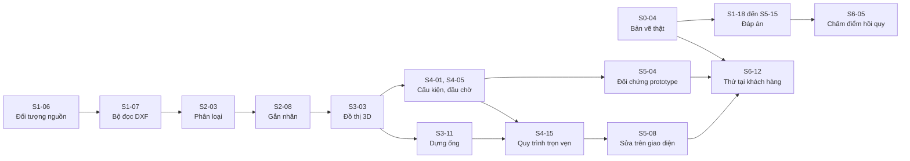

## 7. Giai đoạn 3: Smart 3D, Sprint 13 đến 16

**Mục tiêu giai đoạn.** Cùng một IR dựng được mô hình trong cả AutoCAD và Smart 3D. Mô hình trong Smart 3D dùng đúng cấp ống của dự án thử nghiệm.

**Mức chi tiết.** Các việc dưới đây ở mức hạng mục. Mọi chi tiết về API của Smart 3D là **[CẦN XÁC MINH]**. Việc S12-13 phải chia nhỏ lại theo báo cáo khảo sát S10-12. Nếu khảo sát cho thấy API không đủ để định tuyến bằng mã thì Sprint 14 và 15 chuyển sang phương án tệp trung gian.

**Thay đổi về vai trò.** `CAD` làm bộ thích ứng Smart 3D. `LÕI` làm phần dùng chung, xuất PCF và bảo trì bản AutoCAD đang chạy ở khách hàng.

### Sprint 13: khung plug-in Smart 3D và ánh xạ cấp ống

**Mục tiêu.** Plug-in chạy trong Smart 3D, đọc được mô hình hiện có, và người dùng ánh xạ được tuyến sang cấp ống của dự án.

**Trình diễn cuối sprint.** Trong Smart 3D, nạp một IR, xem bảng ánh xạ tuyến sang cấp ống, thấy danh sách thiết bị và đầu chờ có sẵn khớp theo số hiệu.

| Mã | Việc | Kết quả phải có | Vai trò | Công | Phụ thuộc | Truy vết |
|---|---|---|---|---|---|---|
| S13-01 | Hoàn chỉnh dự án plug-in Smart 3D: lệnh, nạp lõi, nạp bảng điều khiển dùng chung, nhật ký | Bảng điều khiển chạy trong Smart 3D với cùng mã giao diện của bản AutoCAD | CAD | 2 | S12-12 | Hạng mục 3.2 |
| S13-02 | Khai báo năng lực cho bộ thích ứng Smart 3D. Giao diện tự ẩn chức năng mà ứng dụng chủ không có | Chức năng không hỗ trợ bị ẩn hoặc mờ kèm lý do, không gây lỗi | CAD | 1,5 | S12-07 | Mục 6.12.3 |
| S13-03 | Giao diện ánh xạ tuyến và DN sang cấp ống của dự án. Lưu ánh xạ vào hồ sơ dự án | Mọi tuyến trong IR có cấp ống trước khi cho dựng. Cấp ống thiếu DN cần dùng thì báo vấn đề | CAD | 2,5 | S13-01 | Hạng mục 3.3, FR-BLD-10 |
| S13-04 | Đọc mô hình Smart 3D hiện có: hệ thống ống, tuyến, thiết bị và đầu chờ theo số hiệu | Danh sách thiết bị và đầu chờ hiện trên bảng điều khiển, khớp với thiết bị trong IR | CAD | 2 | S13-01 | Mục 10.3, mục 7.8.5 cách 1 |
| S13-05 | Bộ kiểm thử chung cho bộ thích ứng: nạp bản vẽ chuẩn, dựng, so số lượng, tọa độ, thuộc tính với đáp án | Một bộ kiểm thử chạy được với bất kỳ bộ thích ứng nào cài đặt ba giao diện | LÕI | 2,5 | S12-07 | Mục 6.12.4, NFR-MNT-02 |
| S13-06 | Chạy bộ kiểm thử chung trên bộ thích ứng AutoCAD và bộ thích ứng DXF. Vá các chỗ hợp đồng còn thiếu | Cả hai bộ thích ứng đạt. Danh sách thay đổi hợp đồng | LÕI | 1,5 | S13-05 | NFR-MNT-08 |
| S13-07 | Bổ sung IR cho cấp ống: trường cấp ống, kết quả ánh xạ, vấn đề khi thiếu | Lược đồ IR lên phiên bản mới. IR cũ vẫn đọc được | LÕI | 1,5 | S13-03 | NFR-CMP-06 |
| S13-08 | Xuất PCF, phần một: nghiên cứu định dạng, ghi ống thẳng, co, tê | Tệp PCF của bản vẽ mẫu mở được trong một phần mềm đọc PCF | LÕI | 2,5 | S10-05 | Hạng mục 3.7, FR-EXP-04 |
| S13-09 | Cung cấp quy tắc chọn cấp ống theo lưu chất và DN. Rà bảng ánh xạ | Bảng quy tắc bằng văn bản cho dự án thử nghiệm | ỐNG | 2 | | Hạng mục 3.3 |
| S13-10 | Thu xếp môi trường Smart 3D và dự án thử nghiệm của khách hàng cho Sprint 16 | Lịch, quyền truy cập, phiên bản Smart 3D được xác nhận | KH | 1 | | NFR-CMP-05, hạng mục 3.8 |

{{TONG:S13}}

### Sprint 14: dựng tuyến và đoạn chạy trong Smart 3D

**Mục tiêu.** Dựng được tuyến ống thật trong Smart 3D từ IR.

**Trình diễn cuối sprint.** Từ bản vẽ mẫu, dựng các tuyến ống trong Smart 3D với đúng cấp ống. So số co và tê do Smart 3D tự sinh với IR.

| Mã | Việc | Kết quả phải có | Vai trò | Công | Phụ thuộc | Truy vết |
|---|---|---|---|---|---|---|
| S14-01 | Tạo hệ thống ống và tuyến cho từng số hiệu tuyến trong IR | Cây hệ thống trong Smart 3D khớp danh sách tuyến của IR | CAD | 2 | S13-03 | Hạng mục 3.4, FR-BLD-10 |
| S14-02 | Tạo đoạn chạy theo cấp ống và DN, định tuyến qua các điểm nút của IR | Đường tâm trong Smart 3D khớp IR trong dung sai | CAD | 3 | S14-01 | Hạng mục 3.4 |
| S14-03 | Đối chiếu phụ kiện do Smart 3D tự sinh với nút trong IR. Sai khác thành vấn đề | Bảng đối chiếu co, tê theo tuyến | CAD | 2 | S14-02 | Hạng mục 3.4 |
| S14-04 | Tiến độ, hủy giữa chừng và nhật ký cho quá trình dựng | Hủy giữa chừng không để lại đối tượng dở dang | CAD | 1 | S14-02 | NFR-PRF-05, NFR-REL-02 |
| S14-05 | Xuất PCF, phần hai: van và cấu kiện nối tiếp, mỗi tuyến một tệp | Tệp PCF của một bản vẽ thật được chuyên gia kiểm tra | LÕI | 2 | S13-08 | FR-EXP-04 |
| S14-06 | Bộ lập trình tự dựng: từ IR sinh ra danh sách thao tác có thứ tự cho ứng dụng chủ dựng theo đoạn chạy. Phần này nằm ở lõi để dùng lại cho Plant 3D | Bộ thích ứng Smart 3D chỉ thực thi danh sách, không tự suy luận thứ tự | LÕI | 2,5 | S13-07 | NFR-MNT-02, mục 6.12 |
| S14-07 | Khớp hệ tọa độ bản vẽ 2D với hệ tọa độ nhà máy: gốc, góc xoay, cao độ mốc | Người dùng nhập ba tham số hoặc chọn hai điểm tham chiếu. Kiểm thử quy đổi hai chiều | LÕI | 1,5 | | Mục 10.3.3 mục 3 |
| S14-08 | Bảo trì bản AutoCAD đang chạy ở khách hàng: sửa lỗi, trả lời hỗ trợ | Lỗi được ghi nhận và xử lý trong sprint | LÕI | 2 | | Hạng mục 4.8 |
| S14-09 | Kiểm tra mô hình Smart 3D kết quả theo con mắt người trong nghề | Nhận xét bằng văn bản | ỐNG | 2 | S14-02 | Mục 13.7 mục 6 |
| S14-10 | Duy trì quan hệ khách hàng. Cập nhật tiến độ Smart 3D cho khách hàng quan tâm | Bảng theo dõi cập nhật | KH | 1 | | |

{{TONG:S14}}

### Sprint 15: cấu kiện, đầu chờ và gỡ bỏ an toàn

**Mục tiêu.** Mô hình Smart 3D có van, nối vào đầu chờ thiết bị có sẵn, và gỡ bỏ được sạch khi lỗi hoặc khi dựng lại.

**Trình diễn cuối sprint.** Dựng một bản vẽ thật vào mô hình Smart 3D đã có thiết bị. Ống nối vào đúng đầu chờ. Gỡ bỏ cả lần dựng bằng một thao tác.

| Mã | Việc | Kết quả phải có | Vai trò | Công | Phụ thuộc | Truy vết |
|---|---|---|---|---|---|---|
| S15-01 | Chèn van và cấu kiện nối tiếp vào đoạn chạy theo cấp ống | Van đúng vị trí và đúng loại theo cấp ống | CAD | 2,5 | S14-02 | Hạng mục 3.4 |
| S15-02 | Nối đầu ống vào đầu chờ thiết bị có sẵn, khớp theo số hiệu thiết bị và vị trí. Không tạo thiết bị mới | Đầu ống kết nối thật với đầu chờ. Không khớp được thì báo vấn đề | CAD | 2,5 | S13-04 | Hạng mục 3.5 |
| S15-03 | Chiến lược gỡ bỏ: theo dõi mọi đối tượng đã tạo trong một phiên, gỡ khi lỗi và khi dựng lại | Gỡ bỏ không đụng tới đối tượng do người khác tạo | CAD | 2 | S14-04 | Hạng mục 3.6 |
| S15-04 | Tô sáng và phóng tới vị trí trong Smart 3D, nếu API cho phép | Bấm vào vấn đề thì Smart 3D tới đúng chỗ, hoặc năng lực này được khai báo là không có | CAD | 1 | S13-02 | Mục 10.4 |
| S15-05 | Logic khớp đầu chờ trong lõi. Luật R-EQP-03 dùng dữ liệu đầu chờ thật | Ca kiểm thử: khớp đúng, lệch DN, lệch vị trí | LÕI | 1,5 | S13-04 | Mục 9.3 |
| S15-06 | Phương án dự phòng qua tệp trung gian cho phần mà API không làm được. Bỏ qua nếu S14 và S15 dựng được hoàn toàn bằng API | Phần bị hạn chế được nhập qua tệp, hoặc quyết định không cần | LÕI | 2,5 | S14-03 | R6, mục 10.3.3 mục 4 |
| S15-07 | Chạy bộ kiểm thử chung trên bộ thích ứng Smart 3D | Kết quả từng ca. Ca không đạt có giải thích | LÕI | 2 | S13-05, S15-01 | Mục 6.12.4 |
| S15-08 | Bảo trì bản AutoCAD ở khách hàng | Lỗi được xử lý trong sprint | LÕI | 2 | | Hạng mục 4.8 |
| S15-09 | Rà kết quả nối đầu chờ và loại van theo cấp ống | Nhận xét bằng văn bản | ỐNG | 2 | S15-02 | |
| S15-10 | Chuẩn bị buổi thử tại khách hàng: kịch bản, phiếu ghi, người tham gia | Kịch bản được khách hàng xác nhận | KH | 1 | S13-10 | Hạng mục 3.8 |

{{TONG:S15}}

### Sprint 16: thử nghiệm Smart 3D và nghiệm thu giai đoạn 3

**Mục tiêu.** Dựng được mô hình trong môi trường Smart 3D của khách hàng với cấp ống của họ.

**Trình diễn cuối sprint.** Cùng một IR được dựng trong AutoCAD và trong Smart 3D, đặt cạnh nhau.

| Mã | Việc | Kết quả phải có | Vai trò | Công | Phụ thuộc | Truy vết |
|---|---|---|---|---|---|---|
| S16-01 | Thử nghiệm trong môi trường Smart 3D của khách hàng với dự án và cấp ống của họ | Phiếu ghi cho từng bản vẽ. Danh sách lỗi | CAD | 3 | S15-10 | Hạng mục 3.8, mục 5.11 |
| S16-02 | Sửa lỗi từ buổi thử, phần bộ thích ứng Smart 3D | Không còn lỗi chặn quy trình | CAD | 2,5 | S16-01 | |
| S16-03 | Ghi hình cùng một IR dựng trong hai phần mềm | Đoạn ghi hình dùng cho bán hàng và gọi vốn | CAD | 1 | S16-02 | Mục 5.11 |
| S16-04 | Rà nghiệm thu giai đoạn 3. Chốt phạm vi bản 1.0. Chia nhỏ lại Sprint 17 đến 24 | Biên bản nghiệm thu. Kế hoạch giai đoạn 4 đã cập nhật | CAD | 1,5 | S16-01 | Mốc M7 |
| S16-05 | Sửa lỗi từ buổi thử, phần lõi | Không còn lỗi chặn quy trình | LÕI | 2,5 | S16-01 | |
| S16-06 | Hoàn tất xuất PCF và nối vào lệnh xuất | Xuất PCF từ cả AutoCAD và Smart 3D | LÕI | 1,5 | S14-05 | FR-EXP-04 |
| S16-07 | Cập nhật mục 10.3 của tài liệu dự án bằng thông tin API đã kiểm chứng | Các nhãn cần xác minh ở mục 10.3 được gỡ hoặc sửa | LÕI | 1 | S16-01 | Mục 14.3 |
| S16-08 | Tìm hiểu công cụ làm bộ cài và thủ tục mua chứng thư ký số | Lựa chọn công cụ. Đã nộp hồ sơ mua chứng thư, vì thủ tục xác minh có thể mất nhiều ngày | LÕI | 1 | | Hạng mục 4.1 |
| S16-09 | Ghép nhiều tờ bản vẽ qua điểm nối tiếp. Chỉ làm nếu còn sức | Hai tờ có chung tuyến được nối thành một mô hình | LÕI | 2 | S3-03 | FR-REC-15 |
| S16-10 | Tham gia buổi thử, đánh giá mô hình | Nhận xét bằng văn bản | ỐNG | 2 | S16-01 | |
| S16-11 | Đàm phán hợp đồng trả tiền đầu tiên. Đề xuất mức giá | Bản chào giá đã gửi | KH | 2 | S12-15 | Q12 |

{{TONG:S16}}

---

## 8. Giai đoạn 4: thương mại hóa, Sprint 17 đến 24

**Mục tiêu giai đoạn.** Có bộ cài, cấp phép, tài liệu. Triển khai được trong mạng nội bộ của một khách hàng. Có khách hàng trả tiền.

**Mức chi tiết.** Ở mức hạng mục. Thứ tự các sprint trong giai đoạn này nên xếp lại theo yêu cầu của khách hàng trả tiền đầu tiên. Ví dụ khách cần triển khai nội bộ trước thì Sprint 19 lên trước Sprint 18.

**Việc chạy song song suốt giai đoạn.** Mỗi sprint dành sẵn hai đến ba ngày công của mỗi lập trình viên cho hỗ trợ khách hàng và sửa lỗi. Các việc này ghi là "Hỗ trợ và sửa lỗi".

### Sprint 17: bộ cài và quy trình phát hành

| Mã | Việc | Kết quả phải có | Vai trò | Công | Phụ thuộc | Truy vết |
|---|---|---|---|---|---|---|
| S17-01 | Bộ cài MSI cho plug-in AutoCAD, Agent Host, danh mục, thư viện thiết bị và hồ sơ mẫu | Cài trên máy sạch, mở AutoCAD là dùng được | CAD | 3 | S16-08 | Hạng mục 4.1, FR-LIC-03 |
| S17-02 | Ký số tệp thực thi và bộ cài trong quy trình dựng | Windows không cảnh báo nhà phát hành lạ | CAD | 1,5 | S16-08 | Mục 11.2 |
| S17-03 | Cài đặt không tương tác cho triển khai hàng loạt. Gỡ cài và nâng cấp | Cài, nâng cấp, gỡ bằng dòng lệnh trên máy sạch | CAD | 1,5 | S17-01 | FR-LIC-03 |
| S17-04 | Hỗ trợ và sửa lỗi | Lỗi được xử lý trong sprint | CAD | 2 | | Hạng mục 4.8 |
| S17-05 | Quy trình phát hành: đánh số phiên bản, ghi chú phát hành, dựng tự động ra gói cài | Một nhãn phiên bản trên kho mã sinh ra gói cài đã ký | LÕI | 1,5 | S17-02 | Mục 11.6 |
| S17-06 | Chuyển đổi dữ liệu cũ: IR, hồ sơ, tệp phiên của phiên bản trước đọc được ở phiên bản mới | Kiểm thử với dữ liệu của bản 0.1 và 0.2 | LÕI | 2 | | NFR-CMP-06 |
| S17-07 | Gói thông tin hỗ trợ: gom nhật ký và cấu hình, không chứa nội dung bản vẽ và khóa truy cập. Người dùng xem trước rồi tự gửi | Kiểm thử chứng minh gói không chứa hai loại dữ liệu trên | LÕI | 1,5 | | NFR-SEC-08, mục 11.2 |
| S17-08 | Hỗ trợ và sửa lỗi | Lỗi được xử lý trong sprint | LÕI | 3 | | Hạng mục 4.8 |
| S17-09 | Tìm hiểu điều kiện chương trình nhà phát triển của Autodesk và Hexagon | Danh sách điều kiện và chi phí | KH | 1 | | R12 |

{{TONG:S17}}

### Sprint 18: cấp phép

| Mã | Việc | Kết quả phải có | Vai trò | Công | Phụ thuộc | Truy vết |
|---|---|---|---|---|---|---|
| S18-01 | Thiết kế cấp phép: định dạng khóa có chữ ký, theo người dùng hoặc theo máy, thời hạn | Tài liệu thiết kế được rà về bảo mật | LÕI | 2 | | Hạng mục 4.2, FR-LIC-01 |
| S18-02 | Dịch vụ kích hoạt tối thiểu: cấp khóa, kích hoạt, thu hồi | Kích hoạt và thu hồi chạy được từ đầu đến cuối | LÕI | 3 | S18-01 | FR-LIC-01 |
| S18-03 | Kích hoạt ngoại tuyến cho máy không có Internet | Kích hoạt được bằng trao đổi tệp | LÕI | 2 | S18-02 | FR-LIC-02 |
| S18-04 | Hỗ trợ và sửa lỗi | Lỗi được xử lý trong sprint | LÕI | 1 | | Hạng mục 4.8 |
| S18-05 | Kiểm tra giấy phép trong plug-in. Giao diện nhập khóa. Hành xử khi hết hạn: không khóa dữ liệu của người dùng | Hết hạn thì vẫn mở và xuất được dữ liệu cũ | CAD | 2 | S18-02 | FR-LIC-01 |
| S18-06 | Chế độ dùng thử có thời hạn | Cài mới chạy được ở chế độ dùng thử | CAD | 1 | S18-05 | |
| S18-07 | Kiểm thử cấp phép trên cả hai nền .NET và trong Smart 3D | Bảng kết quả | CAD | 1,5 | S18-05 | |
| S18-08 | Rà soát bảo mật cho cấp phép và lưu khóa truy cập | Danh sách điểm yếu đã xử lý | CAD | 1,5 | S18-03 | Mục 11.2 |
| S18-09 | Hỗ trợ và sửa lỗi | Lỗi được xử lý trong sprint | CAD | 2 | | Hạng mục 4.8 |
| S18-10 | Chốt tên sản phẩm. Kiểm tra trùng nhãn hiệu | Tên chính thức | KH | 1 | | Q1 |

{{TONG:S18}}

### Sprint 19: triển khai trong mạng của khách hàng

| Mã | Việc | Kết quả phải có | Vai trò | Công | Phụ thuộc | Truy vết |
|---|---|---|---|---|---|---|
| S19-01 | Chế độ triển khai C: gọi mô hình qua tài khoản đám mây của khách hàng. Viết bộ kết nối cho nền tảng mà khách hàng đầu tiên dùng | Một phiên agent chạy trọn qua tài khoản của khách hàng | LÕI | 3 | S7-05 | Hạng mục 4.3, mục 11.1, NFR-SEC-02 |
| S19-02 | Chế độ triển khai D: Agent Host chạy trên máy chủ nội bộ dùng chung cho nhóm | Hai máy người dùng cùng dùng một Agent Host | LÕI | 2,5 | S19-01 | Mục 11.1 |
| S19-03 | Rà lại mô hình mối đe dọa ở mục 11.2 với kiến trúc đã triển khai | Từng mối đe dọa có biện pháp đã kiểm chứng | LÕI | 1 | S19-02 | Mục 11.2 |
| S19-04 | Hỗ trợ và sửa lỗi | Lỗi được xử lý trong sprint | LÕI | 1,5 | | Hạng mục 4.8 |
| S19-05 | Khóa cấu hình kết nối mô hình ngôn ngữ ở cấp máy. Người dùng không đổi được | Người dùng thường không sửa được cấu hình đã khóa | CAD | 1,5 | S7-09 | FR-LIC-05 |
| S19-06 | Triển khai thử trong mạng nội bộ của một khách hàng, cùng quản trị viên của họ | Biên bản triển khai. Danh sách vướng mắc về tường lửa, quyền cài đặt | CAD | 3 | S17-03, S19-01 | Mục 5.11 |
| S19-07 | Thống kê sử dụng ẩn danh, mặc định tắt, không chứa nội dung bản vẽ | Chỉ gửi khi quản trị viên bật | CAD | 1,5 | | FR-LIC-04 |
| S19-08 | Hỗ trợ và sửa lỗi | Lỗi được xử lý trong sprint | CAD | 2 | | Hạng mục 4.8 |
| S19-09 | Soạn điều khoản sử dụng và chính sách dữ liệu, có người chuyên môn pháp lý xem | Hai tài liệu sẵn sàng cho hợp đồng | KH | 2 | | Q12 |

{{TONG:S19}}

### Sprint 20: tài liệu và đào tạo

| Mã | Việc | Kết quả phải có | Vai trò | Công | Phụ thuộc | Truy vết |
|---|---|---|---|---|---|---|
| S20-01 | Tài liệu người dùng: cài đặt, chuyển đổi một bản vẽ, duyệt và sửa, soạn hồ sơ, thêm thiết bị | Người mới làm theo tài liệu hoàn thành UC-01 trong 30 phút | CAD | 3 | | Hạng mục 4.4, NFR-USE-01 |
| S20-02 | Ba video hướng dẫn ngắn: bắt đầu nhanh, soạn hồ sơ, làm việc với agent | Ba video quay trên AutoCAD thật | CAD | 2 | S20-01 | Hạng mục 4.4 |
| S20-03 | Rà toàn bộ thông báo lỗi: điều gì xảy ra, ở đâu, làm gì tiếp | Không còn thông báo chỉ có mã lỗi | CAD | 1 | | NFR-USE-02 |
| S20-04 | Hỗ trợ và sửa lỗi | Lỗi được xử lý trong sprint | CAD | 2 | | Hạng mục 4.8 |
| S20-05 | Tài liệu quản trị: triển khai hàng loạt, bốn chế độ triển khai, cấp phép, dữ liệu gửi đi | Quản trị viên của khách hàng tự triển khai được | LÕI | 2 | S19-06 | Hạng mục 4.4 |
| S20-06 | Tài liệu cho người tích hợp: các hợp đồng công khai ở mục 6.12.2, lược đồ JSON, ví dụ | Một người ngoài đội viết được chương trình đọc IR | LÕI | 2 | | NFR-MNT-08 |
| S20-07 | Bộ dữ liệu mẫu đi kèm bộ cài: bản vẽ mẫu, hồ sơ, kết quả mong đợi | Người dùng mới chạy thử được ngay sau khi cài | LÕI | 1 | | FR-PRF-08 |
| S20-08 | Hỗ trợ và sửa lỗi | Lỗi được xử lý trong sprint | LÕI | 3 | | Hạng mục 4.8 |
| S20-09 | Rà thuật ngữ đường ống trong giao diện và tài liệu | Danh sách thuật ngữ đã sửa | ỐNG | 2 | S20-01 | NFR-USE-05 |
| S20-10 | Quy trình hỗ trợ: kênh tiếp nhận, phân loại, thời gian phản hồi | Quy trình bằng văn bản, khách hàng đầu tiên đã biết | KH | 1 | | Hạng mục 4.8 |

{{TONG:S20}}

### Sprint 21: máy chủ MCP và chế độ dịch vụ

| Mã | Việc | Kết quả phải có | Vai trò | Công | Phụ thuộc | Truy vết |
|---|---|---|---|---|---|---|
| S21-01 | Máy chủ MCP cục bộ cung cấp cùng bộ công cụ, dùng chung hợp đồng công cụ | Một ứng dụng AI bên ngoài gọi được công cụ chỉ đọc | LÕI | 3 | S7-01 | Hạng mục 4.5, FR-AGT-12, ADR-09 |
| S21-02 | Phân quyền cho máy chủ MCP: mặc định chỉ đọc, công cụ đề xuất và hành động phải bật riêng | Kiểm thử từng lớp quyền | LÕI | 1,5 | S21-01 | NFR-SEC-06 |
| S21-03 | Chế độ dịch vụ của công cụ dòng lệnh: ứng dụng không phải .NET gọi lõi qua JSON-RPC | Một kịch bản Python gửi DXF và nhận IR | LÕI | 2,5 | S7-04 | Mục 6.12.1 mức B |
| S21-04 | Hỗ trợ và sửa lỗi | Lỗi được xử lý trong sprint | LÕI | 1 | | Hạng mục 4.8 |
| S21-05 | Đóng gói lõi và lớp công cụ thành gói thư viện có phiên bản | Một dự án mẫu ngoài kho mã tham chiếu gói và chạy được | CAD | 1,5 | | Mục 6.12.1 mức A |
| S21-06 | Dự án mẫu bộ thích ứng tối thiểu kèm hướng dẫn, làm khuôn cho ứng dụng chủ mới | Dự án mẫu đạt bộ kiểm thử chung | CAD | 2 | S13-05 | Mục 6.12.4 |
| S21-07 | Trình soạn định nghĩa thiết bị có giao diện và xem trước hình 3D | Tạo được một thiết bị mới không cần sửa tệp JSON bằng tay | CAD | 2,5 | S4-10 | Mục 7.8.7 |
| S21-08 | Hỗ trợ và sửa lỗi | Lỗi được xử lý trong sprint | CAD | 2 | | Hạng mục 4.8 |

{{TONG:S21}}

### Sprint 22: theo yêu cầu của khách hàng

Sprint này để trống có chủ ý cho việc mà khách hàng trả tiền yêu cầu. Hai ứng viên chính:

| Mã | Việc | Kết quả phải có | Vai trò | Công | Phụ thuộc | Truy vết |
|---|---|---|---|---|---|---|
| S22-01 | Bộ dựng Plant 3D, phần một: khảo sát API, dựng ống và co bằng đối tượng ống thông minh. Chỉ làm khi có khách hàng cần | Một tuyến của bản vẽ mẫu dựng được trong Plant 3D | CAD | 6 | S14-06 | Hạng mục 4.6, FR-BLD-09 |
| S22-02 | Hỗ trợ và sửa lỗi | Lỗi được xử lý trong sprint | CAD | 2 | | Hạng mục 4.8 |
| S22-03 | Nhận diện ký hiệu van vẽ bằng nét rời qua so khớp mẫu hình học. Chỉ làm khi bản vẽ của khách hàng cần | Ca kiểm thử trên bản vẽ thật | LÕI | 5 | | FR-CLS-05 |
| S22-04 | Hỗ trợ và sửa lỗi | Lỗi được xử lý trong sprint | LÕI | 3 | | Hạng mục 4.8 |

{{TONG:S22}}

Bộ dựng Plant 3D là hạng mục lớn, một sprint không đủ. Nếu làm thì phải lấy thêm Sprint 23 và lùi ngày phát hành.

### Sprint 23: hoàn thiện trước phát hành

| Mã | Việc | Kết quả phải có | Vai trò | Công | Phụ thuộc | Truy vết |
|---|---|---|---|---|---|---|
| S23-01 | Kiểm thử tương thích trên mọi phiên bản AutoCAD trong dải hỗ trợ | Bảng tương thích có kết quả từng phiên bản | CAD | 2,5 | | NFR-CMP-01 |
| S23-02 | Đo và tối ưu thời gian dựng 3D cho IR cỡ 500 đoạn ống | Dưới 60 giây hoặc có giải thích | CAD | 1,5 | | NFR-PRF-03 |
| S23-03 | Danh sách kiểm tra thủ công trên bản vẽ thật do người không viết mã thực hiện | Biên bản. Lỗi chặn được sửa | CAD | 2 | | Mục 13.7 mục 6 |
| S23-04 | Hỗ trợ và sửa lỗi | Lỗi được xử lý trong sprint | CAD | 2 | | Hạng mục 4.8 |
| S23-05 | Đọc tệp DWG khi không có AutoCAD, qua bước chuyển sang DXF | Xử lý theo lô nhận tệp DWG | LÕI | 2 | | Hạng mục 4.7, FR-ING-10 |
| S23-06 | Chạy đủ sáu cổng chất lượng trên bản ứng viên phát hành | Biên bản từng cổng | LÕI | 2 | S23-03 | Mục 13.7 |
| S23-07 | Chạy lại toàn bộ bộ đánh giá agent với mô hình mặc định hiện hành của nhà cung cấp | Bảng điểm. Quyết định giữ hay đổi mô hình mặc định | LÕI | 1 | | R9, mục 13.5 |
| S23-08 | Hỗ trợ và sửa lỗi | Lỗi được xử lý trong sprint | LÕI | 3 | | Hạng mục 4.8 |
| S23-09 | Viết một bài tình huống khách hàng từ kết quả thử nghiệm, có sự đồng ý của khách | Bài viết dùng cho bán hàng | KH | 2 | S12-15 | |

{{TONG:S23}}

### Sprint 24: phát hành bản 1.0

| Mã | Việc | Kết quả phải có | Vai trò | Công | Phụ thuộc | Truy vết |
|---|---|---|---|---|---|---|
| S24-01 | Phát hành bản 1.0: gói cài đã ký, ghi chú phát hành, tài liệu | Gói cài tải được. Khách hàng đầu tiên đã cài | CAD | 1,5 | S23-06 | Mốc M8 |
| S24-02 | Cài đặt và đào tạo tại khách hàng trả tiền đầu tiên | Người dùng của khách tự chạy được UC-01 | CAD | 3 | S24-01 | Mục 5.11 |
| S24-03 | Hỗ trợ và sửa lỗi sau phát hành | Lỗi chặn được sửa trong vòng một ngày làm việc | CAD | 3,5 | S24-01 | Hạng mục 4.8 |
| S24-04 | Hỗ trợ và sửa lỗi sau phát hành | Như trên | LÕI | 4 | S24-01 | Hạng mục 4.8 |
| S24-05 | Cập nhật tài liệu dự án lên bản 1.0: gỡ các nhãn đề xuất đã được kiểm chứng, ghi các quyết định đã chốt | Tài liệu dự án phản ánh đúng sản phẩm | LÕI | 1,5 | | |
| S24-06 | Nhìn lại cả năm. Lập lộ trình năm thứ hai từ danh sách chờ và phản hồi khách hàng | Lộ trình năm thứ hai, bản nháp | LÕI | 2,5 | | |
| S24-07 | Ký hợp đồng trả tiền. Thu phản hồi sau một tuần dùng | Hợp đồng đã ký | KH | 2 | S16-11 | Mục 5.11 |

{{TONG:S24}}

---

## 9. Đường găng và phụ thuộc chính

### 9.1 Chuỗi việc quyết định ngày xong giai đoạn 1

Ba điều rút ra:

- Chuỗi dài nhất chạy qua phần lõi: từ đối tượng nguồn tới đồ thị 3D rồi tới thử tại khách hàng. Chậm một ngày ở S3-03 là chậm một ngày của cả giai đoạn.
- Bản vẽ thật ở S0-04 chặn hai nhánh cùng lúc: bộ đáp án và buổi thử. Đây là phụ thuộc bên ngoài lớn nhất.
- Giao diện và bộ dựng có độ trễ cho phép. Khi thiếu sức, cắt ở hai nhánh này trước.

### 9.2 Phụ thuộc bên ngoài

| Phụ thuộc | Cần trước | Ai lo | Nếu trễ |
|---|---|---|---|
| Bản vẽ thật của khách hàng | Cuối Sprint 2 | `KH` | Không đo được chất lượng. Xem mốc M1 |
| Chuyên gia đường ống | Sprint 0 | `KH` | Không có đáp án. Bộ bản vẽ chuẩn vô nghĩa |
| Hai phiên bản AutoCAD có giấy phép | Sprint 0 | `CAD` | Không kiểm thử được hai nền .NET |
| Lịch thử tại khách hàng | Sprint 6, 12, 16 | `KH` | Lùi nghiệm thu giai đoạn |
| Khách hàng cho phép dùng dịch vụ AI | Sprint 7 | `KH` | Thử agent trên bản vẽ ẩn danh hoặc khách hàng khác |
| Tài khoản và ngân sách dịch vụ mô hình ngôn ngữ | Sprint 7 | `CAD` | Không chạy được agent và bộ đánh giá |
| Môi trường Smart 3D | Sprint 9 | `CAD` | Giai đoạn 3 trễ theo từng tuần |
| Chứng thư ký số | Sprint 17 | `LÕI` | Bộ cài bị Windows cảnh báo |

---

## 10. Kịch bản chỉ có một lập trình viên

Kế hoạch ở trên cần hai lập trình viên toàn thời gian. Nếu chỉ có người sáng lập thì ba tháng không đủ cho giai đoạn 1. Con số dưới đây là ước tính thô.

### 10.1 Khối lượng

{{MOTNGUOI}}

### 10.2 Ba lựa chọn

| Lựa chọn | Nội dung | Thời gian tới buổi thử tại khách hàng | Đánh đổi |
|---|---|---|---|
| A. Giữ phạm vi, kéo dài | Một người làm toàn bộ việc của giai đoạn 1 | Khoảng 12 đến 14 sprint, tức sáu đến bảy tháng | Lộ trình 12 tháng trong bộ slide không còn đúng |
| B. Bản thử nghiệm tối thiểu | Chỉ làm chuỗi nhận diện, bộ dựng và danh sách vấn đề in ra dòng lệnh. Hồ sơ và chỉnh sửa viết tay trong tệp JSON. Chưa có bảng điều khiển | Khoảng 8 đến 10 sprint, tức bốn đến năm tháng | Khách hàng không tự dùng được. Người sáng lập phải ngồi chạy cùng. Chưa chứng minh được UC-02 |
| C. Tuyển người thứ hai trước Sprint 3 | Người sáng lập làm một mình Sprint 0 đến 2 theo thứ tự ở mục 10.3, sau đó theo kế hoạch hai người | Trễ khoảng hai sprint so với kế hoạch | Cần ngân sách cho một người. Mất thời gian tuyển và hướng dẫn |

Khuyến nghị của người soạn: lựa chọn C nếu có ngân sách. Nếu không thì lựa chọn B, vì nó đưa sản phẩm tới bản vẽ thật sớm nhất, và đó là thứ quyết định dự án sống hay chết.

### 10.3 Thứ tự làm khi chỉ có một người

1. Sprint 0 như kế hoạch, ưu tiên S0-04 và S0-05.
2. Phần lõi của Sprint 1 và 2, kèm S1-09 đến S1-11 để có bộ đọc AutoCAD.
3. Phần lõi của Sprint 3, rồi ngay sau đó S3-10 đến S3-16 để sớm thấy ống trong AutoCAD.
4. Phần lõi của Sprint 4 và ba việc dựng S4-09 đến S4-11.
5. Bộ luật S5-01 đến S5-04, rồi S5-05 và S5-06.
6. Buổi thử tại khách hàng theo lựa chọn B.
7. Sau đó mới làm bảng điều khiển, trình soạn hồ sơ và các việc xuất kết quả.

### 10.4 Việc cắt trước khi thiếu sức

Áp dụng cho cả kịch bản hai người khi bị trễ. Cắt theo thứ tự từ trên xuống:

| Việc | Công | Hệ quả khi cắt |
|---|---|---|
| S6-10, giao diện hai ngôn ngữ | 0,5 | Chỉ có một ngôn ngữ ở bản thử |
| S4-13, lọc danh sách vấn đề | 0,5 | Danh sách dài khó xem trên bản vẽ lớn |
| S1-14, giới hạn vùng xử lý | 0,5 | Luôn xử lý cả bản vẽ |
| S5-11, thẻ Tuyến ống | 1 | Xem tuyến qua báo cáo xuất ra |
| S5-12 và S5-13, trình soạn hồ sơ | 3 | Hồ sơ viết tay bằng tệp JSON. Khách hàng chưa tự lập hồ sơ được |
| S3-17, dựng vào bản vẽ mới | 1,5 | Chỉ dựng vào bản đang mở trên layer riêng |
| S5-09, thao tác sửa phần hai | 1,5 | Chỉ sửa được nhãn, DN, cao độ |

Không cắt: S1-16 và S1-17, S5-04, S5-05, S6-05, S6-08, S6-12, và mọi việc của `ỐNG`.

---

## 11. Theo dõi rủi ro theo sprint

Mã rủi ro theo mục 14.1 của tài liệu dự án. Mỗi buổi nhìn lại cuối sprint rà bảng này.

| Rủi ro | Kiểm tra ở sprint | Dấu hiệu phải hành động | Hành động |
|---|---|---|---|
| R1, không có bản vẽ thật | 0, 1, 2 | Cuối Sprint 0 chưa có khách hàng nào đồng ý | Dồn sức `KH`. Đề nghị dịch vụ miễn phí đổi lấy bản vẽ. Cuối Sprint 2 vẫn chưa có thì dừng xem xét |
| R2, bản vẽ thật lộn xộn | 2, 3, 4 | Tỷ lệ chưa phân loại vượt 30% ở S2-18 | Mở rộng hồ sơ quy ước. Chọn lại phân khúc khách hàng có bản vẽ chuẩn hơn |
| R3, thiếu cao độ và đường kính trên mặt bằng | 0, 3 | S0-12 hoặc S3-09 cho thấy nhiều đoạn chạy không nhãn | Thêm việc nhập bổ sung từ bảng tuyến ống vào Sprint 5 |
| R4, agent tự tin sai | 9, 10, 12 | Tỷ lệ đề xuất sai có tin cậy cao tăng giữa hai lần đo | Nâng ngưỡng duyệt hàng loạt. Dành vòng tinh chỉnh cho nhóm lỗi này |
| R5, hãng lớn và công cụ tự định tuyến | 0, 6, 12, 16 | Thông báo sản phẩm mới của Autodesk, Hexagon hoặc nhóm tự định tuyến | Rà lại định vị ở S0-07. Đẩy mạnh tài sản riêng: hồ sơ quy ước và bộ bản vẽ chuẩn |
| R6, API Smart 3D không đủ | 9, 10 | S9-12 không định tuyến được bằng mã | Chuyển giai đoạn 3 sang phương án tệp trung gian. Cân nhắc đổi thứ tự với Plant 3D |
| R7, khách cấm dịch vụ AI ngoài | 1, 7 | Câu trả lời ở S1-19 hoặc S7-13 | Thử agent trên bản vẽ ẩn danh. Kéo Sprint 19 lên sớm |
| R8, chi phí mô hình cao | 8, 10, 12 | Chi phí mỗi bản vẽ ở S10-04 vượt mức khách hàng chấp nhận ở S11-13 | Chạy S10-03 kỹ hơn. Giảm số lượt gọi |
| R9, đổi API hoặc ngừng mô hình | 10, 12, 23 | Thông báo của nhà cung cấp | Chạy lại bộ đánh giá với mô hình thay thế trước khi đổi |
| R10, đội quá nhỏ | 3, 6 | Hệ số thực tế trên ước lượng vượt 1,3 ở mốc M2 | Áp dụng mục 10.4. Lùi Smart 3D |
| R11, phụ thuộc một người | Mọi sprint | Một phần mã chỉ một người hiểu | Rà soát mã chéo. Giữ tài liệu dự án cập nhật |
| R12, điều kiện giấy phép phát triển | 17 | Kết quả S17-09 | Điều chỉnh mô hình phân phối |

---

## 12. Việc người sáng lập cần chốt

### 12.1 Trước khi bắt đầu Sprint 0

| # | Câu hỏi | Vì sao cần ngay |
|---|---|---|
| 1 | Đội có mấy lập trình viên toàn thời gian, từ khi nào | Quyết định dùng kế hoạch chính hay chương 10 |
| 2 | Ai làm vai trò `KH` | Nếu người sáng lập kiêm thì sức lập trình giảm, nhất là ở Sprint 0 và 6 |
| 3 | Ngày bắt đầu thật | Toàn bộ lịch ở chương 3 dời theo |
| 4 | Ngân sách cho chuyên gia đường ống, giấy phép AutoCAD, dịch vụ mô hình ngôn ngữ, chứng thư ký số | Bốn khoản này không có trong kế hoạch nhưng chặn công việc nếu thiếu |
| 5 | Dùng công cụ nào để theo dõi công việc | Nhập `backlog.csv` vào đó |

### 12.2 Lịch chốt các quyết định mở của tài liệu dự án

| Quyết định | Nội dung | Chốt tại |
|---|---|---|
| Q2, Q4, Q5, Q8, Q10, Q11, Q13, Q14 | Dải phiên bản AutoCAD, nơi lưu phiên, nơi dựng, tiêu chuẩn danh mục, người lập đáp án, thư viện DXF, ống trực giao, ký hiệu vẽ bằng nét rời | S0-11 |
| Q6 | Kiểu kết nối mô hình ngôn ngữ | S7-13 |
| Q7 | Con số mục tiêu về giờ công | S6-17 |
| Q9 | Môi trường Smart 3D | S8-13 |
| Q3 | Smart 3D hay Plant 3D trước | S12-13 |
| Q12 | Mức giá và cách tính tiền | S11-13, S16-11 |
| Q1 | Tên sản phẩm | S18-10 |

### 12.3 Lịch sử thay đổi

| Phiên bản | Ngày | Nội dung |
|---|---|---|
| 0.1 | 09/11/2026 | Bản nháp đầu tiên: 25 sprint, phân rã từ chương 12 của tài liệu dự án phiên bản 0.2 |
| 0.2 | 09/11/2026 | Thêm năm việc về chú thích cấu kiện và bảng chú giải ký hiệu: S4-18, S10-15, S11-14, S11-15, S11-16. Mở rộng S0-12 để chốt Q14. Dời S4-08 sang Sprint 5, S5-07 sang Sprint 6, S11-08 sang Sprint 10. Đưa bốn việc vào danh sách chờ ở chương 13 |
| 0.3 | 09/11/2026 | Thêm bảng tiến độ vào Sprint 0 sau khi làm trước các việc S0-07, S0-10, S0-13, S0-14, S0-15, S0-17 |
| 0.4 | 10/11/2026 | Cập nhật tiến độ Sprint 0 sau khi có AutoCAD 2025 và bản vẽ thật: S0-13 xong, S0-12 xong chờ xác nhận, S0-17 có đủ ba đề xuất, S0-10 chạy được trên AutoCAD 2025. Thêm bảng tiến độ Sprint 1 sau khi làm trước S1-01 đến S1-06 |
| 0.5 | 10/11/2026 | Sprint 1 làm xong phần lập trình, S1-01 đến S1-17, trừ bước cài gói tự nạp của S1-09. Hai bộ đọc trùng nhau trên bản vẽ thật |
| 0.6 | 10/11/2026 | Sprint 2 làm xong phần lập trình, S2-01 đến S2-15, danh mục chờ ký ở S2-16. Mốc M1 đo trên bản vẽ thật đầu tiên: 13,3% chưa phân loại, phát hiện ống bị ngắt tại block phụ kiện, ghi yêu cầu cho S3-02 và S3-03 |
| 0.7 | 10/11/2026 | Sprint 3 làm xong phần lập trình, S3-01 đến S3-17. Bản vẽ mẫu dựng 44 solid, Undo một lần bỏ hết. Thêm nối đoạn chạy qua block phụ kiện và khép khe hở |
| 0.8 | 10/11/2026 | Sprint 4 làm xong phần lập trình, S4-01 đến S4-15 và S4-18. Thư viện thiết bị ba lớp, bộ luật, quy trình PA_CONVERT, PA_CHECK, PA_BUILD có khoá theo vấn đề chặn. Thêm danh mục van ASME B16.10 chưa ký |
| 0.9 | 10/11/2026 | Sprint 5 làm xong phần lập trình, S5-01 đến S5-14 trừ phần nhập hồ sơ của trình soạn. Cơ chế quyết định, tệp phiên, PA_FIX, PA_WAIVE, PA_RERUN, thẻ Tuyến ống, đối chứng prototype |
| 0.10 | 10/11/2026 | Sprint 6 phần lập trình: xuất khối lượng CSV, báo cáo Markdown, dòng lệnh batch, bộ chấm điểm hồi quy, gói zip cài thủ công. Phần nghiệm thu với khách hàng chờ |
| 0.11 | 10/11/2026 | Sprint 7 phần lập trình: hợp đồng công cụ, 12 công cụ chỉ đọc, Agent Host JSON-RPC qua named pipe, bộ kết nối kiểu OpenAI qua Hermes proxy, PA_ASK, PA_AGENTCONFIG, cấu hình ba cấp. Quyết định dùng Hermes proxy và mô hình miễn phí tạm thời |

---

## 13. Danh sách chờ

Các việc dưới đây đã rời khỏi sprint để nhường chỗ cho việc được ưu tiên hơn. Sức làm mỗi sprint không đổi, nên thêm việc mới thì phải có việc cũ đi ra. Các việc này không bị hủy. Chúng được xét lại ở mỗi buổi lập kế hoạch giai đoạn.

| Mã | Việc | Kết quả phải có | Vai trò | Công | Phụ thuộc | Truy vết |
|---|---|---|---|---|---|---|
| S6-06 | Đo hiệu năng trên bản vẽ cỡ 5.000 đối tượng. Sửa các điểm chậm rõ rệt | Bảng thời gian từng bước, so với mục tiêu ở mục 5.1 | LÕI | 1 | S6-04 | NFR-PRF-01, 02 |
| S10-06 | Xuất mô hình 3D ra DXF khi chạy ngoài AutoCAD | Tệp mở được trong AutoCAD. Số đối tượng khớp IR | LÕI | 1 | S4-10 | FR-EXP-05 |
| S10-11 | Trạng thái duyệt của mô hình: nháp, đã kiểm tra, đã duyệt. Ghi người duyệt và thời điểm | Trạng thái xuất hiện trong báo cáo chuyển đổi | CAD | 1 | S5-06 | FR-REV-08, UC-11 |
| S11-05 | Chạy lại bộ luật từng phần khi IR đổi cục bộ. Giao diện lập trình để thêm luật mà không sửa lõi | Sửa một tuyến chỉ chạy lại luật liên quan. Một luật mẫu nằm ngoài lõi nạp được | LÕI | 1,5 | S5-03 | FR-CHK-04, FR-CHK-07 |

| Việc rời đi | Nhường chỗ cho | Hệ quả khi chưa làm | Điều kiện đưa lại |
|---|---|---|---|
| Việc S6-06, đo hiệu năng | S4-18, đọc thuộc tính cấu kiện | Chưa biết hành xử trên bản vẽ lớn | Gặp bản vẽ thật trên 5.000 đối tượng, hoặc người dùng thử thấy chậm |
| Việc S10-06, xuất DXF 3D ngoài AutoCAD | S10-15, đọc bảng chú giải | Xử lý theo lô chỉ ra IR và báo cáo, chưa ra mô hình 3D | Có khách hàng cần mô hình 3D mà không có AutoCAD |
| Việc S10-11, trạng thái duyệt của mô hình | S11-15 và S11-16 | Chưa ghi được ai duyệt mô hình và khi nào | Khách hàng yêu cầu truy vết người duyệt. Muộn nhất là trước Sprint 23 |
| Việc S11-05, chạy lại luật từng phần và giao diện thêm luật | S11-14, gắn chú thích với cấu kiện | Mỗi lần sửa chạy lại toàn bộ luật. Luật mới phải viết trong lõi | Thời gian chạy lại luật vượt vài giây trên bản vẽ thật, hoặc có khách hàng muốn tự viết luật |

Người sáng lập đã đồng ý với bốn đánh đổi này ngày 09/11/2026. Về sau, muốn đưa một việc trở lại sprint thì một việc khác cùng cỡ phải rời đi.
